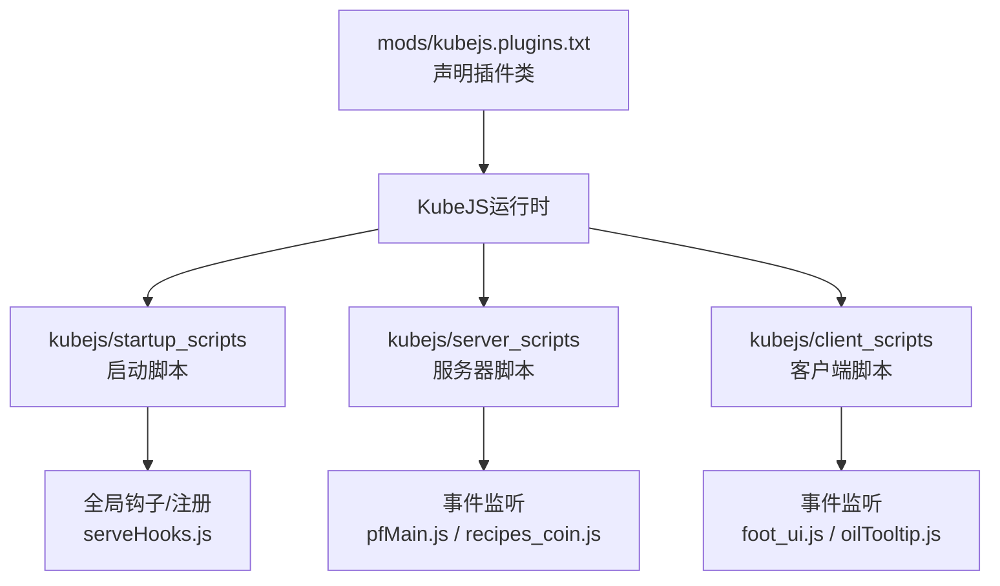
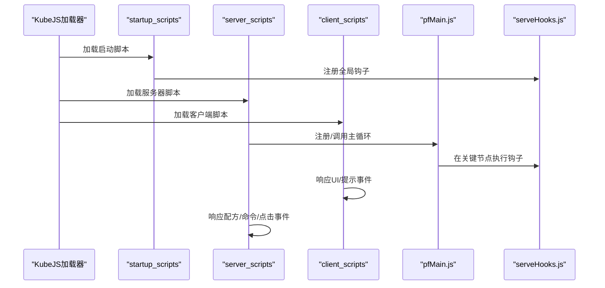
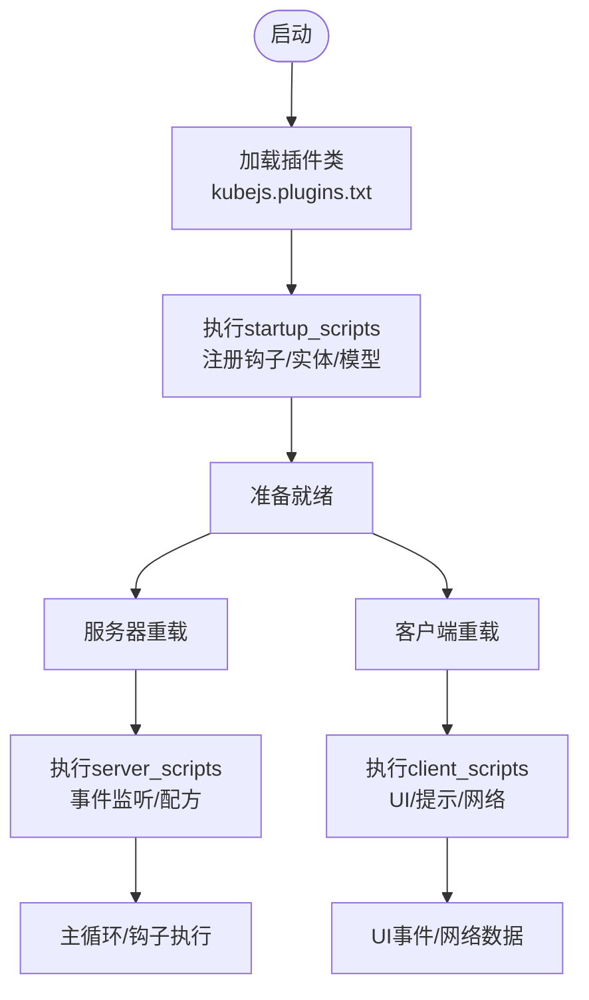
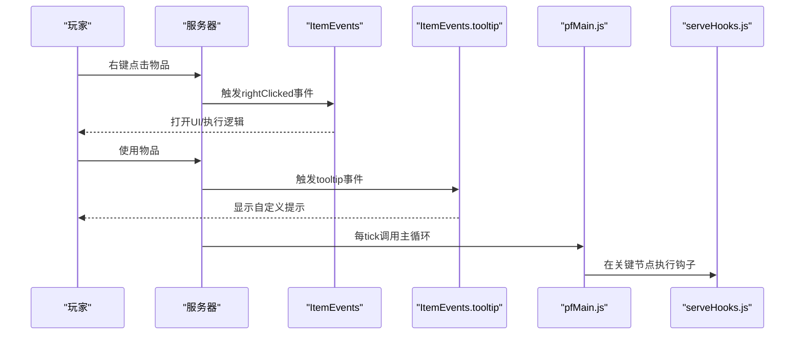
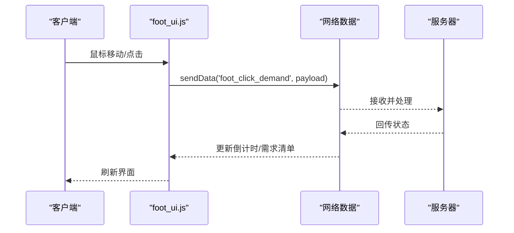
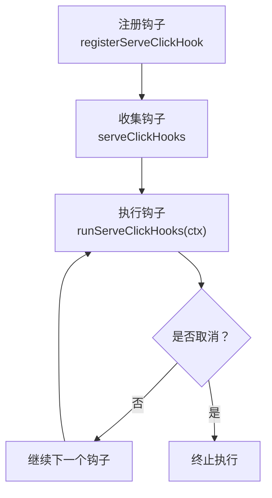
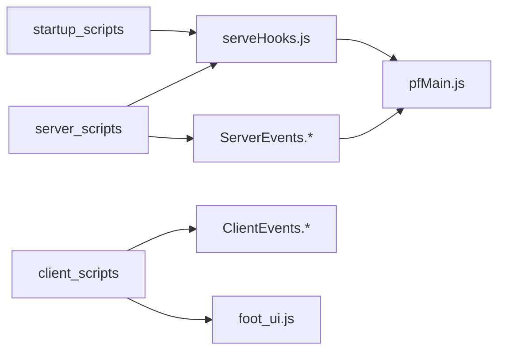

# 插件系统集成

<cite>
**本文引用的文件**
- [kubejs.plugins.txt](file://mods/kubejs.plugins.txt)
- [README.txt](file://kubejs/README.txt)
- [jsconfig.json](file://kubejs/jsconfig.json)
- [example.js（启动脚本）](file://kubejs/startup_scripts/example.js)
- [example.js（服务器脚本）](file://kubejs/server_scripts/example.js)
- [foot_ui.js（客户端UI）](file://kubejs/client_scripts/ui/foot_ui.js)
- [serveHooks.js（服务端钩子）](file://kubejs/startup_scripts/serveHooks.js)
- [pfMain.js（寻路主循环）](file://kubejs/server_scripts/pathfinder/pfMain.js)
- [oilTooltip.js（客户端提示）](file://kubejs/client_scripts/tooltip/oilTooltip.js)
- [recipes_coin.js（服务器配方）](file://kubejs/server_scripts/recipes/recipes_coin.js)
</cite>

## 目录
1. [简介](#简介)
2. [项目结构](#项目结构)
3. [核心组件](#核心组件)
4. [架构总览](#架构总览)
5. [详细组件分析](#详细组件分析)
6. [依赖关系分析](#依赖关系分析)
7. [性能考虑](#性能考虑)
8. [故障排查指南](#故障排查指南)
9. [结论](#结论)
10. [附录](#附录)

## 简介
本文件面向KubeJS插件系统的集成与扩展，结合仓库中的实际脚本与配置，系统性阐述插件注册、生命周期管理、事件监听与加载顺序。文档同时给出插件开发规范、API接口与最佳实践，并提供扩展方法、调试工具与性能监控建议，帮助开发者快速构建稳定高效的KubeJS插件。

## 项目结构
该版本仓库围绕KubeJS目录组织插件相关资源与脚本，主要目录如下：
- kubejs/assets：客户端资源（纹理、模型、声音、语言等）
- kubejs/data：服务端资源（配方、战利品表、标签等）
- kubejs/startup_scripts：游戏启动阶段一次性加载的脚本（适合注册全局钩子、实体、模型等）
- kubejs/server_scripts：每次服务器资源重载时加载的脚本（适合事件监听、配方修改、网络数据处理）
- kubejs/client_scripts：每次客户端资源重载时加载的脚本（适合UI、提示、网络数据处理）
- kubejs/jsconfig.json：TypeScript/JavaScript编译配置，定义根目录与目标环境
- mods/kubejs.plugins.txt：声明插件类名，用于KubeJS识别并加载外部插件

**图表来源**
- [kubejs.plugins.txt:1-1](file://mods/kubejs.plugins.txt#L1-L1)
- [jsconfig.json:1-16](file://kubejs/jsconfig.json#L1-L16)
- [serveHooks.js:1-31](file://kubejs/startup_scripts/serveHooks.js#L1-L31)
- [pfMain.js:1-177](file://kubejs/server_scripts/pathfinder/pfMain.js#L1-L177)
- [oilTooltip.js:1-46](file://kubejs/client_scripts/tooltip/oilTooltip.js#L1-L46)
- [foot_ui.js:1-1026](file://kubejs/client_scripts/ui/foot_ui.js#L1-L1026)
- [recipes_coin.js:1-57](file://kubejs/server_scripts/recipes/recipes_coin.js#L1-L57)

**章节来源**
- [README.txt:1-15](file://kubejs/README.txt#L1-L15)
- [jsconfig.json:1-16](file://kubejs/jsconfig.json#L1-L16)

## 核心组件
- 插件声明与加载
  - 通过mods/kubejs.plugins.txt声明插件类名，KubeJS在启动时扫描并加载对应插件。
- 生命周期与加载顺序
  - startup_scripts：仅在首次启动或显式重载时执行，适合注册全局钩子、实体与模型等一次性初始化。
  - server_scripts：每次服务器资源重载时执行，适合事件监听与配方修改。
  - client_scripts：每次客户端资源重载时执行，适合UI、提示与网络数据处理。
- 事件监听体系
  - 服务器侧：ServerEvents.*（如recipes、tick、commandRegistry）、ItemEvents.*（如rightClicked、tooltip）。
  - 客户端侧：ClientEvents.*（如tick、loggedIn、loggedOut）。
- 钩子与扩展点
  - 通过全局数组与函数注册钩子（如serveHooks.js中的click钩子框架），在关键节点按序执行，便于模块化扩展。

**章节来源**
- [kubejs.plugins.txt:1-1](file://mods/kubejs.plugins.txt#L1-L1)
- [README.txt:8-11](file://kubejs/README.txt#L8-L11)
- [serveHooks.js:1-31](file://kubejs/startup_scripts/serveHooks.js#L1-L31)
- [pfMain.js:1-177](file://kubejs/server_scripts/pathfinder/pfMain.js#L1-L177)
- [oilTooltip.js:1-46](file://kubejs/client_scripts/tooltip/oilTooltip.js#L1-L46)
- [foot_ui.js:1-1026](file://kubejs/client_scripts/ui/foot_ui.js#L1-L1026)
- [recipes_coin.js:1-57](file://kubejs/server_scripts/recipes/recipes_coin.js#L1-L57)

## 架构总览
下图展示了插件系统在启动、运行与事件触发阶段的整体交互：

**图表来源**
- [kubejs.plugins.txt:1-1](file://mods/kubejs.plugins.txt#L1-L1)
- [serveHooks.js:1-31](file://kubejs/startup_scripts/serveHooks.js#L1-L31)
- [pfMain.js:1-177](file://kubejs/server_scripts/pathfinder/pfMain.js#L1-L177)
- [oilTooltip.js:1-46](file://kubejs/client_scripts/tooltip/oilTooltip.js#L1-L46)
- [foot_ui.js:1-1026](file://kubejs/client_scripts/ui/foot_ui.js#L1-L1026)
- [recipes_coin.js:1-57](file://kubejs/server_scripts/recipes/recipes_coin.js#L1-L57)

## 详细组件分析

### 组件A：插件注册与生命周期管理
- 插件注册
  - 通过mods/kubejs.plugins.txt声明插件类名，KubeJS在启动时扫描并加载。
- 生命周期
  - startup_scripts：仅一次，适合注册全局钩子、实体与模型。
  - server_scripts：每次重载，适合事件监听与配方修改。
  - client_scripts：每次重载，适合UI与提示。
- 生命周期示例
  - 启动脚本示例展示了实体注册与动画控制器配置，体现startup_scripts的职责边界。
  - 服务器脚本示例展示了事件监听与UI打开逻辑，体现server_scripts的职责边界。
  - 客户端脚本示例展示了UI窗口创建、事件绑定与网络数据交互，体现client_scripts的职责边界。

**图表来源**
- [kubejs.plugins.txt:1-1](file://mods/kubejs.plugins.txt#L1-L1)
- [example.js（启动脚本）:1-26](file://kubejs/startup_scripts/example.js#L1-L26)
- [example.js（服务器脚本）:1-24](file://kubejs/server_scripts/example.js#L1-L24)
- [foot_ui.js（客户端UI）:1-1026](file://kubejs/client_scripts/ui/foot_ui.js#L1-L1026)

**章节来源**
- [kubejs.plugins.txt:1-1](file://mods/kubejs.plugins.txt#L1-L1)
- [README.txt:8-11](file://kubejs/README.txt#L8-L11)
- [example.js（启动脚本）:1-26](file://kubejs/startup_scripts/example.js#L1-L26)
- [example.js（服务器脚本）:1-24](file://kubejs/server_scripts/example.js#L1-L24)

### 组件B：事件监听与扩展点
- 服务器事件
  - 配方事件：通过ServerEvents.recipes进行配方增删改。
  - 命令事件：通过ServerEvents.commandRegistry注册命令。
  - 点击事件：通过ItemEvents.rightClicked响应右键点击。
  - Tick事件：通过ServerEvents.tick进行周期性处理。
- 客户端事件
  - Tick事件：通过ClientEvents.tick进行客户端循环逻辑。
  - 登录/登出事件：通过ClientEvents.loggedIn/loggedOut进行会话管理。
  - Tooltip事件：通过ItemEvents.tooltip自定义提示文本。
- 寻路系统主循环
  - pfMain.js作为主循环入口，整合多个模块（移动、睡眠、排队、泡脚等），并在关键节点调用钩子。

**图表来源**
- [oilTooltip.js:1-46](file://kubejs/client_scripts/tooltip/oilTooltip.js#L1-L46)
- [recipes_coin.js:1-57](file://kubejs/server_scripts/recipes/recipes_coin.js#L1-L57)
- [pfMain.js:1-177](file://kubejs/server_scripts/pathfinder/pfMain.js#L1-L177)
- [serveHooks.js:1-31](file://kubejs/startup_scripts/serveHooks.js#L1-L31)

**章节来源**
- [oilTooltip.js:1-46](file://kubejs/client_scripts/tooltip/oilTooltip.js#L1-L46)
- [recipes_coin.js:1-57](file://kubejs/server_scripts/recipes/recipes_coin.js#L1-L57)
- [pfMain.js:1-177](file://kubejs/server_scripts/pathfinder/pfMain.js#L1-L177)
- [serveHooks.js:1-31](file://kubejs/startup_scripts/serveHooks.js#L1-L31)

### 组件C：UI与网络数据交互
- 客户端UI
  - foot_ui.js通过WorldWindow创建3D世界窗口，绑定鼠标事件与按键事件，发送网络数据到服务器。
  - 支持倒计时、需求清单、满意度、步骤与抹油状态的动态更新。
- 网络数据
  - 客户端通过player.sendData发送自定义主题数据包，服务器端通过事件监听接收并处理。
- 事件绑定
  - ClientEvents.tick用于检测附近实体并管理UI窗口；ClientEvents.loggedIn/loggedOut用于会话初始化与清理。

**图表来源**
- [foot_ui.js（客户端UI）:1-1026](file://kubejs/client_scripts/ui/foot_ui.js#L1-L1026)

**章节来源**
- [foot_ui.js（客户端UI）:1-1026](file://kubejs/client_scripts/ui/foot_ui.js#L1-L1026)

### 组件D：钩子框架与扩展机制
- serveHooks.js定义了全局钩子数组与注册/执行函数，支持在关键节点插入自定义逻辑。
- 寻路系统通过pfMain.js在主循环中调用钩子，实现模块化扩展。
- 开发者可按需注册钩子函数，实现点击结算、奖励联动等功能。

**图表来源**
- [serveHooks.js（服务端钩子）:1-31](file://kubejs/startup_scripts/serveHooks.js#L1-L31)
- [pfMain.js（寻路主循环）:1-177](file://kubejs/server_scripts/pathfinder/pfMain.js#L1-L177)

**章节来源**
- [serveHooks.js（服务端钩子）:1-31](file://kubejs/startup_scripts/serveHooks.js#L1-L31)
- [pfMain.js（寻路主循环）:1-177](file://kubejs/server_scripts/pathfinder/pfMain.js#L1-L177)

## 依赖关系分析
- 启动脚本依赖
  - 启动脚本负责一次性注册全局钩子与实体，为后续服务器/客户端脚本提供基础能力。
- 服务器脚本依赖
  - 服务器脚本依赖事件监听器与钩子框架，在重载时重新注册。
- 客户端脚本依赖
  - 客户端脚本依赖UI框架与网络数据通道，负责用户交互与状态展示。
- 事件依赖
  - 服务器事件（配方、点击、命令、tick）与客户端事件（tick、登录、提示）相互配合，形成完整的交互闭环。

**图表来源**
- [serveHooks.js:1-31](file://kubejs/startup_scripts/serveHooks.js#L1-L31)
- [pfMain.js:1-177](file://kubejs/server_scripts/pathfinder/pfMain.js#L1-L177)
- [oilTooltip.js:1-46](file://kubejs/client_scripts/tooltip/oilTooltip.js#L1-L46)
- [foot_ui.js:1-1026](file://kubejs/client_scripts/ui/foot_ui.js#L1-L1026)
- [recipes_coin.js:1-57](file://kubejs/server_scripts/recipes/recipes_coin.js#L1-L57)

**章节来源**
- [serveHooks.js:1-31](file://kubejs/startup_scripts/serveHooks.js#L1-L31)
- [pfMain.js:1-177](file://kubejs/server_scripts/pathfinder/pfMain.js#L1-L177)
- [oilTooltip.js:1-46](file://kubejs/client_scripts/tooltip/oilTooltip.js#L1-L46)
- [foot_ui.js:1-1026](file://kubejs/client_scripts/ui/foot_ui.js#L1-L1026)
- [recipes_coin.js:1-57](file://kubejs/server_scripts/recipes/recipes_coin.js#L1-L57)

## 性能考虑
- 事件监听频率控制
  - 服务器与客户端事件监听应避免高频计算，优先使用缓存与节流策略。
- UI更新优化
  - 客户端UI更新应批量处理DOM变更，减少重排与重绘。
- 网络数据传输
  - 尽量压缩payload大小，合并多次发送，避免频繁网络抖动。
- 模块化与延迟加载
  - 将复杂逻辑拆分为模块，按需加载，降低启动与重载时的峰值开销。

## 故障排查指南
- 插件未加载
  - 检查mods/kubejs.plugins.txt中插件类名是否正确，确保类存在于运行时。
- 事件未触发
  - 确认事件监听器注册位置正确（server_scripts/client_scripts），并检查重载命令是否生效。
- UI不显示
  - 检查客户端事件绑定与网络数据发送/接收逻辑，确认WorldWindow参数与HTML路径正确。
- 钩子未执行
  - 确认钩子注册顺序与执行上下文，检查serveHooks.js中的cancel标志与异常捕获。

**章节来源**
- [kubejs.plugins.txt:1-1](file://mods/kubejs.plugins.txt#L1-L1)
- [foot_ui.js:1-1026](file://kubejs/client_scripts/ui/foot_ui.js#L1-L1026)
- [serveHooks.js:1-31](file://kubejs/startup_scripts/serveHooks.js#L1-L31)

## 结论
本仓库展示了KubeJS插件系统在启动、运行与事件层面的完整集成方案。通过明确的生命周期划分、事件监听体系与钩子扩展机制，开发者可以高效地实现复杂功能模块。建议在实际开发中遵循模块化、可重载与可观测性的原则，持续优化性能与稳定性。

## 附录
- 开发规范
  - 将一次性初始化放在startup_scripts，将事件监听放在server_scripts/client_scripts。
  - 使用钩子框架在关键节点插入扩展逻辑，避免在主流程中耦合过多细节。
- API接口
  - 服务器事件：ServerEvents.*（recipes、tick、commandRegistry、item等）
  - 客户端事件：ClientEvents.*（tick、loggedIn、loggedOut、item等）
  - UI框架：WorldWindow（创建3D窗口）、document（DOM操作）
- 最佳实践
  - 使用日志与错误捕获定位问题，避免阻塞主线程。
  - 合理使用缓存与批量更新，提升性能与用户体验。
  - 保持配置与脚本分离，便于维护与回滚。