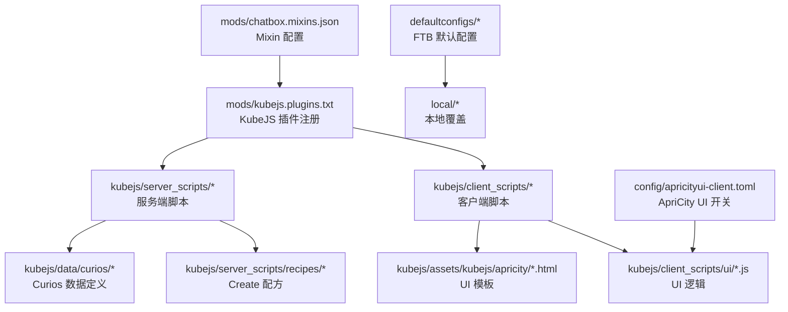
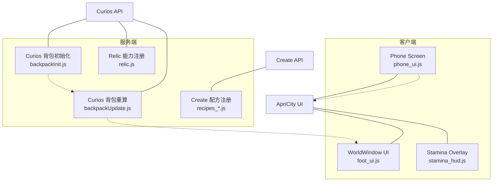
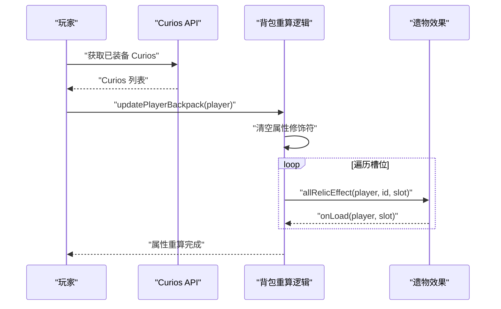
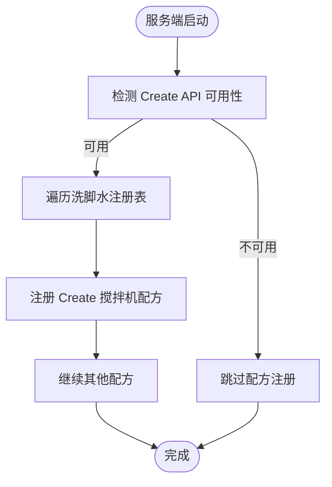
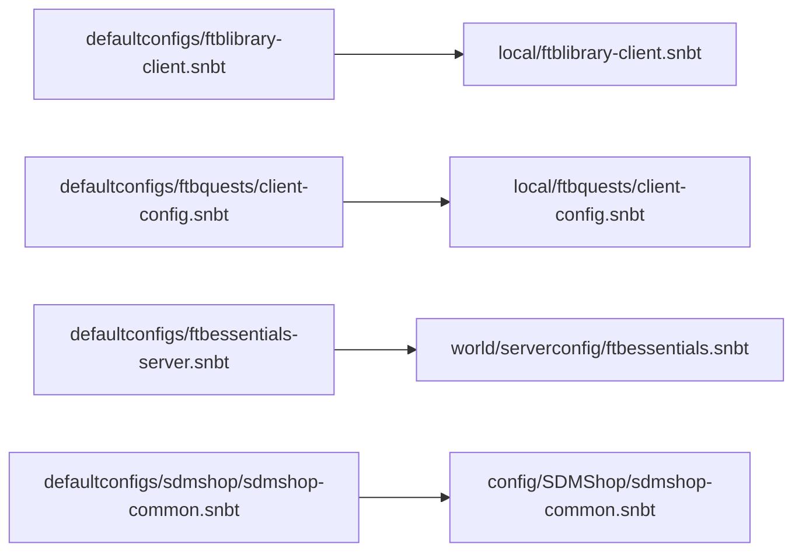
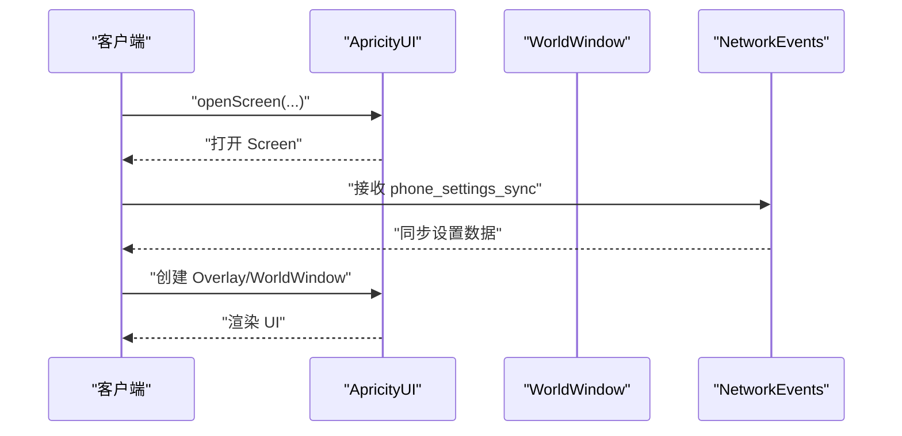
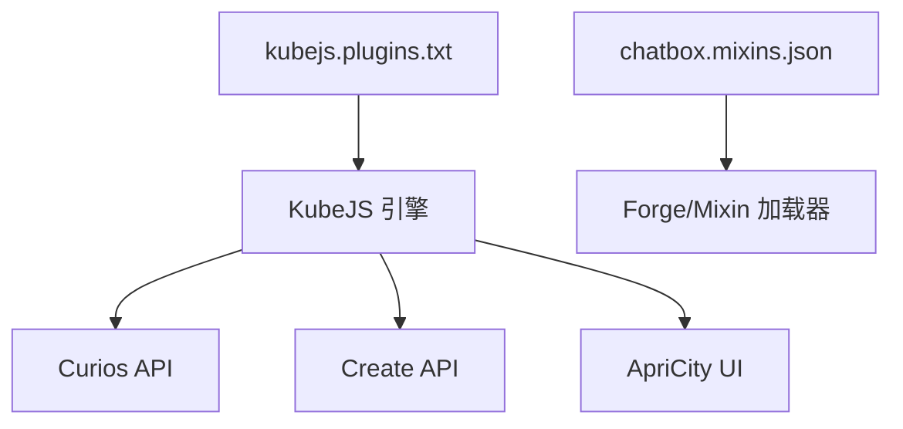

# 模组集成

<cite>
**本文引用的文件**
- [chatbox.mixins.json](file://mods/chatbox.mixins.json)
- [kubejs.plugins.txt](file://mods/kubejs.plugins.txt)
- [README.md](file://README.md)
- [ftblibrary-client.snbt](file://defaultconfigs/ftblibrary/ftblibrary-client.snbt)
- [ftbquests-client.snbt](file://defaultconfigs/ftbquests/client-config.snbt)
- [sdmshop-common.snbt](file://defaultconfigs/sdmshop/sdmshop-common.snbt)
- [apricityui-client.toml](file://config/apricityui-client.toml)
- [package.json](file://kubejs/data/curios/curios/slots/package.json)
- [package.json](file://kubejs/data/curios/tags/items/package.json)
- [backpackInit.js](file://kubejs/server_scripts/backpack/backpackInit.js)
- [backpackUpdate.js](file://kubejs/server_scripts/backpack/backpackUpdate.js)
- [relic.js](file://kubejs/startup_scripts/relic/relic.js)
- [relicHelpers.js](file://kubejs/startup_scripts/relic/relicHelpers.js)
- [recipes_soak_water_create.js](file://kubejs/server_scripts/recipes/recipes_soak_water_create.js)
- [recipes_electrolyte.js](file://kubejs/server_scripts/recipes/recipes_electrolyte.js)
- [recipes_create_precision_mechanism.js](file://kubejs/server_scripts/recipes/recipes_create_precision_mechanism.js)
- [recipes_slot_expander.js](file://kubejs/server_scripts/recipes/recipes_slot_expander.js)
- [footui.html](file://kubejs/assets/kubejs/apricity/footui.html)
- [foot_ui.js](file://kubejs/client_scripts/ui/foot_ui.js)
- [phone_ui.js](file://kubejs/client_scripts/ui/phone_ui.js)
- [stamina_hud.js](file://kubejs/client_scripts/ui/stamina_hud.js)
</cite>

## 目录
1. [简介](#简介)
2. [项目结构](#项目结构)
3. [核心组件](#核心-components)
4. [架构总览](#架构总览)
5. [详细组件分析](#详细组件分析)
6. [依赖关系分析](#依赖关系分析)
7. [性能考量](#性能考量)
8. [故障排查指南](#故障排查指南)
9. [结论](#结论)
10. [附录](#附录)

## 简介
本文件面向模组集成与兼容性工程实践，系统梳理本项目与外部模组的集成方式与适配策略，覆盖以下主题：
- Curios API 的槽位与能力绑定、属性重算与事件适配
- Create 模组配方与机械 API 的条件注册与配方覆盖
- FTB 系列模组（Library、Quests、Essentials、Shop）的默认配置与本地化
- ApriCity UI 框架的客户端窗口与 Overlay/Screen 打开流程
- Mixin 机制、插件注册、KubeJS API 适配与功能扩展
- 兼容性检查、版本适配与冲突规避策略
- 集成开发最佳实践、测试方法与维护指南

## 项目结构
本项目以 KubeJS 为核心扩展点，围绕 Curios、Create、FTB 系列与 ApriCity UI 进行集成。关键目录与文件如下：
- mods：Mixin 配置与 KubeJS 插件声明
- kubejs：资源、脚本与数据定义
- defaultconfigs：FTB 默认配置模板
- config：ApriCity UI 客户端开关
- saves/local：运行时本地配置覆盖

**图表来源**
- [chatbox.mixins.json:1-24](file://mods/chatbox.mixins.json#L1-L24)
- [kubejs.plugins.txt:1-1](file://mods/kubejs.plugins.txt#L1-L1)
- [ftblibrary-client.snbt:1-5](file://defaultconfigs/ftblibrary/ftblibrary-client.snbt#L1-L5)
- [ftbquests-client.snbt:1-5](file://defaultconfigs/ftbquests/client-config.snbt#L1-L5)
- [apricityui-client.toml:1-8](file://config/apricityui-client.toml#L1-L8)

**章节来源**
- [README.md:1-6](file://README.md#L1-L6)
- [chatbox.mixins.json:1-24](file://mods/chatbox.mixins.json#L1-L24)
- [kubejs.plugins.txt:1-1](file://mods/kubejs.plugins.txt#L1-L1)

## 核心组件
- Curios 集成：通过 Curios API 注册槽位、挂载物品能力、监听装备/卸下事件，并在属性系统上进行重算与修正。
- Create 集成：条件注册 Create 搅拌机与注液器配方；覆盖原版精密构件装配配方，调整材料与副产物。
- FTB 系列：提供默认配置模板，便于本地覆盖；与 Quests、Essentials、Shop 等协作。
- ApriCity UI 集成：通过 WorldWindow/Overlay/Screen 打开 UI，结合网络事件与 HTML 模板实现交互。

**章节来源**
- [package.json:1-5](file://kubejs/data/curios/curios/slots/package.json#L1-L5)
- [backpackInit.js:1-35](file://kubejs/server_scripts/backpack/backpackInit.js#L1-L35)
- [backpackUpdate.js:1-72](file://kubejs/server_scripts/backpack/backpackUpdate.js#L1-L72)
- [relic.js:1-30](file://kubejs/startup_scripts/relic/relic.js#L1-L30)
- [relicHelpers.js:40-331](file://kubejs/startup_scripts/relic/relicHelpers.js#L40-L331)
- [recipes_soak_water_create.js:1-26](file://kubejs/server_scripts/recipes/recipes_soak_water_create.js#L1-L26)
- [recipes_electrolyte.js:1-35](file://kubejs/server_scripts/recipes/recipes_electrolyte.js#L1-L35)
- [recipes_create_precision_mechanism.js:1-26](file://kubejs/server_scripts/recipes/recipes_create_precision_mechanism.js#L1-L26)
- [recipes_slot_expander.js:1-28](file://kubejs/server_scripts/recipes/recipes_slot_expander.js#L1-L28)
- [footui.html:1-14](file://kubejs/assets/kubejs/apricity/footui.html#L1-L14)
- [foot_ui.js:1-800](file://kubejs/client_scripts/ui/foot_ui.js#L1-L800)
- [phone_ui.js:1-33](file://kubejs/client_scripts/ui/phone_ui.js#L1-L33)
- [stamina_hud.js:1-45](file://kubejs/client_scripts/ui/stamina_hud.js#L1-L45)

## 架构总览
整体架构围绕 KubeJS 事件驱动，服务端负责数据与配方，客户端负责 UI 渲染与交互。外部模组通过 API 检测与条件注册实现兼容性与版本适配。

**图表来源**
- [backpackInit.js:1-35](file://kubejs/server_scripts/backpack/backpackInit.js#L1-L35)
- [backpackUpdate.js:1-72](file://kubejs/server_scripts/backpack/backpackUpdate.js#L1-L72)
- [relic.js:1-30](file://kubejs/startup_scripts/relic/relic.js#L1-L30)
- [recipes_soak_water_create.js:1-26](file://kubejs/server_scripts/recipes/recipes_soak_water_create.js#L1-L26)
- [foot_ui.js:1-800](file://kubejs/client_scripts/ui/foot_ui.js#L1-L800)
- [phone_ui.js:1-33](file://kubejs/client_scripts/ui/phone_ui.js#L1-L33)
- [stamina_hud.js:1-45](file://kubejs/client_scripts/ui/stamina_hud.js#L1-L45)

## 详细组件分析

### Curios 集成
- 槽位与图标：通过数据定义声明槽位大小、是否化妆位与图标。
- 背包初始化：首次登录时按预设矩阵填充 Curios 槽位，避免重复初始化。
- 背包重算：在属性系统上先清空既有修饰符，再根据当前装备逐一加载效果，避免重复叠加。
- 能力注册：为物品附加 Curios 能力，监听装备/卸下事件，触发背包重算与自定义回调。

**图表来源**
- [backpackUpdate.js:1-72](file://kubejs/server_scripts/backpack/backpackUpdate.js#L1-L72)
- [relic.js:1-30](file://kubejs/startup_scripts/relic/relic.js#L1-L30)

**章节来源**
- [package.json:1-5](file://kubejs/data/curios/curios/slots/package.json#L1-L5)
- [package.json:1-5](file://kubejs/data/curios/tags/items/package.json#L1-L5)
- [backpackInit.js:1-35](file://kubejs/server_scripts/backpack/backpackInit.js#L1-L35)
- [backpackUpdate.js:1-72](file://kubejs/server_scripts/backpack/backpackUpdate.js#L1-L72)
- [relic.js:1-30](file://kubejs/startup_scripts/relic/relic.js#L1-L30)
- [relicHelpers.js:40-331](file://kubejs/startup_scripts/relic/relicHelpers.js#L40-L331)

### Create 模组集成
- 搅拌机配方：条件检测 Create 搅拌 API，逐个注册洗脚水配方，输入包括水与多种流体/物品。
- 电解质水配方：混合与注液器配方，确保 Create 可用时才注册。
- 精密构件配方覆盖：将基材与副产物替换为黄铜板，保持配方一致性。

**图表来源**
- [recipes_soak_water_create.js:1-26](file://kubejs/server_scripts/recipes/recipes_soak_water_create.js#L1-L26)
- [recipes_electrolyte.js:1-35](file://kubejs/server_scripts/recipes/recipes_electrolyte.js#L1-L35)
- [recipes_create_precision_mechanism.js:1-26](file://kubejs/server_scripts/recipes/recipes_create_precision_mechanism.js#L1-L26)

**章节来源**
- [recipes_soak_water_create.js:1-26](file://kubejs/server_scripts/recipes/recipes_soak_water_create.js#L1-L26)
- [recipes_electrolyte.js:1-35](file://kubejs/server_scripts/recipes/recipes_electrolyte.js#L1-L35)
- [recipes_create_precision_mechanism.js:1-26](file://kubejs/server_scripts/recipes/recipes_create_precision_mechanism.js#L1-L26)
- [recipes_slot_expander.js:1-28](file://kubejs/server_scripts/recipes/recipes_slot_expander.js#L1-L28)

### FTB 系列模组集成
- 默认配置模板：提供 FTB Library、Quests、Essentials、Shop 的默认配置文件，便于复制到本地覆盖。
- 本地覆盖：运行时将默认配置复制到 local 目录，支持按需修改。

**图表来源**
- [ftblibrary-client.snbt:1-5](file://defaultconfigs/ftblibrary/ftblibrary-client.snbt#L1-L5)
- [ftbquests-client.snbt:1-5](file://defaultconfigs/ftbquests/client-config.snbt#L1-L5)
- [ftbessentials-server.snbt:1-13](file://defaultconfigs/ftbessentials-server.snbt#L1-L13)
- [sdmshop-common.snbt:1-5](file://defaultconfigs/sdmshop/sdmshop-common.snbt#L1-L5)

**章节来源**
- [ftblibrary-client.snbt:1-5](file://defaultconfigs/ftblibrary/ftblibrary-client.snbt#L1-L5)
- [ftbquests-client.snbt:1-5](file://defaultconfigs/ftbquests/client-config.snbt#L1-L5)
- [ftbessentials-server.snbt:1-13](file://defaultconfigs/ftbessentials-server.snbt#L1-L13)
- [sdmshop-common.snbt:1-5](file://defaultconfigs/sdmshop/sdmshop-common.snbt#L1-L5)

### ApriCity UI 框架集成
- WorldWindow：在世界空间中渲染 HTML 模板，支持旋转、缩放与距离限制。
- Overlay：通过 Overlay 在 HUD 上绘制体力条等信息。
- Screen：通过服务端打开 Screen，客户端接收设置与评分数据并渲染。

**图表来源**
- [foot_ui.js:1-800](file://kubejs/client_scripts/ui/foot_ui.js#L1-L800)
- [phone_ui.js:1-33](file://kubejs/client_scripts/ui/phone_ui.js#L1-L33)
- [stamina_hud.js:1-45](file://kubejs/client_scripts/ui/stamina_hud.js#L1-L45)
- [footui.html:1-14](file://kubejs/assets/kubejs/apricity/footui.html#L1-L14)
- [apricityui-client.toml:1-8](file://config/apricityui-client.toml#L1-L8)

**章节来源**
- [foot_ui.js:1-800](file://kubejs/client_scripts/ui/foot_ui.js#L1-L800)
- [phone_ui.js:1-33](file://kubejs/client_scripts/ui/phone_ui.js#L1-L33)
- [stamina_hud.js:1-45](file://kubejs/client_scripts/ui/stamina_hud.js#L1-L45)
- [footui.html:1-14](file://kubejs/assets/kubejs/apricity/footui.html#L1-L14)
- [apricityui-client.toml:1-8](file://config/apricityui-client.toml#L1-L8)

## 依赖关系分析
- KubeJS 插件：通过 plugins 文件声明插件入口，确保脚本在正确生命周期被加载。
- Mixin：声明包路径、兼容级别与 mixin 列表，确保与目标模组版本匹配。
- 外部 API：对 Curios、Create、ApriCity UI 的 API 可用性进行条件检测，避免版本不兼容导致崩溃。

**图表来源**
- [kubejs.plugins.txt:1-1](file://mods/kubejs.plugins.txt#L1-L1)
- [chatbox.mixins.json:1-24](file://mods/chatbox.mixins.json#L1-L24)

**章节来源**
- [kubejs.plugins.txt:1-1](file://mods/kubejs.plugins.txt#L1-L1)
- [chatbox.mixins.json:1-24](file://mods/chatbox.mixins.json#L1-L24)

## 性能考量
- 属性重算：在背包变更时一次性清空修饰符再重建，避免重复叠加与计算膨胀。
- UI 渲染：WorldWindow 支持距离限制与缩放，减少远距离渲染开销。
- 条件注册：仅在外部模组可用时注册配方与事件，降低无用逻辑开销。
- 网络事件：客户端仅在收到数据后更新 UI，避免频繁刷新。

[本节为通用指导，无需特定文件引用]

## 故障排查指南
- Curios 事件异常：onEquip/onUnequip 包裹在 try-catch 中，出现异常会记录错误日志但不中断事件总线。
- Create API 不可用：配方注册前进行 API 可用性检查，不可用时输出提示并跳过注册。
- ApriCity UI 未显示：确认客户端配置开关与 HTML 模板路径正确，检查 WorldWindow 创建与添加流程。
- FTB 配置未生效：确认默认配置已复制到 local 目录，或手动覆盖对应键值。

**章节来源**
- [relic.js:1-30](file://kubejs/startup_scripts/relic/relic.js#L1-L30)
- [recipes_soak_water_create.js:1-26](file://kubejs/server_scripts/recipes/recipes_soak_water_create.js#L1-L26)
- [foot_ui.js:1-800](file://kubejs/client_scripts/ui/foot_ui.js#L1-L800)
- [apricityui-client.toml:1-8](file://config/apricityui-client.toml#L1-L8)

## 结论
本项目通过 KubeJS 与外部模组形成松耦合集成：以条件注册与 API 检测保障兼容性，以 Mixin 与插件机制扩展底层行为，以 ApriCity UI 提供沉浸式交互体验。Curios 与 Create 的集成体现了“能力注册 + 属性重算”的稳健模式；FTB 默认配置模板简化了本地化与团队部署；ApriCity UI 的多形态（WorldWindow/Overlay/Screen）满足不同场景需求。建议在新版本发布前进行 API 可用性回归测试与 UI 距离/性能验证。

[本节为总结，无需特定文件引用]

## 附录
- 安装与运行：按照 README 指引下载客户端、安装 Forge 并拉取仓库后即可创建存档运行。
- 配置建议：将默认配置复制到 local 目录进行团队共享；ApriCity UI 可开启调试与自动重载以便开发。

**章节来源**
- [README.md:1-6](file://README.md#L1-L6)
- [apricityui-client.toml:1-8](file://config/apricityui-client.toml#L1-L8)