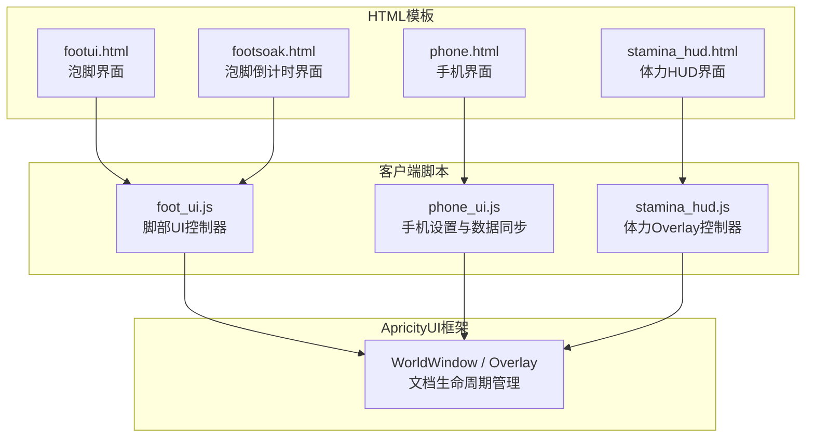
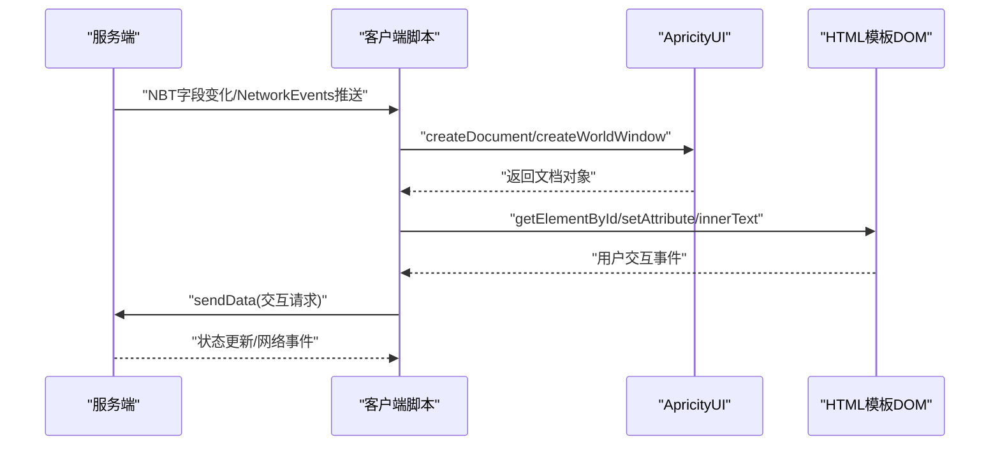
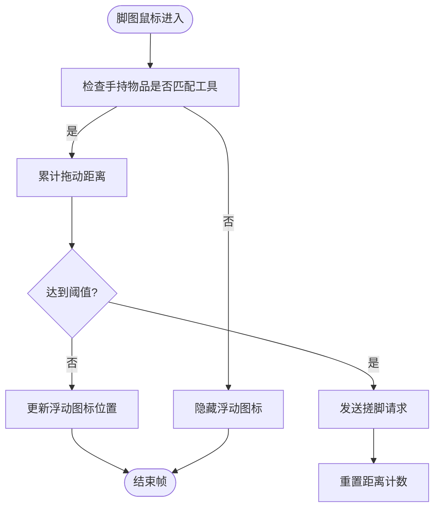
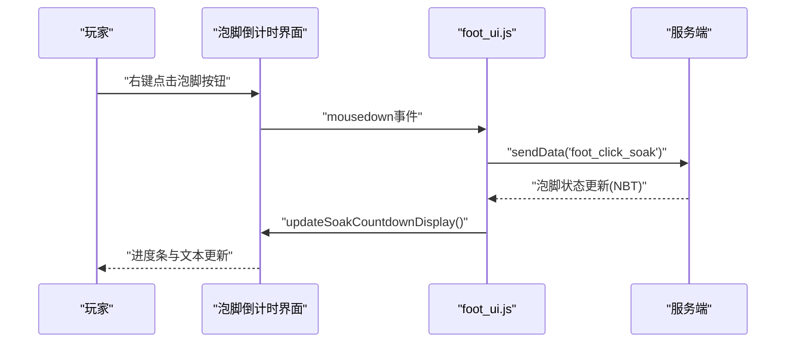
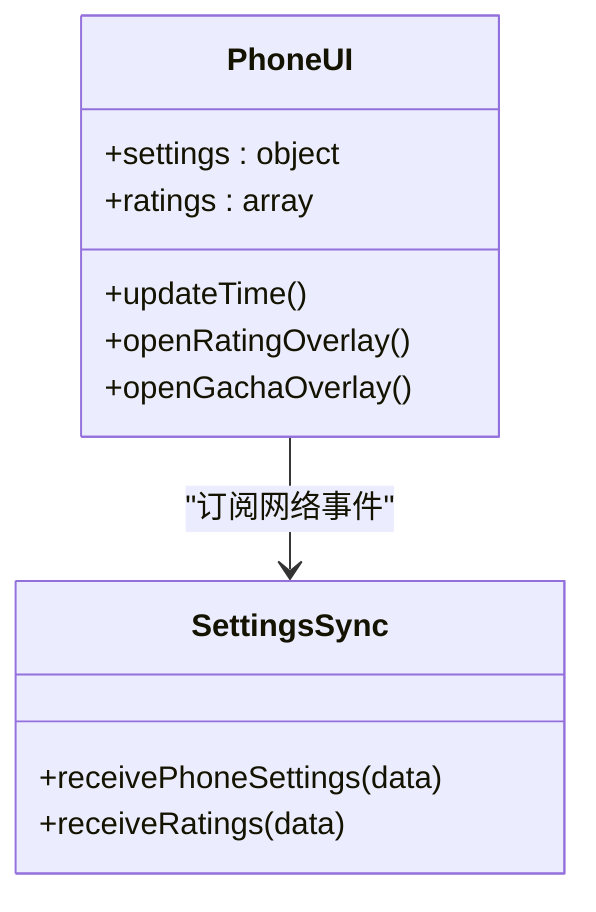
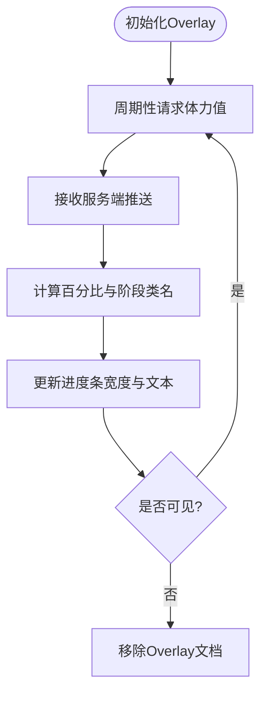
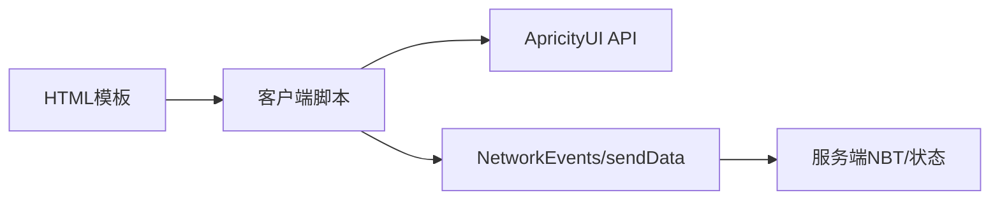

# HTML模板文件

<cite>
**本文引用的文件**   
- [footui.html](file://apricity/kubejs/footui.html)
- [footsoak.html](file://apricity/kubejs/footsoak.html)
- [phone.html](file://apricity/kubejs/phone.html)
- [stamina_hud.html](file://apricity/kubejs/stamina_hud.html)
- [foot_ui.js](file://kubejs/client_scripts/ui/foot_ui.js)
- [phone_ui.js](file://kubejs/client_scripts/ui/phone_ui.js)
- [stamina_hud.js](file://kubejs/client_scripts/ui/stamina_hud.js)
</cite>

## 目录
1. [引言](#引言)
2. [项目结构](#项目结构)
3. [核心组件](#核心组件)
4. [架构总览](#架构总览)
5. [详细组件分析](#详细组件分析)
6. [依赖关系分析](#依赖关系分析)
7. [性能考虑](#性能考虑)
8. [故障排查指南](#故障排查指南)
9. [结论](#结论)
10. [附录：模板参数与交互约定](#附录模板参数与交互约定)

## 引言
本文件面向 ApriCity UI 框架中的 HTML 模板，聚焦四个关键界面：泡脚界面、泡脚倒计时界面、手机界面和体力 HUD 界面。文档从 HTML 结构、CSS 样式绑定、JavaScript 交互逻辑、DOM 组织方式、事件绑定机制、动态内容更新、模板参数传递、条件渲染和用户交互处理等维度进行系统化说明，并给出模板开发最佳实践与性能优化建议。

## 项目结构
ApriCity UI 的 UI 资源位于 `apricity/kubejs` 下的 HTML 模板文件，客户端脚本位于 `kubejs/client_scripts/ui`。HTML 模板通过 ApricityUI API 以 WorldWindow 或 Overlay 的形式加载到游戏世界中；客户端脚本负责创建窗口、绑定事件、同步服务端数据并驱动 DOM 更新。

**图表来源**
- [footui.html:1-69](file://apricity/kubejs/footui.html#L1-L69)
- [footsoak.html:1-29](file://apricity/kubejs/footsoak.html#L1-L29)
- [phone.html:1-184](file://apricity/kubejs/phone.html#L1-L184)
- [stamina_hud.html:1-16](file://apricity/kubejs/stamina_hud.html#L1-L16)
- [foot_ui.js:12-17](file://kubejs/client_scripts/ui/foot_ui.js#L12-L17)
- [phone_ui.js:7-10](file://kubejs/client_scripts/ui/phone_ui.js#L7-L10)
- [stamina_hud.js:7-16](file://kubejs/client_scripts/ui/stamina_hud.js#L7-L16)

**章节来源**
- [footui.html:1-69](file://apricity/kubejs/footui.html#L1-L69)
- [footsoak.html:1-29](file://apricity/kubejs/footsoak.html#L1-L29)
- [phone.html:1-184](file://apricity/kubejs/phone.html#L1-L184)
- [stamina_hud.html:1-16](file://apricity/kubejs/stamina_hud.html#L1-L16)
- [foot_ui.js:12-17](file://kubejs/client_scripts/ui/foot_ui.js#L12-L17)
- [phone_ui.js:7-10](file://kubejs/client_scripts/ui/phone_ui.js#L7-L10)
- [stamina_hud.js:7-16](file://kubejs/client_scripts/ui/stamina_hud.js#L7-L16)

## 核心组件
- 泡脚界面（footui.html）：展示需求清单、满意度进度条、步骤记录、送客按钮、脚图与拖动跟随图标。由 foot_ui.js 创建 WorldWindow，绑定鼠标移动、离开、点击事件，并根据服务端 NBT 数据更新 DOM。
- 泡脚倒计时界面（footsoak.html）：显示泡脚按钮、标题、提示文本与进度条。由 foot_ui.js 创建 WorldWindow，监听右键触发泡脚请求，根据服务端状态更新进度条。
- 手机界面（phone.html）：模拟手机主屏、时间显示、应用图标、评价弹窗与抽卡弹窗。由 phone_ui.js 接收服务端推送的设置与评价数据，并在页面内更新 UI。
- 体力 HUD 界面（stamina_hud.html）：固定左下角体力条与数值。由 stamina_hud.js 创建 Overlay，周期性请求体力值并更新进度条颜色与宽度。

**章节来源**
- [footui.html:9-68](file://apricity/kubejs/footui.html#L9-L68)
- [footsoak.html:10-28](file://apricity/kubejs/footsoak.html#L10-L28)
- [phone.html:110-183](file://apricity/kubejs/phone.html#L110-L183)
- [stamina_hud.html:9-15](file://apricity/kubejs/stamina_hud.html#L9-L15)
- [foot_ui.js:120-269](file://kubejs/client_scripts/ui/foot_ui.js#L120-L269)
- [foot_ui.js:331-396](file://kubejs/client_scripts/ui/foot_ui.js#L331-L396)
- [phone_ui.js:12-47](file://kubejs/client_scripts/ui/phone_ui.js#L12-L47)
- [stamina_hud.js:25-73](file://kubejs/client_scripts/ui/stamina_hud.js#L25-L73)

## 架构总览
整体采用“HTML模板 + 客户端脚本 + ApricityUI”的分层架构：
- HTML 模板定义结构与样式，提供稳定的 DOM 节点 ID。
- 客户端脚本通过 ApricityUI API 创建和管理文档（WorldWindow/Overlay），订阅网络事件，读取实体 NBT 数据，驱动 DOM 更新。
- 服务端通过 NBT 字段与 NetworkEvents 推送数据，客户端据此刷新界面。

**图表来源**
- [foot_ui.js:152-166](file://kubejs/client_scripts/ui/foot_ui.js#L152-L166)
- [foot_ui.js:353-365](file://kubejs/client_scripts/ui/foot_ui.js#L353-L365)
- [stamina_hud.js:94-114](file://kubejs/client_scripts/ui/stamina_hud.js#L94-L114)
- [phone_ui.js:12-47](file://kubejs/client_scripts/ui/phone_ui.js#L12-L47)

## 详细组件分析

### 泡脚界面（footui.html）
- DOM 结构要点
  - 容器 `.foot-ui-container` 包含头部信息区 `.up` 与脚图交互区 `.down`。
  - 需求清单使用 `.requireList` 左右两列布局，分别展示脚掌/脚心与脚趾/脚跟次数。
  - 满意度使用 `.progress-wrapper` 与 `.progress-fill` 实现横向进度条。
  - 步骤记录在 `.steps-container` 中，通过 JS 更新 `.stepsText`。
  - 右上角 `.dismiss-btn` 为送客按钮，点击后发送服务端指令。
  - 脚图 `.foot-image` 承载鼠标移入时的浮动图标动画 `.float-anim`。
- CSS 样式绑定
  - 使用绝对定位与 flex 组合实现紧凑布局。
  - 进度条通过 width 百分比与 transition 实现平滑填充。
  - 完成项通过 `.count.done` 切换绿色对号样式。
- JavaScript 交互逻辑（foot_ui.js）
  - 创建 WorldWindow 并设置位置、旋转、缩放。
  - 监听脚图 mousemove/mouseleave，累计拖动距离达到阈值后发送搓脚请求。
  - 监听送客按钮 mousedown，发送送客指令。
  - 根据服务端 NBT 字段更新需求清单、满意度、步骤、抹油状态。
- 动态内容更新方式
  - 通过 `updateDemandListDisplay`、`updateSatisfactionDisplay`、`updateStepsDisplay`、`updateOilDisplay` 等方法直接操作 DOM 元素属性与文本。
- 条件渲染
  - 需求次数为 0 时显示“✓”并添加完成样式；否则显示次数文本。
  - 步骤为空时清空显示文本。
- 模板参数传递
  - 通过服务端 NBT 字段（如 `pfDemandJiaozhang`、`pfSatisfaction`、`pfSteps`、`pfOilId`、`pfOilLeft`）传递数据，客户端脚本读取并映射到 DOM。

**图表来源**
- [foot_ui.js:171-242](file://kubejs/client_scripts/ui/foot_ui.js#L171-L242)

**章节来源**
- [footui.html:9-68](file://apricity/kubejs/footui.html#L9-L68)
- [footui.html:70-333](file://apricity/kubejs/footui.html#L70-L333)
- [foot_ui.js:120-269](file://kubejs/client_scripts/ui/foot_ui.js#L120-L269)
- [foot_ui.js:533-613](file://kubejs/client_scripts/ui/foot_ui.js#L533-L613)
- [foot_ui.js:642-750](file://kubejs/client_scripts/ui/foot_ui.js#L642-L750)

### 泡脚倒计时界面（footsoak.html）
- DOM 结构要点
  - 容器 `.soak-container` 包含背景 `.bg`、按钮层 `.button-layer` 与文字层 `.text-layer`。
  - 按钮 `.soakBtn` 用于触发泡脚动作。
  - 进度条 `.progress-wrapper` 常驻 DOM，通过 opacity 控制显隐，width 控制填充。
- CSS 样式绑定
  - 按钮使用背景贴图与 transform 缩放反馈。
  - 进度条背景与填充色对比明显，配合 transition 平滑过渡。
- JavaScript 交互逻辑（foot_ui.js）
  - 创建 WorldWindow 并绑定按钮 mousedown 事件，仅接受右键触发。
  - 根据服务端状态更新标题、提示文本与进度条。
- 动态内容更新方式
  - `updateSoakCountdownDisplay` 方法根据 isSoaking 与 timeLeft 计算百分比并更新 DOM。
- 条件渲染
  - 未泡脚时隐藏进度条与文本；泡脚中显示进度条与剩余秒数。

**图表来源**
- [footsoak.html:10-28](file://apricity/kubejs/footsoak.html#L10-L28)
- [foot_ui.js:374-396](file://kubejs/client_scripts/ui/foot_ui.js#L374-L396)
- [foot_ui.js:401-439](file://kubejs/client_scripts/ui/foot_ui.js#L401-L439)

**章节来源**
- [footsoak.html:10-28](file://apricity/kubejs/footsoak.html#L10-L28)
- [footsoak.html:31-195](file://apricity/kubejs/footsoak.html#L31-L195)
- [foot_ui.js:331-396](file://kubejs/client_scripts/ui/foot_ui.js#L331-L396)
- [foot_ui.js:401-439](file://kubejs/client_scripts/ui/foot_ui.js#L401-L439)

### 手机界面（phone.html）
- DOM 结构要点
  - 外层 `.phone-wrapper` 与 `.phone-frame` 模拟手机外壳与屏幕。
  - 状态栏 `.status-bar` 包含时间与电池信息，中间为摄像头挖孔。
  - 主屏幕 `.home-screen` 包含壁纸空白区域与应用图标网格。
  - 评价弹窗 `.rt-overlay` 与抽卡弹窗 `.gc-overlay` 作为独立浮层。
- CSS 样式绑定
  - 全面屏布局使用 flex 与绝对定位组合，确保状态栏与手势条对齐。
  - 应用图标使用统一尺寸与圆角，不同颜色类区分功能。
  - 弹窗使用 fixed 定位与半透明背景，关闭按钮具备点击反馈。
- JavaScript 交互逻辑（phone_ui.js）
  - 接收服务端推送的设置与评价数据，更新全局配置与 DOM。
  - 页面内时间显示与十二时辰映射逻辑在模板脚本中实现。
- 动态内容更新方式
  - 通过 `global.pfPhoneSettings` 存储设置与评价数据，模板脚本读取并更新对应元素。
- 条件渲染
  - 评价列表根据服务端返回的数据动态渲染条形图与数值。
  - 抽卡弹窗根据按钮点击触发不同抽取次数。

**图表来源**
- [phone.html:110-183](file://apricity/kubejs/phone.html#L110-L183)
- [phone_ui.js:12-47](file://kubejs/client_scripts/ui/phone_ui.js#L12-L47)

**章节来源**
- [phone.html:110-183](file://apricity/kubejs/phone.html#L110-L183)
- [phone.html:186-758](file://apricity/kubejs/phone.html#L186-L758)
- [phone_ui.js:12-47](file://kubejs/client_scripts/ui/phone_ui.js#L12-L47)

### 体力 HUD 界面（stamina_hud.html）
- DOM 结构要点
  - 根容器 `.stamina-hud` 包含标签、进度条背景与填充、数值文本。
- CSS 样式绑定
  - 进度条填充使用渐变背景，低/中/高阶段通过类名切换颜色。
  - 使用 translateZ(-1000px) 保证跨文档层级排序，置于所有 AUI 页面底层。
- JavaScript 交互逻辑（stamina_hud.js）
  - 首次登录或可见时创建 Overlay 文档，周期性请求体力值。
  - 根据体力百分比更新进度条宽度与类名，同时更新数值文本。
- 动态内容更新方式
  - `updateStaminaBar` 方法统一处理宽度与类名更新，兼容 setTextContent 与 innerText。
- 条件渲染
  - 当不可见时移除 Overlay 文档，避免资源浪费。

**图表来源**
- [stamina_hud.html:9-15](file://apricity/kubejs/stamina_hud.html#L9-L15)
- [stamina_hud.js:94-127](file://kubejs/client_scripts/ui/stamina_hud.js#L94-L127)

**章节来源**
- [stamina_hud.html:9-15](file://apricity/kubejs/stamina_hud.html#L9-L15)
- [stamina_hud.html:18-107](file://apricity/kubejs/stamina_hud.html#L18-L107)
- [stamina_hud.js:25-73](file://kubejs/client_scripts/ui/stamina_hud.js#L25-L73)
- [stamina_hud.js:94-127](file://kubejs/client_scripts/ui/stamina_hud.js#L94-L127)

## 依赖关系分析
- HTML 模板依赖 ApricityUI 提供的文档生命周期 API（createDocument/createWorldWindow/removeDocument）。
- 客户端脚本依赖 KubeJS 的 Java 桥接类（Minecraft、Vec3、ApricityUI）与服务端通信（sendData/NetworkEvents）。
- 数据源主要来自服务端 NBT 字段与网络事件推送。

**图表来源**
- [foot_ui.js:12-17](file://kubejs/client_scripts/ui/foot_ui.js#L12-L17)
- [phone_ui.js:7-10](file://kubejs/client_scripts/ui/phone_ui.js#L7-L10)
- [stamina_hud.js:7-16](file://kubejs/client_scripts/ui/stamina_hud.js#L7-L16)

**章节来源**
- [foot_ui.js:12-17](file://kubejs/client_scripts/ui/foot_ui.js#L12-L17)
- [phone_ui.js:7-10](file://kubejs/client_scripts/ui/phone_ui.js#L7-L10)
- [stamina_hud.js:7-16](file://kubejs/client_scripts/ui/stamina_hud.js#L7-L16)

## 性能考虑
- 减少频繁 DOM 重排：优先使用 style.width 与 class 切换而非重建节点。
- 节流与去抖：拖动累计距离阈值避免误触；进度条更新使用 transition 平滑过渡。
- 延迟移除窗口：safeRemoveWorldWindow 避免鼠标悬停时立即移除导致框架内部异常。
- 资源清理：登出或不可见时及时 removeDocument，防止内存泄漏。
- 网络请求频率：体力 HUD 每 20 tick 请求一次，平衡实时性与开销。

[本节为通用指导，不直接分析具体文件]

## 故障排查指南
- 窗口创建失败
  - 检查 ApricityUI.createWorldWindow 返回值是否为 null，确认路径与权限。
  - 参考脚部 UI 创建流程与日志输出。
- 事件无响应
  - 确认按钮 ID 与事件绑定是否正确；泡脚按钮仅接受右键。
  - 检查鼠标事件拦截配置（aui-mouse-events）。
- 数据未更新
  - 核对服务端 NBT 字段名称与客户端读取逻辑是否一致。
  - 检查 NetworkEvents 订阅与数据解析。
- 进度条异常
  - 验证百分比计算范围（0-100）与 CSS 类名切换逻辑。
  - 确认文本更新使用 setTextContent 或 innerText 兼容写法。

**章节来源**
- [foot_ui.js:152-166](file://kubejs/client_scripts/ui/foot_ui.js#L152-L166)
- [foot_ui.js:374-396](file://kubejs/client_scripts/ui/foot_ui.js#L374-L396)
- [stamina_hud.js:47-56](file://kubejs/client_scripts/ui/stamina_hud.js#L47-L56)

## 结论
ApriCity UI 的 HTML 模板通过清晰的 DOM 结构与 CSS 样式绑定，结合客户端脚本的事件绑定与动态更新，实现了泡脚界面、泡脚倒计时界面、手机界面与体力 HUD 界面的完整交互体验。遵循模板开发最佳实践与性能优化建议，可进一步提升稳定性与用户体验。

[本节为总结性内容，不直接分析具体文件]

## 附录：模板参数与交互约定
- 泡脚界面参数
  - 需求清单：脚掌、脚心、脚趾、脚跟次数（NBT 字段映射）。
  - 满意度：0-100 百分比。
  - 步骤：逗号分隔整数编码，解码为中文名称序列。
  - 抹油状态：物品 ID 与剩余次数。
- 泡脚倒计时界面参数
  - 泡脚状态：isSoaking 布尔值。
  - 剩余时间：timeLeft 秒数。
- 手机界面参数
  - 设置：跳过泡脚、一键满足开关。
  - 评价数据：种族评分数组与总分池。
- 体力 HUD 参数
  - 体力值：当前值与最大值（默认 10000）。

**章节来源**
- [foot_ui.js:533-613](file://kubejs/client_scripts/ui/foot_ui.js#L533-L613)
- [foot_ui.js:642-750](file://kubejs/client_scripts/ui/foot_ui.js#L642-L750)
- [phone_ui.js:12-47](file://kubejs/client_scripts/ui/phone_ui.js#L12-L47)
- [stamina_hud.js:25-73](file://kubejs/client_scripts/ui/stamina_hud.js#L25-L73)