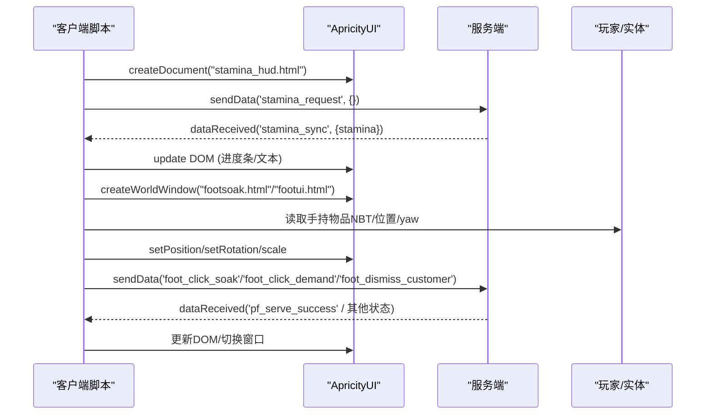
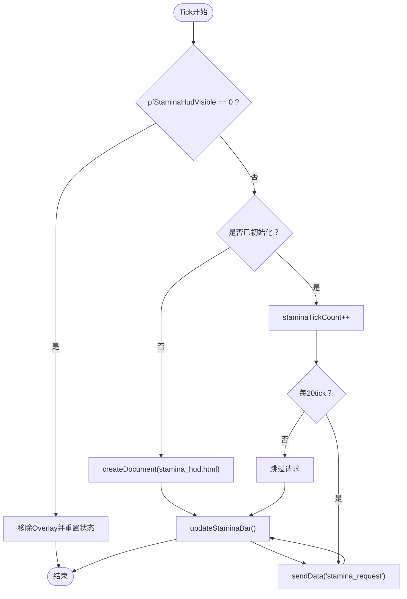
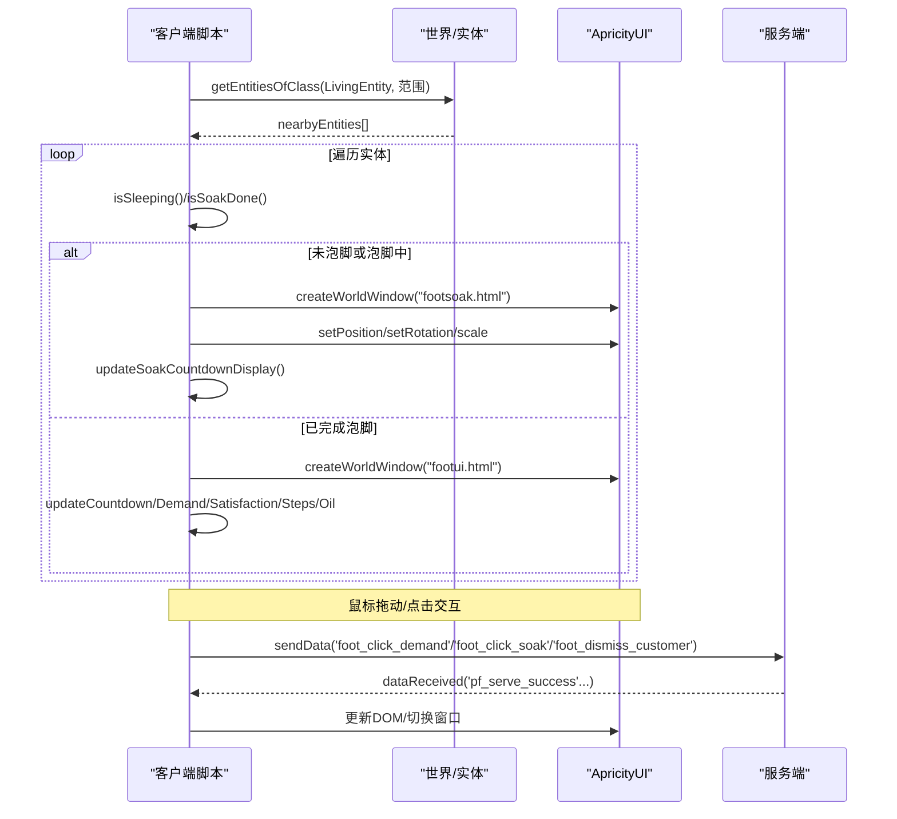
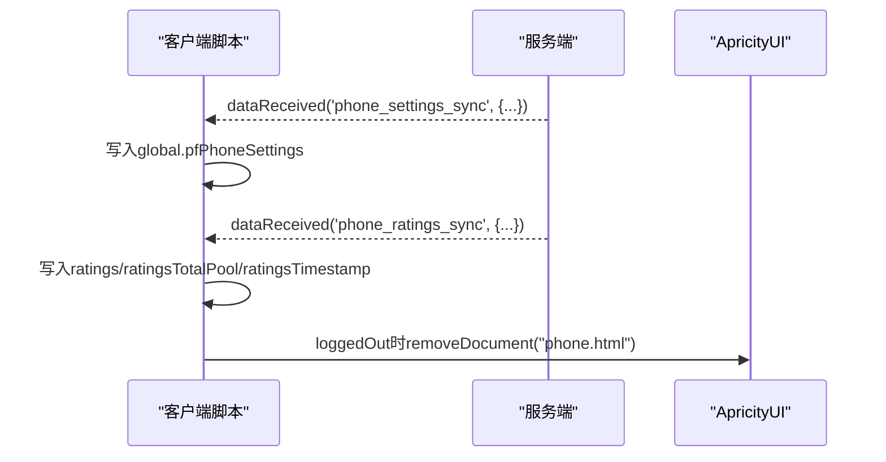
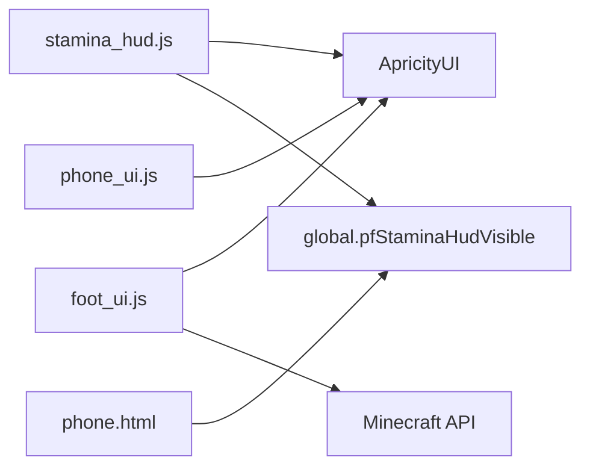

# HUD显示系统

<cite>
**本文引用的文件**   
- [stamina_hud.js](file://kubejs/client_scripts/ui/stamina_hud.js)
- [foot_ui.js](file://kubejs/client_scripts/ui/foot_ui.js)
- [phone_ui.js](file://kubejs/client_scripts/ui/phone_ui.js)
- [phone.html](file://apricity/kubejs/phone.html)
- [apricityui-ui.md](file://components/apricityui-ui.md)
</cite>

## 目录
1. [引言](#引言)
2. [项目结构](#项目结构)
3. [核心组件](#核心组件)
4. [架构总览](#架构总览)
5. [详细组件分析](#详细组件分析)
6. [依赖关系分析](#依赖关系分析)
7. [性能与内存优化](#性能与内存优化)
8. [故障排查指南](#故障排查指南)
9. [结论](#结论)

## 引言
本文件面向 Minecraft KubeJS + ApricityUI 的客户端 HUD 开发，聚焦三类界面：
- 体力 HUD：屏幕叠加层 Overlay，显示玩家体力条。
- 泡脚 UI：世界窗口 WorldWindow，跟随睡眠实体脚部位置，支持搓脚交互、倒计时、满意度等。
- 手机 UI：Screen 类型界面，由服务端打开，客户端负责设置与评价数据同步及登出清理。

文档将解释绘制顺序、位置计算、动态更新机制，以及与游戏内状态（NBT、网络事件、玩家视角）的同步方式，并提供性能优化、内存管理与用户体验设计建议。

## 项目结构
HUD 相关逻辑主要位于 KubeJS 客户端脚本与 ApricityUI HTML 资源中：
- 客户端脚本：
  - stamina_hud.js：体力 HUD 生命周期、Overlay 创建与刷新、与服务端的数据同步。
  - foot_ui.js：世界窗口管理、实体检测、位置计算、交互事件、状态更新。
  - phone_ui.js：手机 Screen 的设置与评价数据接收、登出清理。
- HTML 资源：
  - stamina_hud.html：体力条样式与文本渲染。
  - footsoak.html / footui.html：泡脚与睡眠实体的世界窗口界面。
  - phone.html：手机界面，包含体力 HUD 开关等逻辑。

```mermaid
graph TB
subgraph "KubeJS 客户端脚本"
ST["stamina_hud.js"]
FU["foot_ui.js"]
PU["phone_ui.js"]
end
subgraph "ApricityUI 资源"
SH["stamina_hud.html"]
FS["footsoak.html"]
FF["footui.html"]
PH["phone.html"]
end
subgraph "Minecraft 运行时"
PL["玩家/实体"]
LW["世界/层级"]
AUI["ApricityUI 引擎"]
end
ST --> |createDocument/removeDocument| SH
FU --> |createWorldWindow/removeWindow| FS
FU --> |createWorldWindow/removeWindow| FF
PU --> |openScreen(服务端)| PH
ST --> |NetworkEvents.dataReceived| AUI
FU --> |NetworkEvents.dataReceived| AUI
PU --> |NetworkEvents.dataReceived| AUI
FU --> |读取实体NBT/位置| PL
FU --> |扫描附近实体| LW
```

图表来源
- [stamina_hud.js:7-101](file://kubejs/client_scripts/ui/stamina_hud.js#L7-L101)
- [foot_ui.js:13-16](file://kubejs/client_scripts/ui/foot_ui.js#L13-L16)
- [foot_ui.js:152-166](file://kubejs/client_scripts/ui/foot_ui.js#L152-L166)
- [phone_ui.js:7-55](file://kubejs/client_scripts/ui/phone_ui.js#L7-L55)
- [phone.html:923-966](file://apricity/kubejs/phone.html#L923-L966)

章节来源
- [stamina_hud.js:1-152](file://kubejs/client_scripts/ui/stamina_hud.js#L1-L152)
- [foot_ui.js:1-1020](file://kubejs/client_scripts/ui/foot_ui.js#L1-L1020)
- [phone_ui.js:1-56](file://kubejs/client_scripts/ui/phone_ui.js#L1-L56)
- [phone.html:923-966](file://apricity/kubejs/phone.html#L923-L966)

## 核心组件
- 体力 HUD（stamina_hud.js）
  - 使用 ApricityUI.createDocument 创建屏幕叠加层。
  - 通过 NetworkEvents.dataReceived('stamina_sync') 接收服务端推送的体力值。
  - 每 20 tick 向服务端发送 'stamina_request' 请求最新体力。
  - 根据 global.pfStaminaHudVisible 控制显示/隐藏。
- 泡脚 UI（foot_ui.js）
  - 使用 ApricityUI.createWorldWindow 为每个睡眠实体创建世界窗口。
  - 根据床 yaw 计算脚部位置，并设置窗口旋转、缩放与提升高度。
  - 监听鼠标移动累计拖动距离，达到阈值触发搓脚；支持送客按钮。
  - 维护“睡眠窗口”和“泡脚窗口”两套 Map，并在两者之间安全切换。
- 手机 UI（phone_ui.js）
  - 接收服务端推送的手机设置与评价数据，写入全局对象。
  - 登出时清理 phone.html 文档，避免残留。

章节来源
- [stamina_hud.js:22-73](file://kubejs/client_scripts/ui/stamina_hud.js#L22-L73)
- [foot_ui.js:87-166](file://kubejs/client_scripts/ui/foot_ui.js#L87-L166)
- [phone_ui.js:12-55](file://kubejs/client_scripts/ui/phone_ui.js#L12-L55)

## 架构总览
HUD 系统采用“客户端脚本 + ApricityUI 渲染 + 服务端状态同步”的分层架构：
- 客户端脚本负责：
  - 生命周期管理（登录/登出、tick 循环）。
  - 渲染容器创建与销毁（Overlay 或 WorldWindow）。
  - 用户交互事件处理（鼠标移动、点击）。
  - 与服务端通信（sendData/dataReceived）。
- ApricityUI 提供：
  - createDocument：屏幕叠加层。
  - createWorldWindow：世界空间中的可定位窗口。
  - removeDocument/removeWindow：清理资源。
- 服务端职责（不在本仓库客户端代码范围内）：
  - 维护玩家体力、实体 NBT 状态。
  - 响应客户端请求并推送同步数据。



图表来源
- [stamina_hud.js:64-127](file://kubejs/client_scripts/ui/stamina_hud.js#L64-L127)
- [foot_ui.js:170-268](file://kubejs/client_scripts/ui/foot_ui.js#L170-L268)
- [foot_ui.js:331-395](file://kubejs/client_scripts/ui/foot_ui.js#L331-L395)
- [foot_ui.js:1000-1019](file://kubejs/client_scripts/ui/foot_ui.js#L1000-L1019)

## 详细组件分析

### 体力 HUD（stamina_hud.js）
- 关键职责
  - 创建/移除 Overlay。
  - 根据服务端推送更新进度条与文本。
  - 周期性请求体力值。
  - 支持通过全局变量隐藏/显示。
- 绘制顺序与可见性
  - 首次 tick 且可见时创建 Overlay，随后每 tick 调用 updateStaminaBar 刷新 DOM。
  - 当 global.pfStaminaHudVisible === 0 时移除 Overlay 并重置状态。
- 位置与分辨率兼容
  - 作为 Overlay，由 HTML/CSS 决定布局；脚本不直接计算像素坐标。
- 与游戏状态同步
  - 收到 'stamina_sync' 后更新本地 staminaValue 并刷新 UI。
  - 每 20 tick 主动请求最新体力，防止服务端状态变更未及时推送导致滞后。
- 错误处理
  - 所有 DOM 操作与网络调用均包裹 try/catch，避免异常中断 tick。
  - 对 setTextContent 与 innerText 做兼容尝试。



图表来源
- [stamina_hud.js:77-127](file://kubejs/client_scripts/ui/stamina_hud.js#L77-L127)

章节来源
- [stamina_hud.js:22-73](file://kubejs/client_scripts/ui/stamina_hud.js#L22-L73)
- [stamina_hud.js:77-127](file://kubejs/client_scripts/ui/stamina_hud.js#L77-L127)
- [stamina_hud.js:131-151](file://kubejs/client_scripts/ui/stamina_hud.js#L131-L151)

### 泡脚 UI（foot_ui.js）
- 关键职责
  - 扫描附近 LivingEntity，识别睡眠实体。
  - 根据床 yaw 计算脚部位置，创建/更新世界窗口。
  - 处理鼠标拖动累计距离触发搓脚、右键水桶触发泡脚、送客按钮。
  - 在“泡脚窗口”和“睡眠窗口”之间安全切换。
- 位置计算与视角适配
  - pfGetFootPosition 根据 bedX/Y/Z 与 yaw 计算脚部坐标。
  - liftWorldWindow 将窗口提升到脚上方固定高度。
  - setRotation 根据 bedYaw 调整窗口朝向。
  - window.setScale 统一缩放比例。
- 动态更新机制
  - 每 tick 检查实体存活与距离，超出 MAX_DISTANCE 则移除窗口。
  - 根据 NBT 字段（pfPhase/pfSoakDone/pfIsSoaking/pfSoakTimeLeft 等）更新倒计时、满意度、需求清单、步骤、抹油状态。
- 交互流程
  - 鼠标在脚图移动：累计拖动距离，达到 DRAG_THRESHOLD 触发 'foot_click_demand'。
  - 右键水桶区域：触发 'foot_click_soak'。
  - 点击送客：触发 'foot_dismiss_customer'。
- 安全切换与延迟移除
  - safeRemoveWorldWindow 将窗口加入延迟队列，2 tick 后真正移除，避免框架 mousePosition NPE。
  - scheduleWindowTransition 确保旧窗口移除后再创建新窗口，避免重叠与歧义。



图表来源
- [foot_ui.js:791-951](file://kubejs/client_scripts/ui/foot_ui.js#L791-L951)
- [foot_ui.js:170-268](file://kubejs/client_scripts/ui/foot_ui.js#L170-L268)
- [foot_ui.js:331-395](file://kubejs/client_scripts/ui/foot_ui.js#L331-L395)
- [foot_ui.js:1000-1019](file://kubejs/client_scripts/ui/foot_ui.js#L1000-L1019)

章节来源
- [foot_ui.js:87-166](file://kubejs/client_scripts/ui/foot_ui.js#L87-L166)
- [foot_ui.js:170-268](file://kubejs/client_scripts/ui/foot_ui.js#L170-L268)
- [foot_ui.js:331-395](file://kubejs/client_scripts/ui/foot_ui.js#L331-L395)
- [foot_ui.js:791-951](file://kubejs/client_scripts/ui/foot_ui.js#L791-L951)
- [foot_ui.js:956-997](file://kubejs/client_scripts/ui/foot_ui.js#L956-L997)
- [foot_ui.js:1000-1019](file://kubejs/client_scripts/ui/foot_ui.js#L1000-L1019)

### 手机 UI（phone_ui.js）
- 关键职责
  - 接收服务端推送的手机设置与评价数据，写入 global.pfPhoneSettings。
  - 登出时清理 phone.html 文档，避免残留。
- 与游戏状态同步
  - 'phone_settings_sync'：更新 pfSkipSoak、pfOneClickSatisfy 等设置。
  - 'phone_ratings_sync'：更新评价列表、总池大小与时间戳。
- 与体力 HUD 联动
  - phone.html 内部通过 global.pfStaminaHudVisible 控制体力 HUD 显示/隐藏，并调用 ApricityUI.removeDocument 清理 Overlay。



图表来源
- [phone_ui.js:12-55](file://kubejs/client_scripts/ui/phone_ui.js#L12-L55)
- [phone.html:923-966](file://apricity/kubejs/phone.html#L923-L966)

章节来源
- [phone_ui.js:12-55](file://kubejs/client_scripts/ui/phone_ui.js#L12-L55)
- [phone.html:923-966](file://apricity/kubejs/phone.html#L923-L966)

## 依赖关系分析
- 外部依赖
  - ApricityUI：createDocument/createWorldWindow/removeDocument/removeWindow。
  - KubeJS 事件：ClientEvents.tick/loggedIn/loggedOut、NetworkEvents.dataReceived。
  - Minecraft API：player.position()/getMainHandItem()、level.getEntitiesOfClass()、Vec3。
- 耦合与内聚
  - stamina_hud.js 与 phone.html 通过 global.pfStaminaHudVisible 松耦合联动。
  - foot_ui.js 集中管理世界窗口与实体状态，内聚度高。
  - phone_ui.js 仅负责数据同步与清理，职责单一。
- 潜在循环依赖
  - 无直接循环导入；通过全局变量与事件解耦。



图表来源
- [stamina_hud.js:7-101](file://kubejs/client_scripts/ui/stamina_hud.js#L7-L101)
- [foot_ui.js:13-16](file://kubejs/client_scripts/ui/foot_ui.js#L13-L16)
- [phone_ui.js:7-55](file://kubejs/client_scripts/ui/phone_ui.js#L7-L55)
- [phone.html:923-966](file://apricity/kubejs/phone.html#L923-L966)

章节来源
- [stamina_hud.js:1-152](file://kubejs/client_scripts/ui/stamina_hud.js#L1-L152)
- [foot_ui.js:1-1020](file://kubejs/client_scripts/ui/foot_ui.js#L1-L1020)
- [phone_ui.js:1-56](file://kubejs/client_scripts/ui/phone_ui.js#L1-L56)
- [phone.html:923-966](file://apricity/kubejs/phone.html#L923-L966)

## 性能与内存优化
- 绘制频率控制
  - 体力 HUD 每 20 tick 请求一次服务端数据，避免高频网络开销。
  - 泡脚 UI 每 tick 扫描附近实体，但仅在状态变化时更新 DOM。
- 窗口生命周期管理
  - 使用延迟移除队列 safeRemoveWorldWindow，避免框架内部 NPE。
  - scheduleWindowTransition 确保旧窗口移除后再创建新窗口，减少重叠与歧义。
- DOM 操作优化
  - 仅在必要时更新元素属性与样式，避免频繁重排。
  - 对 setTextContent/innerText 做兼容尝试，降低异常概率。
- 内存清理
  - loggedIn/loggedOut 事件中清理文档与 Map，防止热重载或重登残留。
  - 超出 MAX_DISTANCE 的窗口及时移除，减少渲染负担。
- 用户体验设计原则
  - 进度条颜色随体力阶段变化，增强可读性。
  - 泡脚 UI 提供明确的交互提示（拖动阈值、右键水桶、送客按钮）。
  - 手机 UI 提供体力 HUD 开关，允许玩家自定义显示。

[本节为通用指导，不直接分析具体文件]

## 故障排查指南
- 常见问题
  - UI 无变化：确认日志中出现当前脚本版本标识，检查 ApricityUI 文档加载日志。
  - createWorldWindow ambiguous：Rhino 重载选择失败，优先检查参数是否为 5 个 number。
  - HUD 数字滞后：确保使用官方 API 修改体力，并在自动恢复后调用同步函数。
- 调试建议
  - 查 UI 脚本错误：搜索 FOOT-UI、STAMINA-HUD、PHONE、createWorldWindow、ambiguous、Error in 'ClientEvents.tick'。
  - 查 AUI 文档加载：搜索 footsoak、phone.html、stamina_hud、AUI Document。
- 参考文档
  - 体力 HUD 同步说明与调试建议见 apricityui-ui.md。

章节来源
- [apricityui-ui.md:72-89](file://components/apricityui-ui.md#L72-L89)

## 结论
该 HUD 系统通过 KubeJS 客户端脚本与 ApricityUI 引擎协作，实现了体力 HUD、泡脚 UI 与手机 UI 的稳定运行。其核心在于：
- 清晰的职责划分：体力 HUD 专注屏幕叠加层，泡脚 UI 专注世界窗口与交互，手机 UI 专注设置与评价数据。
- 稳健的生命周期管理：登录/登出清理、延迟移除、窗口安全切换。
- 高效的状态同步：周期性请求与事件驱动更新相结合，兼顾实时性与性能。
在实际开发中，应遵循上述模式，结合性能优化与用户体验设计原则，持续迭代完善 HUD 功能。