# UI资源

<cite>
**本文档引用的文件**
- [footui.html](file://apricity/kubejs/footui.html)
- [phone.html](file://apricity/kubejs/phone.html)
- [stamina_hud.html](file://apricity/kubejs/stamina_hud.html)
- [footsoak.html](file://apricity/kubejs/footsoak.html)
- [footui2.html](file://apricity/kubejs/footui2.html)
- [foot_ui.js](file://kubejs/client_scripts/ui/foot_ui.js)
- [phone_ui.js](file://kubejs/client_scripts/ui/phone_ui.js)
- [stamina_hud.js](file://kubejs/client_scripts/ui/stamina_hud.js)
- [alice.json](file://kubejs/assets/kubejs/geo/alice.json)
</cite>

## 目录
1. [简介](#简介)
2. [项目结构](#项目结构)
3. [核心组件](#核心组件)
4. [架构概览](#架构概览)
5. [详细组件分析](#详细组件分析)
6. [依赖关系分析](#依赖关系分析)
7. [性能考虑](#性能考虑)
8. [故障排除指南](#故障排除指南)
9. [结论](#结论)

## 简介

本项目展示了Minecraft客户端UI资源系统的完整实现，基于ApriCity UI框架构建。系统包含多种UI元素类型，包括3D界面、屏幕界面、HUD显示和交互式组件。该系统通过KubeJS脚本引擎实现，支持动态数据绑定、事件处理和实时更新。

主要特性：
- **3D界面系统**：基于WorldWindow技术创建的三维UI界面
- **屏幕界面**：基于ApriCity UI框架的屏幕级UI
- **HUD显示**：游戏内头部显示器，显示玩家状态信息
- **交互式组件**：支持鼠标事件、拖拽操作和动画效果
- **数据同步**：通过网络事件实现客户端与服务器的数据同步

## 项目结构

项目采用模块化组织方式，按照功能和用途进行分类：

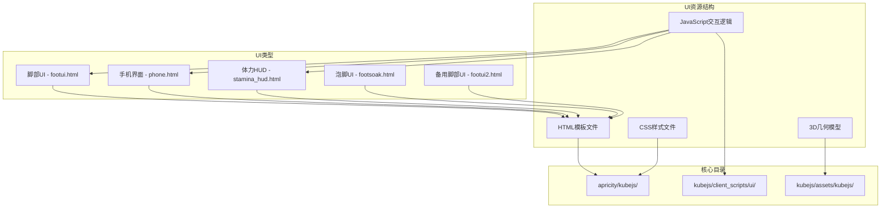

**图表来源**
- [footui.html:1-356](file://apricity/kubejs/footui.html#L1-L356)
- [phone.html:1-800](file://apricity/kubejs/phone.html#L1-L800)
- [stamina_hud.html:1-86](file://apricity/kubejs/stamina_hud.html#L1-L86)

**章节来源**
- [foot_ui.js:1-1026](file://kubejs/client_scripts/ui/foot_ui.js#L1-L1026)
- [phone_ui.js:1-56](file://kubejs/client_scripts/ui/phone_ui.js#L1-L56)
- [stamina_hud.js:1-101](file://kubejs/client_scripts/ui/stamina_hud.js#L1-L101)

## 核心组件

### ApriCity UI框架

ApriCity UI框架提供了强大的UI渲染和管理能力，支持以下核心功能：

- **WorldWindow系统**：创建三维空间中的UI界面
- **Screen系统**：创建屏幕级别的UI界面
- **Overlay系统**：创建覆盖在游戏画面之上的HUD组件
- **文档管理**：统一管理HTML文档的生命周期

### UI组件类型

系统包含四种主要的UI组件类型：

1. **3D界面组件**：基于WorldWindow技术，可以在三维空间中定位和显示UI
2. **屏幕界面组件**：基于ApriCity UI框架，提供完整的屏幕级UI体验
3. **HUD组件**：轻量级的头部显示器，显示实时游戏状态
4. **交互式组件**：支持用户交互的动态UI元素

**章节来源**
- [foot_ui.js:13-16](file://kubejs/client_scripts/ui/foot_ui.js#L13-L16)
- [phone_ui.js:7-7](file://kubejs/client_scripts/ui/phone_ui.js#L7-L7)

## 架构概览

系统采用分层架构设计，确保各个组件之间的松耦合和高内聚：

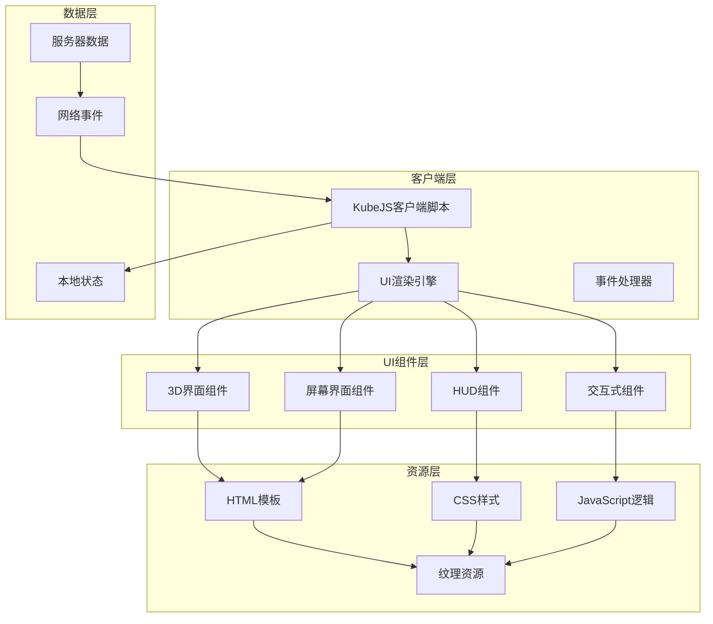

**图表来源**
- [foot_ui.js:1-1026](file://kubejs/client_scripts/ui/foot_ui.js#L1-L1026)
- [phone_ui.js:1-56](file://kubejs/client_scripts/ui/phone_ui.js#L1-L56)
- [stamina_hud.js:1-101](file://kubejs/client_scripts/ui/stamina_hud.js#L1-L101)

### 数据流架构

系统采用双向数据流架构，确保UI状态与游戏状态保持同步：

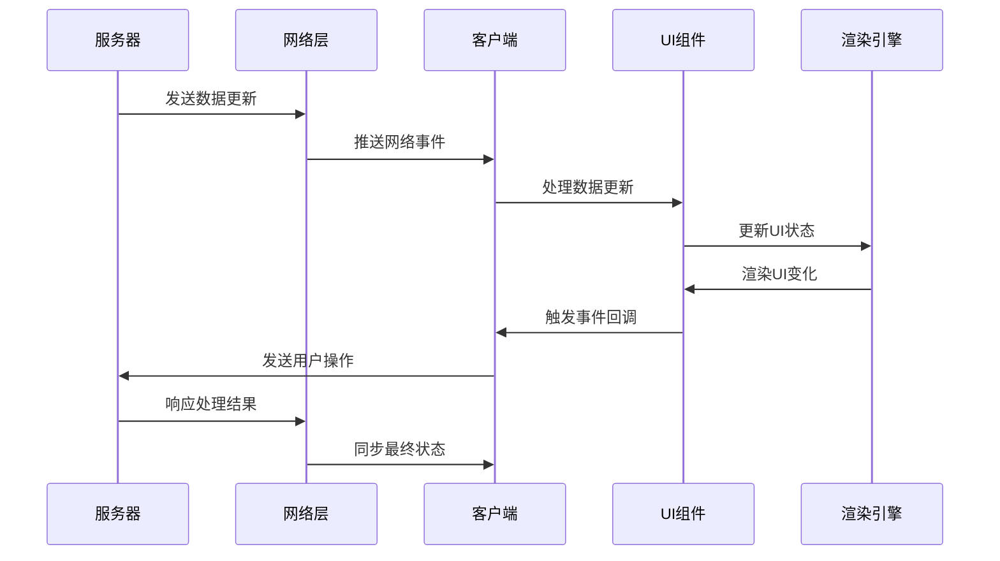

**图表来源**
- [foot_ui.js:782-925](file://kubejs/client_scripts/ui/foot_ui.js#L782-L925)
- [phone_ui.js:13-47](file://kubejs/client_scripts/ui/phone_ui.js#L13-L47)
- [stamina_hud.js:53-86](file://kubejs/client_scripts/ui/stamina_hud.js#L53-L86)

## 详细组件分析

### 脚部UI系统

脚部UI系统是最复杂的UI组件，提供了完整的按摩服务体验：

#### HTML结构设计

脚部UI采用分层设计，包含需求清单、满意度进度条和交互区域：

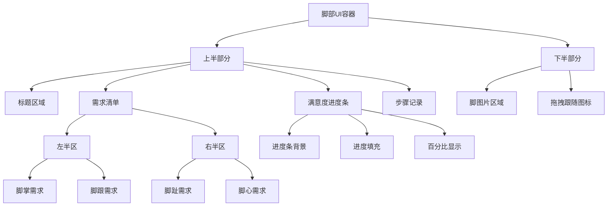

**图表来源**
- [footui.html:1-63](file://apricity/kubejs/footui.html#L1-L63)

#### JavaScript交互逻辑

脚部UI系统实现了复杂的状态管理和事件处理机制：

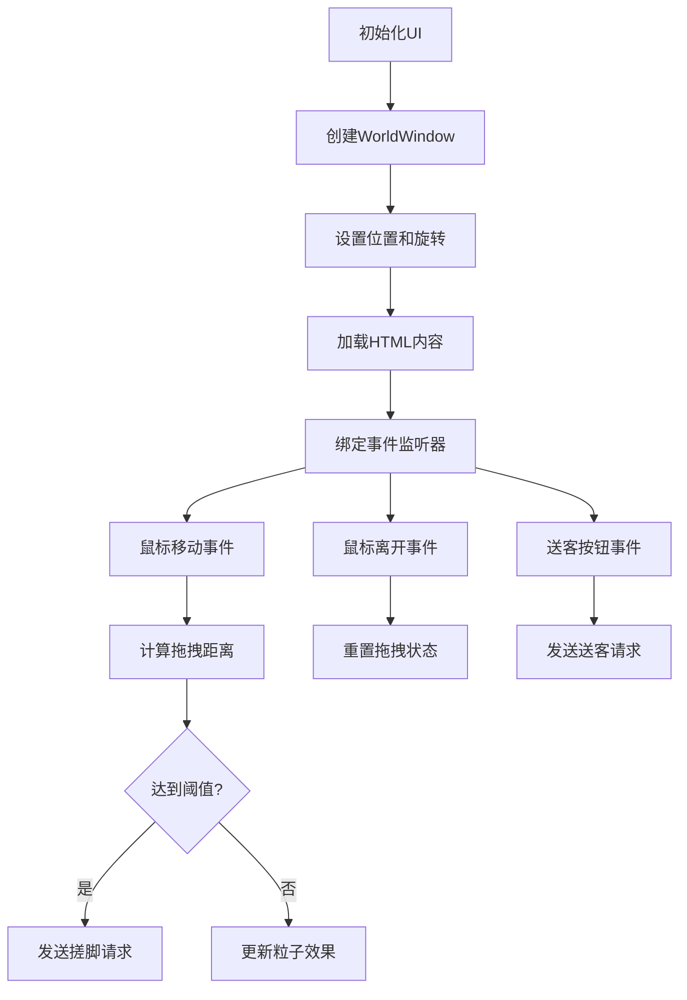

**图表来源**
- [foot_ui.js:133-299](file://kubejs/client_scripts/ui/foot_ui.js#L133-L299)

#### 样式系统设计

CSS样式系统采用了现代化的设计理念，支持响应式布局和动画效果：

| 样式类别 | 功能描述 | 实现特点 |
|---------|----------|----------|
| 容器样式 | UI整体布局 | 使用Flexbox实现响应式布局 |
| 进度条样式 | 满意度显示 | 支持渐变色和动画过渡 |
| 交互样式 | 用户反馈 | 提供悬停和激活状态效果 |
| 动画样式 | 粒子效果 | 支持多种动画参数和生命周期 |

**章节来源**
- [footui.html:64-353](file://apricity/kubejs/footui.html#L64-L353)
- [foot_ui.js:1-1026](file://kubejs/client_scripts/ui/foot_ui.js#L1-L1026)

### 手机界面系统

手机界面系统提供了完整的移动设备体验，包含多个功能模块：

#### 主要功能模块

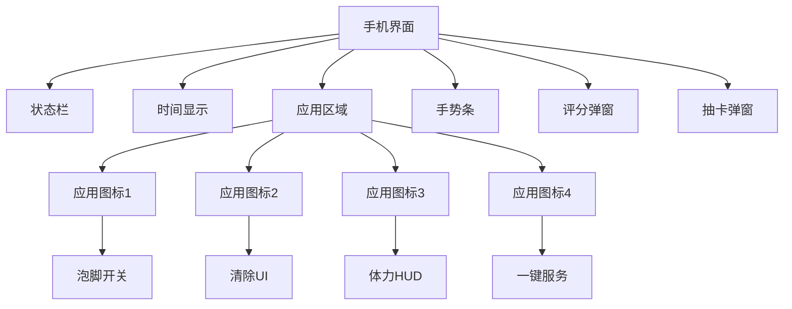

**图表来源**
- [phone.html:102-175](file://apricity/kubejs/phone.html#L102-L175)

#### JavaScript事件处理

手机界面实现了复杂的时间同步和状态管理功能：

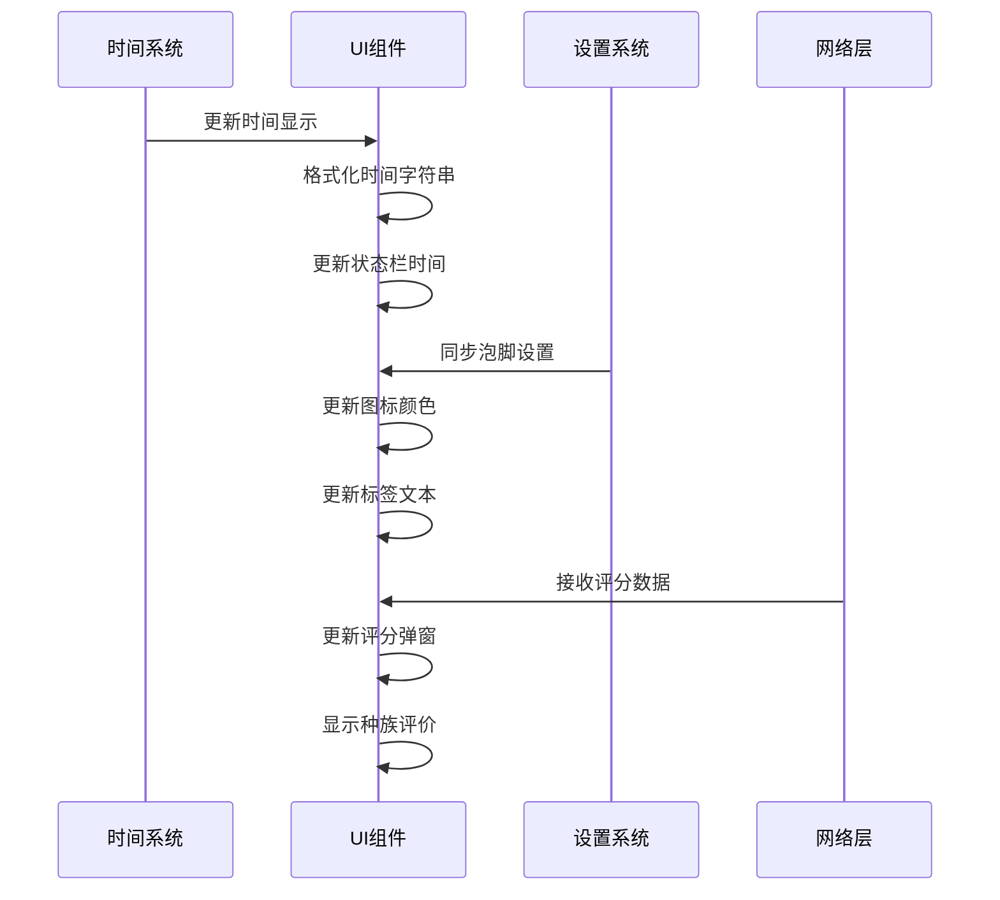

**图表来源**
- [phone.html:744-768](file://apricity/kubejs/phone.html#L744-L768)
- [phone_ui.js:13-47](file://kubejs/client_scripts/ui/phone_ui.js#L13-L47)

**章节来源**
- [phone.html:1-1169](file://apricity/kubejs/phone.html#L1-L1169)
- [phone_ui.js:1-56](file://kubejs/client_scripts/ui/phone_ui.js#L1-L56)

### 体力HUD系统

体力HUD系统是一个轻量级的头部显示器，专门用于显示玩家体力状态：

#### HUD设计特点

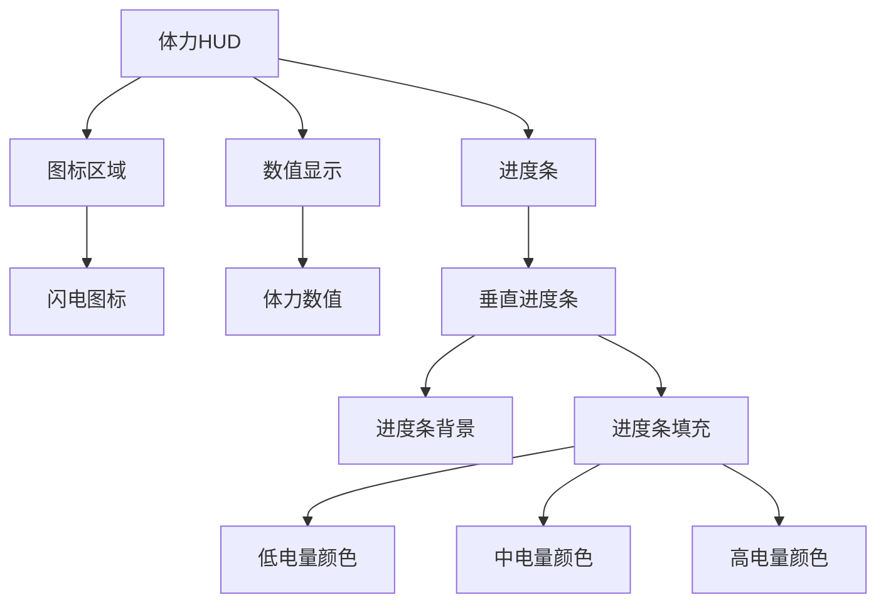

**图表来源**
- [stamina_hud.html:21-85](file://apricity/kubejs/stamina_hud.html#L21-L85)

#### 数据同步机制

体力HUD系统实现了高效的客户端-服务器数据同步：

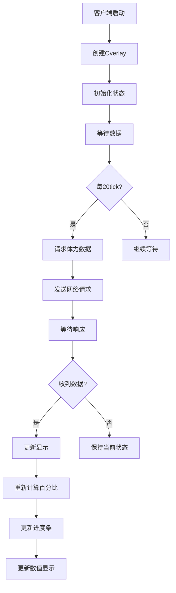

**图表来源**
- [stamina_hud.js:53-86](file://kubejs/client_scripts/ui/stamina_hud.js#L53-L86)

**章节来源**
- [stamina_hud.html:1-86](file://apricity/kubejs/stamina_hud.html#L1-L86)
- [stamina_hud.js:1-101](file://kubejs/client_scripts/ui/stamina_hud.js#L1-L101)

### 备用脚部UI系统

备用脚部UI系统提供了简化的界面版本，具有不同的布局和交互方式：

#### 界面布局差异

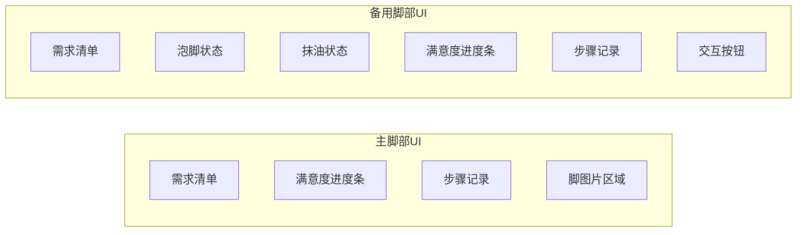

**图表来源**
- [footui2.html:1-364](file://apricity/kubejs/footui2.html#L1-L364)

#### 交互方式对比

| 功能特性 | 主脚部UI | 备用脚部UI |
|----------|----------|------------|
| 需求清单显示 | 4部位独立显示 | 4部位独立显示 |
| 泡脚状态 | 通过NBT数据 | 通过状态标记 |
| 抹油状态 | 实时显示剩余量 | 简单状态指示 |
| 满意度显示 | 进度条+百分比 | 进度条+颜色变化 |
| 交互按钮 | 脚图片区域 | 独立按钮区域 |

**章节来源**
- [footui2.html:1-364](file://apricity/kubejs/footui2.html#L1-L364)

## 依赖关系分析

系统中的组件之间存在复杂的依赖关系，需要仔细分析以确保正确集成：

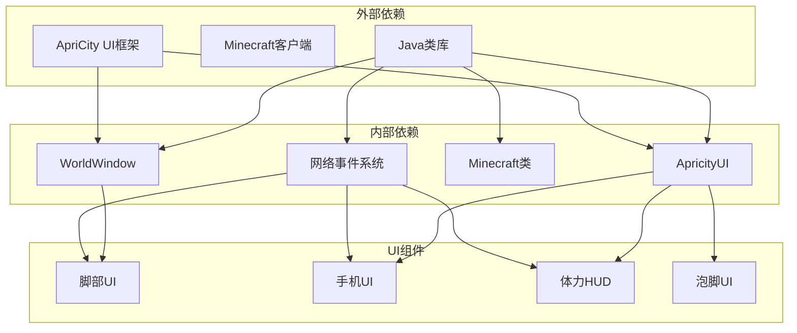

**图表来源**
- [foot_ui.js:13-16](file://kubejs/client_scripts/ui/foot_ui.js#L13-L16)
- [phone_ui.js:7-7](file://kubejs/client_scripts/ui/phone_ui.js#L7-L7)
- [stamina_hud.js:7-7](file://kubejs/client_scripts/ui/stamina_hud.js#L7-L7)

### 关键依赖关系

1. **WorldWindow依赖**：脚部UI系统依赖WorldWindow类来创建三维UI界面
2. **ApriCityUI依赖**：所有屏幕级UI都依赖ApriCityUI框架进行渲染
3. **网络事件依赖**：所有UI组件都依赖网络事件系统进行数据同步
4. **Minecraft客户端依赖**：UI组件需要访问Minecraft客户端API来获取游戏状态

**章节来源**
- [foot_ui.js:1-1026](file://kubejs/client_scripts/ui/foot_ui.js#L1-L1026)
- [phone_ui.js:1-56](file://kubejs/client_scripts/ui/phone_ui.js#L1-L56)
- [stamina_hud.js:1-101](file://kubejs/client_scripts/ui/stamina_hud.js#L1-L101)

## 性能考虑

系统在设计时充分考虑了性能优化，采用多种策略确保流畅的用户体验：

### 内存管理

- **对象池模式**：使用Map结构管理UI窗口实例，避免内存泄漏
- **延迟初始化**：UI组件按需创建，减少启动时的内存占用
- **自动清理**：离开世界时自动清理所有UI资源

### 渲染优化

- **批量更新**：使用requestAnimationFrame进行批量UI更新
- **条件渲染**：只有在数据变化时才更新UI状态
- **层级优化**：合理设置z-index避免不必要的重绘

### 网络优化

- **数据压缩**：网络传输的数据经过压缩处理
- **批量同步**：定期批量同步UI状态，减少网络请求频率
- **错误处理**：完善的网络异常处理机制

## 故障排除指南

### 常见问题及解决方案

#### UI不显示问题

**问题症状**：UI组件无法正常显示
**可能原因**：
- WorldWindow初始化失败
- HTML文件路径错误
- 权限不足

**解决步骤**：
1. 检查WorldWindow类是否正确加载
2. 验证HTML文件路径是否正确
3. 确认UI权限设置

#### 数据同步问题

**问题症状**：UI状态与服务器状态不一致
**可能原因**：
- 网络事件处理异常
- 数据解析错误
- 同步时机不当

**解决步骤**：
1. 检查NetworkEvents事件监听器
2. 验证数据格式和字段名称
3. 确认同步逻辑的时序

#### 性能问题

**问题症状**：UI响应缓慢或卡顿
**可能原因**：
- 频繁的DOM操作
- 未优化的事件处理
- 内存泄漏

**解决步骤**：
1. 减少不必要的DOM更新
2. 使用事件委托优化事件处理
3. 检查内存使用情况

**章节来源**
- [foot_ui.js:927-967](file://kubejs/client_scripts/ui/foot_ui.js#L927-L967)
- [phone_ui.js:12-23](file://kubejs/client_scripts/ui/phone_ui.js#L12-L23)
- [stamina_hud.js:46-48](file://kubejs/client_scripts/ui/stamina_hud.js#L46-L48)

## 结论

本UI资源系统展示了Minecraft客户端UI开发的最佳实践，通过ApriCity UI框架实现了丰富的交互体验。系统的主要优势包括：

1. **模块化设计**：清晰的功能分离和组件化架构
2. **高性能实现**：优化的渲染和数据同步机制
3. **扩展性强**：易于添加新的UI组件和功能
4. **维护友好**：良好的代码结构和文档支持

对于模组开发者而言，本系统提供了完整的开发参考，包括HTML模板设计、CSS样式规范、JavaScript交互逻辑和性能优化策略。通过遵循这些设计原则，开发者可以创建高质量的Minecraft UI组件。

建议在实际开发中重点关注：
- UI组件的生命周期管理
- 数据同步的可靠性和时效性
- 用户交互的流畅性和直观性
- 性能监控和优化策略