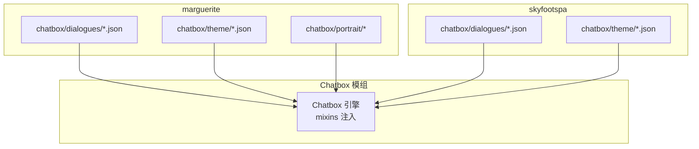
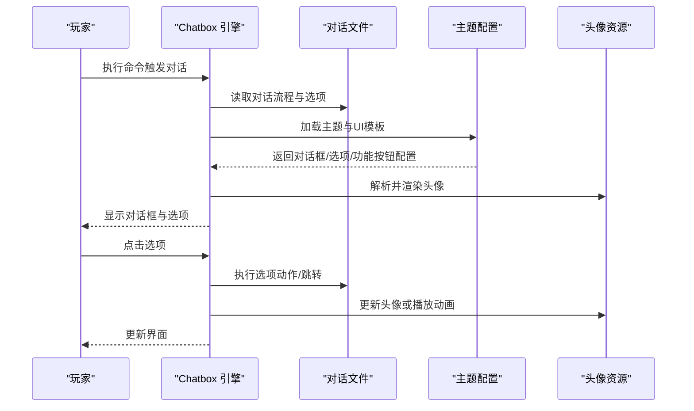
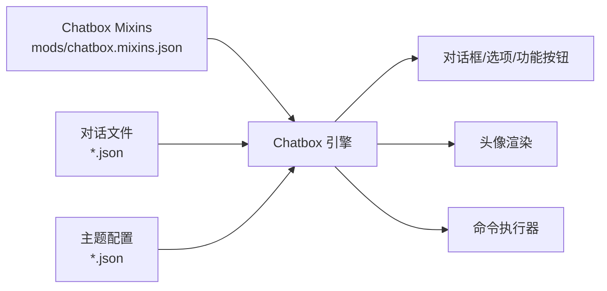

# 聊天框资源

<cite>
**本文引用的文件**   
- [mods/chatbox.mixins.json](file://mods/chatbox.mixins.json)
- [kubejs/data/marguerite/chatbox/dialogues/intro.json](file://kubejs/data/marguerite/chatbox/dialogues/intro.json)
- [kubejs/data/marguerite/chatbox/dialogues/test1.json](file://kubejs/data/marguerite/chatbox/dialogues/test1.json)
- [kubejs/data/marguerite/chatbox/dialogues/intro_gal.json](file://kubejs/data/marguerite/chatbox/dialogues/intro_gal.json)
- [kubejs/data/marguerite/chatbox/theme/default.json](file://kubejs/data/marguerite/chatbox/theme/default.json)
- [kubejs/data/skyfootspa/chatbox/dialogues/intro.json](file://kubejs/data/skyfootspa/chatbox/dialogues/intro.json)
- [kubejs/data/skyfootspa/chatbox/dialogues/intro_gal.json](file://kubejs/data/skyfootspa/chatbox/dialogues/intro_gal.json)
- [kubejs/data/skyfootspa/chatbox/theme/default.json](file://kubejs/data/skyfootspa/chatbox/theme/default.json)
</cite>

## 目录
1. [简介](#简介)
2. [项目结构](#项目结构)
3. [核心组件](#核心组件)
4. [架构总览](#架构总览)
5. [详细组件分析](#详细组件分析)
6. [依赖关系分析](#依赖关系分析)
7. [性能与可维护性](#性能与可维护性)
8. [故障排查指南](#故障排查指南)
9. [结论](#结论)
10. [附录：开发规范与多语言/主题指南](#附录开发规范与多语言主题指南)

## 简介
本文件面向“聊天框资源系统”，系统性说明在 Minecraft（KubeJS + Chatbox）环境下，对话文件（dialogues）、头像资源（portrait）与主题配置（theme）的组织方式、数据结构和交互流程。文档重点覆盖以下方面：
- 对话触发机制与选项跳转
- 头像显示逻辑与渲染事件
- 主题切换与功能按钮配置
- 不同角色（Marguerite、SkyFootspa）的资源差异与配置方法
- 多语言支持与自定义主题创建指南

## 项目结构
聊天框资源以“命名空间:资源路径”的形式组织，主要位于 KubeJS data 包下。每个角色（如 marguerite、skyfootspa）拥有独立的 chatbox 目录，包含 dialogues 与 theme 子目录；部分角色还包含 portrait 资源（纹理或实体头）。

图表来源
- [mods/chatbox.mixins.json:1-24](file://mods/chatbox.mixins.json#L1-L24)
- [kubejs/data/marguerite/chatbox/dialogues/intro.json:1-136](file://kubejs/data/marguerite/chatbox/dialogues/intro.json#L1-L136)
- [kubejs/data/marguerite/chatbox/theme/default.json:1-76](file://kubejs/data/marguerite/chatbox/theme/default.json#L1-L76)
- [kubejs/data/skyfootspa/chatbox/dialogues/intro.json:1-136](file://kubejs/data/skyfootspa/chatbox/dialogues/intro.json#L1-L136)
- [kubejs/data/skyfootspa/chatbox/theme/default.json:1-76](file://kubejs/data/skyfootspa/chatbox/theme/default.json#L1-L76)

章节来源
- [mods/chatbox.mixins.json:1-24](file://mods/chatbox.mixins.json#L1-L24)

## 核心组件
- 对话文件（dialogues）：定义对话流程、文本、选项、音效、头像等。
- 主题配置（theme）：定义对话框外观、选项样式、功能按钮、动画与头像模板。
- 头像资源（portrait）：通过主题中的 portrait 节点引用，支持纹理、玩家头、物品、实体等多种类型。

章节来源
- [kubejs/data/marguerite/chatbox/dialogues/intro.json:1-136](file://kubejs/data/marguerite/chatbox/dialogues/intro.json#L1-L136)
- [kubejs/data/marguerite/chatbox/theme/default.json:1-76](file://kubejs/data/marguerite/chatbox/theme/default.json#L1-L76)
- [kubejs/data/skyfootspa/chatbox/dialogues/intro.json:1-136](file://kubejs/data/skyfootspa/chatbox/dialogues/intro.json#L1-L136)
- [kubejs/data/skyfootspa/chatbox/theme/default.json:1-76](file://kubejs/data/skyfootspa/chatbox/theme/default.json#L1-L76)

## 架构总览
聊天框资源由 Chatbox 引擎加载并渲染。对话文件声明主题与对话序列，主题文件提供 UI 与头像模板，引擎根据当前会话状态驱动渲染与交互。

图表来源
- [mods/chatbox.mixins.json:1-24](file://mods/chatbox.mixins.json#L1-L24)
- [kubejs/data/marguerite/chatbox/dialogues/intro.json:1-136](file://kubejs/data/marguerite/chatbox/dialogues/intro.json#L1-L136)
- [kubejs/data/marguerite/chatbox/theme/default.json:1-76](file://kubejs/data/marguerite/chatbox/theme/default.json#L1-L76)

## 详细组件分析

### 对话文件（dialogues）
- 顶层字段
  - theme：指定使用的主题标识，例如 test:default、marguerite:alice_margatroid。
  - isPause：是否暂停游戏进行对话。
  - dialogues：包含多个对话场景（如 start），每个场景为步骤数组。
- 对话步骤
  - dialogBox：name 与 text 支持本地化键或直接文本。
  - portrait：字符串数组或对象数组，用于叠加多个头像层。
  - clearOldPortrait：是否清除旧头像层。
  - options：选项数组，支持 next、click、unlockCommand、isLock、tooltip 等。
  - sound：可选的音效。
- 选项动作
  - click.type=command：执行命令，常用于 chatbox skip 或 give 等。
  - unlockCommand：条件解锁选项，基于 NBT 或实体查询。

示例参考
- [kubejs/data/marguerite/chatbox/dialogues/intro.json:1-136](file://kubejs/data/marguerite/chatbox/dialogues/intro.json#L1-L136)
- [kubejs/data/marguerite/chatbox/dialogues/test1.json:1-136](file://kubejs/data/marguerite/chatbox/dialogues/test1.json#L1-L136)
- [kubejs/data/skyfootspa/chatbox/dialogues/intro.json:1-136](file://kubejs/data/skyfootspa/chatbox/dialogues/intro.json#L1-L136)

章节来源
- [kubejs/data/marguerite/chatbox/dialogues/intro.json:1-136](file://kubejs/data/marguerite/chatbox/dialogues/intro.json#L1-L136)
- [kubejs/data/marguerite/chatbox/dialogues/test1.json:1-136](file://kubejs/data/marguerite/chatbox/dialogues/test1.json#L1-L136)
- [kubejs/data/skyfootspa/chatbox/dialogues/intro.json:1-136](file://kubejs/data/skyfootspa/chatbox/dialogues/intro.json#L1-L136)

### 主题配置（theme）
- portrait：头像模板集合，支持多种类型：
  - texture：贴图头像，需指定 texture 路径与对齐、尺寸。
  - player_head：玩家头，texture 可为 @s 引用当前玩家。
  - item：物品图标，支持 hoverTexture、itemCount。
  - entity：实体模型，支持 stareAt 注视点。
- option：选项按钮样式，含选中/锁定纹理、位置与对齐。
- dialogBox：对话框背景、宽高、文字偏移、渲染事件（如结束时显示选项）。
- functionalButton：功能按钮列表（日志、快进、自动播放等）。
- customAnimation：自定义动画片段（淡入、滑入、弹跳等）。

示例参考
- [kubejs/data/marguerite/chatbox/theme/default.json:1-76](file://kubejs/data/marguerite/chatbox/theme/default.json#L1-L76)
- [kubejs/data/skyfootspa/chatbox/theme/default.json:1-76](file://kubejs/data/skyfootspa/chatbox/theme/default.json#L1-L76)

章节来源
- [kubejs/data/marguerite/chatbox/theme/default.json:1-76](file://kubejs/data/marguerite/chatbox/theme/default.json#L1-L76)
- [kubejs/data/skyfootspa/chatbox/theme/default.json:1-76](file://kubejs/data/skyfootspa/chatbox/theme/default.json#L1-L76)

### 头像资源（portrait）与渲染事件
- 在对话步骤中，portrait 可声明为：
  - 字符串数组：直接引用主题中已定义的头像模板（如 ["authors"]）。
  - 对象数组：即时定义头像属性，支持 replace、renderEvents、attachment、customAnimation、loop 等。
- renderEvents：在头像渲染时触发的行为，如 play_animation、show、play_sound。
- attachment：为头像添加附加元素（如文本标签）。
- customAnimation：自定义关键帧动画（旋转、缩放、透明度变化等）。

示例参考
- [kubejs/data/marguerite/chatbox/dialogues/intro.json:82-105](file://kubejs/data/marguerite/chatbox/dialogues/intro.json#L82-L105)
- [kubejs/data/marguerite/chatbox/dialogues/intro_gal.json:88-107](file://kubejs/data/marguerite/chatbox/dialogues/intro_gal.json#L88-L107)
- [kubejs/data/skyfootspa/chatbox/dialogues/intro_gal.json:88-107](file://kubejs/data/skyfootspa/chatbox/dialogues/intro_gal.json#L88-L107)

章节来源
- [kubejs/data/marguerite/chatbox/dialogues/intro.json:82-105](file://kubejs/data/marguerite/chatbox/dialogues/intro.json#L82-L105)
- [kubejs/data/marguerite/chatbox/dialogues/intro_gal.json:88-107](file://kubejs/data/marguerite/chatbox/dialogues/intro_gal.json#L88-L107)
- [kubejs/data/skyfootspa/chatbox/dialogues/intro_gal.json:88-107](file://kubejs/data/skyfootspa/chatbox/dialogues/intro_gal.json#L88-L107)

### 对话触发机制与选项跳转
- 触发方式：通过命令调用 chatbox，常见用法包括：
  - chatbox skip <namespace>:<dialogue> <scene> [<step>]
  - chatbox command isScreen true/false
- 选项跳转：
  - next：跳转到指定步骤或 this（当前场景）。
  - click：执行命令，常与 skip 组合实现流程控制。
  - unlockCommand：条件解锁，结合 isLock 实现动态选项。

示例参考
- [kubejs/data/marguerite/chatbox/dialogues/intro.json:20-48](file://kubejs/data/marguerite/chatbox/dialogues/intro.json#L20-L48)
- [kubejs/data/marguerite/chatbox/dialogues/intro.json:64-80](file://kubejs/data/marguerite/chatbox/dialogues/intro.json#L64-L80)
- [kubejs/data/skyfootspa/chatbox/dialogues/intro.json:20-48](file://kubejs/data/skyfootspa/chatbox/dialogues/intro.json#L20-L48)

章节来源
- [kubejs/data/marguerite/chatbox/dialogues/intro.json:20-48](file://kubejs/data/marguerite/chatbox/dialogues/intro.json#L20-L48)
- [kubejs/data/marguerite/chatbox/dialogues/intro.json:64-80](file://kubejs/data/marguerite/chatbox/dialogues/intro.json#L64-L80)
- [kubejs/data/skyfootspa/chatbox/dialogues/intro.json:20-48](file://kubejs/data/skyfootspa/chatbox/dialogues/intro.json#L20-L48)

### 主题切换与功能按钮
- 主题切换：在对话文件顶部设置 theme 字段，例如 test:default、marguerite:alice_margatroid。
- 功能按钮：在主题的 functionalButton 中声明可用按钮（log、fastForward、autoPlay）。若未声明，则对应功能不可用。
- 对话框渲染事件：可在 dialogBox.renderEvents 中定义结束时的行为，如显示选项面板。

示例参考
- [kubejs/data/marguerite/chatbox/dialogues/intro.json:1-5](file://kubejs/data/marguerite/chatbox/dialogues/intro.json#L1-L5)
- [kubejs/data/marguerite/chatbox/dialogues/test1.json:1-5](file://kubejs/data/marguerite/chatbox/dialogues/test1.json#L1-L5)
- [kubejs/data/marguerite/chatbox/theme/default.json:40-62](file://kubejs/data/marguerite/chatbox/theme/default.json#L40-L62)

章节来源
- [kubejs/data/marguerite/chatbox/dialogues/intro.json:1-5](file://kubejs/data/marguerite/chatbox/dialogues/intro.json#L1-L5)
- [kubejs/data/marguerite/chatbox/dialogues/test1.json:1-5](file://kubejs/data/marguerite/chatbox/dialogues/test1.json#L1-L5)
- [kubejs/data/marguerite/chatbox/theme/default.json:40-62](file://kubejs/data/marguerite/chatbox/theme/default.json#L40-L62)

### 不同角色的资源差异与配置方法
- Marguerite
  - 对话文件：位于 kubejs/data/marguerite/chatbox/dialogues/，包含 intro.json、test1.json、intro_gal.json。
  - 主题文件：位于 kubejs/data/marguerite/chatbox/theme/，包含 default.json 等。
  - 头像资源：可通过主题 portrait 节点引用纹理、玩家头、物品、实体等。
- SkyFootspa
  - 对话文件：位于 kubejs/data/skyfootspa/chatbox/dialogues/，包含 intro.json、intro_gal.json。
  - 主题文件：位于 kubejs/data/skyfootspa/chatbox/theme/，包含 default.json 等。
  - 头像资源：同样通过主题 portrait 节点管理。

差异要点
- 两者均使用相同的主题结构与对话语法，但命名空间不同（marguerite vs skyfootspa）。
- 对话内容可能因角色而异，但结构一致；主题可独立定制。

章节来源
- [kubejs/data/marguerite/chatbox/dialogues/intro.json:1-136](file://kubejs/data/marguerite/chatbox/dialogues/intro.json#L1-L136)
- [kubejs/data/marguerite/chatbox/dialogues/test1.json:1-136](file://kubejs/data/marguerite/chatbox/dialogues/test1.json#L1-L136)
- [kubejs/data/marguerite/chatbox/dialogues/intro_gal.json:1-139](file://kubejs/data/marguerite/chatbox/dialogues/intro_gal.json#L1-L139)
- [kubejs/data/marguerite/chatbox/theme/default.json:1-76](file://kubejs/data/marguerite/chatbox/theme/default.json#L1-L76)
- [kubejs/data/skyfootspa/chatbox/dialogues/intro.json:1-136](file://kubejs/data/skyfootspa/chatbox/dialogues/intro.json#L1-L136)
- [kubejs/data/skyfootspa/chatbox/dialogues/intro_gal.json:1-139](file://kubejs/data/skyfootspa/chatbox/dialogues/intro_gal.json#L1-L139)
- [kubejs/data/skyfootspa/chatbox/theme/default.json:1-76](file://kubejs/data/skyfootspa/chatbox/theme/default.json#L1-L76)

## 依赖关系分析
- Chatbox 模组通过 mixins 注入客户端与服务端钩子，负责监听输入、屏幕、声音等事件，驱动聊天框渲染与交互。
- 对话文件依赖主题配置来渲染 UI 与头像；主题配置依赖纹理与资源路径。
- 选项动作依赖命令执行器（如 chatbox skip/give），并与服务器状态（NBT、库存）联动。

图表来源
- [mods/chatbox.mixins.json:1-24](file://mods/chatbox.mixins.json#L1-L24)
- [kubejs/data/marguerite/chatbox/dialogues/intro.json:1-136](file://kubejs/data/marguerite/chatbox/dialogues/intro.json#L1-L136)
- [kubejs/data/marguerite/chatbox/theme/default.json:1-76](file://kubejs/data/marguerite/chatbox/theme/default.json#L1-L76)

章节来源
- [mods/chatbox.mixins.json:1-24](file://mods/chatbox.mixins.json#L1-L24)

## 性能与可维护性
- 头像渲染优化：避免过多复杂实体与频繁动画；合理使用 loop 与 renderOrder。
- 主题复用：将常用头像模板放入主题 portrait，减少重复定义。
- 对话拆分：将长对话拆分为多个场景（start、chapter1 等），便于维护与测试。
- 本地化：优先使用本地化键而非硬编码文本，便于多语言扩展。

[本节为通用建议，不直接分析具体文件]

## 故障排查指南
- 主题未生效
  - 检查对话文件 top-level theme 是否正确命名空间与文件名。
  - 确认主题文件中 portrait、option、dialogBox、functionalButton 是否存在必要字段。
- 选项无法点击或无响应
  - 检查 click.value 命令是否正确；确认 unlockCommand 条件满足。
  - 核对 isLock 与 unlockCommand 的组合是否符合预期。
- 头像不显示或错位
  - 检查 portrait 的类型与坐标/对齐参数；确认纹理路径正确。
  - 对于实体头像，检查 stareAt 目标点是否合理。
- 功能按钮不显示
  - 确认主题的 functionalButton 列表中已声明所需按钮类型。

章节来源
- [kubejs/data/marguerite/chatbox/dialogues/intro.json:20-80](file://kubejs/data/marguerite/chatbox/dialogues/intro.json#L20-L80)
- [kubejs/data/marguerite/chatbox/theme/default.json:31-62](file://kubejs/data/marguerite/chatbox/theme/default.json#L31-L62)

## 结论
聊天框资源系统通过对话文件、主题配置与头像资源的解耦设计，实现了灵活的对话流程与高度可定制的 UI。借助 Chatbox 模组的混入机制，系统在客户端与服务端之间建立了稳定的交互通道。开发者可基于现有结构快速扩展新角色、新主题与新头像类型，并通过命令与条件解锁构建丰富的互动体验。

[本节为总结性内容，不直接分析具体文件]

## 附录：开发规范与多语言/主题指南

### 对话文件设计规范
- 统一使用命名空间前缀（如 marguerite:、skyfootspa:）管理资源。
- 将长对话拆分为多个场景，使用 next 与 this 控制流程。
- 所有用户可见文本优先使用本地化键，便于多语言支持。
- 对需要条件解锁的选项，明确 isLock 与 unlockCommand 的条件。

章节来源
- [kubejs/data/marguerite/chatbox/dialogues/intro.json:1-136](file://kubejs/data/marguerite/chatbox/dialogues/intro.json#L1-L136)
- [kubejs/data/skyfootspa/chatbox/dialogues/intro.json:1-136](file://kubejs/data/skyfootspa/chatbox/dialogues/intro.json#L1-L136)

### 主题配置文件规范
- portrait 节点集中定义头像模板，供对话步骤引用。
- option 节点统一选项样式，确保视觉一致性。
- dialogBox 节点定义对话框布局与渲染事件。
- functionalButton 必须显式声明可用按钮，否则对应功能不可用。
- customAnimation 提供可复用的动画片段，提升表现力。

章节来源
- [kubejs/data/marguerite/chatbox/theme/default.json:1-76](file://kubejs/data/marguerite/chatbox/theme/default.json#L1-L76)
- [kubejs/data/skyfootspa/chatbox/theme/default.json:1-76](file://kubejs/data/skyfootspa/chatbox/theme/default.json#L1-L76)

### 多语言支持
- 使用本地化键（如 chatbox.test.name.1、chatbox.test.text.2）替代硬编码文本。
- 在对话步骤的 dialogBox.name 与 dialogBox.text 中引用本地化键。
- 建议在 assets/lang 下按语言组织翻译文件（本项目中存在其他模块的 lang 示例）。

章节来源
- [kubejs/data/marguerite/chatbox/dialogues/intro.json:8-13](file://kubejs/data/marguerite/chatbox/dialogues/intro.json#L8-L13)
- [kubejs/data/skyfootspa/chatbox/dialogues/intro.json:8-13](file://kubejs/data/skyfootspa/chatbox/dialogues/intro.json#L8-L13)

### 自定义主题创建指南
- 复制默认主题文件作为起点，修改 portrait、option、dialogBox、functionalButton 与 customAnimation。
- 在对话文件顶部设置 theme 为新主题标识（namespace:name）。
- 逐步验证头像渲染、选项样式与功能按钮可用性。

章节来源
- [kubejs/data/marguerite/chatbox/theme/default.json:1-76](file://kubejs/data/marguerite/chatbox/theme/default.json#L1-L76)
- [kubejs/data/marguerite/chatbox/dialogues/test1.json:1-5](file://kubejs/data/marguerite/chatbox/dialogues/test1.json#L1-L5)