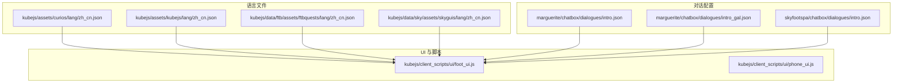
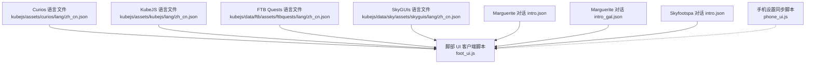
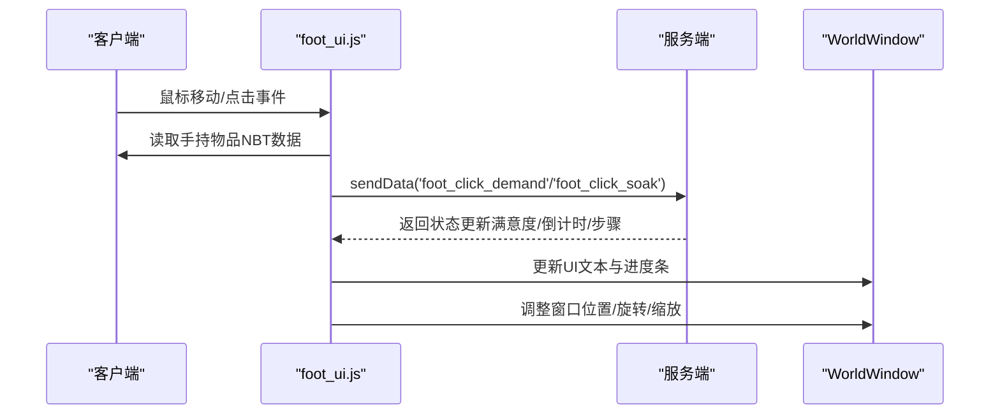
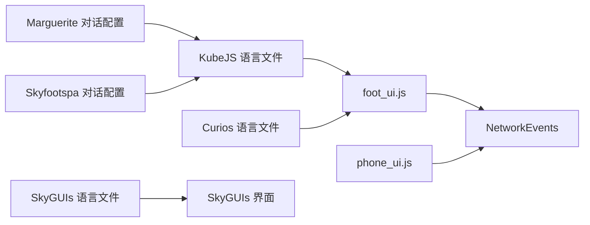

# 语言文件

<cite>
**本文引用的文件**   
- [kubejs/assets/curios/lang/zh_cn.json](file://kubejs/assets/curios/lang/zh_cn.json)
- [kubejs/assets/kubejs/lang/zh_cn.json](file://kubejs/assets/kubejs/lang/zh_cn.json)
- [kubejs/data/ftb/assets/ftbquests/lang/zh_cn.json](file://kubejs/data/ftb/assets/ftbquests/lang/zh_cn.json)
- [kubejs/data/sky/assets/skyguis/lang/zh_cn.json](file://kubejs/data/sky/assets/skyguis/lang/zh_cn.json)
- [kubejs/client_scripts/ui/foot_ui.js](file://kubejs/client_scripts/ui/foot_ui.js)
- [kubejs/client_scripts/ui/phone_ui.js](file://kubejs/client_scripts/ui/phone_ui.js)
- [kubejs/data/marguerite/chatbox/dialogues/intro.json](file://kubejs/data/marguerite/chatbox/dialogues/intro.json)
- [kubejs/data/marguerite/chatbox/dialogues/intro_gal.json](file://kubejs/data/marguerite/chatbox/dialogues/intro_gal.json)
- [kubejs/data/skyfootspa/chatbox/dialogues/intro.json](file://kubejs/data/skyfootspa/chatbox/dialogues/intro.json)
</cite>

## 目录
1. [简介](#简介)
2. [项目结构](#项目结构)
3. [核心组件](#核心组件)
4. [架构总览](#架构总览)
5. [详细组件分析](#详细组件分析)
6. [依赖关系分析](#依赖关系分析)
7. [性能考虑](#性能考虑)
8. [故障排查指南](#故障排查指南)
9. [结论](#结论)
10. [附录](#附录)

## 简介
本文件面向 Minecraft 整合包中的多语言支持实现与管理，重点覆盖以下内容：
- 中文语言文件 zh_cn.json 的结构与翻译键命名规范
- KubeJS、Marguerite（Chatbox）、SkyGUIs 等模块的语言文件组织方式
- 动态文本替换、参数化字符串与复数形式的处理策略
- 本地化开发流程、质量保证与多语言测试方法

本仓库采用“资源包式”的 lang 目录结构，按模组或功能域拆分语言文件；同时通过 KubeJS 客户端脚本驱动 UI 的动态文本渲染。对话系统使用 Marguerite Chatbox 的 JSON 配置，其中引用翻译键以完成本地化。

## 项目结构
本项目语言文件主要分布在以下路径：
- kubejs/assets/curios/lang/zh_cn.json：Curios 扩展项的中文翻译
- kubejs/assets/kubejs/lang/zh_cn.json：KubeJS 自定义物品与属性名称的中文翻译
- kubejs/data/ftb/assets/ftbquests/lang/zh_cn.json：FTB Quests 任务系统的中文翻译
- kubejs/data/sky/assets/skyguis/lang/zh_cn.json：SkyGUIs 团队界面的中文翻译
- kubejs/data/marguerite/chatbox/dialogues/*.json：Marguerite Chatbox 对话配置，内部引用翻译键
- kubejs/data/skyfootspa/chatbox/dialogues/*.json：Skyfootspa 的对话配置，同样引用翻译键

图表来源
- [kubejs/assets/curios/lang/zh_cn.json:1-4](file://kubejs/assets/curios/lang/zh_cn.json#L1-L4)
- [kubejs/assets/kubejs/lang/zh_cn.json:1-27](file://kubejs/assets/kubejs/lang/zh_cn.json#L1-L27)
- [kubejs/data/ftb/assets/ftbquests/lang/zh_cn.json:1-542](file://kubejs/data/ftb/assets/ftbquests/lang/zh_cn.json#L1-L542)
- [kubejs/data/sky/assets/skyguis/lang/zh_cn.json:1-79](file://kubejs/data/sky/assets/skyguis/lang/zh_cn.json#L1-L79)
- [kubejs/client_scripts/ui/foot_ui.js:1-800](file://kubejs/client_scripts/ui/foot_ui.js#L1-L800)
- [kubejs/client_scripts/ui/phone_ui.js:1-56](file://kubejs/client_scripts/ui/phone_ui.js#L1-L56)
- [kubejs/data/marguerite/chatbox/dialogues/intro.json:1-136](file://kubejs/data/marguerite/chatbox/dialogues/intro.json#L1-L136)
- [kubejs/data/marguerite/chatbox/dialogues/intro_gal.json:1-139](file://kubejs/data/marguerite/chatbox/dialogues/intro_gal.json#L1-L139)
- [kubejs/data/skyfootspa/chatbox/dialogues/intro.json:1-136](file://kubejs/data/skyfootspa/chatbox/dialogues/intro.json#L1-L136)

章节来源
- [kubejs/assets/curios/lang/zh_cn.json:1-4](file://kubejs/assets/curios/lang/zh_cn.json#L1-L4)
- [kubejs/assets/kubejs/lang/zh_cn.json:1-27](file://kubejs/assets/kubejs/lang/zh_cn.json#L1-L27)
- [kubejs/data/ftb/assets/ftbquests/lang/zh_cn.json:1-542](file://kubejs/data/ftb/assets/ftbquests/lang/zh_cn.json#L1-L542)
- [kubejs/data/sky/assets/skyguis/lang/zh_cn.json:1-79](file://kubejs/data/sky/assets/skyguis/lang/zh_cn.json#L1-L79)

## 核心组件
- 语言文件集合：各模组的 zh_cn.json 提供键值对映射，键遵循“模组前缀.分类.条目”的命名约定，便于隔离与维护。
- KubeJS 客户端脚本：负责在运行时将服务端数据转换为 UI 显示文本，并在必要时进行本地化键解析。
- Marguerite Chatbox 对话配置：通过 JSON 定义对话流程，文本字段可引用翻译键，由 Chatbox 引擎解析为本地化文本。
- SkyGUIs 界面语言：提供团队管理相关界面的中文文案。

章节来源
- [kubejs/assets/kubejs/lang/zh_cn.json:1-27](file://kubejs/assets/kubejs/lang/zh_cn.json#L1-L27)
- [kubejs/data/ftb/assets/ftbquests/lang/zh_cn.json:1-542](file://kubejs/data/ftb/assets/ftbquests/lang/zh_cn.json#L1-L542)
- [kubejs/data/sky/assets/skyguis/lang/zh_cn.json:1-79](file://kubejs/data/sky/assets/skyguis/lang/zh_cn.json#L1-L79)
- [kubejs/client_scripts/ui/foot_ui.js:1-800](file://kubejs/client_scripts/ui/foot_ui.js#L1-L800)
- [kubejs/data/marguerite/chatbox/dialogues/intro.json:1-136](file://kubejs/data/marguerite/chatbox/dialogues/intro.json#L1-L136)

## 架构总览
下图展示语言文件、对话配置与客户端 UI 之间的交互关系：语言文件提供静态文案，对话配置引用翻译键，客户端脚本根据状态动态更新 UI 文本。

图表来源
- [kubejs/assets/curios/lang/zh_cn.json:1-4](file://kubejs/assets/curios/lang/zh_cn.json#L1-L4)
- [kubejs/assets/kubejs/lang/zh_cn.json:1-27](file://kubejs/assets/kubejs/lang/zh_cn.json#L1-L27)
- [kubejs/data/ftb/assets/ftbquests/lang/zh_cn.json:1-542](file://kubejs/data/ftb/assets/ftbquests/lang/zh_cn.json#L1-L542)
- [kubejs/data/sky/assets/skyguis/lang/zh_cn.json:1-79](file://kubejs/data/sky/assets/skyguis/lang/zh_cn.json#L1-L79)
- [kubejs/client_scripts/ui/foot_ui.js:1-800](file://kubejs/client_scripts/ui/foot_ui.js#L1-L800)
- [kubejs/client_scripts/ui/phone_ui.js:1-56](file://kubejs/client_scripts/ui/phone_ui.js#L1-L56)
- [kubejs/data/marguerite/chatbox/dialogues/intro.json:1-136](file://kubejs/data/marguerite/chatbox/dialogues/intro.json#L1-L136)
- [kubejs/data/marguerite/chatbox/dialogues/intro_gal.json:1-139](file://kubejs/data/marguerite/chatbox/dialogues/intro_gal.json#L1-L139)
- [kubejs/data/skyfootspa/chatbox/dialogues/intro.json:1-136](file://kubejs/data/skyfootspa/chatbox/dialogues/intro.json#L1-L136)

## 详细组件分析

### KubeJS 语言文件（kubejs/assets/kubejs/lang/zh_cn.json）
- 作用：为 KubeJS 自定义物品与属性提供中文名称，键名以 item.kubejs.* 和 attribute.name.serve.* 为主。
- 命名规范：
  - 物品名称：item.kubejs.<物品ID>
  - 属性名称：attribute.name.serve.<部位>.<指标>
- 示例类别：
  - 水桶类物品：生姜水桶、草灰水桶、花椒水桶、食盐水桶、牛奶水桶、洗脚水桶、富魔洗脚水桶、富魔植物油桶、植物油-魔力悬浊液桶、含盐植物油桶、电解质水桶、皴水桶
  - 服务属性：脚掌/脚跟/脚趾/脚心的满意度、金钱、体力消耗

章节来源
- [kubejs/assets/kubejs/lang/zh_cn.json:1-27](file://kubejs/assets/kubejs/lang/zh_cn.json#L1-L27)

### Curios 语言文件（kubejs/assets/curios/lang/zh_cn.json）
- 作用：为 Curios 扩展槽位与修饰符提供中文文案。
- 键名示例：
  - curios.identifier.package：背包
  - curios.modifiers.package：装备背包时:

章节来源
- [kubejs/assets/curios/lang/zh_cn.json:1-4](file://kubejs/assets/curios/lang/zh_cn.json#L1-L4)

### FTB Quests 语言文件（kubejs/data/ftb/assets/ftbquests/lang/zh_cn.json）
- 作用：全面本地化任务系统 UI、命令反馈、奖励表、进度检测器等。
- 关键领域：
  - 任务屏幕与尺寸、皮肤、全屏、隐藏图标等
  - 任务可见性与依赖线控制
  - 任务类型：物品、流体、FE/EU/MJ 能量、击杀、位置、观察、交互、进度、阶段等
  - 奖励类型：物品、随机、选择、战利品、命令、经验、游戏阶段、CustomNPCs 任务/邮件/势力等
  - 命令反馈与错误提示
- 参数化字符串：
  - 使用 %d、%s 占位符表示数字与字符串参数，例如“已存储物品：%d”“错误：未知的战利品箱“%s”！”

章节来源
- [kubejs/data/ftb/assets/ftbquests/lang/zh_cn.json:1-542](file://kubejs/data/ftb/assets/ftbquests/lang/zh_cn.json#L1-L542)

### SkyGUIs 语言文件（kubejs/data/sky/assets/skyguis/lang/zh_cn.json）
- 作用：本地化团队管理界面，包括创建团队、成员管理、邀请、踢出、出生点管理等。
- 典型键名：
  - screen.skyguis.title.*：界面标题
  - screen.skyguis.text.*：界面文本
  - screen.skyguis.button.*：按钮文案
  - skyguis.key.*：快捷键说明
  - skyguis.command.*：命令反馈

章节来源
- [kubejs/data/sky/assets/skyguis/lang/zh_cn.json:1-79](file://kubejs/data/sky/assets/skyguis/lang/zh_cn.json#L1-L79)

### Marguerite Chatbox 对话配置（intro.json / intro_gal.json）
- 作用：定义对话流程、选项、头像、音效与动画等。
- 本地化方式：
  - text、tooltip、attachment 等字段引用翻译键（如 chatbox.test.text.1、chatbox.test.option.2），由 Chatbox 引擎解析为本地化文本。
- 主题切换：
  - theme 字段指定不同主题（test:default、test:gal），影响外观与部分行为。

章节来源
- [kubejs/data/marguerite/chatbox/dialogues/intro.json:1-136](file://kubejs/data/marguerite/chatbox/dialogues/intro.json#L1-L136)
- [kubejs/data/marguerite/chatbox/dialogues/intro_gal.json:1-139](file://kubejs/data/marguerite/chatbox/dialogues/intro_gal.json#L1-L139)

### Skyfootspa 对话配置（intro.json）
- 作用：与 Marguerite 类似，提供另一套对话流程与主题。
- 本地化方式：同样通过 chatbox.test.* 翻译键引用文本。

章节来源
- [kubejs/data/skyfootspa/chatbox/dialogues/intro.json:1-136](file://kubejs/data/skyfootspa/chatbox/dialogues/intro.json#L1-L136)

### 客户端 UI 脚本（foot_ui.js）
- 作用：在世界中为睡眠实体显示脚部 UI，包含倒计时、需求清单、满意度、步骤记录、抹油状态等。
- 动态文本：
  - 根据服务端 NBT 数据（如 pfDemandJiaozhang、pfSatisfaction、pfSteps）计算并更新 UI 文本。
  - 步骤解码：将整数代码映射为中文部位名称（脚掌、脚后跟、脚趾、脚心）。
- 交互逻辑：
  - 鼠标拖动阈值触发搓脚事件
  - 送客按钮与泡脚按钮的网络事件发送
- 窗口管理：
  - 延迟移除 WorldWindow 避免框架 NPE
  - 睡眠与泡脚窗口的状态转换

图表来源
- [kubejs/client_scripts/ui/foot_ui.js:1-800](file://kubejs/client_scripts/ui/foot_ui.js#L1-L800)

章节来源
- [kubejs/client_scripts/ui/foot_ui.js:1-800](file://kubejs/client_scripts/ui/foot_ui.js#L1-L800)

### 客户端 UI 脚本（phone_ui.js）
- 作用：接收服务端推送的手机设置与评价数据，维护全局设置对象。
- 网络事件：
  - phone_settings_sync：同步开关与一键满足等设置
  - phone_ratings_sync：同步评分键、名称、权重等

章节来源
- [kubejs/client_scripts/ui/phone_ui.js:1-56](file://kubejs/client_scripts/ui/phone_ui.js#L1-L56)

## 依赖关系分析
- 语言文件与 UI：
  - foot_ui.js 直接依赖 KubeJS 与 Curios 语言文件提供的物品与属性名称，用于显示与提示。
  - SkyGUIs 语言文件为团队界面提供文案，虽不直接由 foot_ui.js 调用，但同属 UI 层语言资源。
- 对话配置与语言文件：
  - Marguerite 与 Skyfootspa 对话配置通过翻译键引用语言文件内容，确保对话文本本地化。
- 客户端脚本与网络：
  - foot_ui.js 与 phone_ui.js 通过 NetworkEvents 与服务端通信，更新 UI 状态。

图表来源
- [kubejs/assets/kubejs/lang/zh_cn.json:1-27](file://kubejs/assets/kubejs/lang/zh_cn.json#L1-L27)
- [kubejs/assets/curios/lang/zh_cn.json:1-4](file://kubejs/assets/curios/lang/zh_cn.json#L1-L4)
- [kubejs/data/sky/assets/skyguis/lang/zh_cn.json:1-79](file://kubejs/data/sky/assets/skyguis/lang/zh_cn.json#L1-L79)
- [kubejs/data/marguerite/chatbox/dialogues/intro.json:1-136](file://kubejs/data/marguerite/chatbox/dialogues/intro.json#L1-L136)
- [kubejs/data/skyfootspa/chatbox/dialogues/intro.json:1-136](file://kubejs/data/skyfootspa/chatbox/dialogues/intro.json#L1-L136)
- [kubejs/client_scripts/ui/foot_ui.js:1-800](file://kubejs/client_scripts/ui/foot_ui.js#L1-L800)
- [kubejs/client_scripts/ui/phone_ui.js:1-56](file://kubejs/client_scripts/ui/phone_ui.js#L1-L56)

## 性能考虑
- 语言文件加载：
  - 语言文件为静态 JSON，加载开销低；建议按模组/功能域拆分，避免单文件过大。
- UI 更新频率：
  - foot_ui.js 每 tick 检查并更新 UI，应避免频繁 DOM 操作；当前实现通过条件判断与最小化更新降低开销。
- 网络事件：
  - 减少不必要的 sendData 调用，合并状态更新以降低带宽占用。

[本节为通用指导，无需具体文件分析]

## 故障排查指南
- 翻译键缺失：
  - 若出现未解析的翻译键（如 chatbox.test.text.*），检查对应语言文件是否包含该键。
- UI 文本不更新：
  - 检查 foot_ui.js 中对应元素 ID 是否存在，以及 NBT 数据是否正确同步。
- 对话文本异常：
  - 确认对话配置中的 theme 与翻译键一致，且语言文件未被覆盖或损坏。
- 命令反馈乱码或占位符未替换：
  - 检查 FTB Quests 语言文件中 %d/%s 占位符是否与命令输出匹配。

章节来源
- [kubejs/data/ftb/assets/ftbquests/lang/zh_cn.json:1-542](file://kubejs/data/ftb/assets/ftbquests/lang/zh_cn.json#L1-L542)
- [kubejs/client_scripts/ui/foot_ui.js:1-800](file://kubejs/client_scripts/ui/foot_ui.js#L1-L800)
- [kubejs/data/marguerite/chatbox/dialogues/intro.json:1-136](file://kubejs/data/marguerite/chatbox/dialogues/intro.json#L1-L136)

## 结论
本项目通过模块化语言文件与客户端脚本实现了完整的中文本地化方案：
- 语言文件按模组与功能域拆分，命名规范清晰
- 对话系统通过翻译键实现文本本地化
- 客户端脚本负责动态文本渲染与状态同步
- 参数化字符串广泛使用，便于数值与字符串的动态插入

建议在后续开发中：
- 统一翻译键命名规范，增加前缀与分类
- 引入自动化校验工具，检测缺失键与重复键
- 建立多语言测试用例，覆盖 UI、对话与命令反馈

[本节为总结性内容，无需具体文件分析]

## 附录

### 动态文本替换与参数化字符串
- 参数化字符串：
  - 使用 %d 表示整数，%s 表示字符串，常见于 FTB Quests 的命令反馈与提示信息。
- 动态文本：
  - foot_ui.js 根据服务端 NBT 数据实时计算并更新 UI 文本，如满意度百分比、倒计时秒数、步骤名称等。

章节来源
- [kubejs/data/ftb/assets/ftbquests/lang/zh_cn.json:1-542](file://kubejs/data/ftb/assets/ftbquests/lang/zh_cn.json#L1-L542)
- [kubejs/client_scripts/ui/foot_ui.js:1-800](file://kubejs/client_scripts/ui/foot_ui.js#L1-L800)

### 复数形式处理
- 当前语言文件未使用 ICU 复数规则；如需支持复数，可在语言文件中为不同数量提供独立键（如 item_count_1、item_count_many），或在客户端脚本中进行条件判断与文本拼接。

[本节为通用指导，无需具体文件分析]

### 本地化开发工作流程
- 新增翻译键：
  - 在对应模组语言文件中添加键值对
  - 在对话配置或 UI 脚本中引用翻译键
- 验证与测试：
  - 启动游戏，检查 UI 文本、对话文本与命令反馈是否正常显示
  - 使用 FTB Quests 编辑器导出奖励表，验证命令反馈中的占位符替换

章节来源
- [kubejs/assets/kubejs/lang/zh_cn.json:1-27](file://kubejs/assets/kubejs/lang/zh_cn.json#L1-L27)
- [kubejs/data/ftb/assets/ftbquests/lang/zh_cn.json:1-542](file://kubejs/data/ftb/assets/ftbquests/lang/zh_cn.json#L1-L542)
- [kubejs/data/marguerite/chatbox/dialogues/intro.json:1-136](file://kubejs/data/marguerite/chatbox/dialogues/intro.json#L1-L136)

### 多语言测试策略
- 单元测试：
  - 针对 foot_ui.js 的步骤解码与需求清单显示编写测试用例
- 集成测试：
  - 模拟服务端 NBT 数据变化，验证 UI 实时更新
- 回归测试：
  - 每次新增翻译键后，运行全量 UI 与对话流程，确保无缺失键

[本节为通用指导，无需具体文件分析]