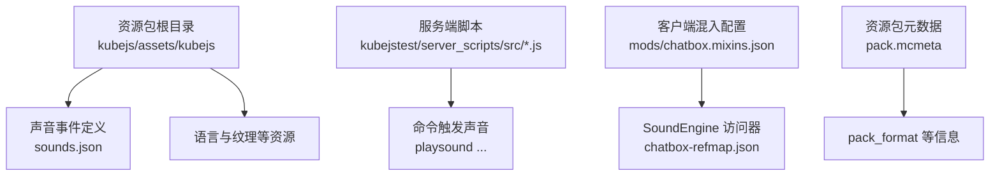
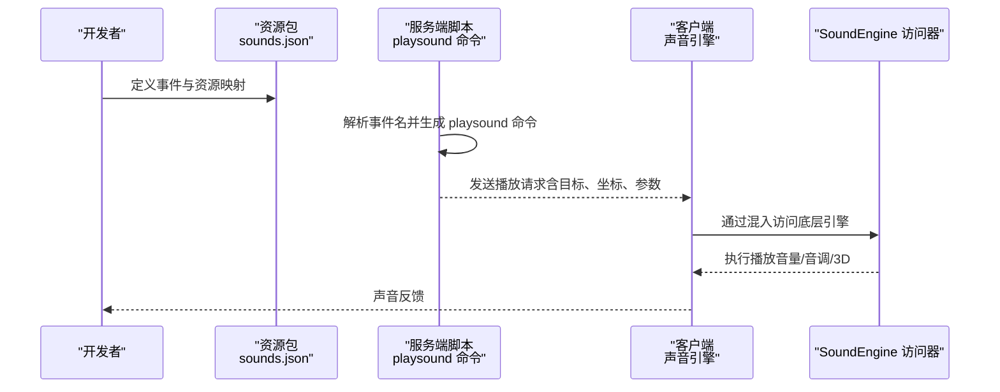
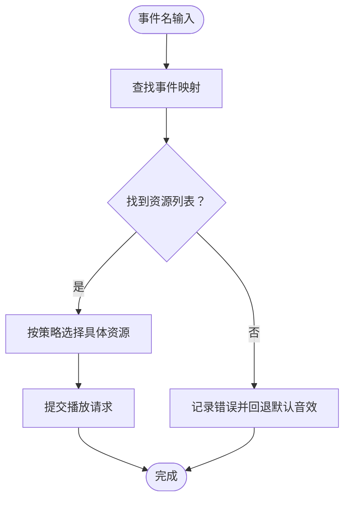
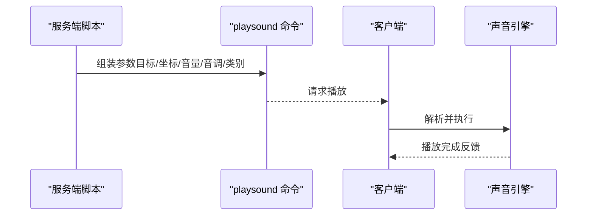
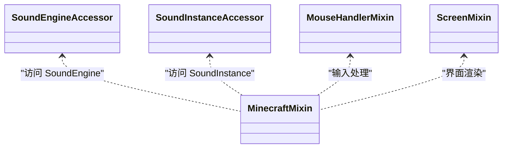
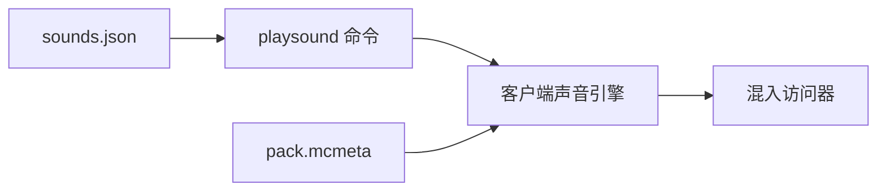

# 声音资源

<cite>
**本文引用的文件**
- [sounds.json](file://kubejs/assets/kubejs/sounds.json)
- [sounds.json（示例）](file://kubejs/assets/kubejs/sounds.json)
- [pack.mcmeta（ftb）](file://kubejs/data/ftb/pack.mcmeta)
- [pack.mcmeta（sky）](file://kubejs/data/sky/pack.mcmeta)
- [chatbox.mixins.json](file://mods/chatbox.mixins.json)
- [chatbox-refmap.json](file://mods/chatbox-refmap.json)
- [cun_block.js](file://kubejs/startup_scripts/block/cun_block.js)
- [counter.js](file://kubejstest/server_scripts/src/counter.js)
- [dialogue.js](file://kubejstest/server_scripts/src/dialogue.js)
- [interaction.js](file://kubejstest/server_scripts/src/interaction.js)
- [sushi_station.js](file://kubejstest/server_scripts/src/sushi_station.js)
- [trident.js](file://kubejstest/server_scripts/src/trident.js)
</cite>

## 目录
1. [简介](#简介)
2. [项目结构](#项目结构)
3. [核心组件](#核心组件)
4. [架构总览](#架构总览)
5. [详细组件分析](#详细组件分析)
6. [依赖关系分析](#依赖关系分析)
7. [性能考虑](#性能考虑)
8. [故障排查指南](#故障排查指南)
9. [结论](#结论)
10. [附录](#附录)

## 简介
本文件面向模组与资源包开发者，系统梳理该Minecraft版本中声音资源的组织方式与实现要点，重点覆盖以下方面：
- 声音事件与资源的声明与映射机制
- 音频文件的格式与播放参数（音量、音调、3D定位）
- 不同类型声音（环境、UI、实体、物品）的分类与管理
- 开发规范、性能优化与音频处理最佳实践
- 基于现有仓库证据的可操作开发指南

说明：本文严格基于仓库中已存在的文件进行分析与总结，不臆造不存在的功能或字段。

## 项目结构
围绕声音资源的关键位置如下：
- 声音事件与资源映射：kubejs/assets/kubejs/sounds.json
- 声音事件在服务端触发示例：多处 server_scripts 中使用 playsound 命令
- 声音引擎访问与混入：mods/chatbox.mixins.json、mods/chatbox-refmap.json
- 资源包元数据：kubejs/data/*/pack.mcmeta（pack_format）

**图表来源**
- [sounds.json:1-5](file://kubejs/assets/kubejs/sounds.json#L1-L5)
- [counter.js:373-373](file://kubejstest/server_scripts/src/counter.js#L373-L373)
- [chatbox.mixins.json:1-23](file://mods/chatbox.mixins.json#L1-L23)
- [chatbox-refmap.json:1-56](file://mods/chatbox-refmap.json#L1-L56)
- [pack.mcmeta（ftb）:1-6](file://kubejs/data/ftb/pack.mcmeta#L1-L6)

**章节来源**
- [sounds.json:1-5](file://kubejs/assets/kubejs/sounds.json#L1-L5)
- [pack.mcmeta（ftb）:1-6](file://kubejs/data/ftb/pack.mcmeta#L1-L6)
- [pack.mcmeta（sky）:1-6](file://kubejs/data/sky/pack.mcmeta#L1-L6)

## 核心组件
- 声音事件定义文件：用于将逻辑事件名映射到一个或多个音频资源标识符，形成“事件 -> 资源列表”的关系。
- 服务端触发层：通过命令在特定情境播放声音，支持指定音量、音调、3D坐标与类别。
- 客户端混入层：通过混入访问底层声音引擎，便于扩展或调试声音播放行为。
- 资源包元数据：声明资源包格式版本，确保兼容性。

**章节来源**
- [sounds.json:1-5](file://kubejs/assets/kubejs/sounds.json#L1-L5)
- [counter.js:373-373](file://kubejstest/server_scripts/src/counter.js#L373-L373)
- [chatbox.mixins.json:1-23](file://mods/chatbox.mixins.json#L1-L23)
- [chatbox-refmap.json:1-56](file://mods/chatbox-refmap.json#L1-L56)

## 架构总览
下图展示从“事件定义”到“命令触发”再到“客户端声音引擎”的整体流程。

**图表来源**
- [sounds.json:1-5](file://kubejs/assets/kubejs/sounds.json#L1-L5)
- [counter.js:373-373](file://kubejstest/server_scripts/src/counter.js#L373-L373)
- [chatbox.mixins.json:11-17](file://mods/chatbox.mixins.json#L11-L17)
- [chatbox-refmap.json:7-13](file://mods/chatbox-refmap.json#L7-L13)

## 详细组件分析

### 组件A：声音事件定义与资源映射
- 结构要点
  - 事件名作为键，值为资源标识符数组；资源标识符通常采用命名空间前缀加路径的方式。
  - 示例文件展示了事件到多个资源的映射关系，便于随机播放或分层音效。
- 数据流
  - 事件名由服务端脚本解析后，拼接为命令参数的一部分。
  - 客户端根据事件名查找对应资源列表，并按引擎策略选择具体音频文件进行播放。
- 复杂度与优化
  - 映射查询为常数时间；资源数量增加会提升选择与加载开销，建议控制单事件资源上限。
  - 将常用事件的资源列表置于前部，有助于减少选择延迟。

**图表来源**
- [sounds.json:1-5](file://kubejs/assets/kubejs/sounds.json#L1-L5)

**章节来源**
- [sounds.json:1-5](file://kubejs/assets/kubejs/sounds.json#L1-L5)

### 组件B：服务端触发与播放参数
- 触发方式
  - 使用 playsound 命令在服务端触发声音；命令支持目标、坐标、音量、音调、最小距离等参数。
- 参数说明（基于仓库中的命令用法）
  - 目标：@a 全体玩家、@p 最近玩家、或指定玩家名
  - 类别：如 block、neutral、ambient 等
  - 坐标：x y z（3D定位）
  - 音量：如 0.5、0.3 等
  - 音调：如 1.1 等
  - 最小距离：如 0.3 等
- 典型场景
  - UI交互、实体动作、物品使用、环境事件等均可通过不同类别与参数组合实现差异化体验。

**图表来源**
- [counter.js:373-373](file://kubejstest/server_scripts/src/counter.js#L373-L373)
- [dialogue.js:447-447](file://kubejstest/server_scripts/src/dialogue.js#L447-L447)
- [interaction.js:31-31](file://kubejstest/server_scripts/src/interaction.js#L31-L31)
- [sushi_station.js:230-230](file://kubejstest/server_scripts/src/sushi_station.js#L230-L230)
- [trident.js:93-93](file://kubejstest/server_scripts/src/trident.js#L93-L93)

**章节来源**
- [counter.js:373-373](file://kubejstest/server_scripts/src/counter.js#L373-L373)
- [dialogue.js:447-447](file://kubejstest/server_scripts/src/dialogue.js#L447-L447)
- [interaction.js:31-31](file://kubejstest/server_scripts/src/interaction.js#L31-L31)
- [sushi_station.js:230-230](file://kubejstest/server_scripts/src/sushi_station.js#L230-L230)
- [trident.js:93-93](file://kubejstest/server_scripts/src/trident.js#L93-L93)

### 组件C：客户端声音引擎访问
- 混入配置
  - 在客户端声明了对 SoundEngine 与 SoundInstance 的访问器混入，便于读取内部状态或扩展行为。
- 访问器用途
  - 读取 SoundEngine 实例、SoundInstance 的通道映射与非暂停 tick 等，可用于调试或自定义播放策略。
- 注意事项
  - 混入属于客户端扩展，需确保兼容性与稳定性；避免在热更新时破坏原有行为。

**图表来源**
- [chatbox.mixins.json:11-17](file://mods/chatbox.mixins.json#L11-L17)
- [chatbox-refmap.json:7-13](file://mods/chatbox-refmap.json#L7-L13)

**章节来源**
- [chatbox.mixins.json:1-23](file://mods/chatbox.mixins.json#L1-L23)
- [chatbox-refmap.json:1-56](file://mods/chatbox-refmap.json#L1-L56)

### 组件D：资源包元数据与兼容性
- pack_format
  - 资源包元数据中包含 pack_format 字段，用于声明资源包格式版本，确保与客户端版本兼容。
- 建议
  - 在开发新资源包时明确 pack_format，避免因版本不匹配导致资源无法加载。

**章节来源**
- [pack.mcmeta（ftb）:1-6](file://kubejs/data/ftb/pack.mcmeta#L1-L6)
- [pack.mcmeta（sky）:1-6](file://kubejs/data/sky/pack.mcmeta#L1-L6)

## 依赖关系分析
- 事件定义依赖资源包结构与命名空间约定
- 服务端脚本依赖命令语法与目标选择策略
- 客户端混入依赖版本兼容与稳定的访问器映射
- 资源包元数据影响加载与回退策略

**图表来源**
- [sounds.json:1-5](file://kubejs/assets/kubejs/sounds.json#L1-L5)
- [counter.js:373-373](file://kubejstest/server_scripts/src/counter.js#L373-L373)
- [chatbox.mixins.json:11-17](file://mods/chatbox.mixins.json#L11-L17)
- [pack.mcmeta（ftb）:1-6](file://kubejs/data/ftb/pack.mcmeta#L1-L6)

**章节来源**
- [sounds.json:1-5](file://kubejs/assets/kubejs/sounds.json#L1-L5)
- [counter.js:373-373](file://kubejstest/server_scripts/src/counter.js#L373-L373)
- [chatbox.mixins.json:1-23](file://mods/chatbox.mixins.json#L1-L23)
- [pack.mcmeta（ftb）:1-6](file://kubejs/data/ftb/pack.mcmeta#L1-L6)

## 性能考虑
- 事件资源数量控制：单事件资源过多会增加选择与解码成本，建议限制在合理范围并优先缓存常用资源。
- 播放参数优化：音量与音调应按场景设定默认值，避免频繁微调造成额外计算。
- 3D定位与距离：仅在必要时启用精确3D定位，以减少空间计算开销。
- 资源包格式：使用合适的 pack_format，确保客户端高效加载与缓存。

## 故障排查指南
- 事件未生效
  - 检查事件名是否与资源包内定义一致，确认资源标识符的命名空间与路径正确。
- 声音未播放
  - 确认服务端命令的目标与坐标有效；检查类别与音量设置是否合理。
- 客户端异常
  - 若使用混入，请核对混入配置与 refmap 是否匹配当前版本；避免访问不存在的字段或方法。
- 资源包加载失败
  - 检查 pack.mcmeta 中 pack_format 与客户端版本兼容性。

**章节来源**
- [sounds.json:1-5](file://kubejs/assets/kubejs/sounds.json#L1-L5)
- [counter.js:373-373](file://kubejstest/server_scripts/src/counter.js#L373-L373)
- [chatbox.mixins.json:1-23](file://mods/chatbox.mixins.json#L1-L23)
- [chatbox-refmap.json:1-56](file://mods/chatbox-refmap.json#L1-L56)
- [pack.mcmeta（ftb）:1-6](file://kubejs/data/ftb/pack.mcmeta#L1-L6)

## 结论
本仓库中的声音系统以“事件定义 + 命令触发 + 客户端引擎”为核心链路，辅以混入访问器与资源包元数据保障兼容性。开发者可通过事件映射实现灵活的声音编排，并结合命令参数实现多样化的播放效果。建议在开发中遵循统一的事件命名、资源组织与参数规范，以获得稳定且高性能的声音体验。

## 附录
- 开发规范建议
  - 事件命名：清晰语义化，避免歧义；按功能域分组（如 UI、环境、实体、物品）。
  - 资源命名：与事件名保持一致或可推导的关系；避免重复与冗余。
  - 参数默认值：为常见场景提供合理的默认音量、音调与类别，减少动态计算。
  - 3D定位：仅在需要沉浸感的场景启用，避免过度使用导致性能下降。
- 性能优化清单
  - 控制单事件资源数量，优先缓存常用资源。
  - 合理设置最小距离与衰减模型，减少远距离播放带来的开销。
  - 使用合适的数据包格式与压缩策略，缩短加载时间。
- 音频文件处理最佳实践
  - 格式选择：优先使用广泛支持的音频格式；确保采样率与位深适配目标平台。
  - 文件大小：压缩至满足质量要求的最小体积；避免冗长的静音片段。
  - 复用策略：对相似效果的资源进行复用，减少重复加载。