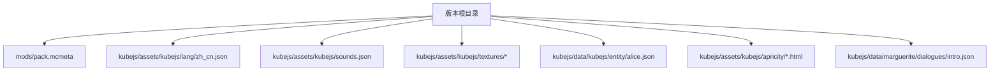
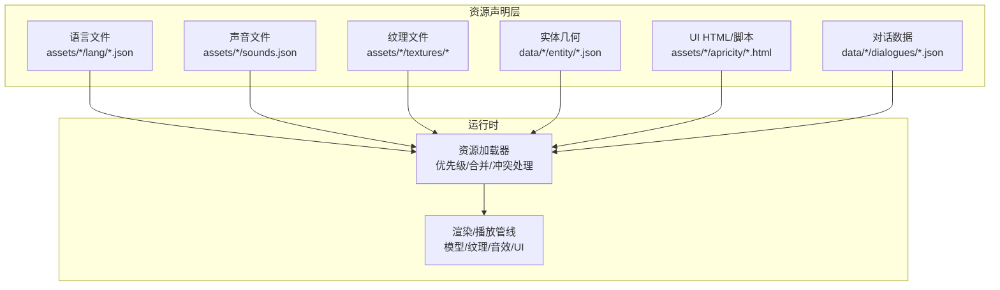
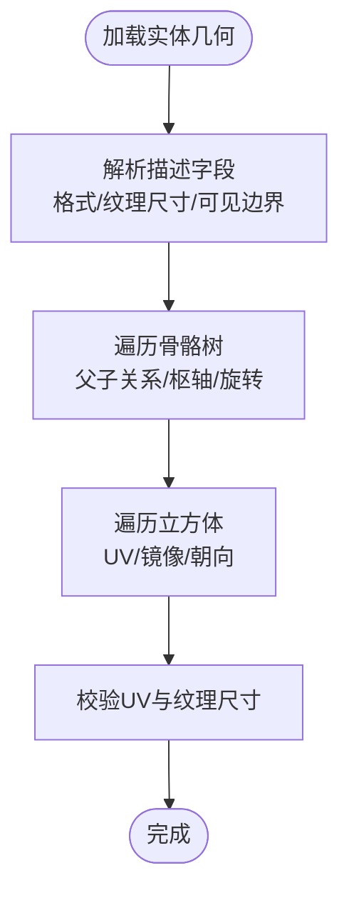
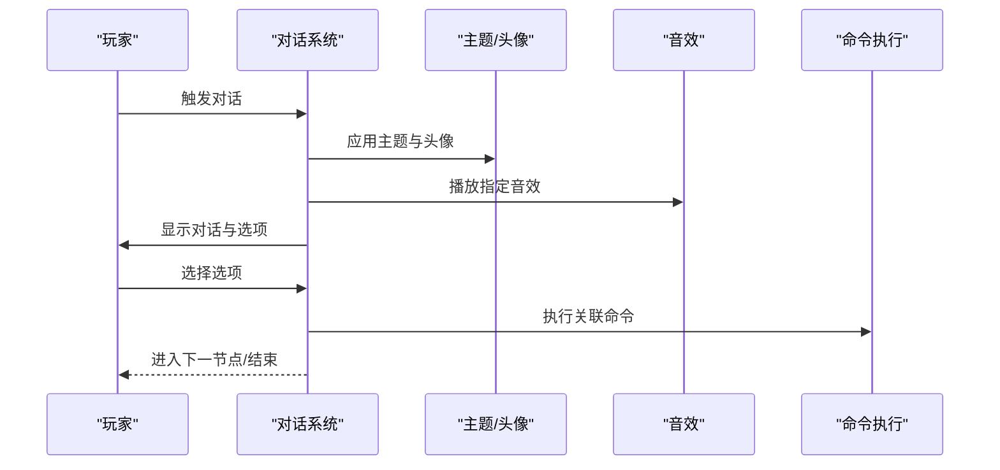
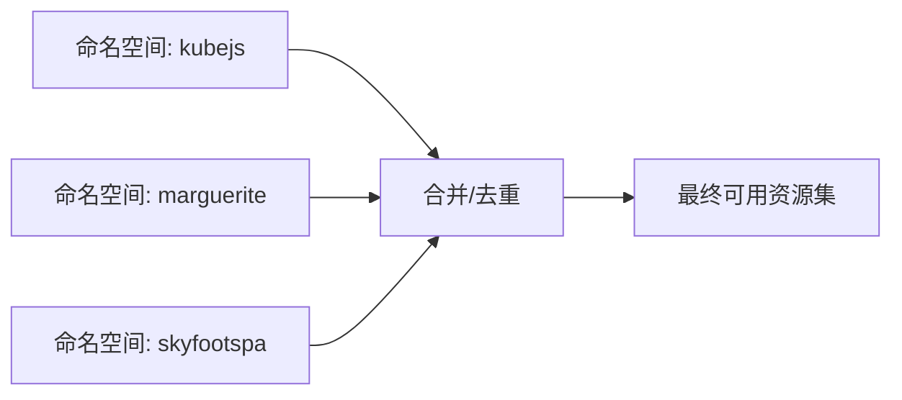

# 客户端资源

<cite>
**本文引用的文件**
- [README.md](file://README.md)
- [pack.mcmeta](file://mods/pack.mcmeta)
- [zh_cn.json](file://kubejs/assets/kubejs/lang/zh_cn.json)
- [sounds.json](file://kubejs/assets/kubejs/sounds.json)
- [alice.json](file://kubejs/data/kubejs/entity/alice.json)
- [intro.json](file://kubejs/data/marguerite/dialogues/intro.json)
</cite>

## 目录
1. [简介](#简介)
2. [项目结构](#项目结构)
3. [核心组件](#核心组件)
4. [架构总览](#架构总览)
5. [详细组件分析](#详细组件分析)
6. [依赖关系分析](#依赖关系分析)
7. [性能考量](#性能考量)
8. [故障排查指南](#故障排查指南)
9. [结论](#结论)
10. [附录](#附录)

## 简介
本文件面向模组开发者与内容创作者，系统化梳理该版本中Minecraft客户端资源的组织结构与管理方式，覆盖语言文件（lang）、声音文件（sounds）、纹理资源（textures）、UI资源、实体模型等的分类、命名规范与加载机制；并给出加载优先级、冲突处理策略、最佳实践、性能优化与调试方法，帮助在不直接读取源码的前提下高效完成资源开发。

## 项目结构
该版本以“KubeJS 资源与数据”为核心，采用按功能域分层的资源组织方式：
- 语言资源：位于 assets/<namespace>/lang/*.json，用于多语言文本映射
- 声音资源：位于 assets/<namespace>/sounds.json，定义声音事件与音效映射
- 纹理资源：位于 assets/<namespace>/textures/*，按 block/item/entity/ui 等子目录组织
- 实体模型：位于 data/<namespace>/entity/*.json，使用几何与骨骼描述实体外观
- UI 资源：位于 assets/<namespace>/apricity/*.html 与相关脚本，配合 KubeJS UI 模块
- 数据与对话：位于 data/<namespace>/dialogues/*.json，驱动聊天框与对话流程

下图展示资源在版本中的分布与关联：

图表来源
- [pack.mcmeta](file://mods/pack.mcmeta)
- [zh_cn.json](file://kubejs/assets/kubejs/lang/zh_cn.json)
- [sounds.json](file://kubejs/assets/kubejs/sounds.json)
- [alice.json](file://kubejs/data/kubejs/entity/alice.json)
- [intro.json](file://kubejs/data/marguerite/dialogues/intro.json)

章节来源
- [README.md:1-6](file://README.md#L1-L6)
- [pack.mcmeta:1-7](file://mods/pack.mcmeta#L1-L7)

## 核心组件
- 语言资源（lang）
  - 作用：提供本地化文本键值对，供UI、提示、对话等模块引用
  - 规范：文件名通常为语言代码（如 zh_cn.json），键名遵循命名空间:键路径
  - 示例：属性名、聊天框名称与文本键等
- 声音资源（sounds）
  - 作用：将逻辑事件映射到具体音效文件或音效集合
  - 规范：sounds.json 中以事件名为键，值为音效列表或变体
  - 示例：自定义事件别名映射多个音效
- 纹理资源（textures）
  - 作用：承载方块、物品、实体、UI 的贴图
  - 规范：按功能域分目录（block/item/entity/ui），命名与路径需与模型/材质引用一致
  - 注意：当前仓库未直接提供 textures 子目录示例文件，但结构已明确
- 实体模型（entity geometry）
  - 作用：定义实体外观与骨骼结构，支持动画与UV映射
  - 规范：使用 JSON 几何格式，包含描述、骨骼树与立方体UV
  - 示例：alice.json 展示了复杂几何与UV配置
- UI 资源（apricity html + 脚本）
  - 作用：通过HTML与脚本实现自定义HUD、界面与交互
  - 规范：HTML放置于 assets/<namespace>/apricity/，脚本与样式通过KubeJS集成
- 数据与对话（dialogues）
  - 作用：驱动聊天框对话流程、头像、音效与命令联动
  - 规范：JSON结构包含主题、对话序列、选项与触发事件

章节来源
- [zh_cn.json:1-15](file://kubejs/assets/kubejs/lang/zh_cn.json#L1-L15)
- [sounds.json:1-5](file://kubejs/assets/kubejs/sounds.json#L1-L5)
- [alice.json:1-800](file://kubejs/data/kubejs/entity/alice.json#L1-L800)
- [intro.json:1-136](file://kubejs/data/marguerite/dialogues/intro.json#L1-L136)

## 架构总览
下图展示从资源声明到渲染/播放的关键链路（概念性示意）：

说明
- 加载器负责解析与合并各资源，依据命名空间与路径进行匹配
- 冲突处理遵循后加载覆盖原则（见“依赖关系分析”）
- 渲染/播放管线根据资源类型调用对应渲染器或播放器

## 详细组件分析

### 语言资源（lang）分析
- 结构与职责
  - 键值对形式，键名通常为“属性名”“聊天框名称”等，值为本地化文本
  - 通过引用键名在UI、对话、提示中显示对应语言文本
- 命名规范
  - 文件名：语言代码（如 zh_cn.json）
  - 键名：建议使用“命名空间.类别.标识符”的层级结构，便于维护与查找
- 典型用途
  - 属性显示、聊天框头像名称、对话文本、按钮文案等

章节来源
- [zh_cn.json:1-15](file://kubejs/assets/kubejs/lang/zh_cn.json#L1-L15)

### 声音资源（sounds）分析
- 结构与职责
  - 声音事件映射：将逻辑事件名映射到具体音效文件或集合
  - 支持事件别名与多音效回放
- 命名规范
  - 事件名应语义化，避免与原版冲突
  - 音效文件命名与路径需与 assets/*/sounds/ 下的实际文件一致
- 典型用途
  - UI点击、对话开始/结束、实体动作、环境氛围等

章节来源
- [sounds.json:1-5](file://kubejs/assets/kubejs/sounds.json#L1-L5)

### 纹理资源（textures）分析
- 组织方式
  - 按功能域分目录：block、item、entity、ui 等
  - 纹理文件命名与路径需与模型/材质引用保持一致
- 命名规范
  - 使用小写与下划线，避免空格与特殊字符
  - 同一资源族内保持命名一致性（如 *_layer0.png）
- 典型用途
  - 方块/物品渲染、实体皮肤、UI贴图、HUD元素

章节来源
- [textures 目录结构](file://kubejs/assets/kubejs/textures)

### 实体模型（entity geometry）分析
- 结构与职责
  - 描述：包含格式版本、几何标识、纹理尺寸、可见边界
  - 骨骼树：定义父子关系与旋转/平移参数
  - 立方体：定义UV、镜像与朝向
- 命名规范
  - 文件名与引用路径一致，命名语义化（如 alice.json）
- 典型用途
  - 自定义实体外观、动画绑定、材质映射

图表来源
- [alice.json:1-800](file://kubejs/data/kubejs/entity/alice.json#L1-L800)

章节来源
- [alice.json:1-800](file://kubejs/data/kubejs/entity/alice.json#L1-L800)

### UI 资源（apricity html + 脚本）分析
- 组织方式
  - HTML 文件位于 assets/<namespace>/apricity/，用于定义界面布局与交互
  - 脚本与样式通过 KubeJS 集成，实现动态更新与事件响应
- 典型用途
  - HUD 显示、菜单界面、交互面板、自定义渲染

章节来源
- [apricity 资源路径](file://kubejs/assets/kubejs/apricity)

### 数据与对话（dialogues）分析
- 结构与职责
  - 主题：对话整体风格与背景
  - 对话序列：包含对话框、头像、音效、选项与命令
  - 选项：可设置跳转、锁定条件、提示信息与命令执行
- 命名规范
  - 文件名语义化（如 intro.json），键名清晰表达流程意图
- 典型用途
  - 引导教程、任务提示、剧情推进、奖励解锁

图表来源
- [intro.json:1-136](file://kubejs/data/marguerite/dialogues/intro.json#L1-L136)

章节来源
- [intro.json:1-136](file://kubejs/data/marguerite/dialogues/intro.json#L1-L136)

## 依赖关系分析
- 资源声明与引用
  - 语言键名被 UI、对话、提示等模块引用
  - 声音事件名被 UI、实体行为、环境模块引用
  - 纹理路径与模型/材质引用保持一致
  - 实体几何文件被实体注册与渲染管线引用
- 加载优先级与冲突处理
  - 同一命名空间内，后加载的资源覆盖先前定义
  - 不同命名空间之间按加载顺序合并，冲突时以最后加载为准
  - 建议通过命名空间隔离资源，减少冲突风险

图表来源
- [pack.mcmeta:1-7](file://mods/pack.mcmeta#L1-L7)

章节来源
- [pack.mcmeta:1-7](file://mods/pack.mcmeta#L1-L7)

## 性能考量
- 纹理与模型
  - 控制纹理分辨率与数量，避免过大的贴图导致内存压力
  - 合理拆分实体模型的骨骼与立方体，减少不必要的面数
- 声音与UI
  - 声音文件尽量短小且压缩，避免长时间音频占用资源
  - UI HTML/脚本尽量轻量化，减少DOM复杂度与重绘
- 加载与缓存
  - 将常用资源置于高频访问路径，利用缓存降低重复加载
  - 合理拆分资源包，按需加载，减少首帧延迟

## 故障排查指南
- 语言文本未显示
  - 检查键名是否与引用一致，确认语言文件编码与键值存在
  - 确认命名空间与路径正确
- 声音无法播放
  - 检查 sounds.json 中事件名与音效文件路径是否匹配
  - 确认音效文件存在于 assets/*/sounds/ 对应位置
- 纹理缺失或错位
  - 检查纹理文件名与路径是否与模型/材质引用一致
  - 核对UV与纹理尺寸配置
- 实体模型渲染异常
  - 检查几何文件的描述、骨骼树与立方体UV
  - 确认纹理尺寸与UV范围匹配
- UI 界面不显示或交互无效
  - 检查 HTML 文件路径与脚本集成
  - 确认事件绑定与资源加载时机

章节来源
- [zh_cn.json:1-15](file://kubejs/assets/kubejs/lang/zh_cn.json#L1-L15)
- [sounds.json:1-5](file://kubejs/assets/kubejs/sounds.json#L1-L5)
- [alice.json:1-800](file://kubejs/data/kubejs/entity/alice.json#L1-L800)
- [intro.json:1-136](file://kubejs/data/marguerite/dialogues/intro.json#L1-L136)

## 结论
该版本通过清晰的资源分层与命名规范，实现了语言、声音、纹理、实体模型、UI与对话的协同工作。遵循命名空间隔离、路径一致性与事件映射原则，可有效降低冲突并提升开发效率。结合本文提供的最佳实践与性能建议，可在保证体验的同时提升资源加载与渲染效率。

## 附录
- 安装与启动
  - 参考版本根目录的安装说明，确保Forge版本与客户端兼容
- 资源开发清单
  - 语言文件：键名规范、多语言覆盖
  - 声音文件：事件映射、音效路径
  - 纹理文件：命名与路径一致性、UV配置
  - 实体模型：几何描述、骨骼与立方体
  - UI 资源：HTML/脚本、事件绑定
  - 对话数据：主题、序列、选项与命令

章节来源
- [README.md:1-6](file://README.md#L1-L6)