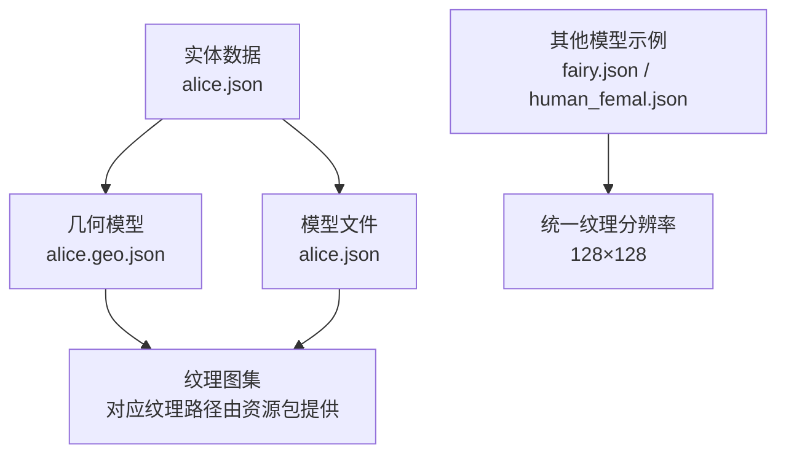
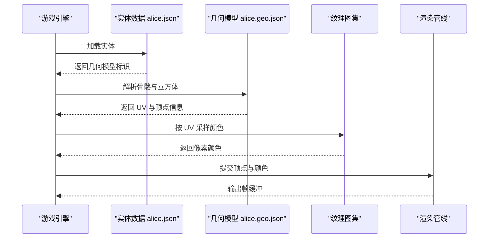
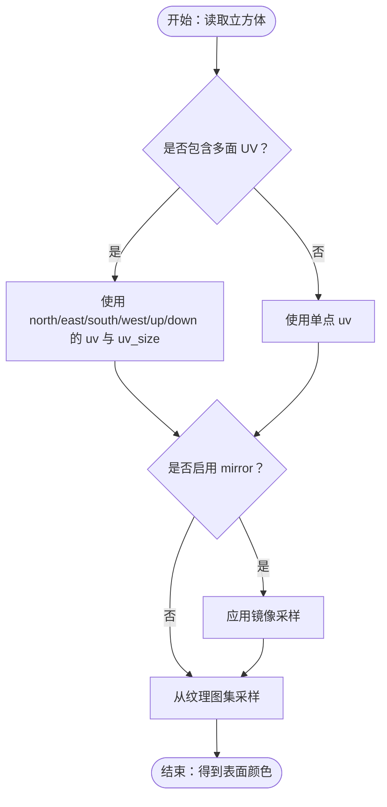
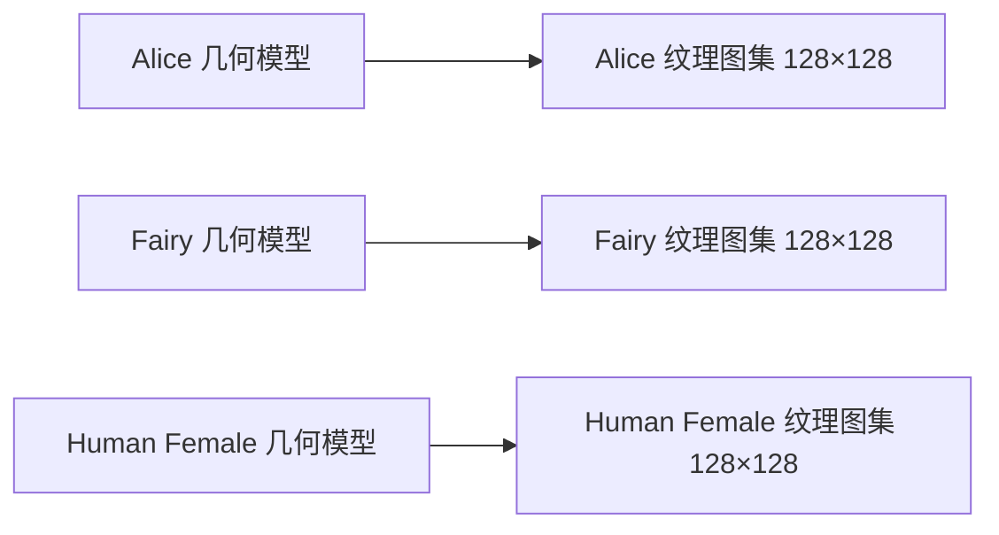
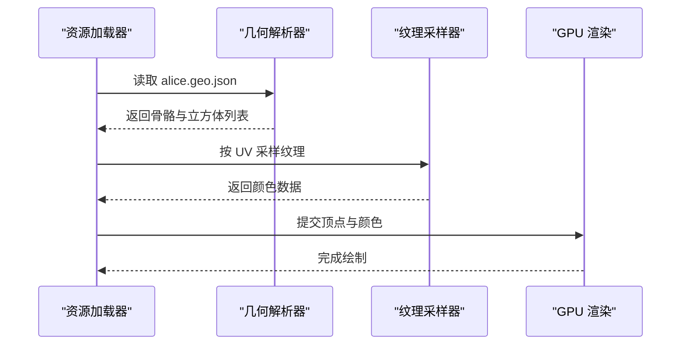
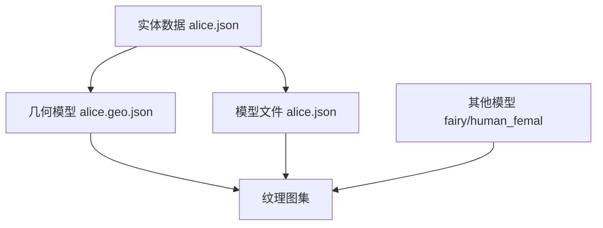

# 几何模型纹理

<cite>
**本文引用的文件**   
- [alice.geo.json](file://kubejs/assets/kubejs/geo/alice.geo.json)
- [alice.json](file://kubejs/assets/kubejs/geo/alice.json)
- [alice实体数据](file://kubejs/data/kubejs/entity/alice.json)
- [fairy.json](file://kubejs/assets/skyfootspa/models/entity/fairy.json)
- [human_femal.json](file://kubejs/assets/skyfootspa/models/entity/human_femal.json)
</cite>

## 目录
1. [简介](#简介)
2. [项目结构](#项目结构)
3. [核心组件](#核心组件)
4. [架构总览](#架构总览)
5. [详细组件分析](#详细组件分析)
6. [依赖关系分析](#依赖关系分析)
7. [性能与优化](#性能与优化)
8. [故障排查](#故障排查)
9. [结论](#结论)
10. [附录：模组开发者指南](#附录模组开发者指南)

## 简介
本文件面向 ApriCity 项目中基于 Bedrock 风格几何模型的 3D 角色纹理系统，说明以下要点：
- 几何模型与纹理的绑定方式、UV 映射规则与材质属性。
- 模型分辨率标准、纹理图集布局与渲染管线中的关键约束。
- 光照贴图与法线贴图的集成思路（在现有资源基础上给出可落地的扩展建议）。
- 为模组开发者提供从建模到纹理制作、再到渲染优化的完整流程规范。

本项目中，3D 角色使用 Bedrock 风格的 `.geo.json` 几何描述文件定义骨骼、立方体与 UV 贴图区域；同时存在一份同名的 `*.json` 模型文件，用于兼容或扩展渲染配置。实体数据位于 `kubejs/data/kubejs/entity/alice.json`，负责将逻辑实体与几何模型关联。

## 项目结构
与几何模型纹理直接相关的资源分布如下：
- `kubejs/assets/kubejs/geo/alice.geo.json`：Alice 角色的几何模型定义，包含骨骼树、立方体网格、UV 坐标与可见边界等。
- `kubejs/assets/kubejs/geo/alice.json`：与 Alice 几何对应的模型文件，结构与几何文件高度相似，可能用于兼容旧版渲染器或作为扩展入口。
- `kubejs/data/kubejs/entity/alice.json`：实体数据，将游戏内实体与几何模型进行绑定。
- `kubejs/assets/skyfootspa/models/entity/fairy.json`、`human_femal.json`：其他角色的几何模型示例，体现统一的纹理分辨率约定与 UV 布局模式。

**图表来源**
- [alice.geo.json:1-12](file://kubejs/assets/kubejs/geo/alice.geo.json#L1-L12)
- [alice.json:1-12](file://kubejs/assets/kubejs/geo/alice.json#L1-L12)
- [fairy.json:1-8](file://kubejs/assets/skyfootspa/models/entity/fairy.json#L1-L8)
- [human_femal.json:1-8](file://kubejs/assets/skyfootspa/models/entity/human_femal.json#L1-L8)

**章节来源**
- [alice.geo.json:1-12](file://kubejs/assets/kubejs/geo/alice.geo.json#L1-L12)
- [alice.json:1-12](file://kubejs/assets/kubejs/geo/alice.json#L1-L12)
- [fairy.json:1-8](file://kubejs/assets/skyfootspa/models/entity/fairy.json#L1-L8)
- [human_femal.json:1-8](file://kubejs/assets/skyfootspa/models/entity/human_femal.json#L1-L8)

## 核心组件
- 几何模型定义（`.geo.json`）：声明骨骼层级、立方体网格、UV 映射、可见边界与纹理尺寸。
- 模型文件（`*.json`）：与几何文件同名，通常用于兼容或扩展渲染行为。
- 实体数据（`entity/*.json`）：将逻辑实体与几何模型绑定，驱动渲染时加载对应几何。
- 纹理图集：由资源包提供，按 128×128 分辨率组织角色皮肤贴图。

关键特征：
- 纹理分辨率固定为 128×128，所有 UV 坐标以像素为单位，范围不超过该分辨率。
- UV 支持两种形式：
  - 单点 UV：`"uv": [x, y]`，表示一个像素点的采样位置。
  - 面级 UV：`"uv": { "north": {"uv": [x,y], "uv_size": [w,h]}, ... }`，为立方体的六个面分别指定 UV 矩形。
- 可见边界（visible_bounds）控制模型包围盒，影响碰撞、相机裁剪与动画空间。

**章节来源**
- [alice.geo.json:1-12](file://kubejs/assets/kubejs/geo/alice.geo.json#L1-L12)
- [alice.geo.json:42-67](file://kubejs/assets/kubejs/geo/alice.geo.json#L42-L67)
- [alice.geo.json:417-489](file://kubejs/assets/kubejs/geo/alice.geo.json#L417-L489)
- [alice.json:1-12](file://kubejs/assets/kubejs/geo/alice.json#L1-L12)

## 架构总览
ApriCity 的几何模型纹理系统遵循“实体 → 几何 → 纹理”的数据流：
1. 实体数据引用几何模型标识。
2. 渲染器加载几何模型，解析骨骼与立方体。
3. 根据每个立方体的 UV 坐标，从纹理图集中采样像素。
4. 将采样结果送入着色器，完成光照、混合与屏幕输出。

**图表来源**
- [alice.json:1-12](file://kubejs/assets/kubejs/geo/alice.json#L1-L12)
- [alice.geo.json:1-12](file://kubejs/assets/kubejs/geo/alice.geo.json#L1-L12)

## 详细组件分析

### 几何模型与 UV 映射
- 纹理分辨率：128×128。
- UV 坐标以像素为单位，不随模型缩放变化。
- 立方体 UV 支持：
  - 简单 UV：`"uv": [x, y]`。
  - 多面 UV：`"uv": { "north/east/south/west/up/down": {...} }`，每个面可独立设置 UV 原点与大小。
- 镜像与翻转：部分立方体使用 `"mirror": true`，用于对称部位复用纹理。

**图表来源**
- [alice.geo.json:42-67](file://kubejs/assets/kubejs/geo/alice.geo.json#L42-L67)
- [alice.geo.json:417-489](file://kubejs/assets/kubejs/geo/alice.geo.json#L417-L489)

**章节来源**
- [alice.geo.json:42-67](file://kubejs/assets/kubejs/geo/alice.geo.json#L42-L67)
- [alice.geo.json:417-489](file://kubejs/assets/kubejs/geo/alice.geo.json#L417-L489)

### 材质属性与光照贴图集成
当前几何文件中未直接定义材质属性（如粗糙度、金属度、自发光），但可通过以下方式扩展：
- 在实体数据或模型 JSON 中增加材质字段，供渲染层读取并传入着色器。
- 使用额外的纹理通道：
  - 光照贴图：单独一张灰度或 RGB 贴图，叠加基础色。
  - 法线贴图：用于增强表面细节，需配合切线空间计算。
- 若需要动态材质（如发光、透明），可在渲染管线中根据实体状态切换纹理或混合模式。

注意：本项目现有资源未显式包含法线或光照贴图，因此上述为扩展建议，需在渲染层实现相应支持。

**章节来源**
- [alice.geo.json:1-12](file://kubejs/assets/kubejs/geo/alice.geo.json#L1-L12)
- [alice.json:1-12](file://kubejs/assets/kubejs/geo/alice.json#L1-L12)

### 模型与纹理的对应关系
- 每个几何模型对应一个纹理图集，分辨率通常为 128×128。
- 不同角色（如 fairy、human_femal）共享相同的纹理分辨率约定，便于统一管理。
- UV 布局应遵循：
  - 主要面部与身体集中在左上区域，减少跨区采样。
  - 对称部位使用镜像，降低纹理面积占用。
  - 避免 UV 重叠，防止纹理拉伸或模糊。

**图表来源**
- [alice.geo.json:1-12](file://kubejs/assets/kubejs/geo/alice.geo.json#L1-L12)
- [fairy.json:1-8](file://kubejs/assets/skyfootspa/models/entity/fairy.json#L1-L8)
- [human_femal.json:1-8](file://kubejs/assets/skyfootspa/models/entity/human_femal.json#L1-L8)

**章节来源**
- [alice.geo.json:1-12](file://kubejs/assets/kubejs/geo/alice.geo.json#L1-L12)
- [fairy.json:1-8](file://kubejs/assets/skyfootspa/models/entity/fairy.json#L1-L8)
- [human_femal.json:1-8](file://kubejs/assets/skyfootspa/models/entity/human_femal.json#L1-L8)

### 渲染机制与绑定过程
- 实体数据加载后，根据几何模型标识找到对应的 `.geo.json`。
- 渲染器解析骨骼层级，构建顶点缓冲。
- 对每个立方体，依据 UV 坐标从纹理图集采样颜色。
- 将顶点、颜色与变换矩阵提交给 GPU，完成绘制。

**图表来源**
- [alice.geo.json:1-12](file://kubejs/assets/kubejs/geo/alice.geo.json#L1-L12)

**章节来源**
- [alice.geo.json:1-12](file://kubejs/assets/kubejs/geo/alice.geo.json#L1-L12)

## 依赖关系分析
- 实体数据依赖几何模型标识。
- 几何模型依赖纹理图集路径（由资源包提供）。
- 模型文件与几何文件通常成对出现，保持命名一致。
- 其他模型示例（fairy、human_femal）体现统一的纹理分辨率与 UV 布局规范。

**图表来源**
- [alice.json:1-12](file://kubejs/assets/kubejs/geo/alice.json#L1-L12)
- [alice.geo.json:1-12](file://kubejs/assets/kubejs/geo/alice.geo.json#L1-L12)
- [fairy.json:1-8](file://kubejs/assets/skyfootspa/models/entity/fairy.json#L1-L8)
- [human_femal.json:1-8](file://kubejs/assets/skyfootspa/models/entity/human_femal.json#L1-L8)

**章节来源**
- [alice.json:1-12](file://kubejs/assets/kubejs/geo/alice.json#L1-L12)
- [alice.geo.json:1-12](file://kubejs/assets/kubejs/geo/alice.geo.json#L1-L12)
- [fairy.json:1-8](file://kubejs/assets/skyfootspa/models/entity/fairy.json#L1-L8)
- [human_femal.json:1-8](file://kubejs/assets/skyfootspa/models/entity/human_femal.json#L1-L8)

## 性能与优化
- 纹理分辨率：统一使用 128×128，避免过高分辨率导致内存压力。
- UV 布局优化：
  - 将常用区域集中在纹理左上角，减少纹理缓存抖动。
  - 使用镜像减少重复贴图面积。
  - 避免 UV 重叠与过度拉伸。
- 材质与光照：
  - 若引入光照贴图，建议使用低精度灰度贴图以减少带宽。
  - 法线贴图仅在必要部位使用，避免全模型高开销。
- 渲染批次：
  - 合并相同材质的立方体，减少 draw call。
  - 使用纹理图集减少纹理切换。

[本节为通用性能建议，不直接分析具体文件]

## 故障排查
常见问题与定位方法：
- 纹理错位或拉伸：检查立方体的 UV 坐标与 uv_size 是否正确，确保不超出 128×128 范围。
- 镜像异常：确认 `"mirror": true` 是否误用，导致左右不对称。
- 模型不可见：检查实体数据是否正确引用几何模型标识。
- 性能下降：检查是否存在过多纹理切换或 UV 重叠。

**章节来源**
- [alice.geo.json:42-67](file://kubejs/assets/kubejs/geo/alice.geo.json#L42-L67)
- [alice.geo.json:417-489](file://kubejs/assets/kubejs/geo/alice.geo.json#L417-L489)

## 结论
本项目采用 Bedrock 风格的几何模型与 128×128 纹理图集，通过明确的 UV 映射与骨骼层级实现角色渲染。现有资源已具备完整的纹理绑定基础，未来可扩展光照贴图与法线贴图以提升视觉质量。模组开发者应遵循统一的分辨率与 UV 布局规范，并结合性能优化策略，确保复杂 3D 对象的稳定渲染。

[本节为总结性内容，不直接分析具体文件]

## 附录：模组开发者指南

### 建模与纹理制作规范
- 使用 128×128 纹理图集，合理划分角色各部位区域。
- 面部、身体等主要区域优先放置于纹理左上角。
- 对称部位使用镜像，减少纹理面积。
- UV 坐标以像素为单位，确保不越界。

### 几何模型编写要点
- 在 `.geo.json` 中正确声明骨骼层级与立方体。
- 为每个立方体设置正确的 UV 坐标与 uv_size。
- 使用 `"mirror": true` 时，确保纹理对称性。

### 实体绑定与渲染
- 在实体数据中引用几何模型标识。
- 确保纹理图集路径正确，资源包加载无误。
- 如需材质扩展，在实体或模型 JSON 中添加材质字段，并在渲染层实现。

### 复杂对象优化技巧
- 合并相同材质，减少 draw call。
- 使用纹理图集，避免频繁切换纹理。
- 谨慎使用高开销材质（如法线贴图、自发光）。

[本节为通用开发指南，不直接分析具体文件]