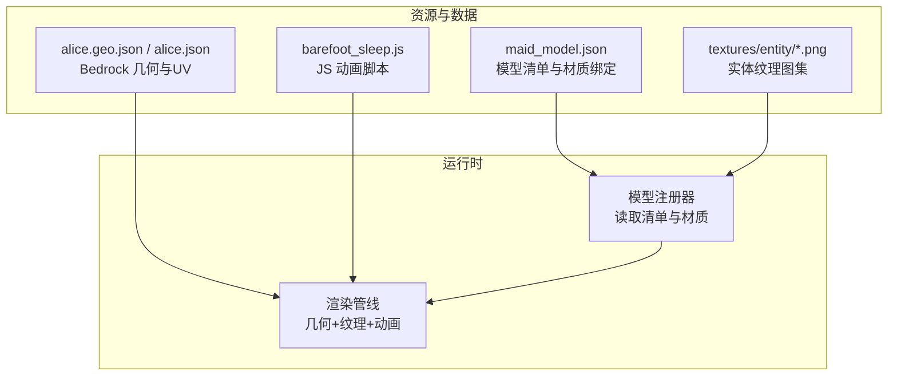
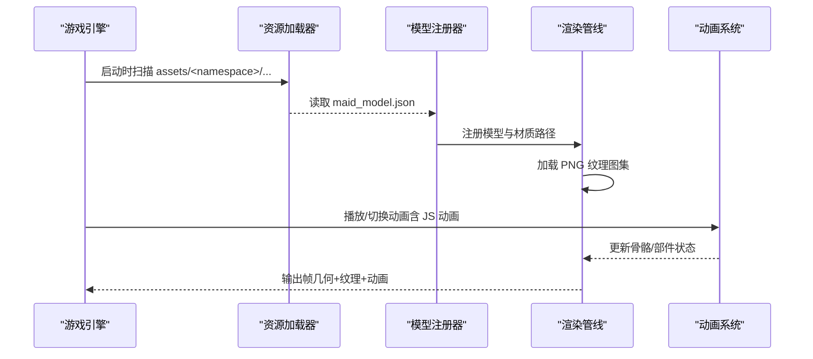
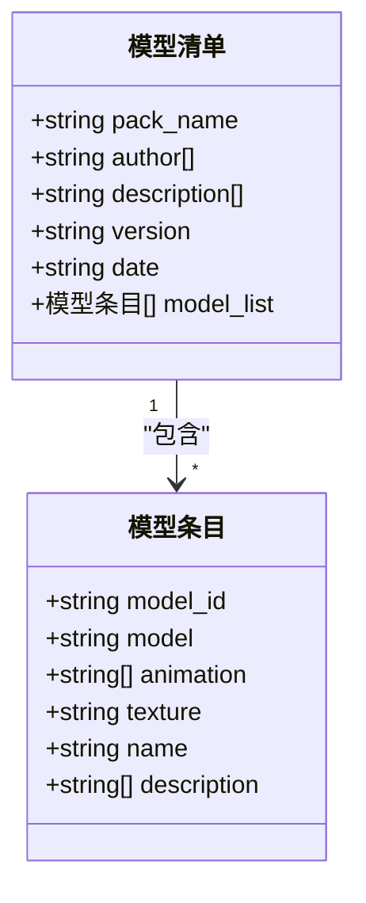
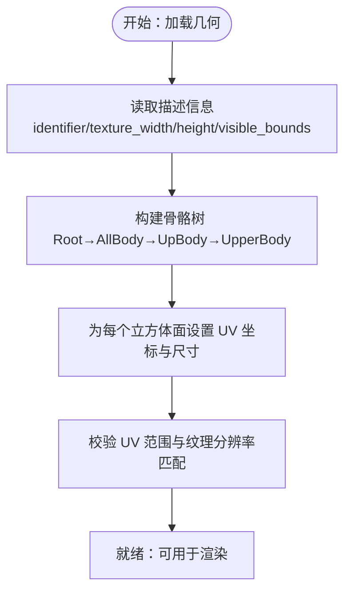
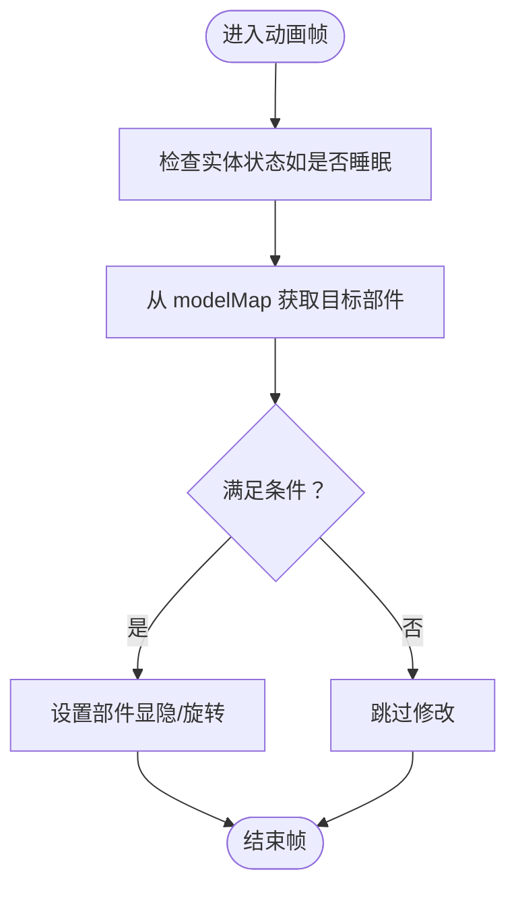
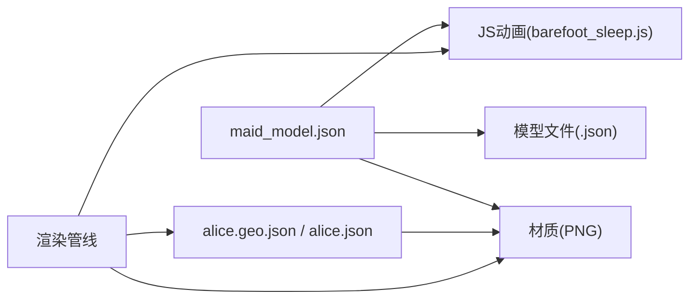

# 实体纹理

<cite>
**本文引用的文件**   
- [maid_model.json](file://kubejs/assets/skyfootspa/maid_model.json)
- [barefoot_sleep.js](file://kubejs/assets/skyfootspa/animations/barefoot_sleep.js)
- [alice.geo.json](file://kubejs/assets/kubejs/geo/alice.geo.json)
- [alice.json（几何）](file://kubejs/data/kubejs/entity/alice.json)
- [textures.md（物品贴图约定）](file://knowledge_base/item/textures.md)
</cite>

## 目录
1. [简介](#简介)
2. [项目结构](#项目结构)
3. [核心组件](#核心组件)
4. [架构总览](#架构总览)
5. [详细组件分析](#详细组件分析)
6. [依赖关系分析](#依赖关系分析)
7. [性能与优化](#性能与优化)
8. [故障排查](#故障排查)
9. [结论](#结论)
10. [附录：模组开发规范](#附录模组开发规范)

## 简介
本文件面向实体纹理系统，聚焦于本项目中已实现的实体模型、材质变体与动画集成方式。内容涵盖：
- 实体纹理命名与路径约定
- 文件格式要求（Bedrock 几何 JSON、JS 动画脚本）
- 渲染机制与资源加载流程
- 不同实体类型的纹理映射（人类女性、妖精等）
- 分辨率标准、材质属性与动画系统集成
- 多纹理支持、皮肤变体系统与动态纹理效果
- 为模组开发者提供的实体纹理创建指南与设计规范

## 项目结构
本项目通过 KubeJS 资源与数据组织实体纹理与模型：
- 实体模型清单与材质绑定：`kubejs/assets/skyfootspa/maid_model.json`
- 实体纹理图集（PNG）：`kubejs/assets/skyfootspa/textures/entity/*.png`
- Bedrock 风格几何定义（含 UV 映射）：`kubejs/assets/kubejs/geo/alice.geo.json` 与 `kubejs/data/kubejs/entity/alice.json`
- JS 动画脚本（TLM 兼容）：`kubejs/assets/skyfootspa/animations/barefoot_sleep.js`
- 资源包内物品贴图约定参考：`knowledge_base/item/textures.md`

图表来源
- [maid_model.json:1-145](file://kubejs/assets/skyfootspa/maid_model.json#L1-L145)
- [alice.geo.json:1-58](file://kubejs/assets/kubejs/geo/alice.geo.json#L1-L58)
- [alice.json（几何）:1-57](file://kubejs/data/kubejs/entity/alice.json#L1-L57)
- [barefoot_sleep.js:1-22](file://kubejs/assets/skyfootspa/animations/barefoot_sleep.js#L1-L22)

章节来源
- [maid_model.json:1-145](file://kubejs/assets/skyfootspa/maid_model.json#L1-L145)
- [alice.geo.json:1-58](file://kubejs/assets/kubejs/geo/alice.geo.json#L1-L58)
- [alice.json（几何）:1-57](file://kubejs/data/kubejs/entity/alice.json#L1-L57)
- [barefoot_sleep.js:1-22](file://kubejs/assets/skyfootspa/animations/barefoot_sleep.js#L1-L22)

## 核心组件
- 模型清单与材质绑定（maid_model.json）
  - 定义实体模型 ID、模型路径、动画列表、材质路径、名称与描述
  - 同一模型可配置多个材质变体（v1~v4），实现“皮肤变体系统”
- 实体纹理图集（PNG）
  - 存放于 `textures/entity/`，按模型 ID 或变体命名
  - 人类女性与妖精两类实体各提供基础与多套变体纹理
- Bedrock 几何与 UV 映射（alice.geo.json / alice.json）
  - 声明纹理分辨率（texture_width/height）、可见边界、骨骼与立方体
  - 每个面指定 UV 坐标与尺寸，用于将纹理映射到几何表面
- JS 动画脚本（barefoot_sleep.js）
  - 遵循 TLM 的 CustomJsAnimationManger 契约，暴露 `animation` 方法
  - 根据实体状态（如睡眠）控制特定部件显隐或旋转

章节来源
- [maid_model.json:1-145](file://kubejs/assets/skyfootspa/maid_model.json#L1-L145)
- [alice.geo.json:1-58](file://kubejs/assets/kubejs/geo/alice.geo.json#L1-L58)
- [alice.json（几何）:1-57](file://kubejs/data/kubejs/entity/alice.json#L1-L57)
- [barefoot_sleep.js:1-22](file://kubejs/assets/skyfootspa/animations/barefoot_sleep.js#L1-L22)

## 架构总览
下图展示从资源加载到渲染的关键流程：清单解析、材质选择、几何加载、动画驱动与最终绘制。

图表来源
- [maid_model.json:1-145](file://kubejs/assets/skyfootspa/maid_model.json#L1-L145)
- [barefoot_sleep.js:1-22](file://kubejs/assets/skyfootspa/animations/barefoot_sleep.js#L1-L22)

## 详细组件分析

### 模型清单与材质变体（maid_model.json）
- 作用
  - 集中管理实体模型的 ID、模型文件、动画列表、材质路径、显示名与说明
  - 支持对同一模型挂载多套材质（v1~v4），形成“皮肤变体系统”
- 关键要点
  - model_id：唯一标识，便于在逻辑层引用
  - model：模型文件路径（通常为 .json）
  - animation：动画数组，包含多个 JS 动画片段，按顺序组合
  - texture：材质路径，指向 textures/entity/*.png
  - name/description：供 UI 或调试使用
- 变体设计
  - 人类女性与妖精均提供 v1~v4 变体，便于外观差异化而不增加新模型

图表来源
- [maid_model.json:1-145](file://kubejs/assets/skyfootspa/maid_model.json#L1-L145)

章节来源
- [maid_model.json:1-145](file://kubejs/assets/skyfootspa/maid_model.json#L1-L145)

### Bedrock 几何与 UV 映射（alice.geo.json / alice.json）
- 作用
  - 定义实体几何体、骨骼层级、可见边界与纹理分辨率
  - 通过 UV 将纹理像素映射到几何体的各个面
- 关键要点
  - texture_width/texture_height：纹理分辨率（示例为 128x128）
  - visible_bounds_*：包围盒参数，影响渲染裁剪与碰撞可视化
  - bones/cubes：骨骼与立方体集合，构成 3D 网格
  - uv/north/east/south/west/up/down：各面的 UV 坐标与尺寸
- 注意事项
  - UV 坐标需与纹理分辨率一致，避免拉伸或错位
  - 几何体与纹理应保持一致的命名空间与版本格式

图表来源
- [alice.geo.json:1-58](file://kubejs/assets/kubejs/geo/alice.geo.json#L1-L58)
- [alice.json（几何）:1-57](file://kubejs/data/kubejs/entity/alice.json#L1-L57)

章节来源
- [alice.geo.json:1-58](file://kubejs/assets/kubejs/geo/alice.geo.json#L1-L58)
- [alice.json（几何）:1-57](file://kubejs/data/kubejs/entity/alice.json#L1-L57)

### JS 动画脚本（barefoot_sleep.js）
- 作用
  - 实现自定义动画逻辑，例如睡眠状态下赤脚部件的显隐与跟随腿部动作
- 关键要点
  - 遵循 TLM 的 CustomJsAnimationManger 契约：脚本末尾返回对象，包含 `animation` 方法
  - 方法签名：`animation(maid, limbSwing, limbSwingAmount, ageInTicks, netHeadYaw, headPitch, scaleFactor, modelMap)`
  - 安全要求：函数体不得抛出异常，否则会被移除该模型的整个动画列表
  - 部件控制：通过 modelMap 获取部件并设置可见性或变换
- 典型流程

图表来源
- [barefoot_sleep.js:1-22](file://kubejs/assets/skyfootspa/animations/barefoot_sleep.js#L1-L22)

章节来源
- [barefoot_sleep.js:1-22](file://kubejs/assets/skyfootspa/animations/barefoot_sleep.js#L1-L22)

### 纹理命名与路径约定
- 实体纹理
  - 位于 `assets/<namespace>/textures/entity/*.png`
  - 文件名通常与 model_id 或变体后缀对应（如 human_femal.png、human_femal_v1.png）
- 物品贴图约定（参考）
  - 未显式指定材质时，默认查找 `assets/<namespace>/textures/item/<item_id>.png`
  - 可通过 `.texture(...)` 指定任意资源包内的贴图路径

章节来源
- [maid_model.json:1-145](file://kubejs/assets/skyfootspa/maid_model.json#L1-L145)
- [textures.md:1-39](file://knowledge_base/item/textures.md#L1-L39)

## 依赖关系分析
- 模型清单依赖
  - 模型清单（maid_model.json）依赖模型文件（.json）与材质（PNG）
  - 动画列表依赖 JS 动画脚本（barefoot_sleep.js）
- 几何与纹理依赖
  - 几何（alice.geo.json / alice.json）依赖纹理分辨率与 UV 映射
- 运行时依赖
  - 渲染管线依赖几何、纹理与动画三者的协同

图表来源
- [maid_model.json:1-145](file://kubejs/assets/skyfootspa/maid_model.json#L1-L145)
- [alice.geo.json:1-58](file://kubejs/assets/kubejs/geo/alice.geo.json#L1-L58)
- [alice.json（几何）:1-57](file://kubejs/data/kubejs/entity/alice.json#L1-L57)
- [barefoot_sleep.js:1-22](file://kubejs/assets/skyfootspa/animations/barefoot_sleep.js#L1-L22)

章节来源
- [maid_model.json:1-145](file://kubejs/assets/skyfootspa/maid_model.json#L1-L145)
- [alice.geo.json:1-58](file://kubejs/assets/kubejs/geo/alice.geo.json#L1-L58)
- [alice.json（几何）:1-57](file://kubejs/data/kubejs/entity/alice.json#L1-L57)
- [barefoot_sleep.js:1-22](file://kubejs/assets/skyfootspa/animations/barefoot_sleep.js#L1-L22)

## 性能与优化
- 纹理分辨率
  - 几何定义中声明了 texture_width/height（示例为 128x128），建议保持统一分辨率以减少内存碎片
- 图集打包
  - 将同类型实体纹理合并至图集，减少纹理切换开销
- 动画复杂度
  - JS 动画应避免频繁状态判断与复杂计算；仅在必要时更新部件显隐或变换
- 可见边界
  - 合理设置 visible_bounds_*，减少不必要的渲染与裁剪计算

[本节为通用指导，不直接分析具体文件]

## 故障排查
- 缺失贴图（紫色方块）
  - 确认材质路径与 PNG 文件存在且命名正确
  - 若未显式指定材质，确保默认路径下存在 `<id>.png`
- 纹理错位或拉伸
  - 检查几何中的 UV 坐标与纹理分辨率是否匹配
  - 确认 UV 范围未越界
- 动画失效或消失
  - 检查 JS 动画脚本是否抛出异常；若有异常，模型动画将被移除
  - 确认动画路径在清单中正确列出，且脚本符合 TLM 契约

章节来源
- [textures.md:1-39](file://knowledge_base/item/textures.md#L1-L39)
- [barefoot_sleep.js:1-22](file://kubejs/assets/skyfootspa/animations/barefoot_sleep.js#L1-L22)

## 结论
本项目通过 KubeJS 资源与数据实现了完整的实体纹理体系：以模型清单为核心，结合 Bedrock 几何与 JS 动画，达成多纹理、多变体与动态效果的统一。遵循统一的命名与路径约定、合理的分辨率与 UV 映射，以及安全的动画脚本编写规范，可显著提升开发效率与运行稳定性。

[本节为总结性内容，不直接分析具体文件]

## 附录：模组开发规范
- 命名规范
  - 实体纹理：`assets/<namespace>/textures/entity/<model_id>[_variant].png`
  - 模型清单：`assets/<namespace>/maid_model.json`（或同类清单）
  - 几何定义：`assets/<namespace>/geo/<entity>.geo.json` 与 `data/<namespace>/entity/<entity>.json`
  - 动画脚本：`assets/<namespace>/animations/<anim>.js`
- 文件格式要求
  - 清单 JSON：包含 pack_name、author、description、version、date、model_list
  - 几何 JSON：包含 format_version、minecraft:geometry、description（identifier、texture_width/height、visible_bounds_*）、bones、cubes、uv
  - JS 动画：导出包含 `animation` 方法的对象，遵循 TLM 契约
- 渲染机制
  - 清单解析 → 材质选择 → 几何加载 → 动画驱动 → 渲染输出
- 多纹理支持与皮肤变体
  - 通过清单中的 texture 字段为同一模型绑定多套材质（v1~v4）
- 动态纹理效果
  - 使用 JS 动画脚本控制部件显隐与变换，实现状态驱动的视觉效果
- 开发最佳实践
  - 统一纹理分辨率，避免混合不同尺寸图集
  - 合理拆分动画片段，按需组合
  - 严格校验 UV 与分辨率匹配，防止错位
  - 在 JS 动画中加入异常保护，避免动画被整体移除

[本节为通用指导，不直接分析具体文件]