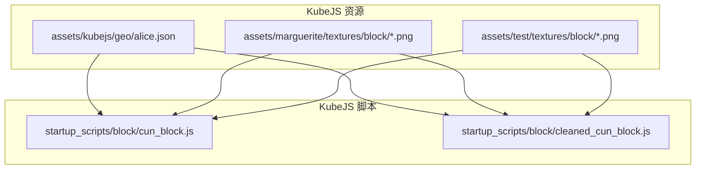
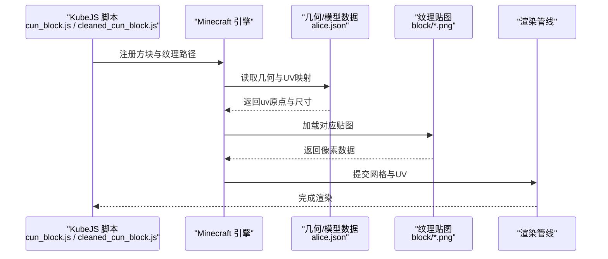
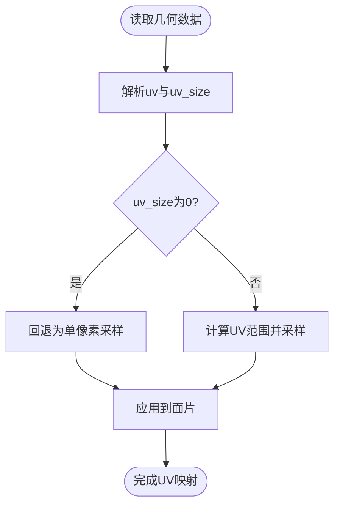
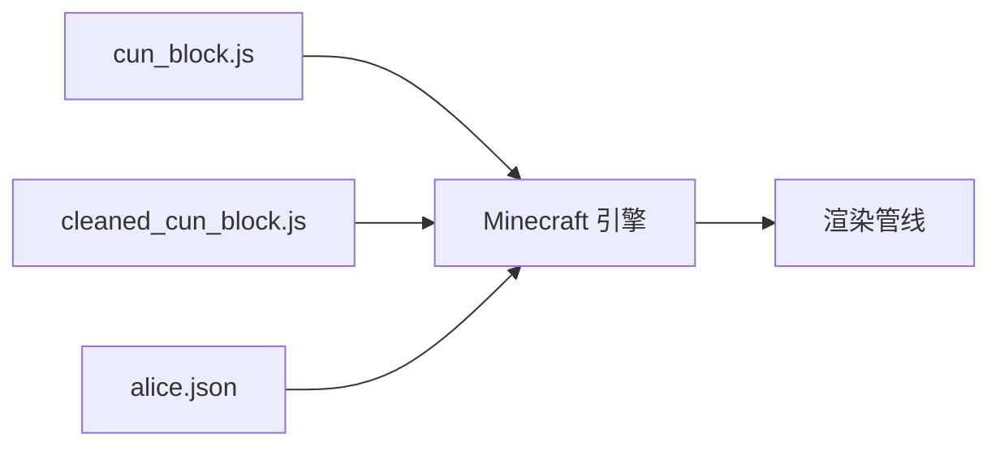

# 方块纹理

<cite>
**本文引用的文件**   
- [alice.json](file://kubejs/assets/kubejs/geo/alice.json)
- [cleaned_cun_block.js](file://kubejs/startup_scripts/block/cleaned_cun_block.js)
- [cun_block.js](file://kubejs/startup_scripts/block/cun_block.js)
</cite>

## 目录
1. [简介](#简介)
2. [项目结构](#项目结构)
3. [核心组件](#核心组件)
4. [架构总览](#架构总览)
5. [详细组件分析](#详细组件分析)
6. [依赖关系分析](#依赖关系分析)
7. [性能考虑](#性能考虑)
8. [故障排查指南](#故障排查指南)
9. [结论](#结论)
10. [附录](#附录)

## 简介
本文件面向模组与资源包开发者，系统化说明 Minecraft 方块纹理的命名规范、文件格式要求与渲染机制；梳理不同方块类型的纹理定义方式（侧面、顶部、底部映射规则）；解释纹理贴图分辨率标准（通常为 16x16 像素）、材质属性设置与光照效果处理；并提供 UV 坐标映射、纹理拼接与多纹理混合技术的设计规范与实践建议。文档同时结合仓库中已有的 KubeJS 脚本与实体几何数据，给出可操作的参考路径与最佳实践。

## 项目结构
仓库中与“方块纹理”直接相关的资产与脚本主要位于以下位置：
- 资源资产目录 assets：存放纹理贴图与模型/几何数据等
- KubeJS 启动脚本 startup_scripts：用于注册方块、绑定纹理与行为
- 实体几何数据 geo：包含大量 UV 映射示例，可用于理解 UV 坐标与面片映射

图表来源
- [alice.json:1738-1924](file://kubejs/assets/kubejs/geo/alice.json#L1738-L1924)
- [cun_block.js:20-20](file://kubejs/startup_scripts/block/cun_block.js#L20-L20)
- [cleaned_cun_block.js:20-20](file://kubejs/startup_scripts/block/cleaned_cun_block.js#L20-L20)

章节来源
- [alice.json:1738-1924](file://kubejs/assets/kubejs/geo/alice.json#L1738-L1924)
- [cun_block.js:20-20](file://kubejs/startup_scripts/block/cun_block.js#L20-L20)
- [cleaned_cun_block.js:20-20](file://kubejs/startup_scripts/block/cleaned_cun_block.js#L20-L20)

## 核心组件
- 纹理贴图与命名规范
  - 方块纹理通常位于 assets/<namespace>/textures/block/ 下，文件名与方块 ID 对应，扩展名为 .png。
  - 常见变体通过后缀区分，如 _top.png、_bottom.png、_side.png，或按状态使用多个文件。
  - 透明纹理需保留 alpha 通道，避免锯齿与边缘发灰。
- 模型与几何数据
  - 在 KubeJS 生态中，常以 JSON 描述几何体与 UV 映射，例如 alice.json 中的 uv 字段定义了各面的 UV 原点与尺寸。
  - UV 坐标支持浮点精度，允许精细控制贴图的局部采样区域。
- 脚本与注册
  - 通过 KubeJS 脚本注册方块并关联纹理路径，便于动态管理与调试。
  - 注释中明确标注了纹理路径约定，便于定位与替换。

章节来源
- [alice.json:1738-1924](file://kubejs/assets/kubejs/geo/alice.json#L1738-L1924)
- [cun_block.js:20-20](file://kubejs/startup_scripts/block/cun_block.js#L20-L20)
- [cleaned_cun_block.js:20-20](file://kubejs/startup_scripts/block/cleaned_cun_block.js#L20-L20)

## 架构总览
下图展示从脚本到纹理资源的整体流程：脚本声明方块与纹理路径，引擎加载贴图并根据模型/几何数据的 UV 映射进行渲染。

图表来源
- [cun_block.js:20-20](file://kubejs/startup_scripts/block/cun_block.js#L20-L20)
- [cleaned_cun_block.js:20-20](file://kubejs/startup_scripts/block/cleaned_cun_block.js#L20-L20)
- [alice.json:1738-1924](file://kubejs/assets/kubejs/geo/alice.json#L1738-L1924)

## 详细组件分析

### 几何与 UV 映射（alice.json）
- 关键要点
  - 每个面（north/east/south/west/up/down）均提供 uv 与 uv_size，表示 UV 原点和采样区域大小。
  - uv_size 可为 0，表示该方向不采样或退化为单像素采样。
  - 浮点 uv_size 支持更精细的纹理切片，适合复杂模型的细节表现。
- 复杂度与影响
  - 高精度 UV 提升视觉质量，但需注意纹理抖动与 mip 选择。
  - 过多细分可能导致纹理缓存压力增大。

图表来源
- [alice.json:1738-1924](file://kubejs/assets/kubejs/geo/alice.json#L1738-L1924)

章节来源
- [alice.json:1738-1924](file://kubejs/assets/kubejs/geo/alice.json#L1738-L1924)

### 方块纹理命名与路径（cun_block.js / cleaned_cun_block.js）
- 关键要点
  - 脚本注释明确指出纹理路径约定，例如 assets/marguerite/textures/block/cun_block.png。
  - KubeJS 默认识别规则将方块 ID 与 textures/block/ 下的同名 PNG 关联。
  - 若需要变体纹理，可在文件名中使用后缀（如 _top/_bottom/_side），并在脚本或模型中指定。
- 最佳实践
  - 统一命名空间与目录结构，避免跨包冲突。
  - 对透明纹理使用 PNG 并保留 alpha。
  - 对高对比度边缘使用抗锯齿与适当的 mip 生成。

章节来源
- [cun_block.js:20-20](file://kubejs/startup_scripts/block/cun_block.js#L20-L20)
- [cleaned_cun_block.js:20-20](file://kubejs/startup_scripts/block/cleaned_cun_block.js#L20-L20)

### 方块类型与面片映射规则
- 标准立方体方块
  - 顶部/底部/侧面分别对应 up/down/north/east/south/west 六个面。
  - 可通过模型或几何数据为不同面指定不同纹理或 UV 区域。
- 非标准方块（台阶、楼梯、斜面板等）
  - 使用子块或自定义几何体，配合 uv 与 uv_size 精确映射。
  - 注意相邻块的接缝与光照过渡，必要时引入遮罩或渐变纹理。
- 多纹理混合
  - 在同一面上叠加多层纹理（如泥土+草皮），通过遮罩纹理控制混合比例。
  - 使用 AO（环境光遮蔽）贴图增强立体感。

[本节为概念性说明，无需代码来源]

### 纹理分辨率与材质属性
- 分辨率标准
  - 经典风格采用 16x16 像素；高清资源包可采用 32x32、64x64 等更高规格。
  - 保持幂次方尺寸以获得更好的 mip 链与缓存命中。
- 材质属性
  - 透明度：alpha 通道用于半透明方块（玻璃、水等）。
  - 光照：启用 smooth lighting 与 AO 贴图，减少硬阴影。
  - 法线贴图：可选，用于增强表面细节（需着色器支持）。

[本节为概念性说明，无需代码来源]

### UV 坐标映射、纹理拼接与多纹理混合
- UV 坐标映射
  - 使用 uv 与 uv_size 精确定位贴图区域，避免拉伸与错位。
  - 对于曲面或倾斜面，合理分配 UV 以避免接缝。
- 纹理拼接
  - 将多个小图拼接到一张大图（atlas），减少绘制调用次数。
  - 确保图集边界留白，防止采样溢出。
- 多纹理混合
  - 使用遮罩纹理控制不同材质的混合区域。
  - 注意混合后的光照一致性，避免明暗突变。

[本节为概念性说明，无需代码来源]

## 依赖关系分析
- 脚本与几何数据
  - cun_block.js 与 cleaned_cun_block.js 负责注册方块与纹理路径。
  - alice.json 提供几何与 UV 映射示例，供模型与渲染管线使用。
- 外部依赖
  - Minecraft 引擎负责加载纹理、构建网格与执行渲染。
  - 资源包与模组可能覆盖默认纹理与模型。

图表来源
- [cun_block.js:20-20](file://kubejs/startup_scripts/block/cun_block.js#L20-L20)
- [cleaned_cun_block.js:20-20](file://kubejs/startup_scripts/block/cleaned_cun_block.js#L20-L20)
- [alice.json:1738-1924](file://kubejs/assets/kubejs/geo/alice.json#L1738-L1924)

章节来源
- [cun_block.js:20-20](file://kubejs/startup_scripts/block/cun_block.js#L20-L20)
- [cleaned_cun_block.js:20-20](file://kubejs/startup_scripts/block/cleaned_cun_block.js#L20-L20)
- [alice.json:1738-1924](file://kubejs/assets/kubejs/geo/alice.json#L1738-L1924)

## 性能考虑
- 纹理图集（Atlas）
  - 合并小图到大图，减少绘制调用与切换开销。
  - 合理布局图集，避免频繁采样跨越边界。
- Mip 链与缓存
  - 使用幂次方尺寸，启用自动 mip 生成。
  - 避免过高分辨率导致显存占用过大。
- 几何复杂度
  - 控制顶点数与面片数量，避免过度细分。
  - 对静态场景使用批处理与实例化渲染。

[本节为概念性说明，无需代码来源]

## 故障排查指南
- 纹理未显示或显示错误
  - 检查纹理路径是否与脚本注释一致，确认命名空间与文件名正确。
  - 验证 PNG 是否包含 alpha 通道（透明纹理）。
- UV 错位或拉伸
  - 核对 uv 与 uv_size 的计算，确保与贴图尺寸匹配。
  - 检查模型旋转与缩放是否影响 UV 映射。
- 光照异常或接缝明显
  - 调整 AO 贴图与光照模式，确保相邻块光照一致。
  - 在接缝处添加遮罩或渐变纹理，平滑过渡。

章节来源
- [cun_block.js:20-20](file://kubejs/startup_scripts/block/cun_block.js#L20-L20)
- [cleaned_cun_block.js:20-20](file://kubejs/startup_scripts/block/cleaned_cun_block.js#L20-L20)
- [alice.json:1738-1924](file://kubejs/assets/kubejs/geo/alice.json#L1738-L1924)

## 结论
本文件系统梳理了 Minecraft 方块纹理的命名规范、文件格式、渲染机制与开发实践。结合仓库中的 KubeJS 脚本与几何数据，提供了从脚本注册到 UV 映射的完整链路说明。遵循本文档的规范与最佳实践，可有效提升纹理质量与渲染性能，并为模组与资源包的持续迭代奠定基础。

[本节为总结性内容，无需代码来源]

## 附录
- 快速清单
  - 纹理命名：assets/<namespace>/textures/block/<block_id>.png
  - 变体纹理：_top/_bottom/_side 后缀
  - UV 映射：使用 uv 与 uv_size 精确定位
  - 透明纹理：PNG + alpha 通道
  - 光照优化：AO 贴图与平滑光照
  - 性能优化：图集、mip 链、几何简化

[本节为补充信息，无需代码来源]