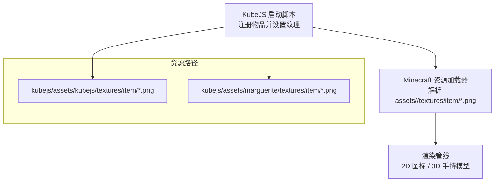
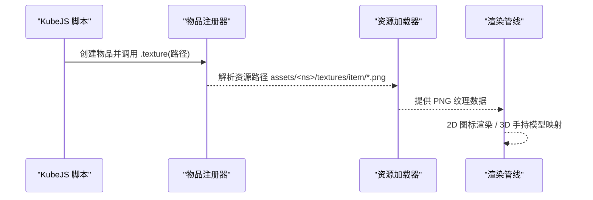
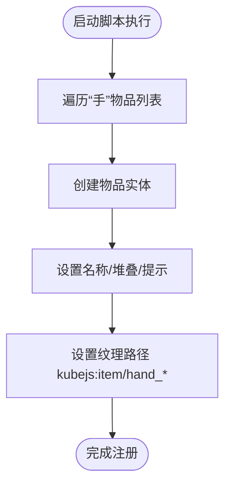
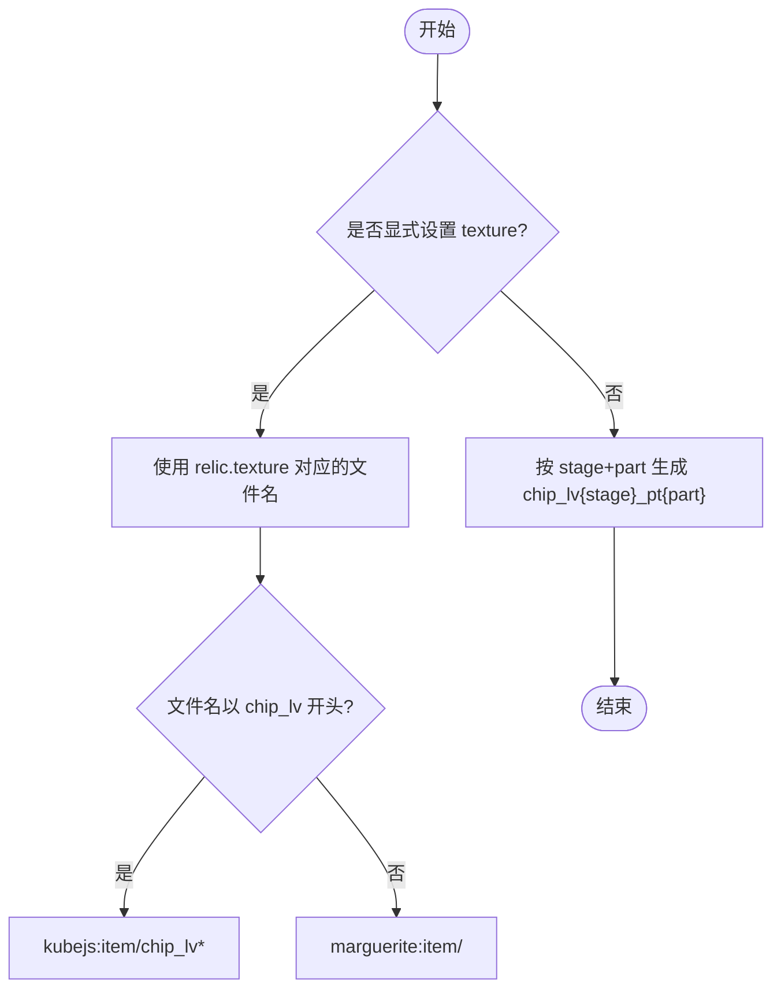
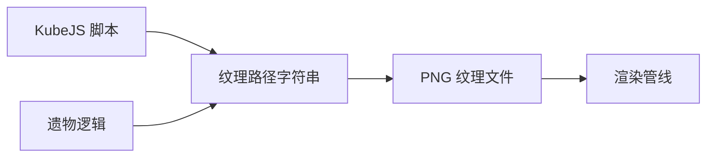

# 物品纹理

<cite>
**本文引用的文件**   
- [hand_items.js](file://kubejs/startup_scripts/item/hand_items.js)
- [relic.js](file://kubejs/startup_scripts/relic/relic.js)
- [textures.md](file://knowledge_base/item/textures.md)
- [README.md](file://README.md)
</cite>

## 目录
1. [简介](#简介)
2. [项目结构](#项目结构)
3. [核心组件](#核心组件)
4. [架构总览](#架构总览)
5. [详细组件分析](#详细组件分析)
6. [依赖关系分析](#依赖关系分析)
7. [性能与渲染特性](#性能与渲染特性)
8. [故障排查指南](#故障排查指南)
9. [结论](#结论)
10. [附录：模组开发规范](#附录模组开发规范)

## 简介
本文件面向模组开发者，系统化说明本包中“物品纹理”的命名规范、资源路径约定、注册方式与渲染机制。内容覆盖：
- 手持物品的 2D 图标显示与 3D 手持渲染的关系
- 不同物品类型的纹理定义方式（原版贴图复用、自定义贴图、自动芯片贴图）
- 纹理分辨率标准、材质属性设置与光影效果处理要点
- 纹理动画支持与特殊渲染效果的实现思路
- 针对武器、工具、消耗品等常见物品类型的纹理制作规范

## 项目结构
本仓库使用 KubeJS 脚本在启动阶段注册物品并绑定纹理。与物品纹理直接相关的代码与资源分布如下：
- 脚本层：通过 `StartupEvents.registry("item", ...)` 创建物品并调用 `.texture(...)` 指定纹理
- 资源层：PNG 纹理位于 `assets/<namespace>/textures/item/` 下，命名与脚本中的纹理路径一一对应
- 知识文档：`knowledge_base/item/textures.md` 总结了默认贴图路径、复用原版贴图与自定义贴图的规则

图表来源
- [hand_items.js:12-33](file://kubejs/startup_scripts/item/hand_items.js#L12-L33)
- [relic.js:71-87](file://kubejs/startup_scripts/relic/relic.js#L71-L87)
- [textures.md:1-39](file://knowledge_base/item/textures.md#L1-L39)

章节来源
- [README.md:1-6](file://README.md#L1-L6)
- [textures.md:1-39](file://knowledge_base/item/textures.md#L1-L39)

## 核心组件
- 手持物品注册器：集中声明“手”类物品，统一设置名称、堆叠上限、提示与纹理
- 遗物纹理分配器：根据遗物名称后缀与阶段，自动选择对应芯片纹理或独特遗物纹理
- 纹理约定文档：明确默认贴图路径、原版贴图复用与自定义贴图放置位置

章节来源
- [hand_items.js:12-33](file://kubejs/startup_scripts/item/hand_items.js#L12-L33)
- [relic.js:71-87](file://kubejs/startup_scripts/relic/relic.js#L71-L87)
- [textures.md:1-39](file://knowledge_base/item/textures.md#L1-L39)

## 架构总览
以下序列图展示从脚本注册到最终渲染的关键流程：

图表来源
- [hand_items.js:12-33](file://kubejs/startup_scripts/item/hand_items.js#L12-L33)
- [relic.js:71-87](file://kubejs/startup_scripts/relic/relic.js#L71-L87)
- [textures.md:1-39](file://knowledge_base/item/textures.md#L1-L39)

## 详细组件分析

### 手持物品纹理注册
- 功能要点
  - 批量注册四种“手”物品，分别用于搓脚的不同部位
  - 每个物品均设置显示名、最大堆叠数、提示文本与纹理路径
  - 纹理路径指向 `kubejs:item/hand_jiaozhang|jiaoxin|jiaogen|jiaozhi`
- 关键行为
  - 通过 `event.create(id).texture(path)` 将 PNG 纹理与物品绑定
  - 若未显式设置纹理，则遵循默认路径约定（见下文“纹理约定”）

图表来源
- [hand_items.js:12-33](file://kubejs/startup_scripts/item/hand_items.js#L12-L33)

章节来源
- [hand_items.js:12-33](file://kubejs/startup_scripts/item/hand_items.js#L12-L33)

### 遗物纹理自动分配
- 功能要点
  - 根据遗物名称后缀 `_toe/_sole/_center/_heel/_all` 映射为芯片部位编号 1~5
  - 若遗物对象包含 `texture` 字段，优先使用该值；否则按阶段+部位自动生成芯片纹理路径
  - 对非芯片类遗物，回退到 `marguerite:item/<name>` 作为纹理路径
- 关键行为
  - 自动拼接 `kubejs:item/chip_lv{stage}_pt{part}` 或 `marguerite:item/<name>`
  - 支持为遗物附加标签（tags），便于分类与筛选

图表来源
- [relic.js:61-87](file://kubejs/startup_scripts/relic/relic.js#L61-L87)

章节来源
- [relic.js:61-87](file://kubejs/startup_scripts/relic/relic.js#L61-L87)

### 纹理约定与资源路径
- 默认贴图路径
  - 未显式调用 `.texture(...)` 时，KubeJS 默认查找 `assets/marguerite/textures/item/<item_id>.png`
- 复用原版贴图
  - 可直接引用 `minecraft:item/*` 的原版纹理，如药水、蜂蜜瓶、经验瓶等
- 自定义贴图
  - 自定义纹理需放置在对应 namespace 的资源目录下，例如：
    - `kubejs/assets/kubejs/textures/item/hand_jiaozhang.png`
    - `kubejs/assets/marguerite/textures/item/wrench_copper.png`
- 缺失贴图
  - 未找到纹理时会显示紫色缺失贴图，需检查路径与命名是否正确

章节来源
- [textures.md:1-39](file://knowledge_base/item/textures.md#L1-L39)

## 依赖关系分析
- 脚本与资源的耦合
  - 脚本通过字符串路径引用资源，强依赖资源文件的实际存在与命名一致性
- 内部模块耦合
  - 遗物系统依赖名称后缀与阶段信息来推导纹理，属于“约定驱动”的设计
- 外部依赖
  - 依赖 Minecraft 资源加载器与渲染管线进行 2D/3D 渲染
  - 依赖 Curios API 能力构建器（仅用于装备逻辑，不影响纹理本身）

图表来源
- [hand_items.js:12-33](file://kubejs/startup_scripts/item/hand_items.js#L12-L33)
- [relic.js:61-87](file://kubejs/startup_scripts/relic/relic.js#L61-L87)
- [textures.md:1-39](file://knowledge_base/item/textures.md#L1-L39)

章节来源
- [hand_items.js:12-33](file://kubejs/startup_scripts/item/hand_items.js#L12-L33)
- [relic.js:61-87](file://kubejs/startup_scripts/relic/relic.js#L61-L87)
- [textures.md:1-39](file://knowledge_base/item/textures.md#L1-L39)

## 性能与渲染特性
- 2D 图标与 3D 手持模型
  - 所有物品在背包、快捷栏、掉落物等场景均以 2D 图标形式渲染
  - 当玩家手持物品时，Minecraft 会根据物品类型（剑、镐、棍等）套用内置 3D 手持模型，并将纹理映射到模型表面
- 分辨率与格式
  - 本项目中使用的纹理均为 PNG 格式，建议采用 16x16 像素的标准尺寸以保持像素风格一致性与性能稳定
- 材质属性与光影
  - 普通 PNG 纹理不支持法线、粗糙度等高级材质属性
  - 启用光影后，光照计算基于顶点法线与基础纹理；如需更丰富效果，可考虑使用带法线贴图的资源包或第三方渲染增强
- 动画与特效
  - 静态 PNG 不支持帧动画
  - 若需要动态效果，可通过以下方式之一实现：
    - 使用带有发光/透明通道的纹理配合光影
    - 借助第三方模组或客户端优化（如 OptiFine/Iris）提供的粒子/光晕效果
    - 在脚本层控制粒子或 HUD 元素模拟“动态”反馈

[本节为通用指导，不直接分析具体文件]

## 故障排查指南
- 现象：物品显示为紫色缺失贴图
  - 可能原因
    - 未在脚本中设置 `.texture(...)`，且默认路径下缺少 `<item_id>.png`
    - 自定义纹理路径与文件实际路径不一致
    - 文件名大小写或扩展名错误
  - 解决步骤
    - 确认脚本中 `.texture(...)` 的路径与 `assets/<namespace>/textures/item/` 下的文件名完全一致
    - 若未设置纹理，请确保 `assets/marguerite/textures/item/<item_id>.png` 存在
    - 检查命名规范与后缀是否为 `.png`
- 现象：遗物纹理未按预期切换
  - 可能原因
    - 遗物名称后缀不符合 `_toe/_sole/_center/_heel/_all` 约定
    - 遗物对象未正确设置 `texture` 字段或 `stage` 范围不在 1~5
  - 解决步骤
    - 核对遗物名称后缀与阶段配置
    - 若使用自定义纹理，确保 `texture` 字段为不含 `.png` 的文件名字符串

章节来源
- [textures.md:1-39](file://knowledge_base/item/textures.md#L1-L39)
- [relic.js:61-87](file://kubejs/startup_scripts/relic/relic.js#L61-L87)

## 结论
本包的物品纹理体系以 KubeJS 脚本为核心入口，通过明确的资源路径约定与自动化纹理分配策略，实现了多类型物品的快速开发与统一管理。遵循本文档的命名规范与路径约定，可显著降低纹理缺失与渲染异常的概率，并为后续扩展（如动画、光影增强）预留空间。

[本节为总结性内容，不直接分析具体文件]

## 附录：模组开发规范
- 纹理命名规范
  - 手持物品：`hand_<部位>.png`，对应脚本中的 `kubejs:item/hand_*`
  - 遗物芯片：`chip_lv{阶段}_pt{部位}.png`，部位编号 1~5 对应脚趾、脚掌、脚心、脚跟、全部
  - 独特遗物：`<遗物名>.png`，路径为 `marguerite:item/<遗物名>`
- 资源目录组织
  - 自定义纹理统一放在 `assets/<namespace>/textures/item/` 下
  - 推荐按功能域划分 namespace（如 `kubejs`、`marguerite`）
- 纹理尺寸与格式
  - 推荐使用 16x16 像素 PNG，保持像素风一致性与渲染性能
  - 避免使用过大的纹理，以免增加内存占用与带宽压力
- 材质与光影
  - 普通 PNG 不支持高级材质属性；如需法线/高光，请使用支持该特性的资源包或客户端增强
  - 开启光影后，注意对比度与边缘锐利度的调整，避免视觉噪点
- 动画与特效
  - 静态纹理无法实现帧动画；如需动态效果，建议使用粒子系统或 HUD 叠加
  - 对于需要“发光”的物品，可使用半透明通道与光影结合的方式提升表现力
- 最佳实践
  - 在脚本中显式设置 `.texture(...)`，避免依赖默认路径导致的不确定性
  - 对遗物纹理采用“名称后缀 + 阶段”的约定，减少硬编码分支
  - 建立纹理清单与命名对照表，便于团队协作与维护

[本节为通用指导，不直接分析具体文件]