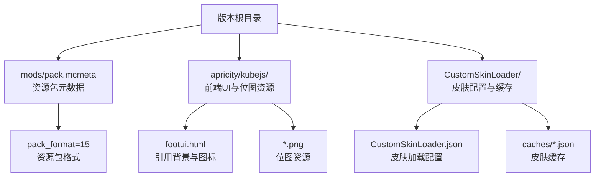
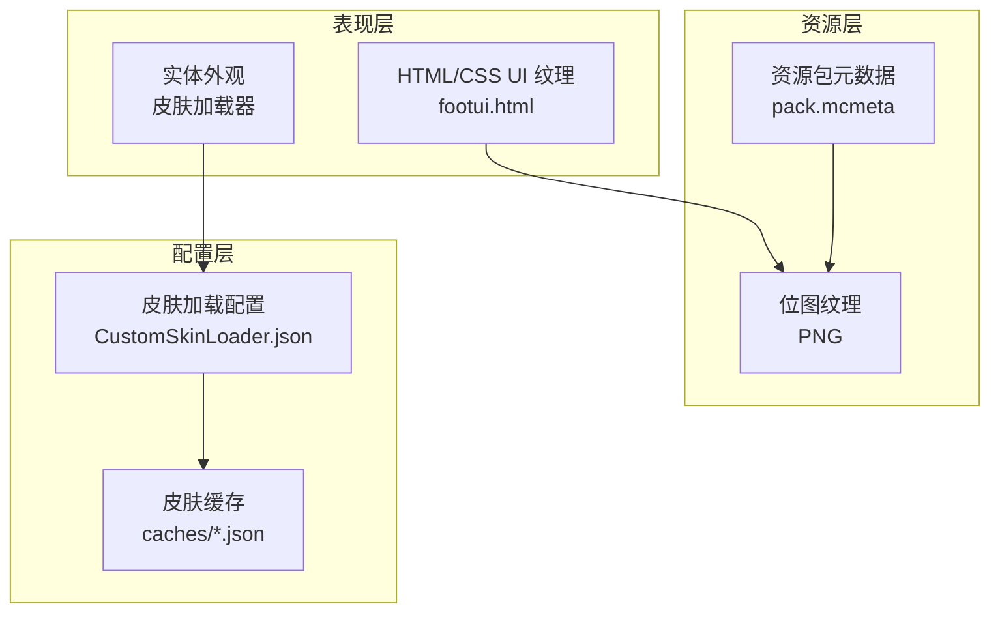
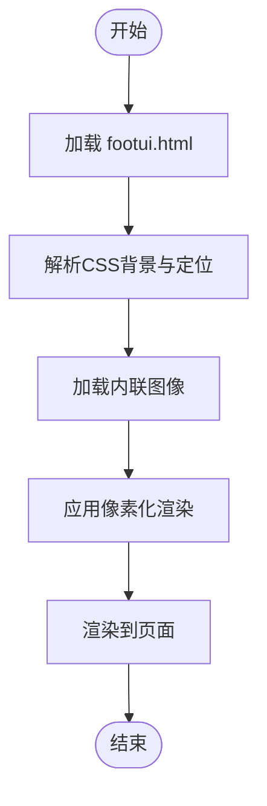
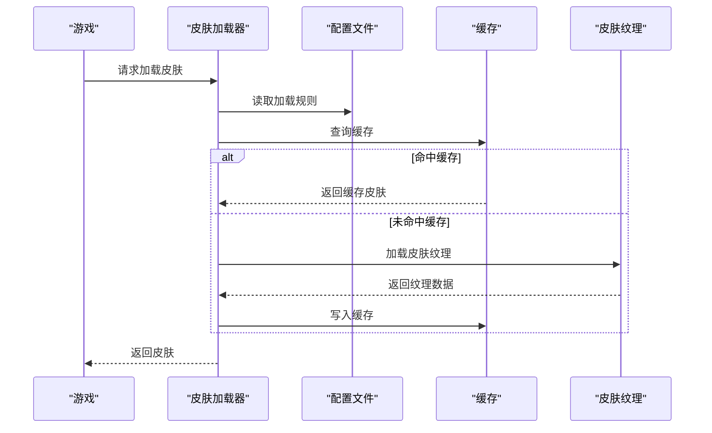
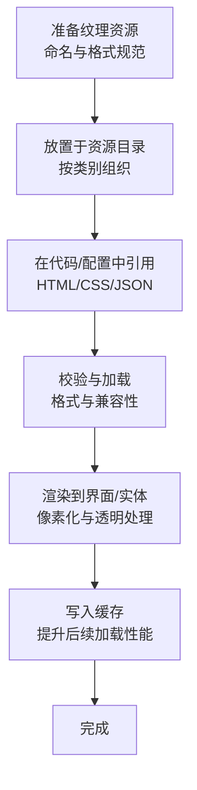
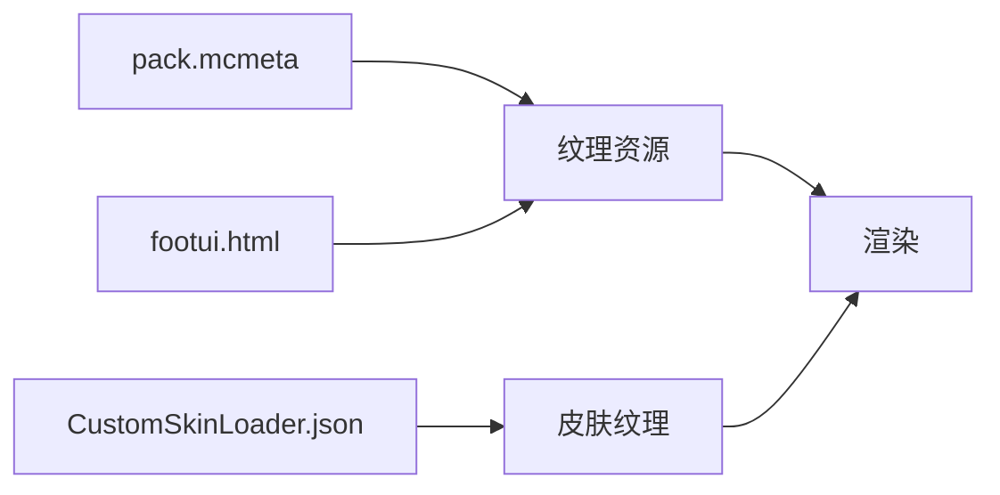

# 纹理资源

<cite>
**本文引用的文件**
- [README.md](file://README.md)
- [pack.mcmeta](file://mods/pack.mcmeta)
- [footui.html](file://apricity/kubejs/footui.html)
- [CustomSkinLoader.json](file://CustomSkinLoader/CustomSkinLoader.json)
</cite>

## 目录
1. [简介](#简介)
2. [项目结构](#项目结构)
3. [核心组件](#核心组件)
4. [架构总览](#架构总览)
5. [详细组件分析](#详细组件分析)
6. [依赖关系分析](#依赖关系分析)
7. [性能考量](#性能考量)
8. [故障排查指南](#故障排查指南)
9. [结论](#结论)
10. [附录](#附录)

## 简介
本文件面向模组开发者，系统化梳理该Minecraft版本中“纹理资源”的组织结构与管理方式，覆盖方块、物品、实体、UI与自定义皮肤等多类纹理的命名规范、文件格式要求、渲染机制与开发设计规范，并结合现有资源给出优化策略与兼容性建议。由于当前工作区以KubeJS与前端UI为主，本文将重点围绕HTML/CSS中使用的位图资源、皮肤加载器配置以及资源包元数据展开。

## 项目结构
该版本根目录包含多个与“纹理资源”相关的子树与文件：
- KubeJS前端UI资源：位于 apricity/kubejs/，其中 footui.html 引用多张PNG纹理作为背景与图标。
- 自定义皮肤加载器：位于 CustomSkinLoader/，包含皮肤配置与缓存文件，用于实体/玩家皮肤的动态加载。
- 资源包元数据：位于 mods/pack.mcmeta，声明资源包格式与描述信息。
- 版本安装说明：位于 README.md，提供基础环境与安装指引。

图表来源
- [pack.mcmeta:1-7](file://mods/pack.mcmeta#L1-L7)
- [footui.html:1-356](file://apricity/kubejs/footui.html#L1-L356)
- [CustomSkinLoader.json](file://CustomSkinLoader/CustomSkinLoader.json)

章节来源
- [README.md:1-6](file://README.md#L1-L6)
- [pack.mcmeta:1-7](file://mods/pack.mcmeta#L1-L7)

## 核心组件
- 前端UI纹理（HTML/CSS）
  - 使用CSS背景与内联图像的方式加载PNG纹理，强调像素风格与清晰度控制。
  - 关键点：背景平铺、定位、像素化渲染、透明通道与颜色叠加。
- 自定义皮肤加载器
  - 通过配置文件指定皮肤来源与缓存策略，支持实体/玩家皮肤的动态替换。
  - 关键点：配置项、缓存文件、加载优先级与容错策略。
- 资源包元数据
  - pack.mcmeta声明资源包格式与描述，确保客户端正确识别与加载资源。

章节来源
- [footui.html:64-353](file://apricity/kubejs/footui.html#L64-L353)
- [CustomSkinLoader.json](file://CustomSkinLoader/CustomSkinLoader.json)
- [pack.mcmeta:1-7](file://mods/pack.mcmeta#L1-L7)

## 架构总览
从“纹理资源”的视角，系统可抽象为三层：
- 表现层（UI与实体外观）：HTML/CSS负责UI纹理渲染；皮肤加载器负责实体/玩家皮肤。
- 资源层（资源包与元数据）：pack.mcmeta声明资源包格式；KubeJS与模组资源提供纹理素材。
- 配置层（加载与缓存）：皮肤加载器配置与缓存文件决定纹理加载路径与回退策略。

图表来源
- [footui.html:64-353](file://apricity/kubejs/footui.html#L64-L353)
- [pack.mcmeta:1-7](file://mods/pack.mcmeta#L1-L7)
- [CustomSkinLoader.json](file://CustomSkinLoader/CustomSkinLoader.json)

## 详细组件分析

### 组件A：前端UI纹理（footui.html）
- 功能概述
  - 通过CSS背景与内联图像组合实现UI界面的视觉呈现，强调像素风格与清晰度控制。
- 纹理使用方式
  - 背景图：使用CSS背景属性加载背景纹理，控制平铺与定位。
  - 图标图：内联图像加载图标纹理，支持像素化渲染与交互状态。
- 渲染机制
  - CSS层叠与定位：通过绝对定位、flex布局与z-index控制层级。
  - 像素化渲染：通过特定CSS属性保证像素风格在高DPI下的清晰度。
  - 透明与色彩：利用RGBA与透明通道实现半透明覆盖与颜色叠加。
- 设计规范
  - 命名规范：纹理文件名语义化，便于维护与查找。
  - 分辨率标准：建议采用整数倍像素（如16×16、32×32、64×64）以适配像素风格。
  - 材质属性：区分背景与图标两类纹理，背景用于大范围平铺，图标用于小面积精确显示。
  - 光照与阴影：通过颜色与透明度模拟光照效果，避免复杂光照计算。
- 开发流程
  - 资源准备：按规范生成PNG纹理并放置于指定目录。
  - 引用与调试：在HTML中引用纹理，使用浏览器开发者工具检查渲染结果。
  - 优化与兼容：确保在不同DPI与缩放比例下的显示一致性。

图表来源
- [footui.html:64-353](file://apricity/kubejs/footui.html#L64-L353)

章节来源
- [footui.html:1-356](file://apricity/kubejs/footui.html#L1-L356)

### 组件B：自定义皮肤加载器（CustomSkinLoader）
- 功能概述
  - 提供皮肤来源配置与缓存机制，支持实体/玩家皮肤的动态加载与替换。
- 配置要点
  - 配置文件：定义皮肤来源、加载规则与回退策略。
  - 缓存文件：记录已加载皮肤的缓存信息，提升重复访问性能。
- 加载流程
  - 初始化：读取配置文件，建立加载规则。
  - 查询：根据实体或玩家标识查询可用皮肤。
  - 缓存命中：若命中缓存则直接使用，否则进行网络/本地加载。
  - 回退：若加载失败，按配置回退至默认皮肤。
- 设计规范
  - 命名规范：皮肤文件命名遵循统一前缀与扩展名约定。
  - 文件格式：推荐使用PNG格式，支持透明通道。
  - 分辨率标准：建议与目标实体的渲染分辨率匹配，避免拉伸失真。
  - 材质属性：注意透明通道与边缘羽化，减少接缝感。
  - 兼容性：为不同客户端版本与模组提供兼容的加载策略。

图表来源
- [CustomSkinLoader.json](file://CustomSkinLoader/CustomSkinLoader.json)

章节来源
- [CustomSkinLoader.json](file://CustomSkinLoader/CustomSkinLoader.json)

### 组件C：资源包元数据（pack.mcmeta）
- 功能概述
  - 声明资源包格式与描述，确保客户端正确识别与加载资源。
- 关键字段
  - pack_format：资源包格式版本，影响资源加载与验证逻辑。
  - description：资源包描述，便于用户理解资源用途。
- 设计规范
  - 版本对齐：pack_format需与客户端版本兼容。
  - 描述清晰：description应简洁明确，便于维护与分发。

章节来源
- [pack.mcmeta:1-7](file://mods/pack.mcmeta#L1-L7)

### 概念性总览
以下为概念性流程图，展示纹理资源从“准备—引用—渲染—缓存”的通用路径，帮助开发者建立整体认知。

## 依赖关系分析
- 资源包元数据与纹理资源
  - pack.mcmeta声明资源包格式，影响纹理资源的加载与验证。
- 前端UI与纹理资源
  - footui.html通过CSS背景与内联图像引用PNG纹理，依赖正确的文件路径与格式。
- 皮肤加载器与纹理资源
  - CustomSkinLoader.json定义皮肤来源与加载规则，依赖皮肤纹理文件的存在与命名规范。

图表来源
- [pack.mcmeta:1-7](file://mods/pack.mcmeta#L1-L7)
- [footui.html:64-353](file://apricity/kubejs/footui.html#L64-L353)
- [CustomSkinLoader.json](file://CustomSkinLoader/CustomSkinLoader.json)

章节来源
- [pack.mcmeta:1-7](file://mods/pack.mcmeta#L1-L7)
- [footui.html:64-353](file://apricity/kubejs/footui.html#L64-L353)
- [CustomSkinLoader.json](file://CustomSkinLoader/CustomSkinLoader.json)

## 性能考量
- 纹理分辨率与缩放
  - 推荐使用整数倍像素（如16×16、32×32、64×64），避免插值导致的模糊。
- 像素风格渲染
  - 通过CSS属性启用像素化渲染，保证UI在高DPI下的清晰度。
- 缓存策略
  - 利用皮肤加载器缓存减少重复加载，提升启动与切换性能。
- 透明通道与合成
  - 合理使用透明通道与颜色叠加，避免过度合成导致的性能损耗。
- 文件大小与压缩
  - PNG格式支持无损压缩，适合UI与皮肤纹理；注意文件大小与内存占用平衡。

## 故障排查指南
- 纹理未显示
  - 检查文件路径是否正确，确认PNG格式与分辨率符合预期。
  - 在浏览器开发者工具中验证CSS背景与图像加载状态。
- 皮肤加载失败
  - 检查CustomSkinLoader.json配置是否正确，确认皮肤文件存在且命名规范。
  - 查看缓存文件是否存在异常，必要时清理缓存后重试。
- 资源包格式不兼容
  - 对照pack.mcmeta中的pack_format，确保与客户端版本一致。
- 性能问题
  - 优化纹理分辨率与数量，启用缓存，减少不必要的透明合成。

章节来源
- [footui.html:64-353](file://apricity/kubejs/footui.html#L64-L353)
- [CustomSkinLoader.json](file://CustomSkinLoader/CustomSkinLoader.json)
- [pack.mcmeta:1-7](file://mods/pack.mcmeta#L1-L7)

## 结论
本版本的纹理资源体系以KubeJS前端UI与自定义皮肤加载器为核心，辅以pack.mcmeta资源包元数据进行统一管理。开发者应遵循统一的命名规范与文件格式要求，合理组织纹理资源，利用缓存与像素化渲染提升性能与视觉质量。通过本文提供的设计规范与优化策略，可有效保障模组在多平台与多版本下的兼容性与稳定性。

## 附录
- 安装与运行
  - 参考版本根目录的安装说明，确保客户端版本与资源包格式匹配。
- 相关文件
  - pack.mcmeta：资源包元数据与格式声明。
  - footui.html：前端UI纹理引用示例。
  - CustomSkinLoader.json：皮肤加载配置示例。

章节来源
- [README.md:1-6](file://README.md#L1-L6)
- [pack.mcmeta:1-7](file://mods/pack.mcmeta#L1-L7)
- [footui.html:1-356](file://apricity/kubejs/footui.html#L1-L356)
- [CustomSkinLoader.json](file://CustomSkinLoader/CustomSkinLoader.json)