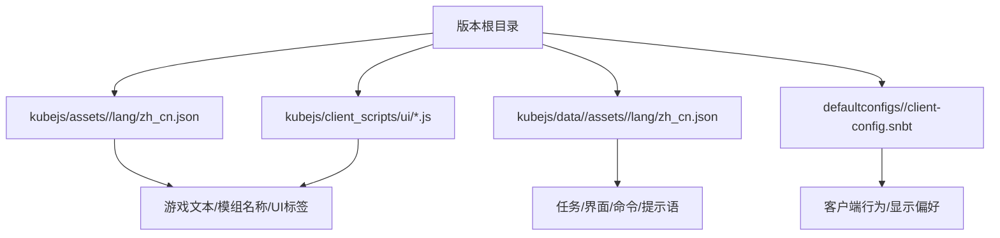
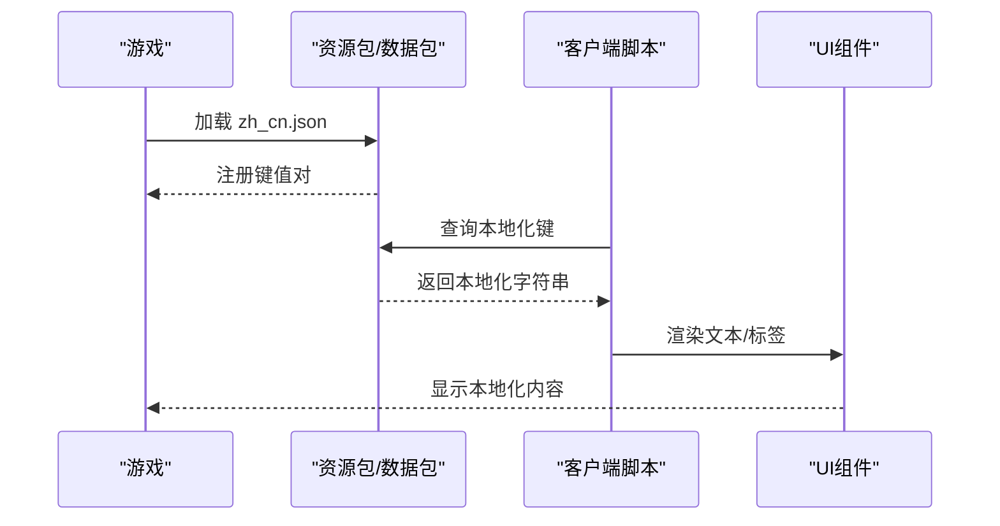
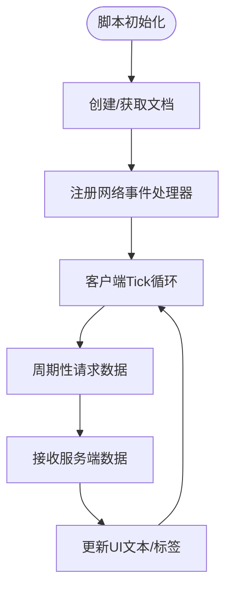
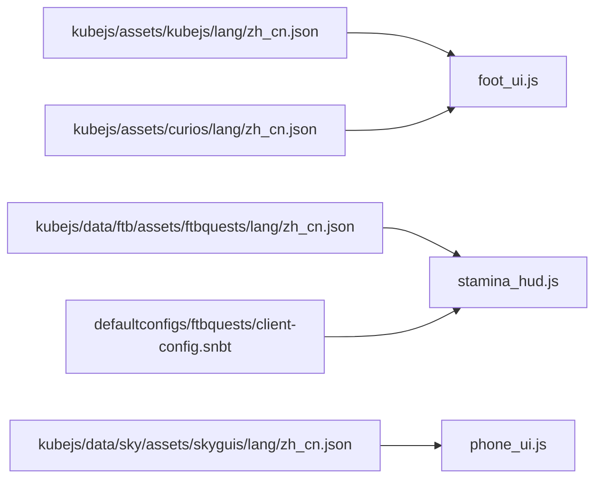

# 语言文件

<cite>
**本文引用的文件**
- [README.md](file://README.md)
- [kubejs/assets/kubejs/lang/zh_cn.json](file://kubejs/assets/kubejs/lang/zh_cn.json)
- [kubejs/assets/curios/lang/zh_cn.json](file://kubejs/assets/curios/lang/zh_cn.json)
- [kubejs/data/ftb/assets/ftbquests/lang/zh_cn.json](file://kubejs/data/ftb/assets/ftbquests/lang/zh_cn.json)
- [kubejs/data/sky/assets/skyguis/lang/zh_cn.json](file://kubejs/data/sky/assets/skyguis/lang/zh_cn.json)
- [kubejs/assets/kubejs/sounds.json](file://kubejs/assets/kubejs/sounds.json)
- [kubejs/client_scripts/ui/foot_ui.js](file://kubejs/client_scripts/ui/foot_ui.js)
- [kubejs/client_scripts/ui/stamina_hud.js](file://kubejs/client_scripts/ui/stamina_hud.js)
- [kubejs/client_scripts/ui/phone_ui.js](file://kubejs/client_scripts/ui/phone_ui.js)
- [defaultconfigs/ftbquests/client-config.snbt](file://defaultconfigs/ftbquests/client-config.snbt)
- [kubejs/data/ftb/pack.mcmeta](file://kubejs/data/ftb/pack.mcmeta)
</cite>

## 目录
1. [简介](#简介)
2. [项目结构](#项目结构)
3. [核心组件](#核心组件)
4. [架构总览](#架构总览)
5. [详细组件分析](#详细组件分析)
6. [依赖关系分析](#依赖关系分析)
7. [性能考量](#性能考量)
8. [故障排查指南](#故障排查指南)
9. [结论](#结论)
10. [附录](#附录)

## 简介
本文件系统文档聚焦于该Minecraft版本中的多语言支持实现，围绕KubeJS生态下的JSON语言文件展开，涵盖键值对命名规范、本地化字符串组织方式、加载顺序与覆盖机制、以及游戏文本、UI标签、聊天框对话、模组名称等多类型内容的管理策略。同时提供面向模组开发者的最佳实践、翻译维护策略与多语言测试方法，帮助开发者高效构建与维护高质量的本地化体验。

## 项目结构
该版本语言资源主要分布在以下位置：
- 模组资产语言文件：位于 kubejs/assets/<modid>/lang/zh_cn.json
- 数据包语言文件：位于 kubejs/data/<namespace>/assets/<modid>/lang/zh_cn.json
- 客户端脚本：通过KubeJS ClientEvents.lang钩子或脚本内部逻辑使用本地化键
- 默认配置：defaultconfigs/<mod>/client-config.snbt 提供默认客户端行为，间接影响UI呈现与本地化显示

**图表来源**
- [kubejs/assets/kubejs/lang/zh_cn.json](file://kubejs/assets/kubejs/lang/zh_cn.json)
- [kubejs/assets/curios/lang/zh_cn.json](file://kubejs/assets/curios/lang/zh_cn.json)
- [kubejs/data/ftb/assets/ftbquests/lang/zh_cn.json](file://kubejs/data/ftb/assets/ftbquests/lang/zh_cn.json)
- [kubejs/data/sky/assets/skyguis/lang/zh_cn.json](file://kubejs/data/sky/assets/skyguis/lang/zh_cn.json)
- [kubejs/client_scripts/ui/foot_ui.js](file://kubejs/client_scripts/ui/foot_ui.js)
- [kubejs/client_scripts/ui/stamina_hud.js](file://kubejs/client_scripts/ui/stamina_hud.js)
- [kubejs/client_scripts/ui/phone_ui.js](file://kubejs/client_scripts/ui/phone_ui.js)
- [defaultconfigs/ftbquests/client-config.snbt](file://defaultconfigs/ftbquests/client-config.snbt)

**章节来源**
- [README.md:1-6](file://README.md#L1-L6)

## 核心组件
- JSON语言文件：采用标准键值对结构，键为唯一标识符，值为本地化字符串。键命名遵循“命名空间.子命名空间...”层级，便于区分来源与用途。
- 客户端脚本：通过KubeJS事件与API在运行时读取本地化键，渲染UI与提示信息。
- 默认配置：提供客户端默认行为，影响UI显示细节与本地化呈现。

**章节来源**
- [kubejs/assets/kubejs/lang/zh_cn.json:1-15](file://kubejs/assets/kubejs/lang/zh_cn.json#L1-L15)
- [kubejs/assets/curios/lang/zh_cn.json:1-4](file://kubejs/assets/curios/lang/zh_cn.json#L1-L4)
- [kubejs/data/ftb/assets/ftbquests/lang/zh_cn.json:1-542](file://kubejs/data/ftb/assets/ftbquests/lang/zh_cn.json#L1-L542)
- [kubejs/data/sky/assets/skyguis/lang/zh_cn.json:1-79](file://kubejs/data/sky/assets/skyguis/lang/zh_cn.json#L1-L79)
- [kubejs/client_scripts/ui/foot_ui.js:1-1026](file://kubejs/client_scripts/ui/foot_ui.js#L1-L1026)
- [kubejs/client_scripts/ui/stamina_hud.js:1-101](file://kubejs/client_scripts/ui/stamina_hud.js#L1-L101)
- [kubejs/client_scripts/ui/phone_ui.js:1-56](file://kubejs/client_scripts/ui/phone_ui.js#L1-L56)
- [defaultconfigs/ftbquests/client-config.snbt:1-5](file://defaultconfigs/ftbquests/client-config.snbt#L1-L5)

## 架构总览
语言文件的加载与使用流程如下：
- 游戏启动时，资源包加载JSON语言文件，注册键值对。
- 客户端脚本通过事件或API查询本地化键，渲染UI与提示。
- 模组/数据包各自维护独立语言文件，键冲突时遵循覆盖规则。

**图表来源**
- [kubejs/assets/kubejs/lang/zh_cn.json](file://kubejs/assets/kubejs/lang/zh_cn.json)
- [kubejs/assets/curios/lang/zh_cn.json](file://kubejs/assets/curios/lang/zh_cn.json)
- [kubejs/data/ftb/assets/ftbquests/lang/zh_cn.json](file://kubejs/data/ftb/assets/ftbquests/lang/zh_cn.json)
- [kubejs/data/sky/assets/skyguis/lang/zh_cn.json](file://kubejs/data/sky/assets/skyguis/lang/zh_cn.json)
- [kubejs/client_scripts/ui/foot_ui.js](file://kubejs/client_scripts/ui/foot_ui.js)
- [kubejs/client_scripts/ui/stamina_hud.js](file://kubejs/client_scripts/ui/stamina_hud.js)
- [kubejs/client_scripts/ui/phone_ui.js](file://kubejs/client_scripts/ui/phone_ui.js)

## 详细组件分析

### JSON语言文件结构与键值对命名规范
- 结构：顶层为对象，键为字符串标识符，值为字符串或格式化占位符。
- 命名规范：
  - 命名空间：通常使用“命名空间.子命名空间...”层级，如“ftbquests.xxx”、“itemGroup.xxx”。
  - 用途分类：按功能域划分，如任务系统、界面、命令、提示语等。
  - 键的可读性：建议使用清晰的层级与语义，便于维护与定位。
- 示例来源：
  - KubeJS属性与UI标签：[kubejs/assets/kubejs/lang/zh_cn.json:1-15](file://kubejs/assets/kubejs/lang/zh_cn.json#L1-L15)
  - Curios标识与修饰器：[kubejs/assets/curios/lang/zh_cn.json:1-4](file://kubejs/assets/curios/lang/zh_cn.json#L1-L4)
  - FTB任务系统：[kubejs/data/ftb/assets/ftbquests/lang/zh_cn.json:1-542](file://kubejs/data/ftb/assets/ftbquests/lang/zh_cn.json#L1-L542)
  - Sky GUIs界面文本：[kubejs/data/sky/assets/skyguis/lang/zh_cn.json:1-79](file://kubejs/data/sky/assets/skyguis/lang/zh_cn.json#L1-L79)

**章节来源**
- [kubejs/assets/kubejs/lang/zh_cn.json:1-15](file://kubejs/assets/kubejs/lang/zh_cn.json#L1-L15)
- [kubejs/assets/curios/lang/zh_cn.json:1-4](file://kubejs/assets/curios/lang/zh_cn.json#L1-L4)
- [kubejs/data/ftb/assets/ftbquests/lang/zh_cn.json:1-542](file://kubejs/data/ftb/assets/ftbquests/lang/zh_cn.json#L1-L542)
- [kubejs/data/sky/assets/skyguis/lang/zh_cn.json:1-79](file://kubejs/data/sky/assets/skyguis/lang/zh_cn.json#L1-L79)

### 本地化字符串的组织方式
- 按模组/数据包分层：每个模组或数据包维护独立语言文件，避免键冲突。
- 按功能域分组：将UI标签、游戏文本、命令提示、任务描述等分别组织，便于查找与维护。
- 命名空间复用：通过命名空间统一归属，如ftbquests、skyguis、itemGroup等。

**章节来源**
- [kubejs/data/ftb/assets/ftbquests/lang/zh_cn.json:1-542](file://kubejs/data/ftb/assets/ftbquests/lang/zh_cn.json#L1-L542)
- [kubejs/data/sky/assets/skyguis/lang/zh_cn.json:1-79](file://kubejs/data/sky/assets/skyguis/lang/zh_cn.json#L1-L79)

### 加载顺序、优先级与覆盖机制
- 加载顺序：游戏启动时按资源包与数据包的加载顺序注册语言文件。
- 优先级与覆盖：当多个来源出现相同键时，后加载的来源会覆盖先前的值。因此，建议在整合包或模组中明确覆盖策略，避免意外覆盖。
- 数据包与资源包：数据包语言文件与资源包语言文件各自独立注册，互不影响，但最终呈现受加载顺序与覆盖规则影响。

**章节来源**
- [kubejs/data/ftb/assets/ftbquests/lang/zh_cn.json:1-542](file://kubejs/data/ftb/assets/ftbquests/lang/zh_cn.json#L1-L542)
- [kubejs/data/sky/assets/skyguis/lang/zh_cn.json:1-79](file://kubejs/data/sky/assets/skyguis/lang/zh_cn.json#L1-L79)

### 不同类型本地化内容管理
- 游戏文本与模组名称：通过命名空间与键值对组织，确保一致性与可维护性。
- UI标签与界面文本：集中在数据包语言文件中，便于统一管理。
- 聊天框对话与提示语：通过键值对提供可替换的文本，支持格式化参数。
- 命令与按键绑定：在语言文件中定义用户可读的命令与按键提示。

**章节来源**
- [kubejs/assets/kubejs/lang/zh_cn.json:1-15](file://kubejs/assets/kubejs/lang/zh_cn.json#L1-L15)
- [kubejs/assets/curios/lang/zh_cn.json:1-4](file://kubejs/assets/curios/lang/zh_cn.json#L1-L4)
- [kubejs/data/ftb/assets/ftbquests/lang/zh_cn.json:1-542](file://kubejs/data/ftb/assets/ftbquests/lang/zh_cn.json#L1-L542)
- [kubejs/data/sky/assets/skyguis/lang/zh_cn.json:1-79](file://kubejs/data/sky/assets/skyguis/lang/zh_cn.json#L1-L79)

### 客户端脚本中的本地化使用
- 脚本职责：通过事件与API查询本地化键，渲染UI与提示信息。
- 典型场景：
  - UI窗口标题与按钮文本：在脚本中读取键值并设置到DOM元素。
  - HUD与Overlay：通过网络事件接收数据并更新显示。
  - 设置同步：从服务端接收设置后更新本地化显示。

**图表来源**
- [kubejs/client_scripts/ui/foot_ui.js:1-1026](file://kubejs/client_scripts/ui/foot_ui.js#L1-L1026)
- [kubejs/client_scripts/ui/stamina_hud.js:1-101](file://kubejs/client_scripts/ui/stamina_hud.js#L1-L101)
- [kubejs/client_scripts/ui/phone_ui.js:1-56](file://kubejs/client_scripts/ui/phone_ui.js#L1-L56)

**章节来源**
- [kubejs/client_scripts/ui/foot_ui.js:1-1026](file://kubejs/client_scripts/ui/foot_ui.js#L1-L1026)
- [kubejs/client_scripts/ui/stamina_hud.js:1-101](file://kubejs/client_scripts/ui/stamina_hud.js#L1-L101)
- [kubejs/client_scripts/ui/phone_ui.js:1-56](file://kubejs/client_scripts/ui/phone_ui.js#L1-L56)

### 声音与本地化联动
- 声音定义：声音文件通过sounds.json进行声明，键名为声音标识，值为声音列表。
- 本地化关联：可在语言文件中为声音标识提供本地化名称，提升用户体验。

**章节来源**
- [kubejs/assets/kubejs/sounds.json:1-5](file://kubejs/assets/kubejs/sounds.json#L1-L5)

## 依赖关系分析
- 文件间依赖：语言文件之间无直接依赖，但UI脚本依赖语言文件提供的键值。
- 模块间耦合：客户端脚本与UI组件耦合度较高，需确保键值一致与可用。
- 配置影响：默认配置文件影响客户端行为，间接影响UI显示与本地化呈现。

**图表来源**
- [kubejs/assets/kubejs/lang/zh_cn.json](file://kubejs/assets/kubejs/lang/zh_cn.json)
- [kubejs/assets/curios/lang/zh_cn.json](file://kubejs/assets/curios/lang/zh_cn.json)
- [kubejs/data/ftb/assets/ftbquests/lang/zh_cn.json](file://kubejs/data/ftb/assets/ftbquests/lang/zh_cn.json)
- [kubejs/data/sky/assets/skyguis/lang/zh_cn.json](file://kubejs/data/sky/assets/skyguis/lang/zh_cn.json)
- [kubejs/client_scripts/ui/foot_ui.js](file://kubejs/client_scripts/ui/foot_ui.js)
- [kubejs/client_scripts/ui/stamina_hud.js](file://kubejs/client_scripts/ui/stamina_hud.js)
- [kubejs/client_scripts/ui/phone_ui.js](file://kubejs/client_scripts/ui/phone_ui.js)
- [defaultconfigs/ftbquests/client-config.snbt](file://defaultconfigs/ftbquests/client-config.snbt)

**章节来源**
- [kubejs/assets/kubejs/lang/zh_cn.json](file://kubejs/assets/kubejs/lang/zh_cn.json)
- [kubejs/assets/curios/lang/zh_cn.json](file://kubejs/assets/curios/lang/zh_cn.json)
- [kubejs/data/ftb/assets/ftbquests/lang/zh_cn.json](file://kubejs/data/ftb/assets/ftbquests/lang/zh_cn.json)
- [kubejs/data/sky/assets/skyguis/lang/zh_cn.json](file://kubejs/data/sky/assets/skyguis/lang/zh_cn.json)
- [kubejs/client_scripts/ui/foot_ui.js](file://kubejs/client_scripts/ui/foot_ui.js)
- [kubejs/client_scripts/ui/stamina_hud.js](file://kubejs/client_scripts/ui/stamina_hud.js)
- [kubejs/client_scripts/ui/phone_ui.js](file://kubejs/client_scripts/ui/phone_ui.js)
- [defaultconfigs/ftbquests/client-config.snbt](file://defaultconfigs/ftbquests/client-config.snbt)

## 性能考量
- 键值对数量：语言文件键值对过多可能增加内存占用与解析时间，建议按功能域拆分文件。
- 覆盖策略：避免频繁覆盖，减少不必要的键冲突处理。
- UI渲染：客户端脚本应避免在高频Tick中重复查询与更新UI，可通过节流与缓存优化。

## 故障排查指南
- 键缺失：若UI显示原始键而非本地化文本，检查对应键是否存在与拼写是否正确。
- 覆盖问题：若出现意外覆盖，检查加载顺序与覆盖策略，确保关键键的来源明确。
- 客户端脚本：若UI不更新，检查网络事件是否正常接收与UI更新逻辑是否执行。
- 配置影响：若UI显示异常，检查默认配置文件是否影响了客户端行为。

**章节来源**
- [kubejs/client_scripts/ui/foot_ui.js:1-1026](file://kubejs/client_scripts/ui/foot_ui.js#L1-L1026)
- [kubejs/client_scripts/ui/stamina_hud.js:1-101](file://kubejs/client_scripts/ui/stamina_hud.js#L1-L101)
- [kubejs/client_scripts/ui/phone_ui.js:1-56](file://kubejs/client_scripts/ui/phone_ui.js#L1-L56)
- [defaultconfigs/ftbquests/client-config.snbt:1-5](file://defaultconfigs/ftbquests/client-config.snbt#L1-L5)

## 结论
该版本语言文件系统通过清晰的命名空间与键值对组织，结合客户端脚本与默认配置，实现了对游戏文本、UI标签、聊天框对话与模组名称的多类型本地化管理。遵循覆盖规则与最佳实践，可有效提升本地化质量与维护效率。

## 附录

### 模组开发者本地化开发指南
- 键命名规范：使用“命名空间.子命名空间...”层级，确保唯一性与可读性。
- 文件组织：按模组/数据包拆分语言文件，按功能域分组，便于维护。
- 覆盖策略：明确加载顺序与覆盖规则，避免意外覆盖关键键。
- 测试方法：
  - 单元测试：验证键是否存在与值是否符合预期。
  - UI测试：在客户端脚本中验证键值渲染到UI的效果。
  - 多语言测试：在不同语言环境下验证键值显示与格式化参数。
- 维护策略：定期审查键值对，清理冗余键，保持语言文件整洁与高效。

**章节来源**
- [kubejs/assets/kubejs/lang/zh_cn.json:1-15](file://kubejs/assets/kubejs/lang/zh_cn.json#L1-L15)
- [kubejs/assets/curios/lang/zh_cn.json:1-4](file://kubejs/assets/curios/lang/zh_cn.json#L1-L4)
- [kubejs/data/ftb/assets/ftbquests/lang/zh_cn.json:1-542](file://kubejs/data/ftb/assets/ftbquests/lang/zh_cn.json#L1-L542)
- [kubejs/data/sky/assets/skyguis/lang/zh_cn.json:1-79](file://kubejs/data/sky/assets/skyguis/lang/zh_cn.json#L1-L79)
- [kubejs/client_scripts/ui/foot_ui.js:1-1026](file://kubejs/client_scripts/ui/foot_ui.js#L1-L1026)
- [kubejs/client_scripts/ui/stamina_hud.js:1-101](file://kubejs/client_scripts/ui/stamina_hud.js#L1-L101)
- [kubejs/client_scripts/ui/phone_ui.js:1-56](file://kubejs/client_scripts/ui/phone_ui.js#L1-L56)
- [kubejs/assets/kubejs/sounds.json:1-5](file://kubejs/assets/kubejs/sounds.json#L1-L5)
- [kubejs/data/ftb/pack.mcmeta](file://kubejs/data/ftb/pack.mcmeta)