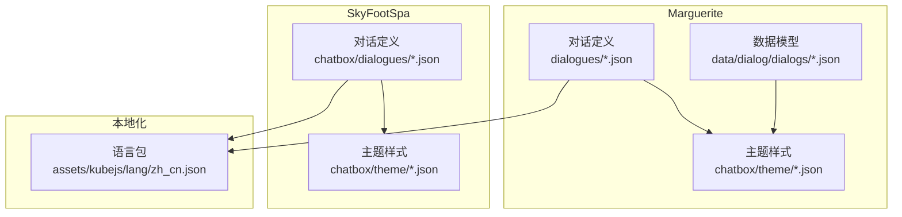
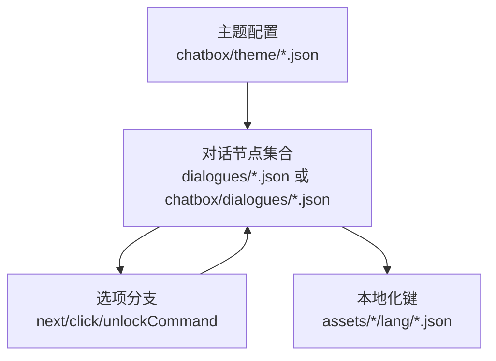
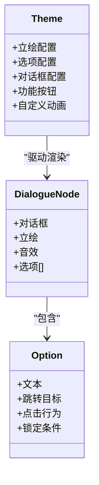
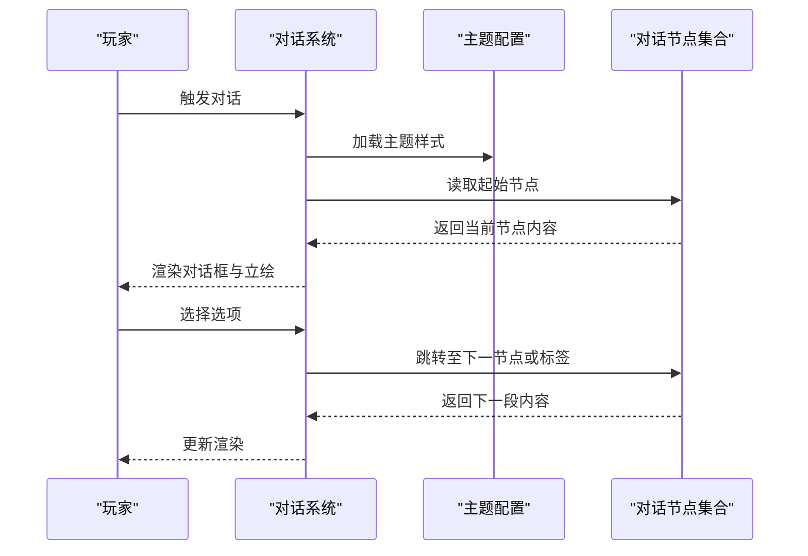
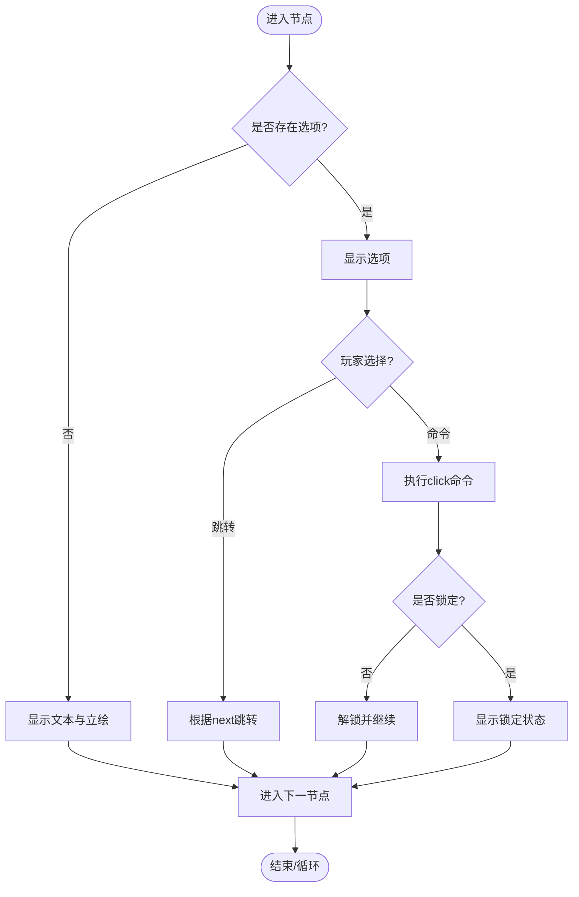
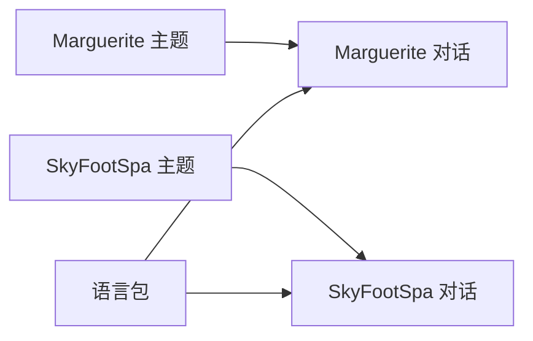

# 对话系统数据

<cite>
**本文引用的文件**
- [kubejs/data/marguerite/dialogues/intro.json](file://kubejs/data/marguerite/dialogues/intro.json)
- [kubejs/data/marguerite/dialogues/test1.json](file://kubejs/data/marguerite/dialogues/test1.json)
- [kubejs/data/skyfootspa/chatbox/dialogues/intro.json](file://kubejs/data/skyfootspa/chatbox/dialogues/intro.json)
- [kubejs/data/marguerite/data/dialog/dialogs/text_dialog.json](file://kubejs/data/marguerite/data/dialog/dialogs/text_dialog.json)
- [kubejs/data/marguerite/chatbox/theme/default.json](file://kubejs/data/marguerite/chatbox/theme/default.json)
- [kubejs/data/marguerite/chatbox/theme/alice_margatroid.json](file://kubejs/data/marguerite/chatbox/theme/alice_margatroid.json)
- [kubejs/data/skyfootspa/chatbox/dialogues/start.json](file://kubejs/data/skyfootspa/chatbox/dialogues/start.json)
- [kubejs/assets/kubejs/lang/zh_cn.json](file://kubejs/assets/kubejs/lang/zh_cn.json)
</cite>

## 目录
1. [简介](#简介)
2. [项目结构](#项目结构)
3. [核心组件](#核心组件)
4. [架构总览](#架构总览)
5. [详细组件分析](#详细组件分析)
6. [依赖分析](#依赖分析)
7. [性能考虑](#性能考虑)
8. [故障排查指南](#故障排查指南)
9. [结论](#结论)
10. [附录](#附录)

## 简介
本文件为Minecraft模组中的对话系统数据文档，聚焦两类对话系统：Marguerite与SkyFootSpa。文档围绕以下目标展开：
- 解析对话文件的JSON结构、触发条件、响应逻辑与分支结构
- 对比Marguerite与SkyFootSpa的数据差异与适用场景
- 说明本地化、角色立绘与动画配置、主题与选项样式
- 总结对话树设计模式、循环处理与条件判断机制
- 提供模组开发者的最佳实践与常见问题解决方案

## 项目结构
对话系统相关资源主要位于kubejs/data与kubejs/assets目录下，按系统与功能模块组织：
- Marguerite系统
  - 对话定义：kubejs/data/marguerite/dialogues/*.json
  - 数据模型：kubejs/data/marguerite/data/dialog/dialogs/*.json
  - 主题与样式：kubejs/data/marguerite/chatbox/theme/*.json
- SkyFootSpa系统
  - 对话定义：kubejs/data/skyfootspa/chatbox/dialogues/*.json
  - 主题与样式：kubejs/data/skyfootspa/chatbox/theme/*.json
- 本地化
  - 语言包：kubejs/assets/kubejs/lang/zh_cn.json

图表来源
- [kubejs/data/marguerite/dialogues/intro.json:1-136](file://kubejs/data/marguerite/dialogues/intro.json#L1-L136)
- [kubejs/data/marguerite/data/dialog/dialogs/text_dialog.json:1-16](file://kubejs/data/marguerite/data/dialog/dialogs/text_dialog.json#L1-L16)
- [kubejs/data/marguerite/chatbox/theme/default.json:1-76](file://kubejs/data/marguerite/chatbox/theme/default.json#L1-L76)
- [kubejs/data/skyfootspa/chatbox/dialogues/intro.json:1-136](file://kubejs/data/skyfootspa/chatbox/dialogues/intro.json#L1-L136)
- [kubejs/assets/kubejs/lang/zh_cn.json:1-15](file://kubejs/assets/kubejs/lang/zh_cn.json#L1-L15)

章节来源
- [kubejs/data/marguerite/dialogues/intro.json:1-136](file://kubejs/data/marguerite/dialogues/intro.json#L1-L136)
- [kubejs/data/skyfootspa/chatbox/dialogues/intro.json:1-136](file://kubejs/data/skyfootspa/chatbox/dialogues/intro.json#L1-L136)
- [kubejs/data/marguerite/chatbox/theme/default.json:1-76](file://kubejs/data/marguerite/chatbox/theme/default.json#L1-L76)
- [kubejs/assets/kubejs/lang/zh_cn.json:1-15](file://kubejs/assets/kubejs/lang/zh_cn.json#L1-L15)

## 核心组件
- 对话文件（JSON）
  - 定义对话主题、是否暂停游戏、对话节点集合与分支选项
  - 支持文本占位符、本地化键、音效、立绘与动画事件
- 主题与样式（Theme）
  - 配置立绘位置、尺寸、对齐、渲染顺序与纹理
  - 配置选项按钮纹理、选中/锁定状态、对齐与文本样式
  - 配置对话框背景纹理、名称与文本区域布局、行宽等
  - 定义自定义动画序列（如淡入、滑入、弹跳等）
- 数据模型（Dialog Model）
  - 用于另一种对话数据组织形式，包含标题、描述、起始节点与条目列表
- 本地化（Localization）
  - 通过语言包键值映射对话文本，便于多语言支持

章节来源
- [kubejs/data/marguerite/dialogues/intro.json:1-136](file://kubejs/data/marguerite/dialogues/intro.json#L1-L136)
- [kubejs/data/marguerite/data/dialog/dialogs/text_dialog.json:1-16](file://kubejs/data/marguerite/data/dialog/dialogs/text_dialog.json#L1-L16)
- [kubejs/data/marguerite/chatbox/theme/default.json:1-76](file://kubejs/data/marguerite/chatbox/theme/default.json#L1-L76)
- [kubejs/assets/kubejs/lang/zh_cn.json:1-15](file://kubejs/assets/kubejs/lang/zh_cn.json#L1-L15)

## 架构总览
对话系统采用“主题驱动”的UI渲染与“节点驱动”的逻辑推进相结合的架构：
- 主题（Theme）定义UI层的外观与交互元素（立绘、选项、对话框、功能按钮、自定义动画）
- 节点（Dialogue Node）定义一次展示的内容（文本、名称、音效、立绘、选项）
- 分支（Options）定义下一步跳转（可指向特定标签、当前节点或执行命令）
- 条件（Lock/Unlock）控制选项可用性，结合命令与条件语句实现动态解锁
- 本地化（Lang）统一管理文本键值，支持多语言切换

图表来源
- [kubejs/data/marguerite/chatbox/theme/default.json:1-76](file://kubejs/data/marguerite/chatbox/theme/default.json#L1-L76)
- [kubejs/data/marguerite/dialogues/intro.json:1-136](file://kubejs/data/marguerite/dialogues/intro.json#L1-L136)
- [kubejs/assets/kubejs/lang/zh_cn.json:1-15](file://kubejs/assets/kubejs/lang/zh_cn.json#L1-L15)

## 详细组件分析

### Marguerite 对话系统
- 对话文件结构
  - 顶层字段：介绍、主题、是否暂停、对话节点集合
  - 节点字段：对话框文本与名称、立绘列表、音效、选项数组
  - 选项字段：文本、跳转目标、点击行为（命令）、锁定/解锁条件
- 立绘与动画
  - 支持按ID指定立绘，支持替换、附加装饰物、自定义动画与循环播放
  - 可绑定渲染事件（如点击触发播放动画）
- 主题样式
  - 立绘区：类型、坐标、尺寸、对齐、纹理、渲染顺序
  - 选项区：纹理、选中/锁定纹理、对齐、文本对齐、隐藏状态
  - 对话框：背景纹理、对齐、行宽、尺寸、名称与文本区域偏移、渲染事件
  - 功能按钮：日志、快进、自动播放等
  - 自定义动画：预设动画序列（时间、透明度、偏移、缓动）

图表来源
- [kubejs/data/marguerite/chatbox/theme/default.json:1-76](file://kubejs/data/marguerite/chatbox/theme/default.json#L1-L76)
- [kubejs/data/marguerite/dialogues/intro.json:1-136](file://kubejs/data/marguerite/dialogues/intro.json#L1-L136)

章节来源
- [kubejs/data/marguerite/dialogues/intro.json:1-136](file://kubejs/data/marguerite/dialogues/intro.json#L1-L136)
- [kubejs/data/marguerite/dialogues/test1.json:1-136](file://kubejs/data/marguerite/dialogues/test1.json#L1-L136)
- [kubejs/data/marguerite/chatbox/theme/default.json:1-76](file://kubejs/data/marguerite/chatbox/theme/default.json#L1-L76)
- [kubejs/data/marguerite/chatbox/theme/alice_margatroid.json:1-46](file://kubejs/data/marguerite/chatbox/theme/alice_margatroid.json#L1-L46)

### SkyFootSpa 对话系统
- 对话文件结构
  - 顶层字段：介绍、主题、是否暂停、对话节点集合
  - 节点字段：对话框文本、立绘ID、动画标识、可选名称占位
  - 分支：通过不同标签组织章节（如start/chapter1/chapter2等），形成线性剧情推进
- 立绘与动画
  - 使用ID引用预设立绘，支持替换、动画标识（如TALK、BOUNCE）
  - 名称占位符可叠加在立绘上
- 主题样式
  - 与Marguerite类似，但针对SkyFootSpa的美术风格定制（纹理、对齐、附件文本等）

图表来源
- [kubejs/data/skyfootspa/chatbox/dialogues/start.json:1-836](file://kubejs/data/skyfootspa/chatbox/dialogues/start.json#L1-L836)
- [kubejs/data/skyfootspa/chatbox/dialogues/intro.json:1-136](file://kubejs/data/skyfootspa/chatbox/dialogues/intro.json#L1-L136)
- [kubejs/data/marguerite/chatbox/theme/default.json:1-76](file://kubejs/data/marguerite/chatbox/theme/default.json#L1-L76)

章节来源
- [kubejs/data/skyfootspa/chatbox/dialogues/intro.json:1-136](file://kubejs/data/skyfootspa/chatbox/dialogues/intro.json#L1-L136)
- [kubejs/data/skyfootspa/chatbox/dialogues/start.json:1-836](file://kubejs/data/skyfootspa/chatbox/dialogues/start.json#L1-L836)

### 数据模型对比（Marguerite vs SkyFootSpa）
- Marguerite
  - 对话文件采用“节点数组+选项”的结构，强调分支与交互
  - 支持复杂立绘配置、渲染事件与自定义动画
  - 适合需要丰富交互与视觉效果的对话场景
- SkyFootSpa
  - 对话文件采用“章节标签+线性推进”的结构，强调剧情叙述
  - 立绘与动画通过ID与动画标识控制，简洁直观
  - 适合主线剧情或章节式故事推进

章节来源
- [kubejs/data/marguerite/dialogues/intro.json:1-136](file://kubejs/data/marguerite/dialogues/intro.json#L1-L136)
- [kubejs/data/skyfootspa/chatbox/dialogues/start.json:1-836](file://kubejs/data/skyfootspa/chatbox/dialogues/start.json#L1-L836)

### 本地化支持
- 文本键值
  - 对话文本与选项文本使用语言包键值，便于多语言扩展
  - 示例键值覆盖属性名称等，体现系统内其他文本也采用本地化策略
- 建议
  - 统一键命名规范，避免重复与歧义
  - 在新增语言时同步补充键值

章节来源
- [kubejs/assets/kubejs/lang/zh_cn.json:1-15](file://kubejs/assets/kubejs/lang/zh_cn.json#L1-L15)

### 角色表情与动画配置
- Marguerite
  - 立绘支持替换、附加装饰物、自定义动画与循环播放
  - 可绑定渲染事件（如点击触发播放动画）
  - 主题中定义多种预设动画序列
- SkyFootSpa
  - 通过立绘ID与动画标识控制表情与动作
  - 名称占位符可叠加在立绘上，增强角色识别

章节来源
- [kubejs/data/marguerite/dialogues/intro.json:88-104](file://kubejs/data/marguerite/dialogues/intro.json#L88-L104)
- [kubejs/data/marguerite/chatbox/theme/default.json:63-75](file://kubejs/data/marguerite/chatbox/theme/default.json#L63-L75)
- [kubejs/data/skyfootspa/chatbox/dialogues/start.json:8-124](file://kubejs/data/skyfootspa/chatbox/dialogues/start.json#L8-L124)

### 分支结构与条件判断
- 分支
  - 选项支持next字段跳转至标签或当前节点
  - click字段可执行命令，实现跳转、物品发放、开关屏幕等
- 条件
  - isLock与unlockCommand配合，基于实体NBT或条件语句控制选项解锁
  - tooltip可提供提示文本，增强用户体验

图表来源
- [kubejs/data/marguerite/dialogues/intro.json:20-80](file://kubejs/data/marguerite/dialogues/intro.json#L20-L80)

章节来源
- [kubejs/data/marguerite/dialogues/intro.json:20-80](file://kubejs/data/marguerite/dialogues/intro.json#L20-L80)

### 循环对话处理
- 当next指向"this"时，表示回到当前节点，可用于多次询问或重复提示
- 结合clearOldPortrait可控制是否清理旧立绘，避免视觉混乱

章节来源
- [kubejs/data/marguerite/dialogues/intro.json:22-47](file://kubejs/data/marguerite/dialogues/intro.json#L22-L47)

## 依赖分析
- Marguerite
  - 对话文件依赖主题样式；主题样式影响立绘、选项与对话框的渲染
  - 数据模型与对话文件可并存，分别适用于不同数据组织方式
- SkyFootSpa
  - 对话文件依赖主题样式；章节标签组织剧情推进
- 本地化
  - 所有文本键值依赖语言包，确保多语言一致性

图表来源
- [kubejs/data/marguerite/chatbox/theme/default.json:1-76](file://kubejs/data/marguerite/chatbox/theme/default.json#L1-L76)
- [kubejs/data/marguerite/dialogues/intro.json:1-136](file://kubejs/data/marguerite/dialogues/intro.json#L1-L136)
- [kubejs/data/skyfootspa/chatbox/dialogues/intro.json:1-136](file://kubejs/data/skyfootspa/chatbox/dialogues/intro.json#L1-L136)
- [kubejs/assets/kubejs/lang/zh_cn.json:1-15](file://kubejs/assets/kubejs/lang/zh_cn.json#L1-L15)

章节来源
- [kubejs/data/marguerite/chatbox/theme/default.json:1-76](file://kubejs/data/marguerite/chatbox/theme/default.json#L1-L76)
- [kubejs/data/marguerite/dialogues/intro.json:1-136](file://kubejs/data/marguerite/dialogues/intro.json#L1-L136)
- [kubejs/data/skyfootspa/chatbox/dialogues/intro.json:1-136](file://kubejs/data/skyfootspa/chatbox/dialogues/intro.json#L1-L136)
- [kubejs/assets/kubejs/lang/zh_cn.json:1-15](file://kubejs/assets/kubejs/lang/zh_cn.json#L1-L15)

## 性能考虑
- 合理使用立绘与动画
  - 控制同时渲染的立绘数量，避免过多实体导致卡顿
  - 自定义动画应适度，避免过长或高频率的动画序列
- 选项与分支
  - 将复杂逻辑下沉到命令或脚本，减少JSON层级深度
  - 使用标签组织章节，避免过深的嵌套
- 本地化
  - 统一键值，减少重复翻译与查找成本

## 故障排查指南
- 文本未显示或显示为键值
  - 检查语言包中是否存在对应键值
  - 确认键值拼写与大小写一致
- 立绘不显示或错位
  - 检查主题中立绘配置的纹理路径与对齐参数
  - 确认立绘ID与实际资源一致
- 选项不可用或无法解锁
  - 检查isLock与unlockCommand的条件语句
  - 确认命令语法正确且作用对象为目标实体
- 动画不生效
  - 检查主题中自定义动画序列与触发事件
  - 确认渲染事件绑定的触发器与目标一致

章节来源
- [kubejs/assets/kubejs/lang/zh_cn.json:1-15](file://kubejs/assets/kubejs/lang/zh_cn.json#L1-L15)
- [kubejs/data/marguerite/chatbox/theme/default.json:63-75](file://kubejs/data/marguerite/chatbox/theme/default.json#L63-L75)
- [kubejs/data/marguerite/dialogues/intro.json:67-76](file://kubejs/data/marguerite/dialogues/intro.json#L67-L76)

## 结论
- Marguerite与SkyFootSpa均提供完善的对话系统数据结构与主题样式配置
- Marguerite更适合复杂交互与丰富视觉效果的场景
- SkyFootSpa更适合线性剧情推进与简洁直观的对话体验
- 建议在项目中统一本地化策略、合理组织分支与条件逻辑，并优化立绘与动画性能

## 附录
- 最佳实践
  - 使用标签组织章节，保持对话树清晰
  - 将复杂逻辑封装为命令或脚本，减少JSON复杂度
  - 统一键命名规范，便于维护与扩展
  - 在主题中预设常用动画，复用提高效率
- 常见问题
  - 键值缺失：检查语言包与键值拼写
  - 立绘错位：核对主题配置与对齐参数
  - 选项锁定：校验unlockCommand与条件语句