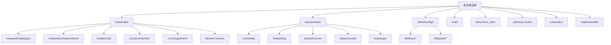
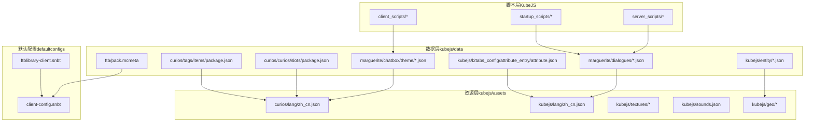
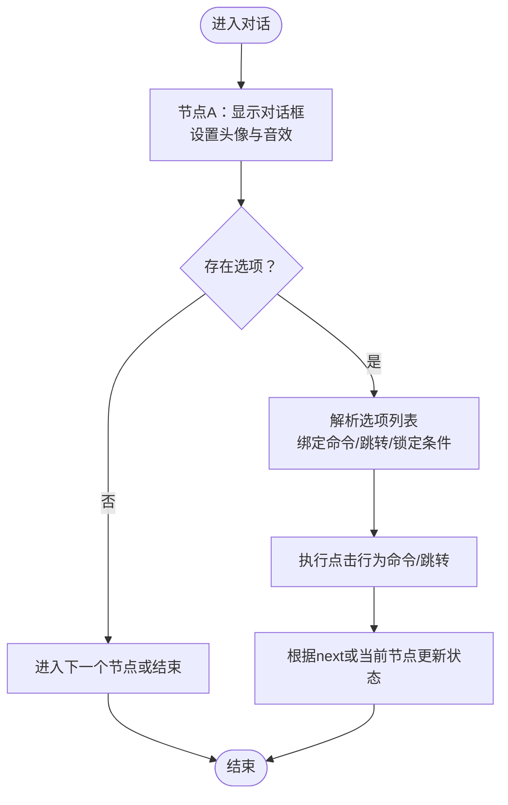
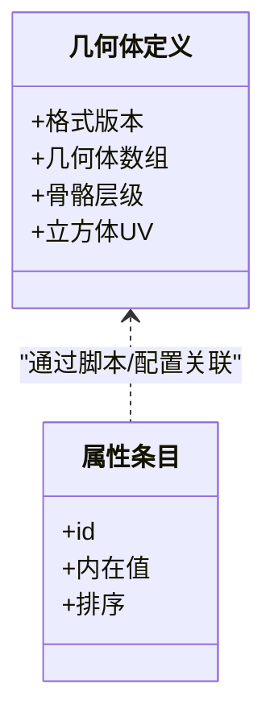
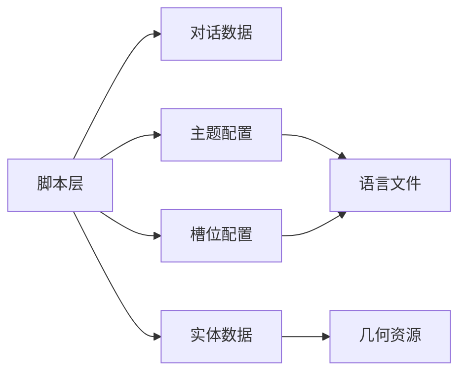

# 服务器数据

<cite>
**本文引用的文件**
- [README.md](file://README.md)
- [pack.mcmeta](file://mods/pack.mcmeta)
- [alice.json](file://kubejs/data/kubejs/entity/alice.json)
- [package.json](file://kubejs/data/curios/curios/slots/package.json)
- [package.json](file://kubejs/data/curios/tags/items/package.json)
- [zh_cn.json](file://kubejs/assets/curios/lang/zh_cn.json)
- [zh_cn.json](file://kubejs/assets/kubejs/lang/zh_cn.json)
- [intro.json](file://kubejs/data/marguerite/dialogues/intro.json)
- [default.json](file://kubejs/data/marguerite/chatbox/theme/default.json)
- [gal.json](file://kubejs/data/marguerite/chatbox/theme/gal.json)
- [alice_margatroid.json](file://kubejs/data/marguerite/chatbox/theme/alice_margatroid.json)
- [attribute.json](file://kubejs/data/kubejs/l2tabs_config/attribute_entry/attribute.json)
- [ftb pack.mcmeta](file://kubejs/data/ftb/pack.mcmeta)
- [ftblibrary-client.snbt](file://defaultconfigs/ftblibrary/ftblibrary-client.snbt)
- [client-config.snbt](file://defaultconfigs/ftbquests/client-config.snbt)
</cite>

## 目录
1. [简介](#简介)
2. [项目结构](#项目结构)
3. [核心组件](#核心组件)
4. [架构总览](#架构总览)
5. [详细组件分析](#详细组件分析)
6. [依赖关系分析](#依赖关系分析)
7. [性能考量](#性能考量)
8. [故障排查指南](#故障排查指南)
9. [结论](#结论)
10. [附录](#附录)

## 简介
本文件面向服务器管理员与模组开发者，系统化梳理该Minecraft服务器端数据管理实践，重点覆盖以下方面：
- 对话数据（dialogues）：结构、主题与交互流程
- 结构数据（structures）：当前仓库未提供具体结构文件，但可基于对话与主题配置进行扩展
- 标签数据（tags）：Curios物品标签与槽位配置
- 实体数据：KubeJS几何体与实体定义
- 数据包加载顺序、依赖关系与版本兼容性
- FTB系列模组的整合要点
- Curios装备槽位配置与自定义实体定义
- 数据文件验证方法、错误排查与性能优化策略

## 项目结构
该版本根目录包含数据资源、脚本与默认配置等关键目录。数据文件主要位于 kubejs/data 与 kubejs/assets 下，配合 defaultconfigs 中的默认配置模板。

图表来源
- [README.md](file://README.md)
- [pack.mcmeta](file://mods/pack.mcmeta)

章节来源
- [README.md:1-6](file://README.md#L1-L6)
- [pack.mcmeta:1-7](file://mods/pack.mcmeta#L1-L7)

## 核心组件
- 对话系统（Marguerite）
  - 对话数据：位于 kubejs/data/marguerite/dialogues，采用键值驱动的多分支对话结构，支持选项跳转、命令触发与音效联动
  - 主题配置：位于 kubejs/data/marguerite/chatbox/theme，定义头像、选项、对话框纹理与动画
- Curios装备整合
  - 槽位配置：kubejs/data/curios/curios/slots/package.json 控制槽位数量、是否添加装饰与图标
  - 物品标签：kubejs/data/curios/tags/items/package.json 定义物品标签集合
  - 本地化：kubejs/assets/curios/lang/zh_cn.json 提供槽位标识与修饰语本地化
- 自定义实体
  - 幾何体定义：kubejs/data/kubejs/entity/alice.json 使用Minecraft格式描述实体几何与骨骼
  - 属性列表：kubejs/data/kubejs/l2tabs_config/attribute_entry/attribute.json 定义属性条目与排序
- 默认配置
  - FTB系列：defaultconfigs/ftblibrary 与 defaultconfigs/ftbquests 提供客户端与任务配置模板

章节来源
- [intro.json:1-136](file://kubejs/data/marguerite/dialogues/intro.json#L1-L136)
- [default.json:1-76](file://kubejs/data/marguerite/chatbox/theme/default.json#L1-L76)
- [gal.json:1-69](file://kubejs/data/marguerite/chatbox/theme/gal.json#L1-L69)
- [alice_margatroid.json:1-46](file://kubejs/data/marguerite/chatbox/theme/alice_margatroid.json#L1-L46)
- [package.json:1-5](file://kubejs/data/curios/curios/slots/package.json#L1-L5)
- [package.json:1-5](file://kubejs/data/curios/tags/items/package.json#L1-L5)
- [zh_cn.json:1-4](file://kubejs/assets/curios/lang/zh_cn.json#L1-L4)
- [alice.json:1-800](file://kubejs/data/kubejs/entity/alice.json#L1-L800)
- [attribute.json:1-64](file://kubejs/data/kubejs/l2tabs_config/attribute_entry/attribute.json#L1-L64)
- [ftb pack.mcmeta:1-6](file://kubejs/data/ftb/pack.mcmeta#L1-L6)
- [ftblibrary-client.snbt:1-5](file://defaultconfigs/ftblibrary/ftblibrary-client.snbt#L1-L5)
- [client-config.snbt:1-5](file://defaultconfigs/ftbquests/client-config.snbt#L1-L5)

## 架构总览
下图展示从玩家触发到数据生效的关键路径：脚本层（KubeJS）通过数据文件与资源文件协作，实现对话、主题、槽位与实体的统一管理；默认配置为客户端与FTB相关模块提供基础开关。

图表来源
- [intro.json](file://kubejs/data/marguerite/dialogues/intro.json)
- [default.json](file://kubejs/data/marguerite/chatbox/theme/default.json)
- [gal.json](file://kubejs/data/marguerite/chatbox/theme/gal.json)
- [alice_margatroid.json](file://kubejs/data/marguerite/chatbox/theme/alice_margatroid.json)
- [package.json](file://kubejs/data/curios/curios/slots/package.json)
- [package.json](file://kubejs/data/curios/tags/items/package.json)
- [alice.json](file://kubejs/data/kubejs/entity/alice.json)
- [attribute.json](file://kubejs/data/kubejs/l2tabs_config/attribute_entry/attribute.json)
- [ftb pack.mcmeta](file://kubejs/data/ftb/pack.mcmeta)
- [zh_cn.json](file://kubejs/assets/curios/lang/zh_cn.json)
- [zh_cn.json](file://kubejs/assets/kubejs/lang/zh_cn.json)
- [ftblibrary-client.snbt](file://defaultconfigs/ftblibrary/ftblibrary-client.snbt)
- [client-config.snbt](file://defaultconfigs/ftbquests/client-config.snbt)

## 详细组件分析

### 对话数据（dialogues）
- 结构特征
  - 多分支对话以键名（如 start）组织，每个节点包含对话框、头像、选项与事件
  - 支持命令触发（如跳转、给予物品）、条件解锁（如执行NBT检查）、音效与渲染事件
- 关键字段示例
  - dialogBox：名称与文本键值
  - options：文本、下一节点、点击行为（command）、锁定与解锁条件
  - portrait：头像序列与附加渲染事件
- 主题与样式
  - 主题文件控制头像布局、选项样式、对话框纹理与动画序列
  - 支持功能按钮（日志、快进、自动播放）与自定义动画（淡入、滑入、弹跳）

图表来源
- [intro.json:1-136](file://kubejs/data/marguerite/dialogues/intro.json#L1-L136)

章节来源
- [intro.json:1-136](file://kubejs/data/marguerite/dialogues/intro.json#L1-L136)
- [default.json:1-76](file://kubejs/data/marguerite/chatbox/theme/default.json#L1-L76)
- [gal.json:1-69](file://kubejs/data/marguerite/chatbox/theme/gal.json#L1-L69)
- [alice_margatroid.json:1-46](file://kubejs/data/marguerite/chatbox/theme/alice_margatroid.json#L1-L46)

### 结构数据（structures）
- 当前仓库未包含结构文件（例如 marguerite_house.json），无法直接分析其内容
- 建议在 kubejs/data/marguerite/structures 下新增结构文件，并与对话/主题联动，实现场景化叙事与空间互动

章节来源
- [README.md:1-6](file://README.md#L1-L6)

### 标签数据（tags）
- Curios物品标签
  - package.json 定义标签集合与合并策略（replace）
  - 可用于将特定物品归类至“package”槽位，配合槽位配置实现统一的装备逻辑
- 本地化
  - zh_cn.json 提供槽位标识与修饰语翻译，确保UI一致性

章节来源
- [package.json:1-5](file://kubejs/data/curios/tags/items/package.json#L1-L5)
- [zh_cn.json:1-4](file://kubejs/assets/curios/lang/zh_cn.json#L1-L4)

### 实体数据
- 几何体与骨骼
  - alice.json 描述实体几何、纹理尺寸、可见边界与骨骼层级，支持UV映射与立方体定义
  - 适用于自定义模型实体（如NPC或特殊生物）
- 属性配置
  - attribute.json 定义属性条目与排序，便于在UI中展示与管理

图表来源
- [alice.json:1-800](file://kubejs/data/kubejs/entity/alice.json#L1-L800)
- [attribute.json:1-64](file://kubejs/data/kubejs/l2tabs_config/attribute_entry/attribute.json#L1-L64)

章节来源
- [alice.json:1-800](file://kubejs/data/kubejs/entity/alice.json#L1-L800)
- [attribute.json:1-64](file://kubejs/data/kubejs/l2tabs_config/attribute_entry/attribute.json#L1-L64)

### Curios装备槽位配置
- 槽位数量与装饰
  - package.json 控制槽位总数、是否添加装饰以及图标资源
- 与对话/主题的集成
  - 可在主题中为特定头像或选项绑定槽位效果，提升交互表现力

章节来源
- [package.json:1-5](file://kubejs/data/curios/curios/slots/package.json#L1-L5)
- [default.json:1-76](file://kubejs/data/marguerite/chatbox/theme/default.json#L1-L76)

### FTB系列模组整合
- 配置模板
  - defaultconfigs/ftblibrary 与 defaultconfigs/ftbquests 提供默认配置文件，可在首次运行时复制到本地
- 数据包元信息
  - ftb/pack.mcmeta 与 mods/pack.mcmeta 统一数据包格式与描述，确保版本兼容性

章节来源
- [ftblibrary-client.snbt:1-5](file://defaultconfigs/ftblibrary/ftblibrary-client.snbt#L1-L5)
- [client-config.snbt:1-5](file://defaultconfigs/ftbquests/client-config.snbt#L1-L5)
- [ftb pack.mcmeta:1-6](file://kubejs/data/ftb/pack.mcmeta#L1-L6)
- [pack.mcmeta:1-7](file://mods/pack.mcmeta#L1-L7)

## 依赖关系分析
- 脚本与数据的耦合
  - server_scripts 与 startup_scripts 通过数据文件（对话、主题、槽位、实体）驱动运行时行为
- 资源与本地化的依赖
  - 主题与槽位依赖语言文件（assets/*/lang/zh_cn.json）保证UI一致性
- 默认配置与运行时的关系
  - defaultconfigs 作为初始模板，影响客户端与FTB相关模块的行为基线

图表来源
- [intro.json](file://kubejs/data/marguerite/dialogues/intro.json)
- [default.json](file://kubejs/data/marguerite/chatbox/theme/default.json)
- [gal.json](file://kubejs/data/marguerite/chatbox/theme/gal.json)
- [alice_margatroid.json](file://kubejs/data/marguerite/chatbox/theme/alice_margatroid.json)
- [package.json](file://kubejs/data/curios/curios/slots/package.json)
- [alice.json](file://kubejs/data/kubejs/entity/alice.json)
- [zh_cn.json](file://kubejs/assets/curios/lang/zh_cn.json)
- [zh_cn.json](file://kubejs/assets/kubejs/lang/zh_cn.json)

## 性能考量
- 数据文件体积与复杂度
  - 对话与主题文件应避免冗余重复，优先复用头像与动画片段
  - 实体几何体的立方体数量与UV复杂度直接影响加载与渲染性能
- 加载顺序与缓存
  - 合理拆分数据文件，减少单次加载压力；利用默认配置模板降低客户端初次启动成本
- 资源纹理与声音
  - 控制纹理分辨率与声音长度，避免过大的资源占用

## 故障排查指南
- 对话不生效或卡顿
  - 检查对话节点的 next/commands 是否正确；确认选项的 unlockCommand 条件是否满足
  - 若存在循环跳转，需在脚本层进行限制
- 主题样式异常
  - 核对主题文件中的纹理路径与渲染事件；确保语言文件中无缺失键值
- 槽位与物品标签问题
  - 检查 package.json 的 values 列表与 replace 行为；确认物品是否正确归类
- 实体模型显示异常
  - 校验 alice.json 的几何体层级与UV映射；确保纹理资源存在且路径正确
- 默认配置未生效
  - 确认 defaultconfigs 文件是否已复制到本地；核对 pack.mcmeta 的格式与描述

章节来源
- [intro.json:1-136](file://kubejs/data/marguerite/dialogues/intro.json#L1-L136)
- [default.json:1-76](file://kubejs/data/marguerite/chatbox/theme/default.json#L1-L76)
- [package.json:1-5](file://kubejs/data/curios/tags/items/package.json#L1-L5)
- [alice.json:1-800](file://kubejs/data/kubejs/entity/alice.json#L1-L800)
- [ftblibrary-client.snbt:1-5](file://defaultconfigs/ftblibrary/ftblibrary-client.snbt#L1-L5)
- [client-config.snbt:1-5](file://defaultconfigs/ftbquests/client-config.snbt#L1-L5)

## 结论
本仓库以KubeJS为核心，结合数据文件与资源文件，实现了对话系统、主题样式、Curios槽位与自定义实体的完整数据管理方案。通过合理的文件组织、默认配置与版本元信息，既保证了开发效率，也为服务器部署提供了清晰的边界。建议后续补充结构数据与更多实体示例，进一步完善场景化体验。

## 附录
- 安装与运行
  - 使用1.20.1客户端与最新Forge，拉取仓库后创建存档即可开始
- 数据包格式与版本
  - mods/pack.mcmeta 与 ftb/pack.mcmeta 均声明 pack_format 为15，确保与1.20.1兼容

章节来源
- [README.md:1-6](file://README.md#L1-L6)
- [pack.mcmeta:1-7](file://mods/pack.mcmeta#L1-L7)
- [ftb pack.mcmeta:1-6](file://kubejs/data/ftb/pack.mcmeta#L1-L6)