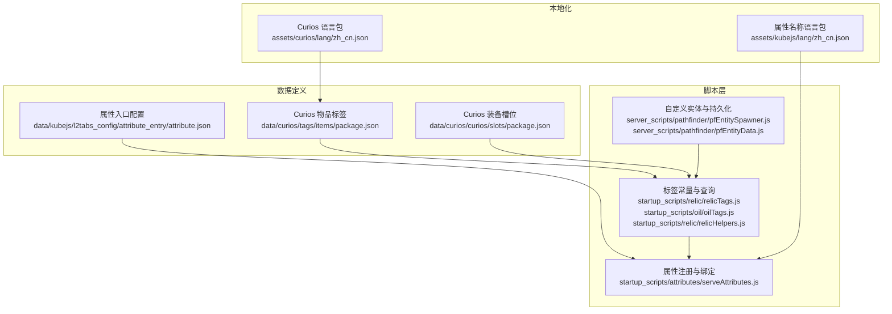
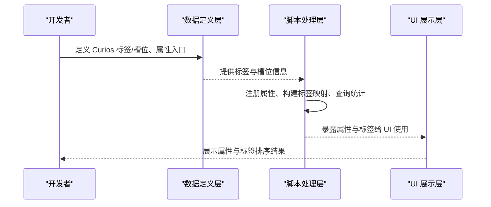
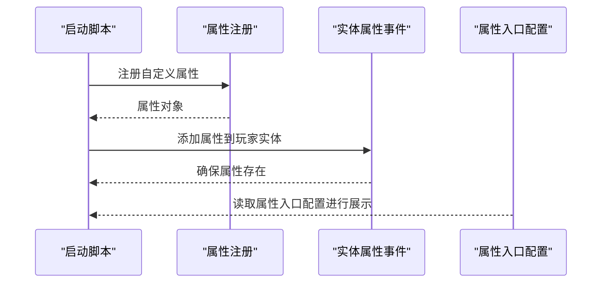
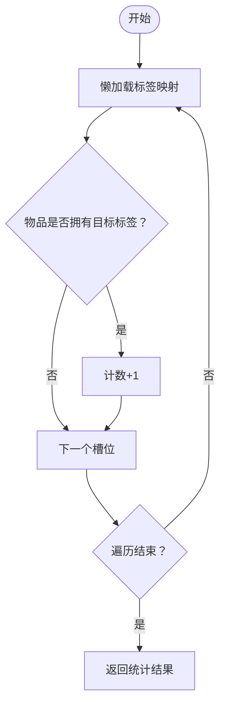
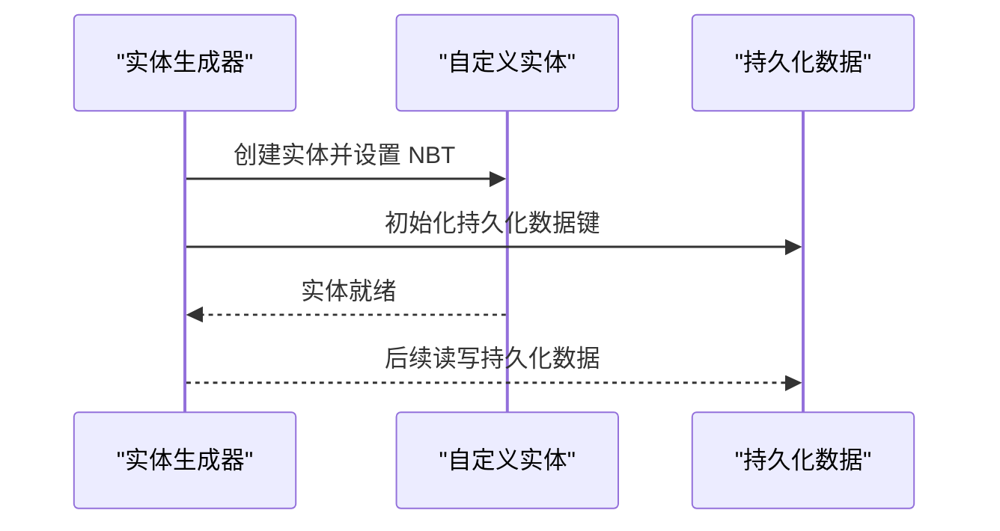
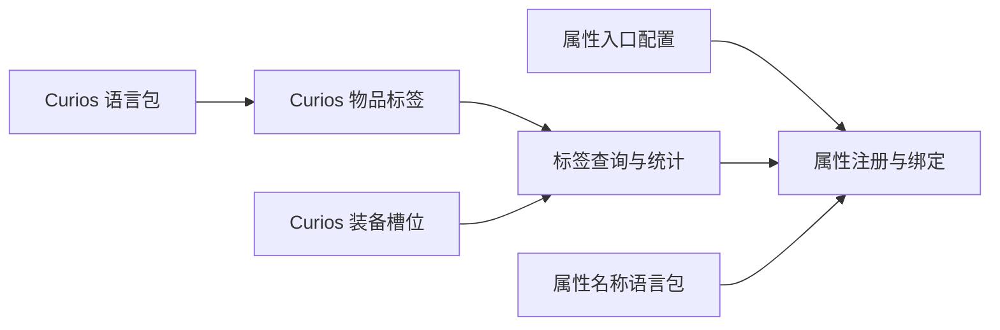

# 标签系统数据

<cite>
**本文档引用的文件**
- [package.json（Curios 物品标签）](file://kubejs/data/curios/tags/items/package.json)
- [package.json（Curios 装备槽位）](file://kubejs/data/curios/curios/slots/package.json)
- [zh_cn.json（Curios 语言包）](file://kubejs/assets/curios/lang/zh_cn.json)
- [attribute.json（属性入口配置）](file://kubejs/data/kubejs/l2tabs_config/attribute_entry/attribute.json)
- [zh_cn.json（属性名称语言包）](file://kubejs/assets/kubejs/lang/zh_cn.json)
- [serveAttributes.js（属性注册与绑定）](file://kubejs/startup_scripts/attributes/serveAttributes.js)
- [relicTags.js（遗物标签常量）](file://kubejs/startup_scripts/relic/relicTags.js)
- [oilTags.js（油标签常量）](file://kubejs/startup_scripts/oil/oilTags.js)
- [relicHelpers.js（标签查询与统计）](file://kubejs/startup_scripts/relic/relicHelpers.js)
- [stage4.js（基于标签的逻辑示例）](file://kubejs/startup_scripts/relic/relicItem/stage4/stage4.js)
- [pfEntitySpawner.js（自定义实体类型与持久化数据）](file://kubejs/server_scripts/pathfinder/pfEntitySpawner.js)
- [pfEntityData.js（实体持久化数据存取）](file://kubejs/server_scripts/pathfinder/pfEntityData.js)
</cite>

## 目录
1. [引言](#引言)
2. [项目结构](#项目结构)
3. [核心组件](#核心组件)
4. [架构总览](#架构总览)
5. [组件详解](#组件详解)
6. [依赖关系分析](#依赖关系分析)
7. [性能考量](#性能考量)
8. [故障排查指南](#故障排查指南)
9. [结论](#结论)
10. [附录](#附录)

## 引言
本文件面向模组开发者，系统性梳理本版本中标签系统的数据配置与使用方式，重点覆盖以下方面：
- Curios 装备槽位标签与物品标签的定义格式与用途
- 自定义实体类型的标签配置与持久化数据入口
- 属性系统与标签联动的入口配置
- 标签的作用机制、继承关系与优先级规则
- 最佳实践、命名规范与维护策略
- 调试方法与性能优化建议

## 项目结构
围绕标签系统的关键数据与脚本分布如下：
- 数据定义层
  - Curios 物品标签：用于声明可被 Curios 装备槽识别的物品集合
  - Curios 装备槽位：用于声明槽位数量、外观与行为
  - 属性入口配置：用于在 UI 或属性面板中展示与排序属性
- 脚本层
  - 属性注册与绑定：注册自定义属性并确保其在客户端可用
  - 标签常量与查询：集中管理标签常量，提供查询与统计能力
  - 自定义实体：通过持久化数据存储实体状态，供标签逻辑使用

图表来源
- [package.json（Curios 物品标签）:1-5](file://kubejs/data/curios/tags/items/package.json#L1-L5)
- [package.json（Curios 装备槽位）:1-5](file://kubejs/data/curios/curios/slots/package.json#L1-L5)
- [attribute.json（属性入口配置）:1-64](file://kubejs/data/kubejs/l2tabs_config/attribute_entry/attribute.json#L1-L64)
- [serveAttributes.js（属性注册与绑定）:1-52](file://kubejs/startup_scripts/attributes/serveAttributes.js#L1-L52)
- [relicTags.js（遗物标签常量）:1-61](file://kubejs/startup_scripts/relic/relicTags.js#L1-L61)
- [oilTags.js（油标签常量）:1-18](file://kubejs/startup_scripts/oil/oilTags.js#L1-L18)
- [relicHelpers.js（标签查询与统计）:240-331](file://kubejs/startup_scripts/relic/relicHelpers.js#L240-L331)
- [pfEntitySpawner.js（自定义实体类型与持久化数据）:1-38](file://kubejs/server_scripts/pathfinder/pfEntitySpawner.js#L1-L38)
- [pfEntityData.js（实体持久化数据存取）:1-48](file://kubejs/server_scripts/pathfinder/pfEntityData.js#L1-L48)
- [zh_cn.json（Curios 语言包）:1-4](file://kubejs/assets/curios/lang/zh_cn.json#L1-L4)
- [zh_cn.json（属性名称语言包）:1-15](file://kubejs/assets/kubejs/lang/zh_cn.json#L1-L15)

章节来源
- [package.json（Curios 物品标签）:1-5](file://kubejs/data/curios/tags/items/package.json#L1-L5)
- [package.json（Curios 装备槽位）:1-5](file://kubejs/data/curios/curios/slots/package.json#L1-L5)
- [attribute.json（属性入口配置）:1-64](file://kubejs/data/kubejs/l2tabs_config/attribute_entry/attribute.json#L1-L64)
- [serveAttributes.js（属性注册与绑定）:1-52](file://kubejs/startup_scripts/attributes/serveAttributes.js#L1-L52)
- [relicTags.js（遗物标签常量）:1-61](file://kubejs/startup_scripts/relic/relicTags.js#L1-L61)
- [oilTags.js（油标签常量）:1-18](file://kubejs/startup_scripts/oil/oilTags.js#L1-L18)
- [relicHelpers.js（标签查询与统计）:240-331](file://kubejs/startup_scripts/relic/relicHelpers.js#L240-L331)
- [pfEntitySpawner.js（自定义实体类型与持久化数据）:1-38](file://kubejs/server_scripts/pathfinder/pfEntitySpawner.js#L1-L38)
- [pfEntityData.js（实体持久化数据存取）:1-48](file://kubejs/server_scripts/pathfinder/pfEntityData.js#L1-L48)
- [zh_cn.json（Curios 语言包）:1-4](file://kubejs/assets/curios/lang/zh_cn.json#L1-L4)
- [zh_cn.json（属性名称语言包）:1-15](file://kubejs/assets/kubejs/lang/zh_cn.json#L1-L15)

## 核心组件
- Curios 物品标签
  - 用于声明某类物品属于 Curios 装备槽位，支持 replace 与 values 字段控制合并策略
- Curios 装备槽位
  - 用于声明槽位数量、外观图标与是否添加装饰性槽位
- 属性入口配置
  - 用于在 UI 中展示与排序自定义属性，包含属性 ID、初始值与排序权重
- 属性注册与绑定
  - 注册自定义属性并在事件中为玩家实体添加属性
- 标签常量与查询
  - 提供标签常量定义与查询、统计等工具函数
- 自定义实体与持久化数据
  - 通过实体持久化数据存储状态，供标签逻辑使用

章节来源
- [package.json（Curios 物品标签）:1-5](file://kubejs/data/curios/tags/items/package.json#L1-L5)
- [package.json（Curios 装备槽位）:1-5](file://kubejs/data/curios/curios/slots/package.json#L1-L5)
- [attribute.json（属性入口配置）:1-64](file://kubejs/data/kubejs/l2tabs_config/attribute_entry/attribute.json#L1-L64)
- [serveAttributes.js（属性注册与绑定）:1-52](file://kubejs/startup_scripts/attributes/serveAttributes.js#L1-L52)
- [relicTags.js（遗物标签常量）:1-61](file://kubejs/startup_scripts/relic/relicTags.js#L1-L61)
- [oilTags.js（油标签常量）:1-18](file://kubejs/startup_scripts/oil/oilTags.js#L1-L18)
- [relicHelpers.js（标签查询与统计）:240-331](file://kubejs/startup_scripts/relic/relicHelpers.js#L240-L331)
- [pfEntitySpawner.js（自定义实体类型与持久化数据）:1-38](file://kubejs/server_scripts/pathfinder/pfEntitySpawner.js#L1-L38)
- [pfEntityData.js（实体持久化数据存取）:1-48](file://kubejs/server_scripts/pathfinder/pfEntityData.js#L1-L48)

## 架构总览
标签系统由“数据定义 + 脚本处理 + UI 展示”三层构成：
- 数据定义层：Curios 标签与槽位、属性入口配置
- 脚本处理层：标签常量、查询与统计、属性注册与绑定、自定义实体持久化
- UI 展示层：语言包与属性入口配置共同决定展示与排序

图表来源
- [package.json（Curios 物品标签）:1-5](file://kubejs/data/curios/tags/items/package.json#L1-L5)
- [package.json（Curios 装备槽位）:1-5](file://kubejs/data/curios/curios/slots/package.json#L1-L5)
- [attribute.json（属性入口配置）:1-64](file://kubejs/data/kubejs/l2tabs_config/attribute_entry/attribute.json#L1-L64)
- [serveAttributes.js（属性注册与绑定）:1-52](file://kubejs/startup_scripts/attributes/serveAttributes.js#L1-L52)
- [relicTags.js（遗物标签常量）:1-61](file://kubejs/startup_scripts/relic/relicTags.js#L1-L61)
- [relicHelpers.js（标签查询与统计）:240-331](file://kubejs/startup_scripts/relic/relicHelpers.js#L240-L331)

## 组件详解

### Curios 装备槽位标签
- 定义格式
  - 字段：size、add_cosmetic、icon
  - 语义：槽位数量、是否添加装饰性槽位、槽位图标资源定位
- 作用机制
  - 通过数据包声明，影响 Curios 在界面与逻辑中的槽位呈现与数量
- 优先级与继承
  - 若多个数据包声明同一槽位，通常遵循“最后加载者覆盖”的原则；具体以 Curios 行为为准

章节来源
- [package.json（Curios 装备槽位）:1-5](file://kubejs/data/curios/curios/slots/package.json#L1-L5)

### Curios 物品标签
- 定义格式
  - 字段：replace、values
  - 语义：replace 控制是否替换默认值；values 为标签值列表
- 作用机制
  - 用于声明某物品属于特定标签，从而进入 Curios 的匹配与筛选流程
- 优先级与继承
  - replace=false 时，values 与默认值合并；true 时完全覆盖

章节来源
- [package.json（Curios 物品标签）:1-5](file://kubejs/data/curios/tags/items/package.json#L1-L5)

### 属性入口配置与属性注册
- 属性入口配置
  - 列表项包含：属性 ID、初始 intrinsic 值、排序 order
  - 用于 UI 展示与排序
- 属性注册与绑定
  - 注册自定义属性并设置同步到客户端
  - 在事件中为玩家实体添加属性，确保可用性

图表来源
- [serveAttributes.js（属性注册与绑定）:1-52](file://kubejs/startup_scripts/attributes/serveAttributes.js#L1-L52)
- [attribute.json（属性入口配置）:1-64](file://kubejs/data/kubejs/l2tabs_config/attribute_entry/attribute.json#L1-L64)

章节来源
- [attribute.json（属性入口配置）:1-64](file://kubejs/data/kubejs/l2tabs_config/attribute_entry/attribute.json#L1-L64)
- [serveAttributes.js（属性注册与绑定）:1-52](file://kubejs/startup_scripts/attributes/serveAttributes.js#L1-L52)

### 标签常量与查询
- 标签常量
  - 提供统一的标签常量定义，便于跨模块复用
- 查询与统计
  - 提供标签映射懒加载、标签存在性检查、数量统计、唯一标签种类统计等工具函数
- 示例：基于标签的逻辑
  - 在特定逻辑中，通过查询同行槽位的标签唯一性，实现效果判定

图表来源
- [relicHelpers.js（标签查询与统计）:240-331](file://kubejs/startup_scripts/relic/relicHelpers.js#L240-L331)
- [stage4.js（基于标签的逻辑示例）:188-210](file://kubejs/startup_scripts/relic/relicItem/stage4/stage4.js#L188-L210)

章节来源
- [relicTags.js（遗物标签常量）:1-61](file://kubejs/startup_scripts/relic/relicTags.js#L1-L61)
- [oilTags.js（油标签常量）:1-18](file://kubejs/startup_scripts/oil/oilTags.js#L1-L18)
- [relicHelpers.js（标签查询与统计）:240-331](file://kubejs/startup_scripts/relic/relicHelpers.js#L240-L331)
- [stage4.js（基于标签的逻辑示例）:188-210](file://kubejs/startup_scripts/relic/relicItem/stage4/stage4.js#L188-L210)

### 自定义实体类型的标签配置与持久化数据
- 自定义实体类型
  - 通过实体生成脚本创建自定义实体类型，并设置 NBT 与持久化数据键
- 持久化数据入口
  - 通过 persistentData 存取实体状态，供标签逻辑与游戏其他部分使用

图表来源
- [pfEntitySpawner.js（自定义实体类型与持久化数据）:1-38](file://kubejs/server_scripts/pathfinder/pfEntitySpawner.js#L1-L38)
- [pfEntityData.js（实体持久化数据存取）:1-48](file://kubejs/server_scripts/pathfinder/pfEntityData.js#L1-L48)

章节来源
- [pfEntitySpawner.js（自定义实体类型与持久化数据）:1-38](file://kubejs/server_scripts/pathfinder/pfEntitySpawner.js#L1-L38)
- [pfEntityData.js（实体持久化数据存取）:1-48](file://kubejs/server_scripts/pathfinder/pfEntityData.js#L1-L48)

## 依赖关系分析
- 数据定义依赖脚本层提供的标签与属性能力
- 脚本层依赖数据定义层的标签与槽位声明
- UI 展示依赖属性入口配置与语言包

图表来源
- [package.json（Curios 物品标签）:1-5](file://kubejs/data/curios/tags/items/package.json#L1-L5)
- [package.json（Curios 装备槽位）:1-5](file://kubejs/data/curios/curios/slots/package.json#L1-L5)
- [attribute.json（属性入口配置）:1-64](file://kubejs/data/kubejs/l2tabs_config/attribute_entry/attribute.json#L1-L64)
- [serveAttributes.js（属性注册与绑定）:1-52](file://kubejs/startup_scripts/attributes/serveAttributes.js#L1-L52)
- [relicHelpers.js（标签查询与统计）:240-331](file://kubejs/startup_scripts/relic/relicHelpers.js#L240-L331)
- [zh_cn.json（Curios 语言包）:1-4](file://kubejs/assets/curios/lang/zh_cn.json#L1-L4)
- [zh_cn.json（属性名称语言包）:1-15](file://kubejs/assets/kubejs/lang/zh_cn.json#L1-L15)

章节来源
- [package.json（Curios 物品标签）:1-5](file://kubejs/data/curios/tags/items/package.json#L1-L5)
- [package.json（Curios 装备槽位）:1-5](file://kubejs/data/curios/curios/slots/package.json#L1-L5)
- [attribute.json（属性入口配置）:1-64](file://kubejs/data/kubejs/l2tabs_config/attribute_entry/attribute.json#L1-L64)
- [serveAttributes.js（属性注册与绑定）:1-52](file://kubejs/startup_scripts/attributes/serveAttributes.js#L1-L52)
- [relicHelpers.js（标签查询与统计）:240-331](file://kubejs/startup_scripts/relic/relicHelpers.js#L240-L331)
- [zh_cn.json（Curios 语言包）:1-4](file://kubejs/assets/curios/lang/zh_cn.json#L1-L4)
- [zh_cn.json（属性名称语言包）:1-15](file://kubejs/assets/kubejs/lang/zh_cn.json#L1-L15)

## 性能考量
- 标签映射懒加载
  - 仅在首次使用时构建标签映射，避免不必要的初始化开销
- 查询与统计
  - 对槽位或背包的遍历应限制范围，避免全量扫描
- 属性同步
  - 属性设置为可同步到客户端，有助于 UI 与调试，但需避免频繁变更导致的网络抖动
- 实体持久化
  - 仅在必要时读写持久化数据，减少 IO 开销

## 故障排查指南
- Curios 标签无效
  - 检查 Curios 物品标签的 replace 与 values 是否正确
  - 确认标签 ID 与物品 ID 匹配
- 槽位数量或图标异常
  - 检查 Curios 槽位配置的 size、add_cosmetic、icon
- 属性未显示或排序异常
  - 检查属性入口配置的属性 ID、intrinsic 与 order
  - 确认属性已在事件中添加到玩家实体
- 标签查询结果异常
  - 确认标签映射已懒加载
  - 检查物品是否有效且拥有标签
- 自定义实体状态异常
  - 检查实体生成时的 NBT 与持久化数据键
  - 确认后续读写持久化数据的键一致

章节来源
- [package.json（Curios 物品标签）:1-5](file://kubejs/data/curios/tags/items/package.json#L1-L5)
- [package.json（Curios 装备槽位）:1-5](file://kubejs/data/curios/curios/slots/package.json#L1-L5)
- [attribute.json（属性入口配置）:1-64](file://kubejs/data/kubejs/l2tabs_config/attribute_entry/attribute.json#L1-L64)
- [serveAttributes.js（属性注册与绑定）:1-52](file://kubejs/startup_scripts/attributes/serveAttributes.js#L1-L52)
- [relicHelpers.js（标签查询与统计）:240-331](file://kubejs/startup_scripts/relic/relicHelpers.js#L240-L331)
- [pfEntitySpawner.js（自定义实体类型与持久化数据）:1-38](file://kubejs/server_scripts/pathfinder/pfEntitySpawner.js#L1-L38)
- [pfEntityData.js（实体持久化数据存取）:1-48](file://kubejs/server_scripts/pathfinder/pfEntityData.js#L1-L48)

## 结论
本版本标签系统通过数据定义与脚本处理的清晰分层，实现了 Curios 标签、属性入口与自定义实体持久化的协同工作。遵循本文档的最佳实践与命名规范，可显著提升标签系统的可维护性与性能表现。

## 附录
- 最佳实践
  - 使用统一的标签常量定义，便于跨模块复用
  - 对标签映射采用懒加载策略，按需构建
  - 控制属性同步频率，避免频繁变更
  - 严格管理实体持久化数据键，保持一致性
- 命名规范
  - 标签 ID 使用前缀区分模块，如模块名:标签名
  - 属性 ID 使用统一前缀，如 kubejs:模块.属性.部位
  - 语言包键使用标准命名，如 attribute.name.属性名
- 维护策略
  - 定期清理未使用的标签与属性
  - 对标签与属性变更进行版本化管理
  - 建立调试与性能监控机制