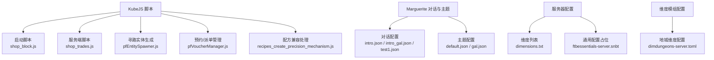
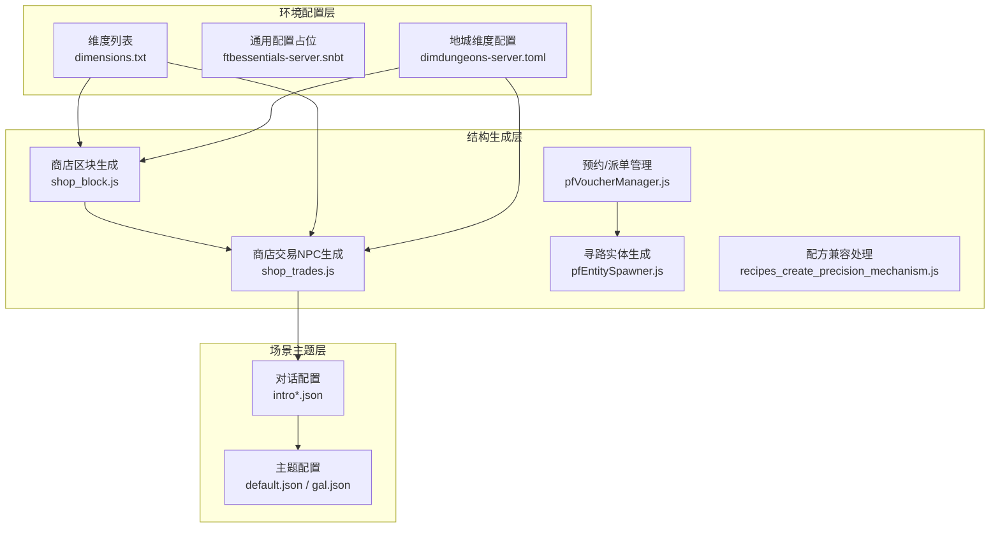
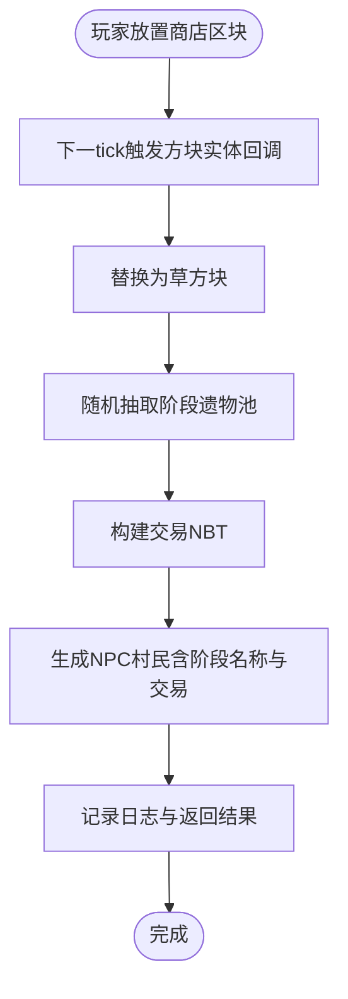
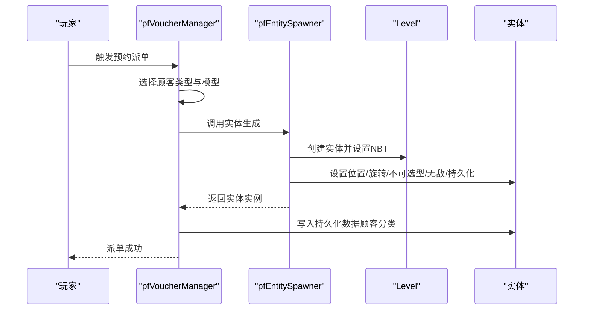
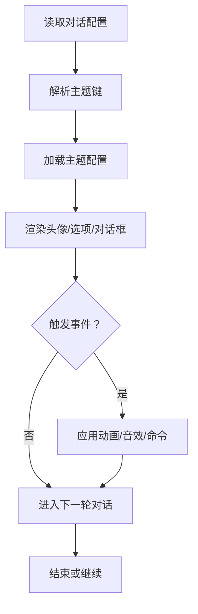
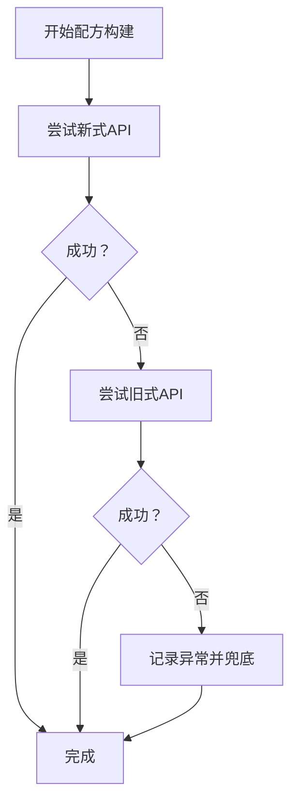
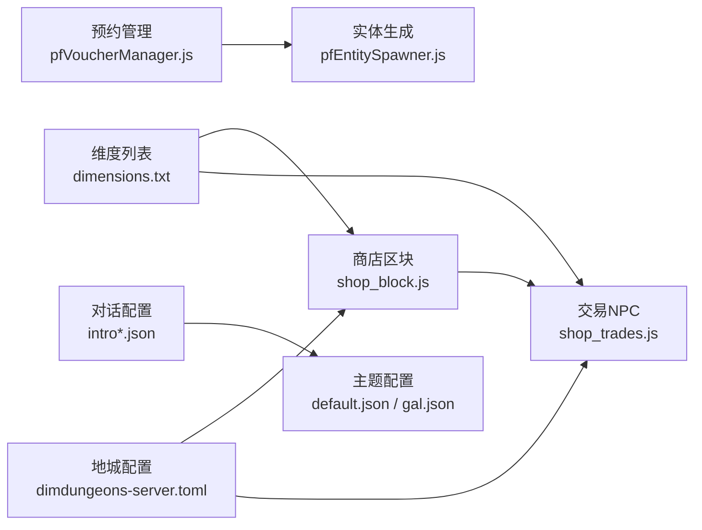

# 结构数据

<cite>
**本文引用的文件**
- [dimdungeons-server.toml](file://config/dimdungeons-server.toml)
- [ftbessentials-server.snbt](file://defaultconfigs/ftbessentials-server.snbt)
- [dimensions.txt](file://config/skyblockbuilder/data/dimensions.txt)
- [intro.json](file://kubejs/data/marguerite/dialogues/intro.json)
- [intro_gal.json](file://kubejs/data/marguerite/dialogues/intro_gal.json)
- [test1.json](file://kubejs/data/marguerite/dialogues/test1.json)
- [default.json](file://kubejs/data/marguerite/chatbox/theme/default.json)
- [gal.json](file://kubejs/data/marguerite/chatbox/theme/gal.json)
- [shop_block.js](file://kubejs/startup_scripts/block/shop_block.js)
- [shop_trades.js](file://kubejs/server_scripts/shop_trades.js)
- [pfEntitySpawner.js](file://kubejs/server_scripts/pathfinder/pfEntitySpawner.js)
- [pfVoucherManager.js](file://kubejs/server_scripts/pathfinder/pfVoucherManager.js)
- [recipes_create_precision_mechanism.js](file://kubejs/server_scripts/recipes/recipes_create_precision_mechanism.js)
</cite>

## 目录
1. [引言](#引言)
2. [项目结构](#项目结构)
3. [核心组件](#核心组件)
4. [架构总览](#架构总览)
5. [详细组件分析](#详细组件分析)
6. [依赖关系分析](#依赖关系分析)
7. [性能考量](#性能考量)
8. [故障排查指南](#故障排查指南)
9. [结论](#结论)
10. [附录](#附录)

## 引言
本文件面向世界构建者与模组开发者，系统梳理本版本中与“结构数据”相关的内容与实现方式。重点覆盖以下方面：
- 结构文件的定义格式与组织方式
- 生成条件与放置规则
- 不同模组（Marguerite、SkyFootSpa）的结构主题配置差异
- 结构尺寸、材质与环境适配
- 数据验证方法、调试技巧与性能优化建议

需要特别说明的是：当前仓库中未发现以“结构文件”命名的原生Minecraft结构资源包或数据包文件；与“结构”最接近的实现体现在以下两类内容：
- 基于KubeJS脚本的动态生成与放置逻辑（如商店区块、NPC生成等）
- Marguerite与SkyFootSpa的对话框与主题配置，用于构建沉浸式场景与氛围

因此，本文将以“结构数据”的广义概念进行说明：既包括可直接观测到的方块布局与实体放置，也包括通过脚本与主题配置营造的“场景结构”。

## 项目结构
围绕“结构数据”的相关文件主要分布在以下路径：
- KubeJS脚本：负责动态生成、放置与交互逻辑
- 对话框与主题：用于构建场景氛围与叙事结构
- 服务器配置：控制维度、行为与性能参数

图表来源
- [shop_block.js:1-31](file://kubejs/startup_scripts/block/shop_block.js#L1-L31)
- [shop_trades.js:133-176](file://kubejs/server_scripts/shop_trades.js#L133-L176)
- [pfEntitySpawner.js:1-38](file://kubejs/server_scripts/pathfinder/pfEntitySpawner.js#L1-L38)
- [pfVoucherManager.js:29-62](file://kubejs/server_scripts/pathfinder/pfVoucherManager.js#L29-L62)
- [recipes_create_precision_mechanism.js:25-53](file://kubejs/server_scripts/recipes/recipes_create_precision_mechanism.js#L25-L53)
- [intro.json:1-136](file://kubejs/data/marguerite/dialogues/intro.json#L1-L136)
- [intro_gal.json:1-139](file://kubejs/data/marguerite/dialogues/intro_gal.json#L1-L139)
- [test1.json:1-136](file://kubejs/data/marguerite/dialogues/test1.json#L1-L136)
- [default.json:1-76](file://kubejs/data/marguerite/chatbox/theme/default.json#L1-L76)
- [gal.json:1-69](file://kubejs/data/marguerite/chatbox/theme/gal.json#L1-L69)
- [dimensions.txt:1-5](file://config/skyblockbuilder/data/dimensions.txt#L1-L5)
- [ftbessentials-server.snbt:1-14](file://defaultconfigs/ftbessentials-server.snbt#L1-L14)
- [dimdungeons-server.toml:1-46](file://config/dimdungeons-server.toml#L1-L46)

章节来源
- [shop_block.js:1-31](file://kubejs/startup_scripts/block/shop_block.js#L1-L31)
- [shop_trades.js:133-176](file://kubejs/server_scripts/shop_trades.js#L133-L176)
- [pfEntitySpawner.js:1-38](file://kubejs/server_scripts/pathfinder/pfEntitySpawner.js#L1-L38)
- [pfVoucherManager.js:29-62](file://kubejs/server_scripts/pathfinder/pfVoucherManager.js#L29-L62)
- [recipes_create_precision_mechanism.js:25-53](file://kubejs/server_scripts/recipes/recipes_create_precision_mechanism.js#L25-L53)
- [intro.json:1-136](file://kubejs/data/marguerite/dialogues/intro.json#L1-L136)
- [intro_gal.json:1-139](file://kubejs/data/marguerite/dialogues/intro_gal.json#L1-L139)
- [test1.json:1-136](file://kubejs/data/marguerite/dialogues/test1.json#L1-L136)
- [default.json:1-76](file://kubejs/data/marguerite/chatbox/theme/default.json#L1-L76)
- [gal.json:1-69](file://kubejs/data/marguerite/chatbox/theme/gal.json#L1-L69)
- [dimensions.txt:1-5](file://config/skyblockbuilder/data/dimensions.txt#L1-L5)
- [ftbessentials-server.snbt:1-14](file://defaultconfigs/ftbessentials-server.snbt#L1-L14)
- [dimdungeons-server.toml:1-46](file://config/dimdungeons-server.toml#L1-L46)

## 核心组件
- 动态结构生成器（KubeJS）
  - 商店区块：按阶段生成不同外观与行为的方块，放置后下一tick执行草方块替换与NPC生成
  - NPC生成：根据预约系统随机挑选模型并生成实体，设置不可选型、无敌、持久化等属性
  - 配方兼容：在API不可用时回退到兼容写法，保证机制稳定运行
- 场景主题与对话（Marguerite）
  - 对话配置：定义多轮对话、选项、解锁条件与音效
  - 主题配置：定义头像、选项、对话框纹理与动画，支持自定义渲染事件
- 维度与环境
  - 维度列表：定义可用维度，供世界构建与脚本判断使用
  - 模组配置：地城维度的行为参数（如建造速度、日志级别等）

章节来源
- [shop_block.js:1-31](file://kubejs/startup_scripts/block/shop_block.js#L1-L31)
- [shop_trades.js:133-176](file://kubejs/server_scripts/shop_trades.js#L133-L176)
- [pfEntitySpawner.js:1-38](file://kubejs/server_scripts/pathfinder/pfEntitySpawner.js#L1-L38)
- [pfVoucherManager.js:29-62](file://kubejs/server_scripts/pathfinder/pfVoucherManager.js#L29-L62)
- [recipes_create_precision_mechanism.js:25-53](file://kubejs/server_scripts/recipes/recipes_create_precision_mechanism.js#L25-L53)
- [intro.json:1-136](file://kubejs/data/marguerite/dialogues/intro.json#L1-L136)
- [gal.json:1-69](file://kubejs/data/marguerite/chatbox/theme/gal.json#L1-L69)
- [dimensions.txt:1-5](file://config/skyblockbuilder/data/dimensions.txt#L1-L5)
- [dimdungeons-server.toml:1-46](file://config/dimdungeons-server.toml#L1-L46)

## 架构总览
下图展示“结构数据”在本版本中的整体架构：KubeJS脚本作为结构生成与放置的核心，结合对话与主题配置形成完整的场景结构；服务器配置与维度信息为结构运行提供环境保障。

图表来源
- [shop_block.js:1-31](file://kubejs/startup_scripts/block/shop_block.js#L1-L31)
- [shop_trades.js:133-176](file://kubejs/server_scripts/shop_trades.js#L133-L176)
- [pfEntitySpawner.js:1-38](file://kubejs/server_scripts/pathfinder/pfEntitySpawner.js#L1-L38)
- [pfVoucherManager.js:29-62](file://kubejs/server_scripts/pathfinder/pfVoucherManager.js#L29-L62)
- [recipes_create_precision_mechanism.js:25-53](file://kubejs/server_scripts/recipes/recipes_create_precision_mechanism.js#L25-L53)
- [intro.json:1-136](file://kubejs/data/marguerite/dialogues/intro.json#L1-L136)
- [gal.json:1-69](file://kubejs/data/marguerite/chatbox/theme/gal.json#L1-L69)
- [dimensions.txt:1-5](file://config/skyblockbuilder/data/dimensions.txt#L1-L5)
- [ftbessentials-server.snbt:1-14](file://defaultconfigs/ftbessentials-server.snbt#L1-L14)
- [dimdungeons-server.toml:1-46](file://config/dimdungeons-server.toml#L1-L46)

## 详细组件分析

### 商店区块结构（shop_block.js）
- 定义与特性
  - 注册5个阶段的商店区块，每个阶段具有不同的显示名与纹理
  - 方块实体在每tick触发回调，调用全局函数进行下一步处理
- 放置与生成流程
  - 玩家放置方块后，下一tick将方块替换为草方块，并在上方生成带随机遗物交易的NPC村民
  - 交易NBT由脚本动态构建，名称与阶段绑定
- 尺寸与材质
  - 尺寸：单格方块，高度随放置位置变化
  - 材质：使用不同纹理块（如木板、红石块、紫珀块、钻石块、紫水晶块）区分阶段
- 环境适配
  - 依赖服务器命令与方块状态变更，确保在单人与多人环境下一致生效

图表来源
- [shop_block.js:1-31](file://kubejs/startup_scripts/block/shop_block.js#L1-L31)
- [shop_trades.js:133-176](file://kubejs/server_scripts/shop_trades.js#L133-L176)

章节来源
- [shop_block.js:1-31](file://kubejs/startup_scripts/block/shop_block.js#L1-L31)
- [shop_trades.js:133-176](file://kubejs/server_scripts/shop_trades.js#L133-L176)

### 寻路实体与预约结构（pfEntitySpawner.js、pfVoucherManager.js）
- 实体生成
  - 创建指定类型的实体，设置位置、朝向与不可选型、无敌、持久化等NBT
  - 随机选择模型，支持覆盖参数
- 预约派单
  - 根据预约键值选择顾客类型与模型，调用实体生成并写入持久化数据
  - 若存在商店管理器，则将生成实体UUID登记至商店管理
- 尺寸与材质
  - 实体为游戏内实体，不涉及方块级尺寸；模型与纹理由外部资源提供
- 环境适配
  - 依赖全局常量与管理器，需确保脚本加载顺序与全局对象可用

图表来源
- [pfVoucherManager.js:29-62](file://kubejs/server_scripts/pathfinder/pfVoucherManager.js#L29-L62)
- [pfEntitySpawner.js:1-38](file://kubejs/server_scripts/pathfinder/pfEntitySpawner.js#L1-L38)

章节来源
- [pfEntitySpawner.js:1-38](file://kubejs/server_scripts/pathfinder/pfEntitySpawner.js#L1-L38)
- [pfVoucherManager.js:29-62](file://kubejs/server_scripts/pathfinder/pfVoucherManager.js#L29-L62)

### 对话与主题结构（Marguerite）
- 对话配置（intro.json、intro_gal.json、test1.json）
  - 定义多轮对话、选项、跳转、命令触发与解锁条件
  - 支持音效、头像切换与动画事件
- 主题配置（default.json、gal.json）
  - 定义头像、选项、对话框纹理与对齐方式
  - 支持自定义动画序列（淡入、滑入、弹跳等）
- 尺寸与材质
  - 头像与对话框尺寸通过坐标与宽高参数定义
  - 材质来源于资源包纹理路径
- 环境适配
  - 主题与对话相互独立，可通过主题键在对话中切换

图表来源
- [intro.json:1-136](file://kubejs/data/marguerite/dialogues/intro.json#L1-L136)
- [gal.json:1-69](file://kubejs/data/marguerite/chatbox/theme/gal.json#L1-L69)

章节来源
- [intro.json:1-136](file://kubejs/data/marguerite/dialogues/intro.json#L1-L136)
- [intro_gal.json:1-139](file://kubejs/data/marguerite/dialogues/intro_gal.json#L1-L139)
- [test1.json:1-136](file://kubejs/data/marguerite/dialogues/test1.json#L1-L136)
- [default.json:1-76](file://kubejs/data/marguerite/chatbox/theme/default.json#L1-L76)
- [gal.json:1-69](file://kubejs/data/marguerite/chatbox/theme/gal.json#L1-L69)

### 配方兼容与结构稳定性（recipes_create_precision_mechanism.js）
- 目标
  - 在多种API形态下稳定产出目标产物，避免因API差异导致的失败
- 流程
  - 优先尝试新式部署配方API；若失败则回退到旧式API
  - 记录异常并继续尝试其他组合
- 性能影响
  - 失败重试会增加CPU开销，建议在开发阶段启用日志，上线前固定为最优API

图表来源
- [recipes_create_precision_mechanism.js:25-53](file://kubejs/server_scripts/recipes/recipes_create_precision_mechanism.js#L25-L53)

章节来源
- [recipes_create_precision_mechanism.js:25-53](file://kubejs/server_scripts/recipes/recipes_create_precision_mechanism.js#L25-L53)

## 依赖关系分析
- 组件耦合
  - 商店区块与交易NPC强耦合：前者负责放置，后者负责生成与交易
  - 预约系统与实体生成弱耦合：通过键值与模型选择连接
  - 对话与主题松耦合：主题仅影响渲染，不参与逻辑分支
- 外部依赖
  - 维度列表决定结构生成的可用范围
  - 模组配置影响维度行为（如地城维度的建造速度与日志级别）

图表来源
- [shop_block.js:1-31](file://kubejs/startup_scripts/block/shop_block.js#L1-L31)
- [shop_trades.js:133-176](file://kubejs/server_scripts/shop_trades.js#L133-L176)
- [pfVoucherManager.js:29-62](file://kubejs/server_scripts/pathfinder/pfVoucherManager.js#L29-L62)
- [pfEntitySpawner.js:1-38](file://kubejs/server_scripts/pathfinder/pfEntitySpawner.js#L1-L38)
- [intro.json:1-136](file://kubejs/data/marguerite/dialogues/intro.json#L1-L136)
- [gal.json:1-69](file://kubejs/data/marguerite/chatbox/theme/gal.json#L1-L69)
- [dimensions.txt:1-5](file://config/skyblockbuilder/data/dimensions.txt#L1-L5)
- [dimdungeons-server.toml:1-46](file://config/dimdungeons-server.toml#L1-L46)

章节来源
- [dimensions.txt:1-5](file://config/skyblockbuilder/data/dimensions.txt#L1-L5)
- [dimdungeons-server.toml:1-46](file://config/dimdungeons-server.toml#L1-L46)

## 性能考量
- 结构生成频率
  - 商店区块在下一tick执行，建议避免在同一tick内大量生成，防止瞬时负载过高
- 实体生成成本
  - 寻路实体生成包含NBT合并与持久化操作，建议限制并发数量或引入队列
- 配方构建回退
  - 新旧API切换会产生额外尝试次数，建议在生产环境固定为最优API
- 维度与日志
  - 地城维度的建造速度与日志级别可调，建议在大规模生成时提高建造速度并降低日志级别

章节来源
- [dimdungeons-server.toml:1-46](file://config/dimdungeons-server.toml#L1-L46)

## 故障排查指南
- 商店区块未生成NPC
  - 检查下一tick回调是否被正确注册（方块实体回调）
  - 校验阶段遗物池是否存在且非空
  - 查看服务器命令执行结果与日志输出
- 实体生成失败或模型异常
  - 确认全局常量与管理器已加载
  - 检查模型键值是否存在于类型映射中
- 对话主题不生效
  - 确认主题键与对话配置一致
  - 检查主题文件路径与纹理资源是否存在
- 配方构建报错
  - 查看API回退日志，确认是否因API版本差异导致
  - 固定为可用API并移除兜底逻辑

章节来源
- [shop_block.js:1-31](file://kubejs/startup_scripts/block/shop_block.js#L1-L31)
- [shop_trades.js:133-176](file://kubejs/server_scripts/shop_trades.js#L133-L176)
- [pfEntitySpawner.js:1-38](file://kubejs/server_scripts/pathfinder/pfEntitySpawner.js#L1-L38)
- [pfVoucherManager.js:29-62](file://kubejs/server_scripts/pathfinder/pfVoucherManager.js#L29-L62)
- [recipes_create_precision_mechanism.js:25-53](file://kubejs/server_scripts/recipes/recipes_create_precision_mechanism.js#L25-L53)

## 结论
本版本的“结构数据”并非传统意义上的原生结构文件，而是通过KubeJS脚本与主题配置实现的动态结构体系。其优势在于灵活性与可扩展性，适合快速迭代与场景化构建。建议在实际使用中：
- 明确结构生成的边界与依赖
- 合理控制生成频率与并发
- 固定API与配置，减少回退与异常
- 使用主题与对话增强场景沉浸感

## 附录
- 关键配置与脚本清单
  - 商店区块：[shop_block.js:1-31](file://kubejs/startup_scripts/block/shop_block.js#L1-L31)
  - 商店交易NPC：[shop_trades.js:133-176](file://kubejs/server_scripts/shop_trades.js#L133-L176)
  - 寻路实体生成：[pfEntitySpawner.js:1-38](file://kubejs/server_scripts/pathfinder/pfEntitySpawner.js#L1-L38)
  - 预约/派单管理：[pfVoucherManager.js:29-62](file://kubejs/server_scripts/pathfinder/pfVoucherManager.js#L29-L62)
  - 对话配置（示例）：[intro.json:1-136](file://kubejs/data/marguerite/dialogues/intro.json#L1-L136)、[intro_gal.json:1-139](file://kubejs/data/marguerite/dialogues/intro_gal.json#L1-L139)、[test1.json:1-136](file://kubejs/data/marguerite/dialogues/test1.json#L1-L136)
  - 主题配置（示例）：[default.json:1-76](file://kubejs/data/marguerite/chatbox/theme/default.json#L1-L76)、[gal.json:1-69](file://kubejs/data/marguerite/chatbox/theme/gal.json#L1-L69)
  - 维度列表：[dimensions.txt:1-5](file://config/skyblockbuilder/data/dimensions.txt#L1-L5)
  - 通用配置占位：[ftbessentials-server.snbt:1-14](file://defaultconfigs/ftbessentials-server.snbt#L1-L14)
  - 地城维度配置：[dimdungeons-server.toml:1-46](file://config/dimdungeons-server.toml#L1-L46)