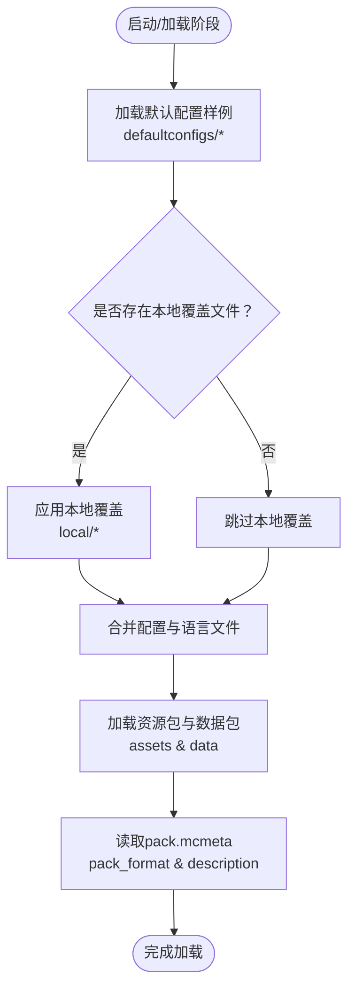
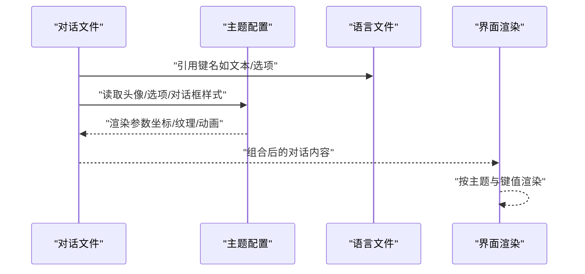
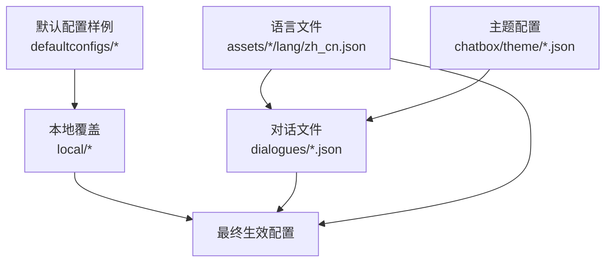
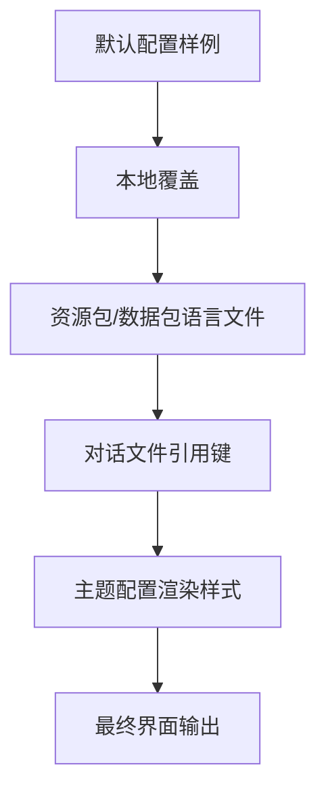

# 语言文件

<cite>
**本文档引用的文件**
- [kubejs/assets/kubejs/lang/zh_cn.json](file://kubejs/assets/kubejs/lang/zh_cn.json)
- [kubejs/data/ftb/assets/ftbquests/lang/zh_cn.json](file://kubejs/data/ftb/assets/ftbquests/lang/zh_cn.json)
- [kubejs/data/sky/assets/skyguis/lang/zh_cn.json](file://kubejs/data/sky/assets/skyguis/lang/zh_cn.json)
- [kubejs/assets/curios/lang/zh_cn.json](file://kubejs/assets/curios/lang/zh_cn.json)
- [defaultconfigs/ftbquests/client-config.snbt](file://defaultconfigs/ftbquests/client-config.snbt)
- [defaultconfigs/ftblibrary/ftblibrary-client.snbt](file://defaultconfigs/ftblibrary/ftblibrary-client.snbt)
- [kubejs/assets/kubejs/sounds.json](file://kubejs/assets/kubejs/sounds.json)
- [kubejs/data/marguerite/dialogues/intro.json](file://kubejs/data/marguerite/dialogues/intro.json)
- [kubejs/data/marguerite/chatbox/theme/default.json](file://kubejs/data/marguerite/chatbox/theme/default.json)
- [kubejs/data/marguerite/dialogues/intro_gal.json](file://kubejs/data/marguerite/dialogues/intro_gal.json)
- [kubejs/data/skyfootspa/chatbox/theme/default.json](file://kubejs/data/skyfootspa/chatbox/theme/default.json)
- [defaultconfigs/ftbessentials-server.snbt](file://defaultconfigs/ftbessentials-server.snbt)
- [kubejs/data/ftb/pack.mcmeta](file://kubejs/data/ftb/pack.mcmeta)
- [kubejs/data/sky/pack.mcmeta](file://kubejs/data/sky/pack.mcmeta)
</cite>

## 目录
1. [简介](#简介)
2. [项目结构](#项目结构)
3. [核心组件](#核心组件)
4. [架构总览](#架构总览)
5. [详细组件分析](#详细组件分析)
6. [依赖关系分析](#依赖关系分析)
7. [性能考量](#性能考量)
8. [故障排查指南](#故障排查指南)
9. [结论](#结论)
10. [附录](#附录)

## 简介
本文件系统围绕Minecraft多语言支持展开，重点说明JSON语言文件的结构、键值对定义与嵌套引用机制，以及不同模组（如FTB Quests、Sky GUIs、KubeJS、Curios等）的语言文件差异与特殊配置。文档还涵盖语言文件的加载顺序、优先级与覆盖机制，并提供本地化最佳实践、质量保障与多语言测试方法，帮助模组开发者建立完善的语言文件管理流程与自动化维护策略。

## 项目结构
仓库中语言文件主要分布在以下路径：
- KubeJS资源语言文件：kubejs/assets/*/lang/zh_cn.json
- KubeJS数据语言文件：kubejs/data/*/assets/*/lang/zh_cn.json
- 默认配置样例：defaultconfigs/*/xxx.snbt（用于演示覆盖机制）
- 对话与主题配置：kubejs/data/*/dialogues/*.json 与 theme/*.json
- 声音与元数据：kubejs/assets/*/sounds.json 与 pack.mcmeta

```mermaid
graph TB
A["语言文件根目录"] --> B["资源语言文件<br/>assets/*/lang/zh_cn.json"]
A --> C["数据语言文件<br/>data/*/assets/*/lang/zh_cn.json"]
A --> D["默认配置样例<br/>defaultconfigs/*/xxx.snbt"]
A --> E["对话与主题<br/>data/*/dialogues/*.json<br/>data/*/chatbox/theme/*.json"]
A --> F["声音与元数据<br/>assets/*/sounds.json<br/>pack.mcmeta"]
B --> B1["kubejs/assets/kubejs/lang/zh_cn.json"]
B --> B2["kubejs/assets/curios/lang/zh_cn.json"]
C --> C1["kubejs/data/ftb/assets/ftbquests/lang/zh_cn.json"]
C --> C2["kubejs/data/sky/assets/skyguis/lang/zh_cn.json"]
D --> D1["defaultconfigs/ftbquests/client-config.snbt"]
D --> D2["defaultconfigs/ftblibrary/ftblibrary-client.snbt"]
D --> D3["defaultconfigs/ftbessentials-server.snbt"]
E --> E1["marguerite/dialogues/intro.json"]
E --> E2["marguerite/chatbox/theme/default.json"]
E --> E3["marguerite/dialogues/intro_gal.json"]
E --> E4["skyfootspa/chatbox/theme/default.json"]
F --> F1["kubejs/assets/kubejs/sounds.json"]
F --> F2["kubejs/data/ftb/pack.mcmeta"]
F --> F3["kubejs/data/sky/pack.mcmeta"]
```

图表来源
- [kubejs/assets/kubejs/lang/zh_cn.json:1-15](file://kubejs/assets/kubejs/lang/zh_cn.json#L1-L15)
- [kubejs/assets/curios/lang/zh_cn.json:1-4](file://kubejs/assets/curios/lang/zh_cn.json#L1-L4)
- [kubejs/data/ftb/assets/ftbquests/lang/zh_cn.json:1-542](file://kubejs/data/ftb/assets/ftbquests/lang/zh_cn.json#L1-L542)
- [kubejs/data/sky/assets/skyguis/lang/zh_cn.json:1-79](file://kubejs/data/sky/assets/skyguis/lang/zh_cn.json#L1-L79)
- [defaultconfigs/ftbquests/client-config.snbt:1-5](file://defaultconfigs/ftbquests/client-config.snbt#L1-L5)
- [defaultconfigs/ftblibrary/ftblibrary-client.snbt:1-5](file://defaultconfigs/ftblibrary/ftblibrary-client.snbt#L1-L5)
- [defaultconfigs/ftbessentials-server.snbt:1-14](file://defaultconfigs/ftbessentials-server.snbt#L1-L14)
- [kubejs/data/marguerite/dialogues/intro.json:1-136](file://kubejs/data/marguerite/dialogues/intro.json#L1-L136)
- [kubejs/data/marguerite/chatbox/theme/default.json:1-76](file://kubejs/data/marguerite/chatbox/theme/default.json#L1-L76)
- [kubejs/data/marguerite/dialogues/intro_gal.json:1-139](file://kubejs/data/marguerite/dialogues/intro_gal.json#L1-L139)
- [kubejs/data/skyfootspa/chatbox/theme/default.json:1-76](file://kubejs/data/skyfootspa/chatbox/theme/default.json#L1-L76)
- [kubejs/assets/kubejs/sounds.json:1-5](file://kubejs/assets/kubejs/sounds.json#L1-L5)
- [kubejs/data/ftb/pack.mcmeta:1-6](file://kubejs/data/ftb/pack.mcmeta#L1-L6)
- [kubejs/data/sky/pack.mcmeta:1-6](file://kubejs/data/sky/pack.mcmeta#L1-L6)

章节来源
- [kubejs/assets/kubejs/lang/zh_cn.json:1-15](file://kubejs/assets/kubejs/lang/zh_cn.json#L1-L15)
- [kubejs/data/ftb/assets/ftbquests/lang/zh_cn.json:1-542](file://kubejs/data/ftb/assets/ftbquests/lang/zh_cn.json#L1-L542)
- [kubejs/data/sky/assets/skyguis/lang/zh_cn.json:1-79](file://kubejs/data/sky/assets/skyguis/lang/zh_cn.json#L1-L79)
- [kubejs/assets/curios/lang/zh_cn.json:1-4](file://kubejs/assets/curios/lang/zh_cn.json#L1-L4)
- [defaultconfigs/ftbquests/client-config.snbt:1-5](file://defaultconfigs/ftbquests/client-config.snbt#L1-L5)
- [defaultconfigs/ftblibrary/ftblibrary-client.snbt:1-5](file://defaultconfigs/ftblibrary/ftblibrary-client.snbt#L1-L5)
- [defaultconfigs/ftbessentials-server.snbt:1-14](file://defaultconfigs/ftbessentials-server.snbt#L1-L14)
- [kubejs/data/marguerite/dialogues/intro.json:1-136](file://kubejs/data/marguerite/dialogues/intro.json#L1-L136)
- [kubejs/data/marguerite/chatbox/theme/default.json:1-76](file://kubejs/data/marguerite/chatbox/theme/default.json#L1-L76)
- [kubejs/data/marguerite/dialogues/intro_gal.json:1-139](file://kubejs/data/marguerite/dialogues/intro_gal.json#L1-L139)
- [kubejs/data/skyfootspa/chatbox/theme/default.json:1-76](file://kubejs/data/skyfootspa/chatbox/theme/default.json#L1-L76)
- [kubejs/assets/kubejs/sounds.json:1-5](file://kubejs/assets/kubejs/sounds.json#L1-L5)
- [kubejs/data/ftb/pack.mcmeta:1-6](file://kubejs/data/ftb/pack.mcmeta#L1-L6)
- [kubejs/data/sky/pack.mcmeta:1-6](file://kubejs/data/sky/pack.mcmeta#L1-L6)

## 核心组件
- JSON语言文件：键值对形式，键通常采用“域.子域.标识符”的层级命名，值为本地化字符串。
- 对话与主题：通过JSON定义对话文本、头像、选项、动画与事件，支持嵌套引用键名（如对话文本引用语言键）。
- 声音与元数据：声音列表与pack元信息，用于资源包描述与兼容性声明。
- 默认配置样例：SNBT文件用于演示如何在本地覆盖默认配置，体现“默认→本地→覆盖”的优先级思想。

章节来源
- [kubejs/assets/kubejs/lang/zh_cn.json:1-15](file://kubejs/assets/kubejs/lang/zh_cn.json#L1-L15)
- [kubejs/data/ftb/assets/ftbquests/lang/zh_cn.json:1-542](file://kubejs/data/ftb/assets/ftbquests/lang/zh_cn.json#L1-L542)
- [kubejs/data/sky/assets/skyguis/lang/zh_cn.json:1-79](file://kubejs/data/sky/assets/skyguis/lang/zh_cn.json#L1-L79)
- [kubejs/assets/curios/lang/zh_cn.json:1-4](file://kubejs/assets/curios/lang/zh_cn.json#L1-L4)
- [kubejs/data/marguerite/dialogues/intro.json:1-136](file://kubejs/data/marguerite/dialogues/intro.json#L1-L136)
- [kubejs/data/marguerite/chatbox/theme/default.json:1-76](file://kubejs/data/marguerite/chatbox/theme/default.json#L1-L76)
- [kubejs/assets/kubejs/sounds.json:1-5](file://kubejs/assets/kubejs/sounds.json#L1-L5)
- [defaultconfigs/ftbquests/client-config.snbt:1-5](file://defaultconfigs/ftbquests/client-config.snbt#L1-L5)
- [defaultconfigs/ftblibrary/ftblibrary-client.snbt:1-5](file://defaultconfigs/ftblibrary/ftblibrary-client.snbt#L1-L5)

## 架构总览
语言文件的加载与覆盖遵循“默认→本地→覆盖”的通用优先级模型。默认配置样例文件展示了如何在本地创建同名配置以实现覆盖；资源包元数据（pack.mcmeta）用于声明pack格式与描述，影响资源包的识别与加载。

图表来源
- [defaultconfigs/ftbquests/client-config.snbt:1-5](file://defaultconfigs/ftbquests/client-config.snbt#L1-L5)
- [defaultconfigs/ftblibrary/ftblibrary-client.snbt:1-5](file://defaultconfigs/ftblibrary/ftblibrary-client.snbt#L1-L5)
- [defaultconfigs/ftbessentials-server.snbt:1-14](file://defaultconfigs/ftbessentials-server.snbt#L1-L14)
- [kubejs/data/ftb/pack.mcmeta:1-6](file://kubejs/data/ftb/pack.mcmeta#L1-L6)
- [kubejs/data/sky/pack.mcmeta:1-6](file://kubejs/data/sky/pack.mcmeta#L1-L6)

章节来源
- [defaultconfigs/ftbquests/client-config.snbt:1-5](file://defaultconfigs/ftbquests/client-config.snbt#L1-L5)
- [defaultconfigs/ftblibrary/ftblibrary-client.snbt:1-5](file://defaultconfigs/ftblibrary/ftblibrary-client.snbt#L1-L5)
- [defaultconfigs/ftbessentials-server.snbt:1-14](file://defaultconfigs/ftbessentials-server.snbt#L1-L14)
- [kubejs/data/ftb/pack.mcmeta:1-6](file://kubejs/data/ftb/pack.mcmeta#L1-L6)
- [kubejs/data/sky/pack.mcmeta:1-6](file://kubejs/data/sky/pack.mcmeta#L1-L6)

## 详细组件分析

### JSON语言文件结构与键值对
- 结构特征：顶层为键值对，键通常采用“域.子域.标识符”命名，便于分组与检索；值为字符串，支持转义与占位符（由具体模组解析）。
- 示例文件：
  - KubeJS资源语言：[kubejs/assets/kubejs/lang/zh_cn.json:1-15](file://kubejs/assets/kubejs/lang/zh_cn.json#L1-L15)
  - FTB Quests数据语言：[kubejs/data/ftb/assets/ftbquests/lang/zh_cn.json:1-542](file://kubejs/data/ftb/assets/ftbquests/lang/zh_cn.json#L1-L542)
  - Sky GUIs数据语言：[kubejs/data/sky/assets/skyguis/lang/zh_cn.json:1-79](file://kubejs/data/sky/assets/skyguis/lang/zh_cn.json#L1-L79)
  - Curios资源语言：[kubejs/assets/curios/lang/zh_cn.json:1-4](file://kubejs/assets/curios/lang/zh_cn.json#L1-L4)

章节来源
- [kubejs/assets/kubejs/lang/zh_cn.json:1-15](file://kubejs/assets/kubejs/lang/zh_cn.json#L1-L15)
- [kubejs/data/ftb/assets/ftbquests/lang/zh_cn.json:1-542](file://kubejs/data/ftb/assets/ftbquests/lang/zh_cn.json#L1-L542)
- [kubejs/data/sky/assets/skyguis/lang/zh_cn.json:1-79](file://kubejs/data/sky/assets/skyguis/lang/zh_cn.json#L1-L79)
- [kubejs/assets/curios/lang/zh_cn.json:1-4](file://kubejs/assets/curios/lang/zh_cn.json#L1-L4)

### 嵌套引用机制与对话系统
- 对话文件通过键名引用语言文件中的条目，形成“键→值”的间接映射，便于统一管理与复用。
- 主题配置定义头像、选项、对话框与动画等渲染参数，支持复杂UI交互。
- 示例文件：
  - 对话定义（引用语言键）：[kubejs/data/marguerite/dialogues/intro.json:1-136](file://kubejs/data/marguerite/dialogues/intro.json#L1-L136)
  - 对话主题（默认）：[kubejs/data/marguerite/chatbox/theme/default.json:1-76](file://kubejs/data/marguerite/chatbox/theme/default.json#L1-L76)
  - 对话定义（Gal主题）：[kubejs/data/marguerite/dialogues/intro_gal.json:1-139](file://kubejs/data/marguerite/dialogues/intro_gal.json#L1-L139)
  - Sky Foot Spa主题（默认）：[kubejs/data/skyfootspa/chatbox/theme/default.json:1-76](file://kubejs/data/skyfootspa/chatbox/theme/default.json#L1-L76)

图表来源
- [kubejs/data/marguerite/dialogues/intro.json:1-136](file://kubejs/data/marguerite/dialogues/intro.json#L1-L136)
- [kubejs/data/marguerite/chatbox/theme/default.json:1-76](file://kubejs/data/marguerite/chatbox/theme/default.json#L1-L76)
- [kubejs/data/marguerite/dialogues/intro_gal.json:1-139](file://kubejs/data/marguerite/dialogues/intro_gal.json#L1-L139)
- [kubejs/data/skyfootspa/chatbox/theme/default.json:1-76](file://kubejs/data/skyfootspa/chatbox/theme/default.json#L1-L76)

章节来源
- [kubejs/data/marguerite/dialogues/intro.json:1-136](file://kubejs/data/marguerite/dialogues/intro.json#L1-L136)
- [kubejs/data/marguerite/chatbox/theme/default.json:1-76](file://kubejs/data/marguerite/chatbox/theme/default.json#L1-L76)
- [kubejs/data/marguerite/dialogues/intro_gal.json:1-139](file://kubejs/data/marguerite/dialogues/intro_gal.json#L1-L139)
- [kubejs/data/skyfootspa/chatbox/theme/default.json:1-76](file://kubejs/data/skyfootspa/chatbox/theme/default.json#L1-L76)

### 声音与元数据
- 声音文件：定义声音列表，供资源包中的音效使用。
  - 示例：[kubejs/assets/kubejs/sounds.json:1-5](file://kubejs/assets/kubejs/sounds.json#L1-L5)
- 元数据：pack.mcmeta声明pack格式与描述，影响资源包识别与兼容性。
  - FTB数据包元数据：[kubejs/data/ftb/pack.mcmeta:1-6](file://kubejs/data/ftb/pack.mcmeta#L1-L6)
  - Sky数据包元数据：[kubejs/data/sky/pack.mcmeta:1-6](file://kubejs/data/sky/pack.mcmeta#L1-L6)

章节来源
- [kubejs/assets/kubejs/sounds.json:1-5](file://kubejs/assets/kubejs/sounds.json#L1-L5)
- [kubejs/data/ftb/pack.mcmeta:1-6](file://kubejs/data/ftb/pack.mcmeta#L1-L6)
- [kubejs/data/sky/pack.mcmeta:1-6](file://kubejs/data/sky/pack.mcmeta#L1-L6)

### 模组差异与特殊配置
- FTB Quests：语言文件覆盖大量游戏界面、任务、章节、奖励、命令反馈等文本，键空间庞大且层级丰富，适合集中管理与版本化控制。
  - 示例：[kubejs/data/ftb/assets/ftbquests/lang/zh_cn.json:1-542](file://kubejs/data/ftb/assets/ftbquests/lang/zh_cn.json#L1-L542)
- Sky GUIs：语言文件聚焦于团队与界面相关文本，键相对简洁，强调交互与状态提示。
  - 示例：[kubejs/data/sky/assets/skyguis/lang/zh_cn.json:1-79](file://kubejs/data/sky/assets/skyguis/lang/zh_cn.json#L1-L79)
- KubeJS：资源语言文件常用于属性与效果名称等，键命名遵循属性域规范。
  - 示例：[kubejs/assets/kubejs/lang/zh_cn.json:1-15](file://kubejs/assets/kubejs/lang/zh_cn.json#L1-L15)
- Curios：语言文件极简，主要用于装备槽位与修饰器标识。
  - 示例：[kubejs/assets/curios/lang/zh_cn.json:1-4](file://kubejs/assets/curios/lang/zh_cn.json#L1-L4)

章节来源
- [kubejs/data/ftb/assets/ftbquests/lang/zh_cn.json:1-542](file://kubejs/data/ftb/assets/ftbquests/lang/zh_cn.json#L1-L542)
- [kubejs/data/sky/assets/skyguis/lang/zh_cn.json:1-79](file://kubejs/data/sky/assets/skyguis/lang/zh_cn.json#L1-L79)
- [kubejs/assets/kubejs/lang/zh_cn.json:1-15](file://kubejs/assets/kubejs/lang/zh_cn.json#L1-L15)
- [kubejs/assets/curios/lang/zh_cn.json:1-4](file://kubejs/assets/curios/lang/zh_cn.json#L1-L4)

## 依赖关系分析
语言文件之间存在间接依赖：对话文件通过键名引用语言文件条目；主题配置决定对话渲染样式；默认配置样例与本地覆盖共同影响最终行为。

图表来源
- [kubejs/assets/kubejs/lang/zh_cn.json:1-15](file://kubejs/assets/kubejs/lang/zh_cn.json#L1-L15)
- [kubejs/data/ftb/assets/ftbquests/lang/zh_cn.json:1-542](file://kubejs/data/ftb/assets/ftbquests/lang/zh_cn.json#L1-L542)
- [kubejs/data/sky/assets/skyguis/lang/zh_cn.json:1-79](file://kubejs/data/sky/assets/skyguis/lang/zh_cn.json#L1-L79)
- [kubejs/assets/curios/lang/zh_cn.json:1-4](file://kubejs/assets/curios/lang/zh_cn.json#L1-L4)
- [kubejs/data/marguerite/dialogues/intro.json:1-136](file://kubejs/data/marguerite/dialogues/intro.json#L1-L136)
- [kubejs/data/marguerite/chatbox/theme/default.json:1-76](file://kubejs/data/marguerite/chatbox/theme/default.json#L1-L76)
- [defaultconfigs/ftbquests/client-config.snbt:1-5](file://defaultconfigs/ftbquests/client-config.snbt#L1-L5)
- [defaultconfigs/ftblibrary/ftblibrary-client.snbt:1-5](file://defaultconfigs/ftblibrary/ftblibrary-client.snbt#L1-L5)

章节来源
- [kubejs/assets/kubejs/lang/zh_cn.json:1-15](file://kubejs/assets/kubejs/lang/zh_cn.json#L1-L15)
- [kubejs/data/ftb/assets/ftbquests/lang/zh_cn.json:1-542](file://kubejs/data/ftb/assets/ftbquests/lang/zh_cn.json#L1-L542)
- [kubejs/data/sky/assets/skyguis/lang/zh_cn.json:1-79](file://kubejs/data/sky/assets/skyguis/lang/zh_cn.json#L1-L79)
- [kubejs/assets/curios/lang/zh_cn.json:1-4](file://kubejs/assets/curios/lang/zh_cn.json#L1-L4)
- [kubejs/data/marguerite/dialogues/intro.json:1-136](file://kubejs/data/marguerite/dialogues/intro.json#L1-L136)
- [kubejs/data/marguerite/chatbox/theme/default.json:1-76](file://kubejs/data/marguerite/chatbox/theme/default.json#L1-L76)
- [defaultconfigs/ftbquests/client-config.snbt:1-5](file://defaultconfigs/ftbquests/client-config.snbt#L1-L5)
- [defaultconfigs/ftblibrary/ftblibrary-client.snbt:1-5](file://defaultconfigs/ftblibrary/ftblibrary-client.snbt#L1-L5)

## 性能考量
- 键命名应保持稳定与语义清晰，避免频繁重构导致的多处引用失效。
- 大型模组（如FTB Quests）建议按功能域拆分键空间，便于定位与维护。
- 对话系统中的键引用应统一管理，减少重复与歧义。
- 资源包元数据（pack_format）需与目标版本一致，避免加载异常。

## 故障排查指南
- 键名缺失：若对话文件引用的语言键不存在，界面可能显示键名而非本地化文本。请核对语言文件与引用位置。
  - 参考：[kubejs/data/marguerite/dialogues/intro.json:1-136](file://kubejs/data/marguerite/dialogues/intro.json#L1-L136)
- 主题配置缺失：若主题未定义所需元素（如头像/选项），对话渲染可能异常。请检查主题文件。
  - 参考：[kubejs/data/marguerite/chatbox/theme/default.json:1-76](file://kubejs/data/marguerite/chatbox/theme/default.json#L1-L76)
- 默认配置覆盖：若本地覆盖未生效，请确认文件路径与名称是否正确，以及是否位于正确的本地目录。
  - 参考：[defaultconfigs/ftbquests/client-config.snbt:1-5](file://defaultconfigs/ftbquests/client-config.snbt#L1-L5)
- pack格式不匹配：若资源包加载失败，请检查pack.mcmeta中的pack_format与目标版本兼容性。
  - 参考：[kubejs/data/ftb/pack.mcmeta:1-6](file://kubejs/data/ftb/pack.mcmeta#L1-L6)

章节来源
- [kubejs/data/marguerite/dialogues/intro.json:1-136](file://kubejs/data/marguerite/dialogues/intro.json#L1-L136)
- [kubejs/data/marguerite/chatbox/theme/default.json:1-76](file://kubejs/data/marguerite/chatbox/theme/default.json#L1-L76)
- [defaultconfigs/ftbquests/client-config.snbt:1-5](file://defaultconfigs/ftbquests/client-config.snbt#L1-L5)
- [kubejs/data/ftb/pack.mcmeta:1-6](file://kubejs/data/ftb/pack.mcmeta#L1-L6)

## 结论
本仓库的语言文件体系以JSON为主，辅以对话与主题配置，形成“键→值→界面”的清晰映射链路。通过默认配置样例与本地覆盖机制，实现了可预期的优先级与可控的定制能力。建议模组开发者遵循统一的键命名规范、集中管理键空间、严格校验引用关系，并结合pack元数据确保兼容性，从而构建高质量、可维护的多语言本地化方案。

## 附录
- 加载顺序与优先级（概念性说明）
  - 默认配置样例 → 本地覆盖 → 资源包/数据包语言文件
  - 对话文件引用语言键，主题配置决定渲染样式
  - pack.mcmeta影响资源包识别与加载

