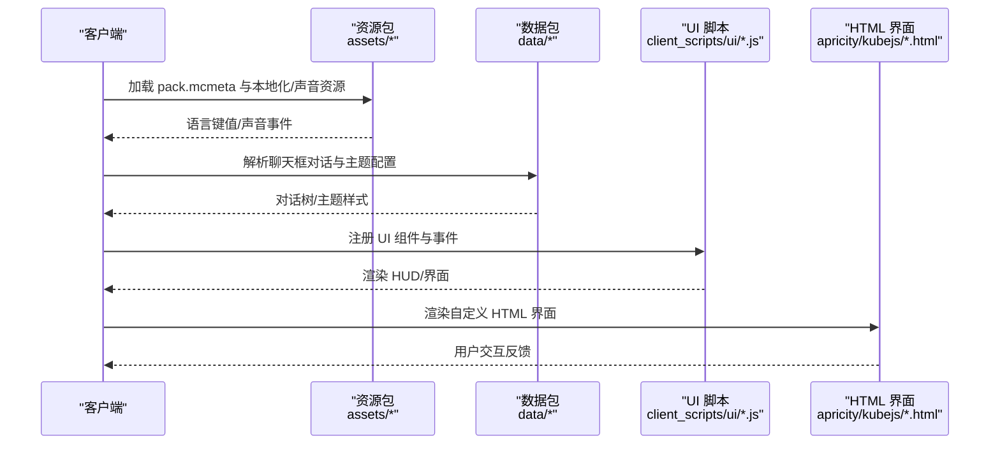
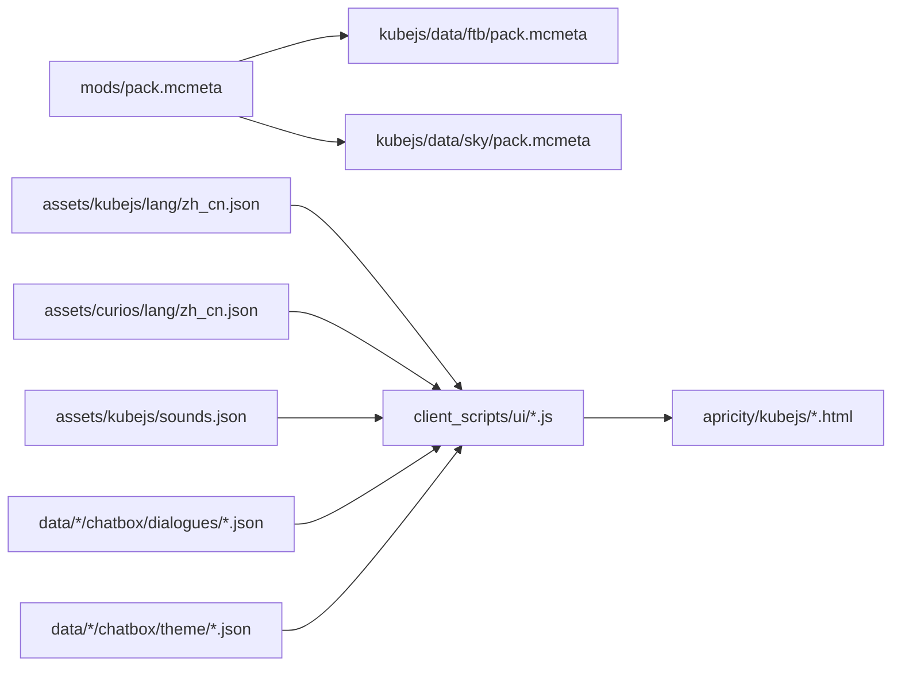

# 资源管理

<cite>
**本文引用的文件**
- [README.md](file://README.md)
- [pack.mcmeta（mods）](file://mods/pack.mcmeta)
- [pack.mcmeta（FTB 数据包）](file://kubejs/data/ftb/pack.mcmeta)
- [pack.mcmeta（Sky 数据包）](file://kubejs/data/sky/pack.mcmeta)
- [语言文件 zh_cn.json（KubeJS）](file://kubejs/assets/kubejs/lang/zh_cn.json)
- [语言文件 zh_cn.json（Curios）](file://kubejs/assets/curios/lang/zh_cn.json)
- [声音定义 sounds.json](file://kubejs/assets/kubejs/sounds.json)
- [聊天框对话示例 intro.json（Marguerite）](file://kubejs/data/marguerite/chatbox/dialogues/intro.json)
- [聊天框主题配置 default.json（Marguerite）](file://kubejs/data/marguerite/chatbox/theme/default.json)
- [聊天框对话示例 intro.json（SkyFootspa）](file://kubejs/data/skyfootspa/chatbox/dialogues/intro.json)
- [聊天框主题配置 alice_margatroid.json（SkyFootspa）](file://kubejs/data/skyfootspa/chatbox/theme/alice_margatroid.json)
- [聊天框对话示例 text_dialog.json（Marguerite）](file://kubejs/data/marguerite/data/dialog/dialogs/text_dialog.json)
- [UI 脚本：foot_ui.js](file://kubejs/client_scripts/ui/foot_ui.js)
- [UI 脚本：phone_ui.js](file://kubejs/client_scripts/ui/phone_ui.js)
- [UI 脚本：stamina_hud.js](file://kubejs/client_scripts/ui/stamina_hud.js)
- [HTML 界面：footui.html](file://apricity/kubejs/footui.html)
- [HTML 界面：stamina_hud.html](file://apricity/kubejs/stamina_hud.html)
- [HTML 界面：phone.html](file://apricity/kubejs/phone.html)
- [默认配置：ftblibrary-client.snbt](file://defaultconfigs/ftblibrary/ftblibrary-client.snbt)
- [默认配置：ftbquests-client-config.snbt](file://defaultconfigs/ftbquests/ftbquests-client-config.snbt)
- [默认配置：sdmshop-common.snbt](file://defaultconfigs/sdmshop/sdmshop-common.snbt)
- [默认配置：dimdungeons-server.toml](file://defaultconfigs/dimdungeons-server.toml)
- [默认配置：ftbessentials-server.snbt](file://defaultconfigs/ftbessentials-server.snbt)
</cite>

## 目录
1. [简介](#简介)
2. [项目结构](#项目结构)
3. [核心组件](#核心组件)
4. [架构总览](#架构总览)
5. [详细组件分析](#详细组件分析)
6. [依赖分析](#依赖分析)
7. [性能考虑](#性能考虑)
8. [故障排查指南](#故障排查指南)
9. [结论](#结论)
10. [附录](#附录)

## 简介
本文件面向内容创作者与开发者，系统性说明该 Minecraft 版本资源管理方案。重点覆盖以下方面：
- 客户端资源与服务器数据的组织方式
- 资源包结构、语言文件管理、声音文件处理与纹理资源组织
- 资源加载机制、缓存策略与性能优化建议
- 资源文件命名规范、目录结构与版本管理
- 资源开发工作流程、测试方法与部署策略

## 项目结构
该版本采用“资源包 + KubeJS 数据包 + 默认配置”的混合结构：
- 资源包层：通过 pack.mcmeta 声明资源包格式与描述，统一由客户端加载
- 数据包层：KubeJS 生成的 data/* 与 assets/* 分别承载行为与表现层数据
- 默认配置层：defaultconfigs/* 提供各模组的客户端/服务端默认配置
- UI 层：client_scripts 与 HTML 文件共同实现自定义界面与 HUD

```mermaid
graph TB
subgraph "资源包层"
P1["pack.mcmetamods"]
P2["pack.mcmetaFTB 数据包"]
P3["pack.mcmetaSky 数据包"]
end
subgraph "数据包层"
D1["assets/kubejs/lang/zh_cn.json"]
D2["assets/curios/lang/zh_cn.json"]
D3["assets/kubejs/sounds.json"]
D4["data/marguerite/chatbox/dialogues/intro.json"]
D5["data/marguerite/chatbox/theme/default.json"]
D6["data/skyfootspa/chatbox/dialogues/intro.json"]
D7["data/skyfootspa/chatbox/theme/alice_margatroid.json"]
D8["data/marguerite/data/dialog/dialogs/text_dialog.json"]
end
subgraph "默认配置层"
C1["ftblibrary-client.snbt"]
C2["ftbquests-client-config.snbt"]
C3["sdmshop-common.snbt"]
C4["dimdungeons-server.toml"]
C5["ftbessentials-server.snbt"]
end
subgraph "UI 层"
U1["client_scripts/ui/foot_ui.js"]
U2["client_scripts/ui/phone_ui.js"]
U3["client_scripts/ui/stamina_hud.js"]
H1["apricity/kubejs/footui.html"]
H2["apricity/kubejs/stamina_hud.html"]
H3["apricity/kubejs/phone.html"]
end
P1 --> D1
P2 --> D4
P3 --> D6
D1 --> U1
D2 --> U2
D3 --> U3
D4 --> H1
D5 --> H2
D6 --> H3
C1 --> U1
C2 --> U2
C3 --> U3
```

图表来源
- [pack.mcmeta（mods）:1-7](file://mods/pack.mcmeta#L1-L7)
- [pack.mcmeta（FTB 数据包）:1-6](file://kubejs/data/ftb/pack.mcmeta#L1-L6)
- [pack.mcmeta（Sky 数据包）:1-6](file://kubejs/data/sky/pack.mcmeta#L1-L6)
- [语言文件 zh_cn.json（KubeJS）:1-15](file://kubejs/assets/kubejs/lang/zh_cn.json#L1-L15)
- [语言文件 zh_cn.json（Curios）:1-4](file://kubejs/assets/curios/lang/zh_cn.json#L1-L4)
- [声音定义 sounds.json:1-5](file://kubejs/assets/kubejs/sounds.json#L1-L5)
- [聊天框对话示例 intro.json（Marguerite）](file://kubejs/data/marguerite/chatbox/dialogues/intro.json)
- [聊天框主题配置 default.json（Marguerite）](file://kubejs/data/marguerite/chatbox/theme/default.json)
- [聊天框对话示例 intro.json（SkyFootspa）](file://kubejs/data/skyfootspa/chatbox/dialogues/intro.json)
- [聊天框主题配置 alice_margatroid.json（SkyFootspa）](file://kubejs/data/skyfootspa/chatbox/theme/alice_margatroid.json)
- [聊天框对话示例 text_dialog.json（Marguerite）](file://kubejs/data/marguerite/data/dialog/dialogs/text_dialog.json)
- [UI 脚本：foot_ui.js](file://kubejs/client_scripts/ui/foot_ui.js)
- [UI 脚本：phone_ui.js](file://kubejs/client_scripts/ui/phone_ui.js)
- [UI 脚本：stamina_hud.js](file://kubejs/client_scripts/ui/stamina_hud.js)
- [HTML 界面：footui.html](file://apricity/kubejs/footui.html)
- [HTML 界面：stamina_hud.html](file://apricity/kubejs/stamina_hud.html)
- [HTML 界面：phone.html](file://apricity/kubejs/phone.html)
- [默认配置：ftblibrary-client.snbt](file://defaultconfigs/ftblibrary/ftblibrary-client.snbt)
- [默认配置：ftbquests-client-config.snbt](file://defaultconfigs/ftbquests/ftbquests-client-config.snbt)
- [默认配置：sdmshop-common.snbt](file://defaultconfigs/sdmshop/sdmshop-common.snbt)
- [默认配置：dimdungeons-server.toml](file://defaultconfigs/dimdungeons-server.toml)
- [默认配置：ftbessentials-server.snbt](file://defaultconfigs/ftbessentials-server.snbt)

章节来源
- [README.md:1-6](file://README.md#L1-L6)
- [pack.mcmeta（mods）:1-7](file://mods/pack.mcmeta#L1-L7)
- [pack.mcmeta（FTB 数据包）:1-6](file://kubejs/data/ftb/pack.mcmeta#L1-L6)
- [pack.mcmeta（Sky 数据包）:1-6](file://kubejs/data/sky/pack.mcmeta#L1-L6)

## 核心组件
- 资源包元数据：通过 pack.mcmeta 统一声明资源包格式与描述，确保客户端正确识别资源包层级与版本要求
- 语言文件：assets/*/lang/zh_cn.json 提供本地化文本键值对，支持属性名、提示语等多类内容
- 声音文件：assets/*/sounds.json 定义声音事件与播放列表，配合客户端播放器使用
- 数据包对话与主题：data/*/chatbox/dialogues 与 data/*/chatbox/theme 提供聊天框交互逻辑与外观配置
- UI 脚本与 HTML：client_scripts/ui/*.js 与 apricity/kubejs/*.html 协同实现自定义界面与 HUD
- 默认配置：defaultconfigs/* 提供各模组的客户端/服务端默认配置，便于快速部署与一致性控制

章节来源
- [pack.mcmeta（mods）:1-7](file://mods/pack.mcmeta#L1-L7)
- [pack.mcmeta（FTB 数据包）:1-6](file://kubejs/data/ftb/pack.mcmeta#L1-L6)
- [pack.mcmeta（Sky 数据包）:1-6](file://kubejs/data/sky/pack.mcmeta#L1-L6)
- [语言文件 zh_cn.json（KubeJS）:1-15](file://kubejs/assets/kubejs/lang/zh_cn.json#L1-L15)
- [语言文件 zh_cn.json（Curios）:1-4](file://kubejs/assets/curios/lang/zh_cn.json#L1-L4)
- [声音定义 sounds.json:1-5](file://kubejs/assets/kubejs/sounds.json#L1-L5)
- [聊天框对话示例 intro.json（Marguerite）](file://kubejs/data/marguerite/chatbox/dialogues/intro.json)
- [聊天框主题配置 default.json（Marguerite）](file://kubejs/data/marguerite/chatbox/theme/default.json)
- [聊天框对话示例 intro.json（SkyFootspa）](file://kubejs/data/skyfootspa/chatbox/dialogues/intro.json)
- [聊天框主题配置 alice_margatroid.json（SkyFootspa）](file://kubejs/data/skyfootspa/chatbox/theme/alice_margatroid.json)
- [聊天框对话示例 text_dialog.json（Marguerite）](file://kubejs/data/marguerite/data/dialog/dialogs/text_dialog.json)
- [UI 脚本：foot_ui.js](file://kubejs/client_scripts/ui/foot_ui.js)
- [UI 脚本：phone_ui.js](file://kubejs/client_scripts/ui/phone_ui.js)
- [UI 脚本：stamina_hud.js](file://kubejs/client_scripts/ui/stamina_hud.js)
- [HTML 界面：footui.html](file://apricity/kubejs/footui.html)
- [HTML 界面：stamina_hud.html](file://apricity/kubejs/stamina_hud.html)
- [HTML 界面：phone.html](file://apricity/kubejs/phone.html)
- [默认配置：ftblibrary-client.snbt](file://defaultconfigs/ftblibrary/ftblibrary-client.snbt)
- [默认配置：ftbquests-client-config.snbt](file://defaultconfigs/ftbquests/ftbquests-client-config.snbt)
- [默认配置：sdmshop-common.snbt](file://defaultconfigs/sdmshop/sdmshop-common.snbt)
- [默认配置：dimdungeons-server.toml](file://defaultconfigs/dimdungeons-server.toml)
- [默认配置：ftbessentials-server.snbt](file://defaultconfigs/ftbessentials-server.snbt)

## 架构总览
下图展示从资源包到数据包、再到 UI 的整体调用链路与职责分工。

图表来源
- [pack.mcmeta（mods）:1-7](file://mods/pack.mcmeta#L1-L7)
- [pack.mcmeta（FTB 数据包）:1-6](file://kubejs/data/ftb/pack.mcmeta#L1-L6)
- [pack.mcmeta（Sky 数据包）:1-6](file://kubejs/data/sky/pack.mcmeta#L1-L6)
- [语言文件 zh_cn.json（KubeJS）:1-15](file://kubejs/assets/kubejs/lang/zh_cn.json#L1-L15)
- [声音定义 sounds.json:1-5](file://kubejs/assets/kubejs/sounds.json#L1-L5)
- [聊天框对话示例 intro.json（Marguerite）](file://kubejs/data/marguerite/chatbox/dialogues/intro.json)
- [聊天框主题配置 default.json（Marguerite）](file://kubejs/data/marguerite/chatbox/theme/default.json)
- [聊天框对话示例 intro.json（SkyFootspa）](file://kubejs/data/skyfootspa/chatbox/dialogues/intro.json)
- [聊天框主题配置 alice_margatroid.json（SkyFootspa）](file://kubejs/data/skyfootspa/chatbox/theme/alice_margatroid.json)
- [UI 脚本：foot_ui.js](file://kubejs/client_scripts/ui/foot_ui.js)
- [UI 脚本：phone_ui.js](file://kubejs/client_scripts/ui/phone_ui.js)
- [UI 脚本：stamina_hud.js](file://kubejs/client_scripts/ui/stamina_hud.js)
- [HTML 界面：footui.html](file://apricity/kubejs/footui.html)
- [HTML 界面：stamina_hud.html](file://apricity/kubejs/stamina_hud.html)
- [HTML 界面：phone.html](file://apricity/kubejs/phone.html)

## 详细组件分析

### 资源包结构与版本管理
- pack_format：所有资源包均声明 pack_format=15，确保与 1.20.1 客户端兼容
- 描述信息：通过 description 字段标识用途，便于在资源包选择界面识别
- 部署位置：mods/pack.mcmeta 作为主资源包入口；FTB 与 Sky 数据包分别提供额外的语言与界面扩展

章节来源
- [pack.mcmeta（mods）:1-7](file://mods/pack.mcmeta#L1-L7)
- [pack.mcmeta（FTB 数据包）:1-6](file://kubejs/data/ftb/pack.mcmeta#L1-L6)
- [pack.mcmeta（Sky 数据包）:1-6](file://kubejs/data/sky/pack.mcmeta#L1-L6)

### 语言文件管理
- 键值组织：assets/*/lang/zh_cn.json 提供统一的本地化键值对，涵盖属性名、提示语等
- KubeJS 语言：用于自定义属性与效果名称的本地化
- Curios 语言：为特定模组的槽位与修饰器提供本地化
- 使用建议：新增键值需保持唯一性与可读性，避免与原版或其它模组冲突

章节来源
- [语言文件 zh_cn.json（KubeJS）:1-15](file://kubejs/assets/kubejs/lang/zh_cn.json#L1-L15)
- [语言文件 zh_cn.json（Curios）:1-4](file://kubejs/assets/curios/lang/zh_cn.json#L1-L4)

### 声音文件处理
- 声音事件定义：assets/*/sounds.json 将声音事件映射到具体音频资源路径
- 多音效组合：同一事件可绑定多个音效以增强表现力
- 客户端播放：结合 UI 脚本触发事件，实现交互反馈

章节来源
- [声音定义 sounds.json:1-5](file://kubejs/assets/kubejs/sounds.json#L1-L5)

### 纹理资源组织
- 结构分布：assets/*/textures 下按功能域划分（如 block、item、entity 等）
- 规范建议：统一命名前缀、分辨率与格式，保证打包与加载效率
- 与 UI 集成：纹理资源通过数据包与脚本联动，驱动界面与 HUD 显示

章节来源
- [README.md:1-6](file://README.md#L1-L6)

### 数据包与聊天框系统
- 对话数据：data/*/chatbox/dialogues 存放对话树，支持多分支与条件触发
- 主题配置：data/*/chatbox/theme 定义界面样式、字体与布局
- 示例文件：Marguerite 与 SkyFootspa 各自提供对话与主题示例，便于复用与扩展

章节来源
- [聊天框对话示例 intro.json（Marguerite）](file://kubejs/data/marguerite/chatbox/dialogues/intro.json)
- [聊天框主题配置 default.json（Marguerite）](file://kubejs/data/marguerite/chatbox/theme/default.json)
- [聊天框对话示例 intro.json（SkyFootspa）](file://kubejs/data/skyfootspa/chatbox/dialogues/intro.json)
- [聊天框主题配置 alice_margatroid.json（SkyFootspa）](file://kubejs/data/skyfootspa/chatbox/theme/alice_margatroid.json)
- [聊天框对话示例 text_dialog.json（Marguerite）](file://kubejs/data/marguerite/data/dialog/dialogs/text_dialog.json)

### UI 脚本与 HTML 界面
- 脚本职责：client_scripts/ui/*.js 注册 UI 组件、事件监听与状态更新
- HTML 界面：apricity/kubejs/*.html 提供自定义 HTML 界面，与脚本协同渲染
- 典型场景：foot_ui、phone_ui、stamina_hud 分别对应足浴、电话与体力 HUD

章节来源
- [UI 脚本：foot_ui.js](file://kubejs/client_scripts/ui/foot_ui.js)
- [UI 脚本：phone_ui.js](file://kubejs/client_scripts/ui/phone_ui.js)
- [UI 脚本：stamina_hud.js](file://kubejs/client_scripts/ui/stamina_hud.js)
- [HTML 界面：footui.html](file://apricity/kubejs/footui.html)
- [HTML 界面：stamina_hud.html](file://apricity/kubejs/stamina_hud.html)
- [HTML 界面：phone.html](file://apricity/kubejs/phone.html)

### 默认配置与部署
- 客户端配置：ftblibrary-client.snbt、ftbquests-client-config.snbt、sdmshop-common.snbt 提供界面与行为默认值
- 服务端配置：dimdungeons-server.toml、ftbessentials-server.snbt 控制服务器端行为
- 部署策略：将资源包与数据包置于版本目录，确保 pack_format 与描述一致，避免加载失败

章节来源
- [默认配置：ftblibrary-client.snbt](file://defaultconfigs/ftblibrary/ftblibrary-client.snbt)
- [默认配置：ftbquests-client-config.snbt](file://defaultconfigs/ftbquests/ftbquests-client-config.snbt)
- [默认配置：sdmshop-common.snbt](file://defaultconfigs/sdmshop/sdmshop-common.snbt)
- [默认配置：dimdungeons-server.toml](file://defaultconfigs/dimdungeons-server.toml)
- [默认配置：ftbessentials-server.snbt](file://defaultconfigs/ftbessentials-server.snbt)

## 依赖分析
- 资源包依赖：mods/pack.mcmeta 为主入口，FTB/Sky 数据包作为扩展
- 数据包依赖：聊天框系统依赖 assets 语言与声音资源，UI 脚本依赖数据包中的对话与主题配置
- 配置依赖：默认配置影响 UI 行为与界面显示，需与资源包版本匹配

图表来源
- [pack.mcmeta（mods）:1-7](file://mods/pack.mcmeta#L1-L7)
- [pack.mcmeta（FTB 数据包）:1-6](file://kubejs/data/ftb/pack.mcmeta#L1-L6)
- [pack.mcmeta（Sky 数据包）:1-6](file://kubejs/data/sky/pack.mcmeta#L1-L6)
- [语言文件 zh_cn.json（KubeJS）:1-15](file://kubejs/assets/kubejs/lang/zh_cn.json#L1-L15)
- [语言文件 zh_cn.json（Curios）:1-4](file://kubejs/assets/curios/lang/zh_cn.json#L1-L4)
- [声音定义 sounds.json:1-5](file://kubejs/assets/kubejs/sounds.json#L1-L5)
- [聊天框对话示例 intro.json（Marguerite）](file://kubejs/data/marguerite/chatbox/dialogues/intro.json)
- [聊天框主题配置 default.json（Marguerite）](file://kubejs/data/marguerite/chatbox/theme/default.json)
- [聊天框对话示例 intro.json（SkyFootspa）](file://kubejs/data/skyfootspa/chatbox/dialogues/intro.json)
- [聊天框主题配置 alice_margatroid.json（SkyFootspa）](file://kubejs/data/skyfootspa/chatbox/theme/alice_margatroid.json)
- [UI 脚本：foot_ui.js](file://kubejs/client_scripts/ui/foot_ui.js)
- [UI 脚本：phone_ui.js](file://kubejs/client_scripts/ui/phone_ui.js)
- [UI 脚本：stamina_hud.js](file://kubejs/client_scripts/ui/stamina_hud.js)
- [HTML 界面：footui.html](file://apricity/kubejs/footui.html)
- [HTML 界面：stamina_hud.html](file://apricity/kubejs/stamina_hud.html)
- [HTML 界面：phone.html](file://apricity/kubejs/phone.html)

## 性能考虑
- 资源包大小：控制贴图分辨率与数量，减少内存占用与加载时间
- 声音文件：压缩至合适码率，避免过多并发播放导致卡顿
- UI 渲染：合理拆分 HTML 与脚本，避免频繁重绘与 DOM 操作
- 缓存策略：利用客户端缓存机制，避免重复加载相同资源；对动态内容设置合理的刷新周期
- 数据包解析：将大型 JSON 拆分为小块，按需加载，降低首帧延迟

## 故障排查指南
- 资源包无法加载：检查 pack_format 是否与客户端版本匹配，description 是否存在拼写错误
- 语言键缺失：确认 assets/*/lang/zh_cn.json 中键值是否存在，是否被 UI 脚本正确引用
- 声音不播放：核对 assets/*/sounds.json 的事件映射与实际音频路径是否一致
- 聊天框异常：检查 data/*/chatbox/dialogues 与 data/*/chatbox/theme 的 JSON 结构与键名
- UI 不显示：验证 client_scripts/ui/*.js 是否注册成功，HTML 文件路径与脚本绑定是否正确
- 默认配置冲突：对比 defaultconfigs/* 与当前版本的默认值差异，必要时回滚或覆盖

章节来源
- [pack.mcmeta（mods）:1-7](file://mods/pack.mcmeta#L1-L7)
- [pack.mcmeta（FTB 数据包）:1-6](file://kubejs/data/ftb/pack.mcmeta#L1-L6)
- [pack.mcmeta（Sky 数据包）:1-6](file://kubejs/data/sky/pack.mcmeta#L1-L6)
- [语言文件 zh_cn.json（KubeJS）:1-15](file://kubejs/assets/kubejs/lang/zh_cn.json#L1-L15)
- [声音定义 sounds.json:1-5](file://kubejs/assets/kubejs/sounds.json#L1-L5)
- [聊天框对话示例 intro.json（Marguerite）](file://kubejs/data/marguerite/chatbox/dialogues/intro.json)
- [聊天框主题配置 default.json（Marguerite）](file://kubejs/data/marguerite/chatbox/theme/default.json)
- [聊天框对话示例 intro.json（SkyFootspa）](file://kubejs/data/skyfootspa/chatbox/dialogues/intro.json)
- [聊天框主题配置 alice_margatroid.json（SkyFootspa）](file://kubejs/data/skyfootspa/chatbox/theme/alice_margatroid.json)
- [UI 脚本：foot_ui.js](file://kubejs/client_scripts/ui/foot_ui.js)
- [UI 脚本：phone_ui.js](file://kubejs/client_scripts/ui/phone_ui.js)
- [UI 脚本：stamina_hud.js](file://kubejs/client_scripts/ui/stamina_hud.js)
- [HTML 界面：footui.html](file://apricity/kubejs/footui.html)
- [HTML 界面：stamina_hud.html](file://apricity/kubejs/stamina_hud.html)
- [HTML 界面：phone.html](file://apricity/kubejs/phone.html)
- [默认配置：ftblibrary-client.snbt](file://defaultconfigs/ftblibrary/ftblibrary-client.snbt)
- [默认配置：ftbquests-client-config.snbt](file://defaultconfigs/ftbquests/ftbquests-client-config.snbt)
- [默认配置：sdmshop-common.snbt](file://defaultconfigs/sdmshop/sdmshop-common.snbt)
- [默认配置：dimdungeons-server.toml](file://defaultconfigs/dimdungeons-server.toml)
- [默认配置：ftbessentials-server.snbt](file://defaultconfigs/ftbessentials-server.snbt)

## 结论
本资源管理方案通过“资源包 + 数据包 + 默认配置 + UI 脚本”的分层设计，实现了内容与表现的解耦。遵循统一的命名规范、目录结构与版本管理策略，可显著提升开发效率与维护性。建议在后续迭代中持续优化资源体积与加载性能，并完善自动化测试与部署流程。

## 附录
- 安装与运行：参考版本根目录的 README 说明进行安装与首次启动
- 版本要求：确保 pack_format 与客户端版本一致，避免加载失败
- 开发流程：先设计数据包结构与键值，再编写 UI 脚本与 HTML，最后调整默认配置与资源包元数据

章节来源
- [README.md:1-6](file://README.md#L1-L6)
- [pack.mcmeta（mods）:1-7](file://mods/pack.mcmeta#L1-L7)
- [pack.mcmeta（FTB 数据包）:1-6](file://kubejs/data/ftb/pack.mcmeta#L1-L6)
- [pack.mcmeta（Sky 数据包）:1-6](file://kubejs/data/sky/pack.mcmeta#L1-L6)