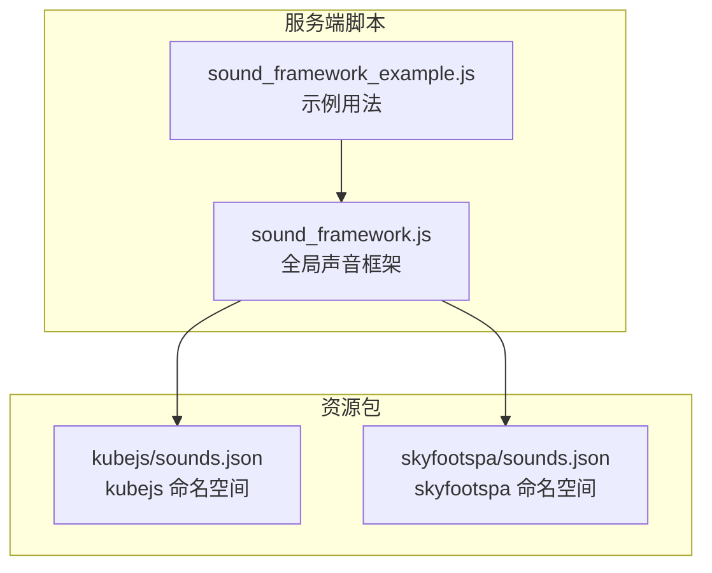
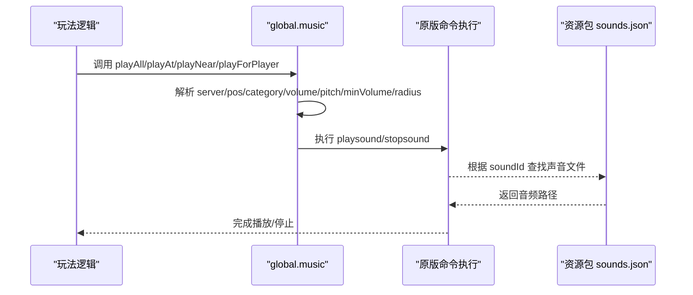
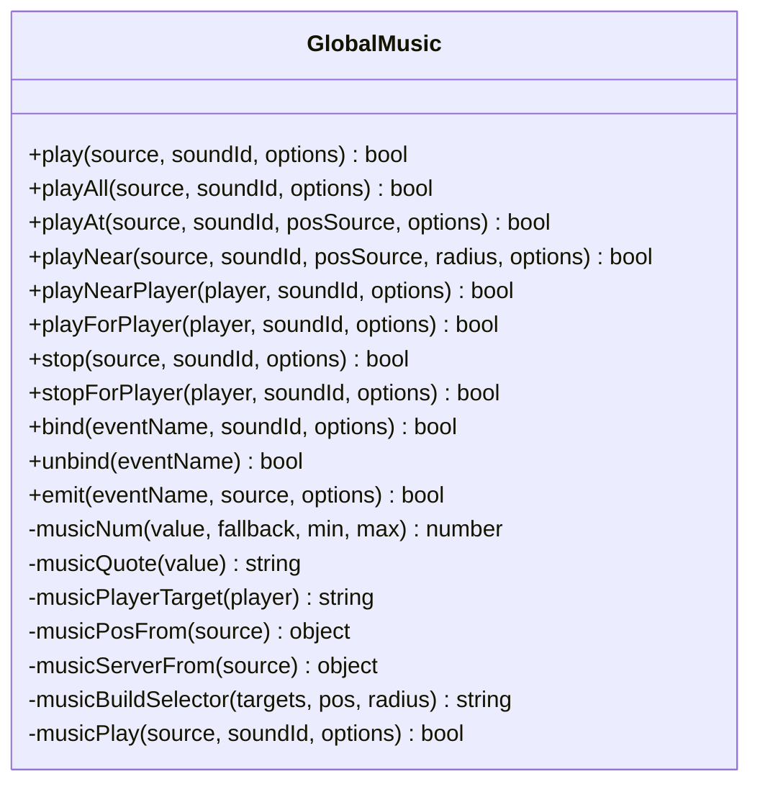
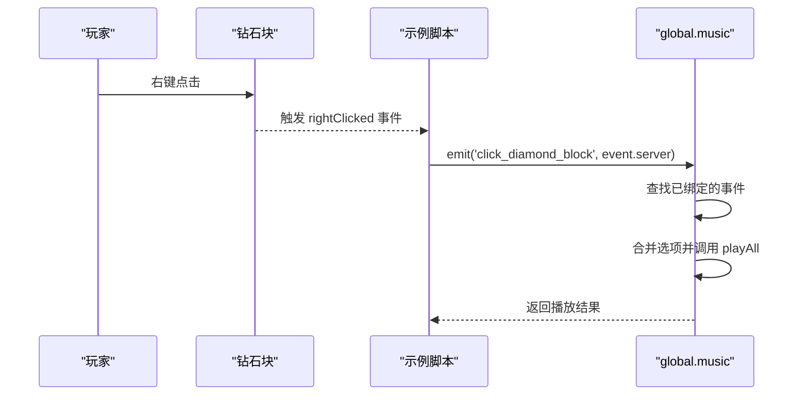
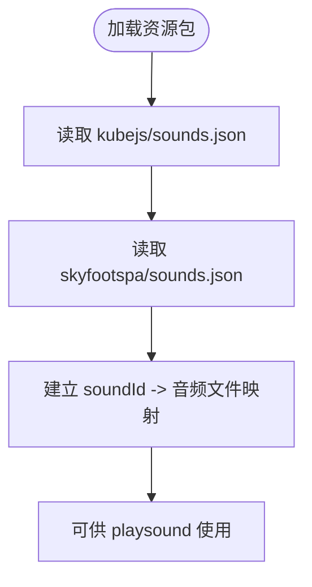
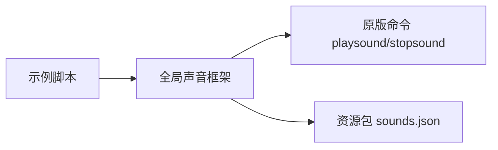

# 音频系统重构

<cite>
**本文引用的文件**   
- [sound_framework.js](file://kubejs/server_scripts/sound/sound_framework.js)
- [sound_framework_example.js](file://kubejs/server_scripts/sound/sound_framework_example.js)
- [sounds.json（kubejs）](file://kubejs/assets/kubejs/sounds.json)
- [sounds.json（skyfootspa）](file://kubejs/assets/skyfootspa/sounds.json)
</cite>

## 目录
1. [引言](#引言)
2. [项目结构](#项目结构)
3. [核心组件](#核心组件)
4. [架构总览](#架构总览)
5. [详细组件分析](#详细组件分析)
6. [依赖关系分析](#依赖关系分析)
7. [性能与稳定性考虑](#性能与稳定性考虑)
8. [故障排查指南](#故障排查指南)
9. [结论](#结论)
10. [附录：使用规范与最佳实践](#附录使用规范与最佳实践)

## 引言
本文件聚焦于“音频系统重构”的主题，围绕 KubeJS 服务端脚本中的全局声音/音乐框架进行系统化梳理。该框架通过服务器端统一封装原版 /playsound 命令，提供面向业务事件的声音播放、停止、绑定与调试能力，使玩法逻辑无需关心底层命令细节，即可实现全服广播、按位置播放、按玩家播放等多样化场景。同时，资源包侧的 sounds.json 负责将声音 ID 映射到实际音频文件，形成“脚本层 + 资源层”的清晰分层。

## 项目结构
本项目中与音频系统直接相关的代码与资源分布如下：
- 服务端脚本层
  - kubejs/server_scripts/sound/sound_framework.js：全局声音/音乐框架核心实现
  - kubejs/server_scripts/sound/sound_framework_example.js：示例用法，演示 bind + emit 的标准流程
- 资源包层
  - kubejs/assets/kubejs/sounds.json：kubejs 命名空间下的声音事件注册
  - kubejs/assets/skyfootspa/sounds.json：skyfootspa 命名空间下的声音事件注册（包含对话语音与示例音效）

**图示来源**
- [sound_framework.js:1-343](file://kubejs/server_scripts/sound/sound_framework.js#L1-L343)
- [sound_framework_example.js:1-38](file://kubejs/server_scripts/sound/sound_framework_example.js#L1-L38)
- [sounds.json（kubejs）:1-5](file://kubejs/assets/kubejs/sounds.json#L1-L5)
- [sounds.json（skyfootspa）:1-96](file://kubejs/assets/skyfootspa/sounds.json#L1-L96)

**章节来源**
- [sound_framework.js:1-343](file://kubejs/server_scripts/sound/sound_framework.js#L1-L343)
- [sound_framework_example.js:1-38](file://kubejs/server_scripts/sound/sound_framework_example.js#L1-L38)
- [sounds.json（kubejs）:1-5](file://kubejs/assets/kubejs/sounds.json#L1-L5)
- [sounds.json（skyfootspa）:1-96](file://kubejs/assets/skyfootspa/sounds.json#L1-L96)

## 核心组件
- 全局声音框架（global.music）
  - 提供统一的播放接口：playAll、playAt、playNear、playNearPlayer、playForPlayer
  - 提供停止接口：stop、stopForPlayer
  - 提供事件绑定与触发：bind、unbind、emit
  - 内部工具函数：musicNum、musicQuote、musicPlayerTarget、musicPosFrom、musicServerFrom、musicBuildSelector、musicPlay
- 示例脚本
  - 演示如何通过 bind 将业务事件名映射到具体声音 ID，并通过 emit 触发
- 资源包声音注册
  - kubejs 命名空间：用于测试与示例（如 l1.07）
  - skyfootspa 命名空间：包含示例音效与角色对话语音

**章节来源**
- [sound_framework.js:23-343](file://kubejs/server_scripts/sound/sound_framework.js#L23-L343)
- [sound_framework_example.js:15-37](file://kubejs/server_scripts/sound/sound_framework_example.js#L15-L37)
- [sounds.json（kubejs）:1-5](file://kubejs/assets/kubejs/sounds.json#L1-L5)
- [sounds.json（skyfootspa）:1-96](file://kubejs/assets/skyfootspa/sounds.json#L1-L96)

## 架构总览
整体架构由“服务端脚本层”和“资源包层”组成。服务端脚本层通过 global.music 暴露统一 API，内部将参数规范化后调用原版 playsound/stopsound 命令；资源包层通过 sounds.json 将声音事件名映射到实际音频文件。

**图示来源**
- [sound_framework.js:167-197](file://kubejs/server_scripts/sound/sound_framework.js#L167-L197)
- [sound_framework.js:203-248](file://kubejs/server_scripts/sound/sound_framework.js#L203-L248)
- [sound_framework.js:253-278](file://kubejs/server_scripts/sound/sound_framework.js#L253-L278)
- [sounds.json（kubejs）:1-5](file://kubejs/assets/kubejs/sounds.json#L1-L5)
- [sounds.json（skyfootspa）:1-96](file://kubejs/assets/skyfootspa/sounds.json#L1-L96)

## 详细组件分析

### 全局声音框架（global.music）
- 设计目标
  - 将声音播放从分散的 playsound 调用中抽离，集中管理声音选择与参数
  - 支持多种播放范围：全服、按位置、按半径、按玩家
  - 支持事件绑定机制，解耦业务逻辑与声音实现
- 关键方法
  - musicPlay：最底层播放函数，负责参数校验、坐标解析、目标选择器构建、命令拼装与执行
  - playAll：全服播放，默认 minVolume=1，确保远端玩家也能听见
  - playAt：在指定位置播放给所有玩家
  - playNear：在指定位置附近播放，只影响半径内玩家
  - playNearPlayer：以玩家为中心附近播放，默认半径 32
  - playForPlayer：仅对指定玩家播放
  - stop/stopForPlayer：停止声音或分类下所有声音
  - bind/unbind/emit：事件绑定与触发，emit 默认走 playAll
- 内部工具
  - musicNum：数值转换与范围限制
  - musicQuote：字符串安全转义
  - musicPlayerTarget：从不同对象中提取玩家目标
  - musicPosFrom：从玩家/实体/方块实体/坐标对象解析播放坐标
  - musicServerFrom：从事件/玩家/实体/命令源提取 MinecraftServer
  - musicBuildSelector：生成 /playsound 的目标选择器

**图示来源**
- [sound_framework.js:23-343](file://kubejs/server_scripts/sound/sound_framework.js#L23-L343)

**章节来源**
- [sound_framework.js:23-343](file://kubejs/server_scripts/sound/sound_framework.js#L23-L343)

### 示例用法（bind + emit）
- 目的
  - 演示标准用法：先用 bind 把业务事件名绑定到具体声音 ID，再在玩法逻辑中 emit 该事件名
- 关键点
  - 声音注册在 skyfootspa 命名空间的 sounds.json
  - 示例通过 BlockEvents.rightClicked 触发事件，调用 global.music.emit
  - emit 默认走 playAll，因此所有玩家都能听到

**图示来源**
- [sound_framework_example.js:15-37](file://kubejs/server_scripts/sound/sound_framework_example.js#L15-L37)
- [sound_framework.js:280-316](file://kubejs/server_scripts/sound/sound_framework.js#L280-L316)

**章节来源**
- [sound_framework_example.js:1-38](file://kubejs/server_scripts/sound/sound_framework_example.js#L1-L38)
- [sound_framework.js:280-316](file://kubejs/server_scripts/sound/sound_framework.js#L280-L316)

### 资源包声音注册
- kubejs 命名空间
  - 定义 l1.07 事件，指向多个音频片段，便于随机播放
- skyfootspa 命名空间
  - 定义 click_diamond_block 示例音效
  - 定义大量角色对话语音（voice.alice.*），均为流式音频

**图示来源**
- [sounds.json（kubejs）:1-5](file://kubejs/assets/kubejs/sounds.json#L1-L5)
- [sounds.json（skyfootspa）:1-96](file://kubejs/assets/skyfootspa/sounds.json#L1-L96)

**章节来源**
- [sounds.json（kubejs）:1-5](file://kubejs/assets/kubejs/sounds.json#L1-L5)
- [sounds.json（skyfootspa）:1-96](file://kubejs/assets/skyfootspa/sounds.json#L1-L96)

## 依赖关系分析
- 模块耦合
  - 示例脚本依赖全局声音框架（global.music）
  - 全局声音框架依赖资源包中的 sounds.json 以解析声音文件
- 外部依赖
  - 原版命令：playsound、stopsound
  - KubeJS 事件：ServerEvents.commandRegistry、BlockEvents.rightClicked
- 潜在循环依赖
  - 当前实现无循环依赖；示例脚本仅调用框架，不反向引用

**图示来源**
- [sound_framework_example.js:15-37](file://kubejs/server_scripts/sound/sound_framework_example.js#L15-L37)
- [sound_framework.js:167-197](file://kubejs/server_scripts/sound/sound_framework.js#L167-L197)
- [sounds.json（kubejs）:1-5](file://kubejs/assets/kubejs/sounds.json#L1-L5)
- [sounds.json（skyfootspa）:1-96](file://kubejs/assets/skyfootspa/sounds.json#L1-L96)

**章节来源**
- [sound_framework_example.js:1-38](file://kubejs/server_scripts/sound/sound_framework_example.js#L1-L38)
- [sound_framework.js:167-197](file://kubejs/server_scripts/sound/sound_framework.js#L167-L197)
- [sounds.json（kubejs）:1-5](file://kubejs/assets/kubejs/sounds.json#L1-L5)
- [sounds.json（skyfootspa）:1-96](file://kubejs/assets/skyfootspa/sounds.json#L1-L96)

## 性能与稳定性考虑
- 命令开销
  - 每次播放都会构造并执行一次 playsound 命令，频繁触发可能带来一定开销
  - 建议对高频音效进行节流或合并策略（例如批量播放、去抖）
- 音量与音高
  - volume、pitch、minVolume 均经过数值校验与范围限制，避免非法值导致命令失败
- 目标选择器
  - near 模式依赖半径与坐标，若未提供有效坐标会退化为 @a，注意避免误播
- 错误处理
  - 命令执行失败会记录日志并返回 false，便于上层判断与重试

[本节为通用指导，不涉及具体文件分析]

## 故障排查指南
- 常见问题
  - 声音无法播放：检查 sounds.json 是否正确注册了 soundId，并确保音频文件存在
  - 听不到声音：确认 category 设置（master/music/player 等）与客户端音量设置一致
  - 只有部分玩家听到：检查 targets 是否为 near 且半径过小，或是否使用了 playForPlayer
  - 命令报错：查看控制台日志中 [MUSIC] 开头的错误信息
- 调试命令
  - /musicjs demo：播放 kubejs:l1.07 示例声音
  - /musicjs stop_all：停止 master 分类下所有声音

**章节来源**
- [sound_framework.js:318-343](file://kubejs/server_scripts/sound/sound_framework.js#L318-L343)

## 结论
该音频系统通过服务端脚本层与资源包层的清晰分工，实现了可维护、可扩展的声音播放体系。全局声音框架屏蔽了底层命令细节，提供了丰富的播放范围与事件绑定能力；资源包层则专注于声音文件的组织与注册。建议在业务开发中遵循“先 bind 再 emit”的规范，集中管理声音选择与参数，提升代码可读性与可维护性。

[本节为总结性内容，不涉及具体文件分析]

## 附录：使用规范与最佳实践
- 推荐流程
  - 在启动阶段通过 global.music.bind 将业务事件名绑定到具体声音 ID 与参数
  - 在玩法逻辑中仅调用 global.music.emit 触发事件，不直接写声音 ID
- 播放范围选择
  - 全服事件（Boss 登场、开店、剧情音乐）：使用 playAll 或 emit（默认 playAll）
  - 局部环境音（机器音效、方块触发）：使用 playNear 或 playNearPlayer
  - 个人提示音：使用 playForPlayer
- 参数建议
  - category：根据用途选择 master（总音量）或 music（音乐音量）
  - volume：保持 1 作为基准，必要时微调
  - pitch：一般保持 1，避免异常音高
- 资源包组织
  - 将同类型声音放在同一命名空间（如 skyfootspa）
  - 使用清晰的 soundId 命名约定，便于管理与检索

[本节为通用指导，不涉及具体文件分析]