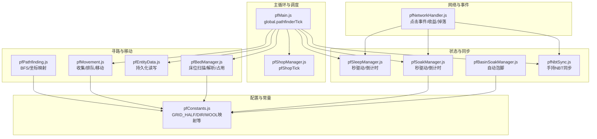
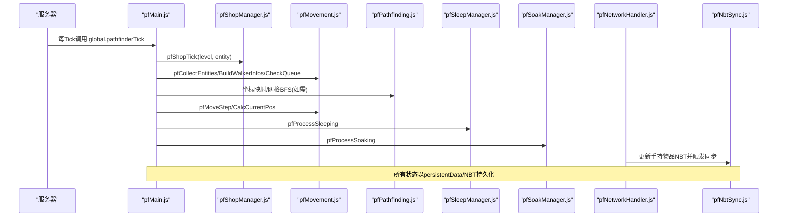
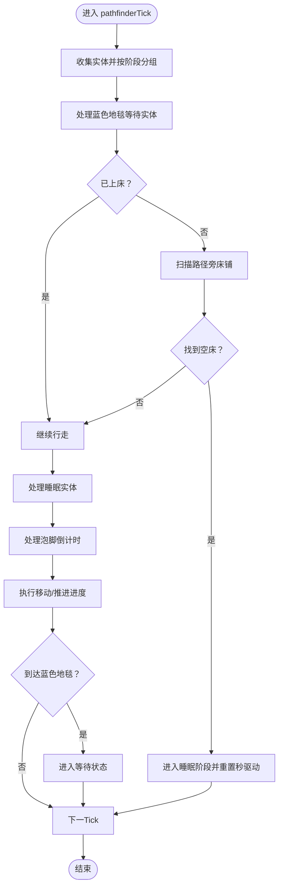
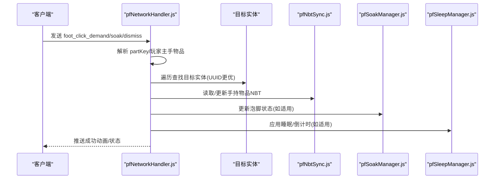
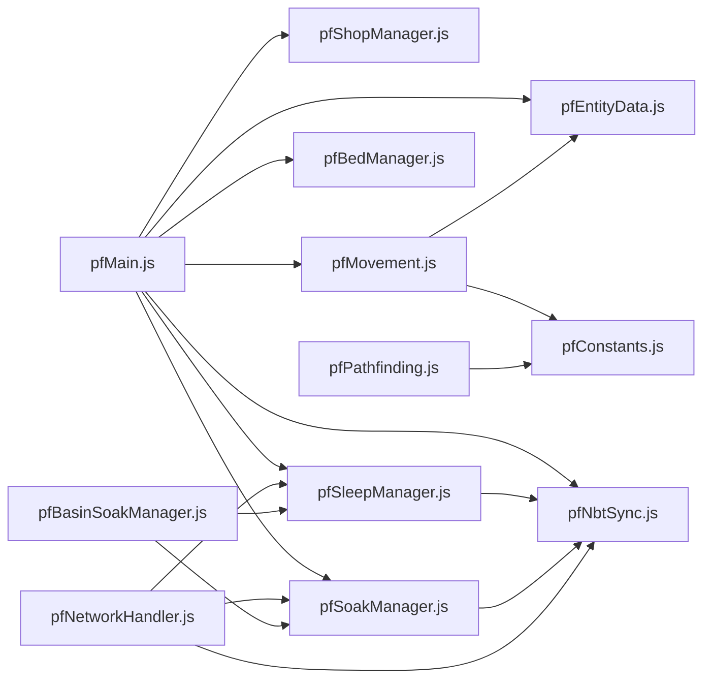

# 性能优化

<cite>
**本文引用的文件**
- [pfMain.js](file://kubejs/server_scripts/pathfinder/pfMain.js)
- [pfConstants.js](file://kubejs/server_scripts/pathfinder/pfConstants.js)
- [pfNetworkHandler.js](file://kubejs/server_scripts/pathfinder/pfNetworkHandler.js)
- [pfNbtSync.js](file://kubejs/server_scripts/pathfinder/pfNbtSync.js)
- [pfPathfinding.js](file://kubejs/server_scripts/pathfinder/pfPathfinding.js)
- [pfMovement.js](file://kubejs/server_scripts/pathfinder/pfMovement.js)
- [pfEntityData.js](file://kubejs/server_scripts/pathfinder/pfEntityData.js)
- [pfBedManager.js](file://kubejs/server_scripts/pathfinder/pfBedManager.js)
- [pfSleepManager.js](file://kubejs/server_scripts/pathfinder/pfSleepManager.js)
- [pfSoakManager.js](file://kubejs/server_scripts/pathfinder/pfSoakManager.js)
- [pfBasinSoakManager.js](file://kubejs/server_scripts/pathfinder/pfBasinSoakManager.js)
- [pfShopManager.js](file://kubejs/server_scripts/pathfinder/pfShopManager.js)
</cite>

## 目录
1. [简介](#简介)
2. [项目结构](#项目结构)
3. [核心组件](#核心组件)
4. [架构总览](#架构总览)
5. [详细组件分析](#详细组件分析)
6. [依赖分析](#依赖分析)
7. [性能考量](#性能考量)
8. [故障排查指南](#故障排查指南)
9. [结论](#结论)
10. [附录](#附录)

## 简介
本指南聚焦于Minecraft KubeJS模组中“寻路系统”的性能优化策略，围绕以下关键模块进行深入剖析与优化建议：
- 主循环与调度：pfMain.js
- 常量与配置：pfConstants.js
- 网络通信与事件处理：pfNetworkHandler.js
- NBT数据同步：pfNbtSync.js
- 寻路算法与网格：pfPathfinding.js
- 实体移动与排队：pfMovement.js
- 实体数据持久化：pfEntityData.js
- 床位管理：pfBedManager.js
- 睡眠与倒计时：pfSleepManager.js
- 泡脚与倒计时：pfSoakManager.js
- 自动泡脚（Create Basin）：pfBasinSoakManager.js
- 开店与定时生成：pfShopManager.js

目标包括：降低Tick延迟、优化内存占用、提升CPU负载均衡、减少网络带宽与I/O压力，并给出监控、基准测试与扩展性建议。

## 项目结构
寻路系统采用模块化设计，主循环在pfMain.js中整合各子模块，形成“常量配置—网格寻路—实体移动—睡眠/泡脚—网络事件—NBT同步—开店定时生成”的完整链路。

图表来源
- [pfMain.js:11-177](file://kubejs/server_scripts/pathfinder/pfMain.js#L11-L177)
- [pfShopManager.js:237-284](file://kubejs/server_scripts/pathfinder/pfShopManager.js#L237-L284)
- [pfConstants.js:10-64](file://kubejs/server_scripts/pathfinder/pfConstants.js#L10-L64)
- [pfPathfinding.js:13-90](file://kubejs/server_scripts/pathfinder/pfPathfinding.js#L13-L90)
- [pfMovement.js:8-186](file://kubejs/server_scripts/pathfinder/pfMovement.js#L8-L186)
- [pfEntityData.js:20-217](file://kubejs/server_scripts/pathfinder/pfEntityData.js#L20-L217)
- [pfBedManager.js:10-128](file://kubejs/server_scripts/pathfinder/pfBedManager.js#L10-L128)
- [pfSleepManager.js:65-128](file://kubejs/server_scripts/pathfinder/pfSleepManager.js#L65-L128)
- [pfSoakManager.js:92-145](file://kubejs/server_scripts/pathfinder/pfSoakManager.js#L92-L145)
- [pfBasinSoakManager.js:329-408](file://kubejs/server_scripts/pathfinder/pfBasinSoakManager.js#L329-L408)
- [pfNbtSync.js:8-93](file://kubejs/server_scripts/pathfinder/pfNbtSync.js#L8-L93)
- [pfNetworkHandler.js:37-311](file://kubejs/server_scripts/pathfinder/pfNetworkHandler.js#L37-L311)

章节来源
- [pfMain.js:11-177](file://kubejs/server_scripts/pathfinder/pfMain.js#L11-L177)
- [pfConstants.js:10-64](file://kubejs/server_scripts/pathfinder/pfConstants.js#L10-L64)

## 核心组件
- 主循环与调度：global.pathfinderTick负责每Tick聚合实体、处理蓝色地毯等待、睡眠、行走、排队与移动，是性能瓶颈最集中的入口。
- 常量与配置：pfConstants集中定义网格半径、方向列表、部位映射等，直接影响寻路网格规模与遍历复杂度。
- 寻路算法：pfPathfinding提供BFS坐标映射与避让逻辑，网格大小为(2*GRID_HALF+1)^2，复杂度与网格面积成正比。
- 实体移动：pfMovement实现实体位置插值、排队检测、进度推进，子步10次一格，影响Tick内CPU分配。
- 睡眠/泡脚：两套“秒驱动”状态机，均以实体persistentData存储，避免跨重启失效，减少对server.getTickCount()依赖。
- 网络事件：pfNetworkHandler处理客户端点击、体力消耗、收益计算、掉落与NBT更新，涉及频繁NBT读写与客户端同步。
- NBT同步：pfNbtSync通过实体主手物品NBT实现自动同步，减少显式网络包，但需注意NBT写入频率与合并成本。
- 自动泡脚：pfBasinSoakManager通过Create Basin流体能力读取与命令写入，存在I/O与反射调用开销。
- 开店管理：pfShopManager以方块实体NBT记录状态，每PF_SPAWN_INTERVAL Tick判定一次生成，避免依赖server.getTickCount()差值。

章节来源
- [pfMain.js:11-177](file://kubejs/server_scripts/pathfinder/pfMain.js#L11-L177)
- [pfConstants.js:10-64](file://kubejs/server_scripts/pathfinder/pfConstants.js#L10-L64)
- [pfPathfinding.js:46-83](file://kubejs/server_scripts/pathfinder/pfPathfinding.js#L46-L83)
- [pfMovement.js:101-162](file://kubejs/server_scripts/pathfinder/pfMovement.js#L101-L162)
- [pfSleepManager.js:65-128](file://kubejs/server_scripts/pathfinder/pfSleepManager.js#L65-L128)
- [pfSoakManager.js:92-145](file://kubejs/server_scripts/pathfinder/pfSoakManager.js#L92-L145)
- [pfNetworkHandler.js:37-311](file://kubejs/server_scripts/pathfinder/pfNetworkHandler.js#L37-L311)
- [pfNbtSync.js:8-93](file://kubejs/server_scripts/pathfinder/pfNbtSync.js#L8-L93)
- [pfBasinSoakManager.js:329-408](file://kubejs/server_scripts/pathfinder/pfBasinSoakManager.js#L329-L408)
- [pfShopManager.js:237-284](file://kubejs/server_scripts/pathfinder/pfShopManager.js#L237-L284)

## 架构总览
整体流程：主循环收集实体，按阶段分组处理；寻路模块生成路径并由移动模块推进；睡眠/泡脚模块以秒驱动状态机运行；网络事件更新NBT并触发客户端同步；自动泡脚模块在床边Basin处按秒节拍检查流体并驱动倒计时。

图表来源
- [pfMain.js:11-177](file://kubejs/server_scripts/pathfinder/pfMain.js#L11-L177)
- [pfShopManager.js:237-284](file://kubejs/server_scripts/pathfinder/pfShopManager.js#L237-L284)
- [pfMovement.js:101-162](file://kubejs/server_scripts/pathfinder/pfMovement.js#L101-L162)
- [pfPathfinding.js:46-83](file://kubejs/server_scripts/pathfinder/pfPathfinding.js#L46-L83)
- [pfSleepManager.js:65-128](file://kubejs/server_scripts/pathfinder/pfSleepManager.js#L65-L128)
- [pfSoakManager.js:92-145](file://kubejs/server_scripts/pathfinder/pfSoakManager.js#L92-L145)
- [pfNetworkHandler.js:37-311](file://kubejs/server_scripts/pathfinder/pfNetworkHandler.js#L37-L311)
- [pfNbtSync.js:8-93](file://kubejs/server_scripts/pathfinder/pfNbtSync.js#L8-L93)

## 详细组件分析

### 主循环优化（pfMain.js）
- 瓶颈点
  - 每Tick对walkers/sleepers/waiters/blueWaiters四类实体逐一处理，存在多次遍历与条件判断。
  - 蓝色地毯等待阶段对每个实体执行距离计算与床铺扫描，复杂度随实体数线性增长。
  - 睡眠阶段每Tick调用睡眠/泡脚处理函数，涉及多次NBT读写与命令执行。
- 优化建议
  - 防重复处理：已通过pfEntityData.pfGetLastTick与currTick比较避免重复处理，建议保持并确保实体唯一性。
  - 分批处理：对walkers/sleepers/waiters/blueWaiters分批处理，减少单次循环内的对象创建与GC压力。
  - 缓存与复用：对AABB范围查询与实体列表缓存，避免重复构造。
  - 提前短路：在蓝色地毯等待阶段，先快速判断是否已上床，再进行床铺扫描。
  - 减少命令调用：睡眠阶段使用命令设置SleepingX/Y/Z，建议在可能情况下减少命令频率或合并。

图表来源
- [pfMain.js:11-177](file://kubejs/server_scripts/pathfinder/pfMain.js#L11-L177)
- [pfMovement.js:101-162](file://kubejs/server_scripts/pathfinder/pfMovement.js#L101-L162)
- [pfSleepManager.js:65-128](file://kubejs/server_scripts/pathfinder/pfSleepManager.js#L65-L128)
- [pfSoakManager.js:92-145](file://kubejs/server_scripts/pathfinder/pfSoakManager.js#L92-L145)

章节来源
- [pfMain.js:11-177](file://kubejs/server_scripts/pathfinder/pfMain.js#L11-L177)

### 常量配置调优（pfConstants.js）
- 影响因素
  - GRID_HALF决定网格半径与BFS搜索空间，GRID_W=2*GRID_HALF+1，网格面积为GRID_W^2。
  - 方向列表与映射影响寻路字符与遍历效率。
- 优化建议
  - 合理设置GRID_HALF：在保证覆盖路径的同时尽量缩小网格，以降低BFS队列与visitmark数组规模。
  - 预编译映射：WOOL_TO_DEMAND/DEMAND_KEY_TO_SUFFIX/DEMAND_KEY_TO_CODE为静态映射，建议在模块初始化时构建一次，避免重复构建。
  - 同步物品ID：SYNC_ITEM_ID作为NBT同步载体，建议保持稳定且唯一，减少冲突。

章节来源
- [pfConstants.js:10-64](file://kubejs/server_scripts/pathfinder/pfConstants.js#L10-L64)

### 网络通信优化（pfNetworkHandler.js）
- 瓶颈点
  - 每次点击事件需遍历实体列表查找目标实体，复杂度与实体总数线性相关。
  - 大量NBT读写与合并，以及客户端数据推送（sendData）带来带宽与序列化开销。
  - 体力消耗与掉落计算涉及多属性读取与条件分支。
- 优化建议
  - 实体查找：使用实体UUID索引或缓存最近目标实体，减少遍历。
  - NBT写入：批量合并NBT后再一次性写入，减少多次withNBT与网络同步。
  - 客户端推送：仅在必要时发送数据（如成功搓脚动画），避免冗余推送。
  - 属性读取：将属性值缓存到本地变量，减少重复调用与类型转换。

图表来源
- [pfNetworkHandler.js:37-311](file://kubejs/server_scripts/pathfinder/pfNetworkHandler.js#L37-L311)
- [pfNbtSync.js:8-93](file://kubejs/server_scripts/pathfinder/pfNbtSync.js#L8-L93)
- [pfSoakManager.js:92-145](file://kubejs/server_scripts/pathfinder/pfSoakManager.js#L92-L145)
- [pfSleepManager.js:65-128](file://kubejs/server_scripts/pathfinder/pfSleepManager.js#L65-L128)

章节来源
- [pfNetworkHandler.js:37-311](file://kubejs/server_scripts/pathfinder/pfNetworkHandler.js#L37-L311)

### NBT数据同步性能（pfNbtSync.js）
- 特点
  - 通过实体主手物品NBT实现自动同步，减少显式网络包。
  - pfSyncDemandList一次性写入多字段，pfSyncPhase/pfSyncBed/pfSyncCountdown按需更新。
- 优化建议
  - 合并NBT写入：在一次tick内合并多次NBT变更，减少多次withNBT与setMainHandItem。
  - 条件更新：仅在状态变化时更新NBT，避免无意义的同步。
  - 字段精简：仅保留必要的同步字段，减少客户端渲染与网络传输。

章节来源
- [pfNbtSync.js:8-93](file://kubejs/server_scripts/pathfinder/pfNbtSync.js#L8-L93)

### 寻路算法与网格（pfPathfinding.js）
- 算法特性
  - BFS广度优先，支持NSWE四个方向移动与避让已有路径。
  - 坐标映射：pfPos2num将二维坐标映射为一维索引，pfPosmv按方向移动并处理边界。
- 优化建议
  - 预分配visitmark与队列：预先分配固定大小数组，避免动态扩容。
  - 避让优化：对routes的检查可改为哈希集合或位掩码，降低O(n)检查成本。
  - 路径长度：合理控制route长度，避免超长路径导致BFS队列膨胀。

章节来源
- [pfPathfinding.js:46-83](file://kubejs/server_scripts/pathfinder/pfPathfinding.js#L46-L83)

### 实体移动与排队（pfMovement.js）
- 关键逻辑
  - pfCollectEntities按阶段收集实体，使用AABB范围查询。
  - pfBuildWalkerInfos构建排队信息，pfCheckQueue按距离与progress判断是否需要等待。
  - pfMoveStep按子步推进，10次子步为一格，到达终点后销毁实体。
- 优化建议
  - 排队检测：对allWalkerInfos进行排序或按距离分桶，减少O(n)遍历。
  - 插值优化：子步推进使用线性插值，建议预计算步长与角度，减少重复计算。
  - 范围查询：AABB范围可缓存并复用，避免每Tick重新构造。

章节来源
- [pfMovement.js:8-186](file://kubejs/server_scripts/pathfinder/pfMovement.js#L8-L186)

### 实体数据持久化（pfEntityData.js）
- 功能
  - 封装persistentData的读写，包括origin/route/time/subStep/phase/bed/sleep/wait等。
  - 与pfNbtSync联动，确保phase与bed信息同步至客户端。
- 优化建议
  - 批量写入：在一次tick内合并多次写入，减少NBT写入次数。
  - 跨重启友好：所有时间相关字段以“秒/计数”存储，避免依赖server.getTickCount()差值。

章节来源
- [pfEntityData.js:20-217](file://kubejs/server_scripts/pathfinder/pfEntityData.js#L20-L217)

### 床位管理（pfBedManager.js）
- 功能
  - 沿路径扫描床铺，序列化/反序列化床铺列表，检测占用状态。
- 优化建议
  - 扫描优化：对路径上的每一格仅扫描周边有限范围，避免过度扫描。
  - 去重：使用哈希表记录已发现床头坐标，避免重复添加。

章节来源
- [pfBedManager.js:10-128](file://kubejs/server_scripts/pathfinder/pfBedManager.js#L10-L128)

### 睡眠与倒计时（pfSleepManager.js）
- 设计
  - 三套计数器：pfSleepSubTick(0~19)/pfSleepSeconds/pfSleepInitTicks，完全按秒驱动。
  - 每秒触发倒计时同步与Basin自动泡脚tick。
- 优化建议
  - 减少命令调用：睡眠姿势设置与停止睡眠尽量使用API而非命令。
  - 下床定位：bestTime查找可缓存route字符数组，减少重复计算。

章节来源
- [pfSleepManager.js:65-128](file://kubejs/server_scripts/pathfinder/pfSleepManager.js#L65-L128)

### 泡脚与倒计时（pfSoakManager.js）
- 设计
  - pfSoakSubTick(0~19)秒内计数，达到20触发秒事件；若水可用则倒计时-1，否则重置。
- 优化建议
  - 水可用性判定：pfIsSoakWaterAvailable可缓存最近一次判定结果，减少重复查询。
  - 倒计时UI：倒计时同步至NBT，由客户端读取，避免额外网络推送。

章节来源
- [pfSoakManager.js:92-145](file://kubejs/server_scripts/pathfinder/pfSoakManager.js#L92-L145)

### 自动泡脚（Create Basin）（pfBasinSoakManager.js）
- 功能
  - 床边Basin检测流体，启动/校验/结算自动泡脚；与手动泡脚流程100%兼容。
- 优化建议
  - 流体读取：优先使用Forge Capability API，失败回退entityData正则，减少正则匹配次数。
  - 写入优化：使用/data modify直接修改BlockEntity NBT，避免多次命令调用。
  - 废水拦截：提前检测OutputTanks中是否存在kubejs:foot_water，避免无效启动。

章节来源
- [pfBasinSoakManager.js:329-408](file://kubejs/server_scripts/pathfinder/pfBasinSoakManager.js#L329-L408)

### 开店与定时生成（pfShopManager.js）
- 设计
  - 以方块实体NBT记录状态，每PF_SPAWN_INTERVAL Tick判定一次生成顾客。
  - 日落自动关店，支持手动关店并清理等待中的顾客。
- 优化建议
  - 生成判定：pfRollCustomer可缓存最近结果，减少重复roll。
  - 实体清理：仅清理行走中(2)与等待中(5)的顾客，保留正在服务(3)的顾客。

章节来源
- [pfShopManager.js:237-284](file://kubejs/server_scripts/pathfinder/pfShopManager.js#L237-L284)

## 依赖分析
- 模块耦合
  - pfMain.js依赖pfShopManager、pfMovement、pfEntityData、pfBedManager、pfSleepManager、pfSoakManager、pfNbtSync。
  - pfMovement依赖pfEntityData与pfConstants；pfPathfinding依赖pfConstants。
  - pfSleepManager/pfSoakManager依赖pfNbtSync与pfEntityData。
  - pfNetworkHandler依赖pfNbtSync、pfSoakManager、pfSleepManager与属性系统。
  - pfBasinSoakManager依赖pfSleepManager与pfSoakManager。
- 循环依赖
  - 未发现直接循环依赖；模块间通过全局对象与NBT解耦。
- 外部依赖
  - Forge Capability API用于Create Basin流体读取，失败时回退正则匹配。

图表来源
- [pfMain.js:11-177](file://kubejs/server_scripts/pathfinder/pfMain.js#L11-L177)
- [pfMovement.js:101-162](file://kubejs/server_scripts/pathfinder/pfMovement.js#L101-L162)
- [pfPathfinding.js:13-90](file://kubejs/server_scripts/pathfinder/pfPathfinding.js#L13-L90)
- [pfSleepManager.js:65-128](file://kubejs/server_scripts/pathfinder/pfSleepManager.js#L65-L128)
- [pfSoakManager.js:92-145](file://kubejs/server_scripts/pathfinder/pfSoakManager.js#L92-L145)
- [pfNetworkHandler.js:37-311](file://kubejs/server_scripts/pathfinder/pfNetworkHandler.js#L37-L311)
- [pfBasinSoakManager.js:329-408](file://kubejs/server_scripts/pathfinder/pfBasinSoakManager.js#L329-L408)
- [pfNbtSync.js:8-93](file://kubejs/server_scripts/pathfinder/pfNbtSync.js#L8-L93)
- [pfConstants.js:10-64](file://kubejs/server_scripts/pathfinder/pfConstants.js#L10-L64)

章节来源
- [pfMain.js:11-177](file://kubejs/server_scripts/pathfinder/pfMain.js#L11-L177)
- [pfMovement.js:101-162](file://kubejs/server_scripts/pathfinder/pfMovement.js#L101-L162)
- [pfPathfinding.js:13-90](file://kubejs/server_scripts/pathfinder/pfPathfinding.js#L13-L90)
- [pfSleepManager.js:65-128](file://kubejs/server_scripts/pathfinder/pfSleepManager.js#L65-L128)
- [pfSoakManager.js:92-145](file://kubejs/server_scripts/pathfinder/pfSoakManager.js#L92-L145)
- [pfNetworkHandler.js:37-311](file://kubejs/server_scripts/pathfinder/pfNetworkHandler.js#L37-L311)
- [pfBasinSoakManager.js:329-408](file://kubejs/server_scripts/pathfinder/pfBasinSoakManager.js#L329-L408)
- [pfNbtSync.js:8-93](file://kubejs/server_scripts/pathfinder/pfNbtSync.js#L8-L93)
- [pfConstants.js:10-64](file://kubejs/server_scripts/pathfinder/pfConstants.js#L10-L64)

## 性能考量
- CPU负载均衡
  - 将实体分批处理，避免单次Tick内大量对象创建与遍历。
  - 使用缓存与预分配数组，减少动态扩容与GC压力。
  - 将高频NBT读写合并，减少I/O与序列化开销。
- 内存使用优化
  - 复用AABB与坐标数组，避免重复构造。
  - 控制BFS队列与visitmark规模，合理设置GRID_HALF。
  - 仅保留必要字段在NBT中，减少客户端渲染与网络传输。
- Tick延迟减少
  - 减少命令调用（如设置SleepingX/Y/Z与停止睡眠），优先使用API。
  - 优化实体查找与排队检测，使用索引或排序结构。
  - 将自动泡脚与倒计时逻辑拆分为按秒节拍的轻量处理。
- 网络带宽与I/O
  - 利用实体主手物品NBT自动同步，减少显式网络包。
  - 仅在必要时推送客户端数据，避免冗余消息。
  - 对Create Basin的流体读取与写入进行缓存与去重。

## 故障排查指南
- 症状：实体卡在蓝色地毯等待
  - 检查床铺扫描与占用检测逻辑，确认床铺列表是否正确解析。
  - 确认实体是否已标记pfHasSlept与pfSetPhase=3。
- 症状：睡眠倒计时异常
  - 检查pfSleepSubTick/pfSleepSeconds/pfSleepInitTicks是否正确递增与重置。
  - 确认每秒节拍触发与倒计时同步是否正常。
- 症状：泡脚倒计时不下降
  - 检查pfSoakSubTick是否达到20触发秒事件。
  - 确认水可用性判定与剩余秒数更新逻辑。
- 症状：自动泡脚未启动或中断
  - 检查Basin流体读取与废水拦截逻辑。
  - 确认NBT标记pfBasinAuto与状态切换是否正确。
- 症状：网络事件响应慢
  - 检查实体查找是否使用UUID索引。
  - 优化NBT写入与客户端推送频率。

章节来源
- [pfBedManager.js:109-120](file://kubejs/server_scripts/pathfinder/pfBedManager.js#L109-L120)
- [pfSleepManager.js:65-128](file://kubejs/server_scripts/pathfinder/pfSleepManager.js#L65-L128)
- [pfSoakManager.js:92-145](file://kubejs/server_scripts/pathfinder/pfSoakManager.js#L92-L145)
- [pfBasinSoakManager.js:329-408](file://kubejs/server_scripts/pathfinder/pfBasinSoakManager.js#L329-L408)
- [pfNetworkHandler.js:37-311](file://kubejs/server_scripts/pathfinder/pfNetworkHandler.js#L37-L311)

## 结论
通过对主循环、常量配置、网络事件、NBT同步、寻路算法、实体移动、睡眠/泡脚状态机、自动泡脚与开店管理的系统性优化，可在保证功能正确性的前提下显著降低Tick延迟、减少内存占用与网络带宽，并提升CPU负载均衡。建议在生产环境中结合监控与基准测试持续迭代优化策略。

## 附录
- 性能监控工具
  - 使用服务器日志输出关键节点耗时（如BFS耗时、实体遍历耗时、NBT写入耗时）。
  - 对高频函数（如pfMoveStep、pfProcessSleeping、pfProcessSoaking、pfTickBasinSoak）进行采样统计。
- 基准测试
  - 在不同GRID_HALF与实体数量下测量Tick耗时，确定最优配置。
  - 对比命令调用与API调用的性能差异，优先使用API。
- 实际优化案例
  - 将实体查找从线性遍历改为UUID索引，减少查找时间。
  - 合并NBT写入批次，减少网络同步次数。
  - 使用预分配数组与缓存，降低GC压力。
- 大型服务器扩展性与集群部署
  - 将寻路系统按区域拆分，每个区域由独立的pathfinder_block驱动，减少全局遍历。
  - 使用分布式状态存储（如Redis）缓存热点数据，降低单点压力。
  - 对网络事件进行限流与去重，避免风暴式请求。