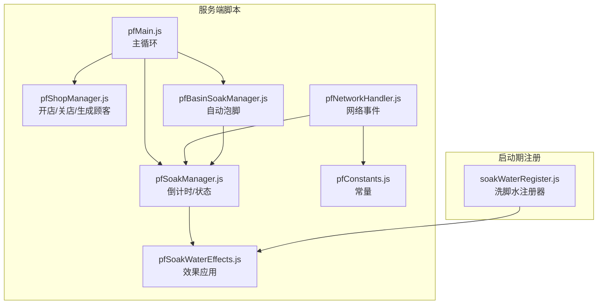
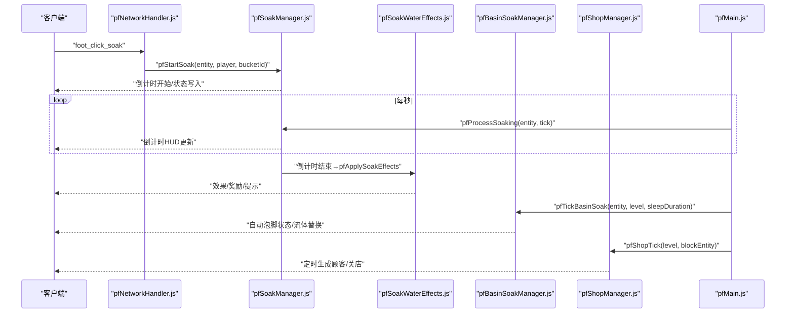
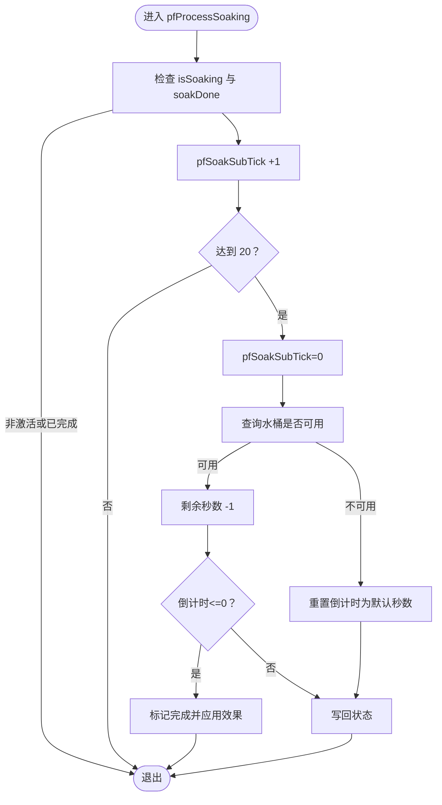
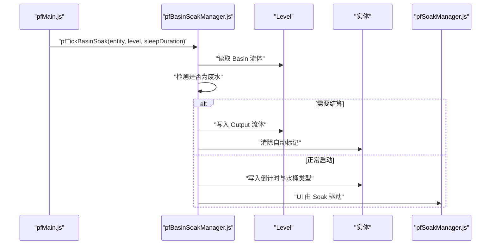
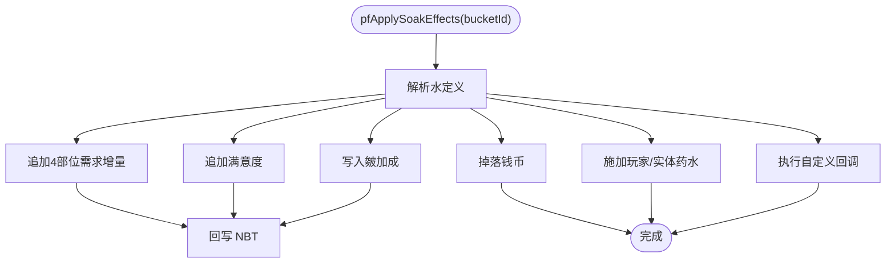
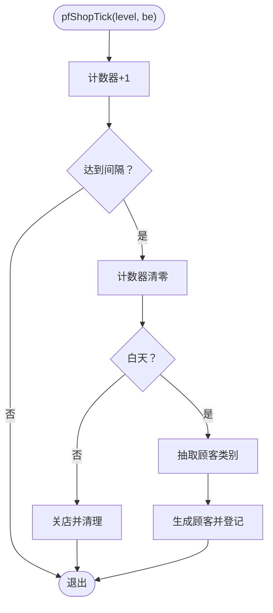
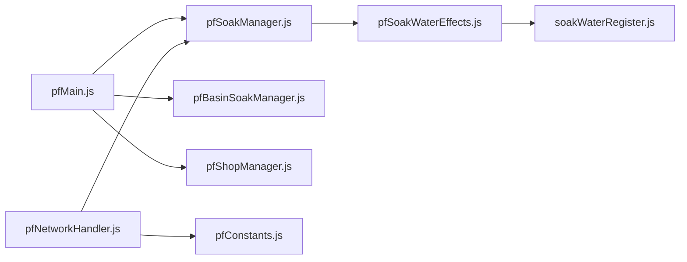

# 故障排除

<cite>
**本文引用的文件**
- [pfBasinSoakManager.js](file://kubejs/server_scripts/pathfinder/pfBasinSoakManager.js)
- [pfSoakManager.js](file://kubejs/server_scripts/pathfinder/pfSoakManager.js)
- [pfSoakWaterEffects.js](file://kubejs/server_scripts/pathfinder/pfSoakWaterEffects.js)
- [pfBossManager.js](file://kubejs/server_scripts/pathfinder/pfBossManager.js)
- [pfShopManager.js](file://kubejs/server_scripts/pathfinder/pfShopManager.js)
- [pfNetworkHandler.js](file://kubejs/server_scripts/pathfinder/pfNetworkHandler.js)
- [pfMain.js](file://kubejs/server_scripts/pathfinder/pfMain.js)
- [pfConstants.js](file://kubejs/server_scripts/pathfinder/pfConstants.js)
- [soakWaterRegister.js](file://kubejs/startup_scripts/soakwater/soakWaterRegister.js)
</cite>

## 目录
1. [简介](#简介)
2. [项目结构](#项目结构)
3. [核心组件](#核心组件)
4. [架构总览](#架构总览)
5. [详细组件分析](#详细组件分析)
6. [依赖关系分析](#依赖关系分析)
7. [性能考量](#性能考量)
8. [故障排除指南](#故障排除指南)
9. [结论](#结论)
10. [附录](#附录)

## 简介
本指南聚焦于模组运行中的常见问题，围绕以下模块进行系统化故障排除：
- 泡脚管理：pfBasinSoakManager.js（自动泡脚）、pfSoakManager.js（倒计时与效果）、pfSoakWaterEffects.js（效果应用）
- Boss 挑战：pfBossManager.js（Boss 生成与登记）
- 商店交易与库存：pfShopManager.js（开店/关店/生成顾客）、pfNetworkHandler.js（网络事件与交易）、pfConstants.js（常量）
- 诊断与调试：日志分析、错误码解读、性能与内存问题定位、紧急修复与临时方案

## 项目结构
本项目采用按功能域划分的组织方式，核心逻辑集中在 pathfinder 子目录，启动期注册在 startup_scripts 下。与泡脚相关的注册器位于 soakwater 子目录。

图表来源
- [pfMain.js:11-177](file://kubejs/server_scripts/pathfinder/pfMain.js#L11-L177)
- [pfShopManager.js:151-284](file://kubejs/server_scripts/pathfinder/pfShopManager.js#L151-L284)
- [pfSoakManager.js:92-145](file://kubejs/server_scripts/pathfinder/pfSoakManager.js#L92-L145)
- [pfSoakWaterEffects.js:109-226](file://kubejs/server_scripts/pathfinder/pfSoakWaterEffects.js#L109-L226)
- [pfBasinSoakManager.js:329-408](file://kubejs/server_scripts/pathfinder/pfBasinSoakManager.js#L329-L408)
- [pfNetworkHandler.js:37-311](file://kubejs/server_scripts/pathfinder/pfNetworkHandler.js#L37-L311)
- [pfConstants.js:53-64](file://kubejs/server_scripts/pathfinder/pfConstants.js#L53-L64)
- [soakWaterRegister.js:40-121](file://kubejs/startup_scripts/soakwater/soakWaterRegister.js#L40-L121)

章节来源
- [pfMain.js:11-177](file://kubejs/server_scripts/pathfinder/pfMain.js#L11-L177)
- [pfShopManager.js:151-284](file://kubejs/server_scripts/pathfinder/pfShopManager.js#L151-L284)
- [pfSoakManager.js:92-145](file://kubejs/server_scripts/pathfinder/pfSoakManager.js#L92-L145)
- [pfSoakWaterEffects.js:109-226](file://kubejs/server_scripts/pathfinder/pfSoakWaterEffects.js#L109-L226)
- [pfBasinSoakManager.js:329-408](file://kubejs/server_scripts/pathfinder/pfBasinSoakManager.js#L329-L408)
- [pfNetworkHandler.js:37-311](file://kubejs/server_scripts/pathfinder/pfNetworkHandler.js#L37-L311)
- [pfConstants.js:53-64](file://kubejs/server_scripts/pathfinder/pfConstants.js#L53-L64)
- [soakWaterRegister.js:40-121](file://kubejs/startup_scripts/soakwater/soakWaterRegister.js#L40-L121)

## 核心组件
- 泡脚管理链路：客户端点击 → 网络事件 → 服务端开始倒计时 → 每秒驱动 → 倒计时结束 → 效果应用
- 自动泡脚：基于床边工作盆（Create Basin）的流体检测与替换
- 商店系统：基于方块实体 NBT 的持久化状态，定时生成顾客
- Boss 系统：通过触发器生成 Boss 顾客并登记到商店管理

章节来源
- [pfSoakManager.js:92-145](file://kubejs/server_scripts/pathfinder/pfSoakManager.js#L92-L145)
- [pfBasinSoakManager.js:329-408](file://kubejs/server_scripts/pathfinder/pfBasinSoakManager.js#L329-L408)
- [pfShopManager.js:237-284](file://kubejs/server_scripts/pathfinder/pfShopManager.js#L237-L284)
- [pfBossManager.js:11-50](file://kubejs/server_scripts/pathfinder/pfBossManager.js#L11-L50)

## 架构总览

图表来源
- [pfNetworkHandler.js:222-272](file://kubejs/server_scripts/pathfinder/pfNetworkHandler.js#L222-L272)
- [pfSoakManager.js:92-145](file://kubejs/server_scripts/pathfinder/pfSoakManager.js#L92-L145)
- [pfSoakWaterEffects.js:109-226](file://kubejs/server_scripts/pathfinder/pfSoakWaterEffects.js#L109-L226)
- [pfBasinSoakManager.js:329-408](file://kubejs/server_scripts/pathfinder/pfBasinSoakManager.js#L329-L408)
- [pfShopManager.js:237-284](file://kubejs/server_scripts/pathfinder/pfShopManager.js#L237-L284)
- [pfMain.js:11-177](file://kubejs/server_scripts/pathfinder/pfMain.js#L11-L177)

## 详细组件分析

### 泡脚管理（pfSoakManager.js）
- 倒计时机制：以秒为单位的状态存储，避免跨重启差值失效；每 20 tick 归零子计数器，达到 20 触发“秒事件”
- 可用性检查：依据水桶 ID 查询注册表，原版水桶始终可用
- 倒计时结束：写入完成标记并调用效果应用模块

图表来源
- [pfSoakManager.js:92-145](file://kubejs/server_scripts/pathfinder/pfSoakManager.js#L92-L145)

章节来源
- [pfSoakManager.js:92-145](file://kubejs/server_scripts/pathfinder/pfSoakManager.js#L92-L145)
- [pfSoakManager.js:149-186](file://kubejs/server_scripts/pathfinder/pfSoakManager.js#L149-L186)

### 自动泡脚（pfBasinSoakManager.js）
- 床边工作盆检测：根据床朝向计算 Basin 位置，读取流体（优先 Capability，失败回退 entityData 正则）
- 废水拦截：任一 Input/Output 槽位含“已使用洗脚水”即禁止自动泡脚
- 写入流体：通过命令直接修改 BlockEntity NBT，保证视觉与逻辑一致
- 结算：倒计时完成后替换流体并清除自动标记

图表来源
- [pfBasinSoakManager.js:329-408](file://kubejs/server_scripts/pathfinder/pfBasinSoakManager.js#L329-L408)
- [pfSoakManager.js:92-145](file://kubejs/server_scripts/pathfinder/pfSoakManager.js#L92-L145)

章节来源
- [pfBasinSoakManager.js:329-408](file://kubejs/server_scripts/pathfinder/pfBasinSoakManager.js#L329-L408)

### 效果应用（pfSoakWaterEffects.js）
- 效果维度：4 部位需求增量、满意度、掉落钱币、皴加成、玩家/实体药水效果、自定义回调
- NBT 写回：在应用后回写到同步物品，确保 UI 与服务端状态一致
- 掉落机制：优先使用调度器批量掉落，失败时回退一次性 summon

图表来源
- [pfSoakWaterEffects.js:109-226](file://kubejs/server_scripts/pathfinder/pfSoakWaterEffects.js#L109-L226)

章节来源
- [pfSoakWaterEffects.js:109-226](file://kubejs/server_scripts/pathfinder/pfSoakWaterEffects.js#L109-L226)

### 商店系统（pfShopManager.js）
- 持久化：所有状态写入 pathfinder_block 的 BlockEntity NBT，避免跨重启失效
- 定时生成：每 5 秒判定一次，日落自动关店
- 统一清理：关店时仅清理行走中与等待中的顾客，保留正在服务中的实体

图表来源
- [pfShopManager.js:237-284](file://kubejs/server_scripts/pathfinder/pfShopManager.js#L237-L284)

章节来源
- [pfShopManager.js:151-284](file://kubejs/server_scripts/pathfinder/pfShopManager.js#L151-L284)

### Boss 挑战（pfBossManager.js）
- 入口：通过触发器生成 Boss 顾客，不改变商店开关状态
- 登记：若商店已开，Boss UUID 纳入统一管理，随关店清理

章节来源
- [pfBossManager.js:11-50](file://kubejs/server_scripts/pathfinder/pfBossManager.js#L11-L50)

## 依赖关系分析
- pfMain.js 调用各模块：泡脚倒计时、睡眠处理、商店定时、自动泡脚
- pfNetworkHandler.js 依赖全局常量与注册器，负责网络事件与状态回写
- 效果应用依赖注册器提供的水定义
- 自动泡脚依赖全局常量中的同步物品 ID

图表来源
- [pfMain.js:11-177](file://kubejs/server_scripts/pathfinder/pfMain.js#L11-L177)
- [pfNetworkHandler.js:37-311](file://kubejs/server_scripts/pathfinder/pfNetworkHandler.js#L37-L311)
- [pfSoakManager.js:92-145](file://kubejs/server_scripts/pathfinder/pfSoakManager.js#L92-L145)
- [pfSoakWaterEffects.js:109-226](file://kubejs/server_scripts/pathfinder/pfSoakWaterEffects.js#L109-L226)
- [soakWaterRegister.js:40-121](file://kubejs/startup_scripts/soakwater/soakWaterRegister.js#L40-L121)
- [pfConstants.js:53-64](file://kubejs/server_scripts/pathfinder/pfConstants.js#L53-L64)

章节来源
- [pfMain.js:11-177](file://kubejs/server_scripts/pathfinder/pfMain.js#L11-L177)
- [pfNetworkHandler.js:37-311](file://kubejs/server_scripts/pathfinder/pfNetworkHandler.js#L37-L311)
- [pfSoakManager.js:92-145](file://kubejs/server_scripts/pathfinder/pfSoakManager.js#L92-L145)
- [pfSoakWaterEffects.js:109-226](file://kubejs/server_scripts/pathfinder/pfSoakWaterEffects.js#L109-L226)
- [soakWaterRegister.js:40-121](file://kubejs/startup_scripts/soakwater/soakWaterRegister.js#L40-L121)
- [pfConstants.js:53-64](file://kubejs/server_scripts/pathfinder/pfConstants.js#L53-L64)

## 性能考量
- 日志输出：大量 console.log 会影响 TPS，建议在稳定版本关闭或降低频率
- NBT 读写：频繁读写 BlockEntity NBT 与实体 NBT 会带来开销，尽量批量处理
- 网络事件：客户端高频点击需服务端快速响应，注意异常捕获与回退逻辑
- 定时器：商店与自动泡脚均使用持久化计数器，避免依赖 server.getTickCount()

[本节为通用指导，无需特定文件来源]

## 故障排除指南

### 一、泡脚管理问题（pfBasinSoakManager.js）
- 症状
  - 自动泡脚不触发
  - 倒计时异常或 UI 不更新
  - 流体未被替换或 Basin 被抽干后未重置
- 诊断流程
  - 检查床朝向与 Basin 位置计算是否正确
  - 确认 Basin 流体读取路径（Capability 优先，失败回退 entityData）
  - 核对“已使用洗脚水”拦截逻辑
  - 验证倒计时结束后的流体替换命令是否执行
- 常见错误与修复
  - “找不到 Basin”：确认坐标计算与 BlockEntity 可用性
  - “流体被抽走或不足 1000mb”：检查上游供应与抽液行为
  - “废水拦截导致中断”：清理 Output 槽位或更换输入槽位
- 修复步骤
  - 重新放置 Basin 并注入足量泡脚水
  - 使用命令查看 BlockEntity NBT，确认 InputTanks 状态
  - 临时禁用自动泡脚标记，手动触发倒计时验证

章节来源
- [pfBasinSoakManager.js:329-408](file://kubejs/server_scripts/pathfinder/pfBasinSoakManager.js#L329-L408)

### 二、泡脚效果异常（pfSoakManager.js 与 pfSoakWaterEffects.js）
- 症状
  - 倒计时结束后无效果
  - 需求增量/满意度未增加
  - 掉落钱币失败
- 诊断流程
  - 确认倒计时结束标志（soakDone）已写入
  - 检查水桶 ID 是否在注册表中，原版水桶兜底
  - 核对效果应用模块的 NBT 写回与掉落逻辑
- 常见错误与修复
  - “水桶不可用”：手持水桶不正确或注册表未初始化
  - “效果应用异常”：捕获异常并记录堆栈
  - “掉落失败”：切换到调度器或回退 summon
- 修复步骤
  - 重新注册洗脚水定义并验证流体/桶 ID
  - 检查全局注册器实例是否可用
  - 临时回退到原版水桶测试效果链路

章节来源
- [pfSoakManager.js:92-145](file://kubejs/server_scripts/pathfinder/pfSoakManager.js#L92-L145)
- [pfSoakWaterEffects.js:109-226](file://kubejs/server_scripts/pathfinder/pfSoakWaterEffects.js#L109-L226)
- [soakWaterRegister.js:40-121](file://kubejs/startup_scripts/soakwater/soakWaterRegister.js#L40-L121)

### 三、Boss 挑战失败（pfBossManager.js）
- 症状
  - Boss 生成失败
  - 生成后未登记到商店
- 诊断流程
  - 检查触发器是否正确调用生成函数
  - 确认 Boss 定义与需求倍率
  - 核对商店登记逻辑与 BlockEntity 可用性
- 常见错误与修复
  - “BossDef 为空”：检查注册表与参数传递
  - “登记失败”：BlockEntity 不存在或权限问题
- 修复步骤
  - 重新加载注册表并验证 BossDef
  - 手动调用生成函数并观察日志
  - 临时绕过登记逻辑验证生成流程

章节来源
- [pfBossManager.js:11-50](file://kubejs/server_scripts/pathfinder/pfBossManager.js#L11-L50)

### 四、商店交易与库存同步（pfShopManager.js 与 pfNetworkHandler.js）
- 症状
  - 无法开店/关店
  - 生成顾客失败
  - 关店未清理实体
- 诊断流程
  - 检查 pathfinder_block 的 BlockEntity 是否存在
  - 确认持久化状态字段（开关、计数器、玩家 UUID、路线等）
  - 核对网络事件处理与权限
- 常见错误与修复
  - “找不到方块实体”：坐标错误或方块被破坏
  - “关店清理失败”：实体已死亡或不在范围内
  - “网络事件未响应”：客户端未发送或服务端未注册
- 修复步骤
  - 重新放置触发方块并确认 NBT
  - 手动执行关店命令并观察清理结果
  - 临时关闭定时生成，排查网络事件链路

章节来源
- [pfShopManager.js:151-284](file://kubejs/server_scripts/pathfinder/pfShopManager.js#L151-L284)
- [pfNetworkHandler.js:37-311](file://kubejs/server_scripts/pathfinder/pfNetworkHandler.js#L37-L311)

### 五、日志分析与调试工具
- 日志要点
  - 泡脚：开始/倒计时/完成/效果应用
  - 自动泡脚：启动/校验/结算/中断
  - 商店：开店/关店/生成/清理
  - Boss：生成/登记/提示
- 调试技巧
  - 使用命令查看 BlockEntity NBT 与实体 NBT
  - 临时注释部分日志以降低开销
  - 逐步回退到最小功能验证链路

章节来源
- [pfBasinSoakManager.js:329-408](file://kubejs/server_scripts/pathfinder/pfBasinSoakManager.js#L329-L408)
- [pfSoakManager.js:92-145](file://kubejs/server_scripts/pathfinder/pfSoakManager.js#L92-L145)
- [pfShopManager.js:151-284](file://kubejs/server_scripts/pathfinder/pfShopManager.js#L151-L284)
- [pfBossManager.js:11-50](file://kubejs/server_scripts/pathfinder/pfBossManager.js#L11-L50)

### 六、性能问题定位
- 症状
  - TPS 下降明显
  - 倒计时卡顿
  - 关店/生成延迟
- 诊断与优化
  - 减少日志输出频率
  - 批量处理 NBT 读写
  - 优化网络事件处理
  - 使用持久化计数器替代 server.getTickCount()

章节来源
- [pfMain.js:11-177](file://kubejs/server_scripts/pathfinder/pfMain.js#L11-L177)
- [pfShopManager.js:237-284](file://kubejs/server_scripts/pathfinder/pfShopManager.js#L237-L284)

### 七、内存泄漏与网络连接故障
- 内存泄漏
  - 长时间运行后内存增长：检查全局对象引用与 UI 层资源释放
  - 建议定期重启服务器或使用垃圾回收命令
- 网络连接
  - 客户端无响应：检查网络事件注册与权限
  - 数据不同步：确认同步物品 ID 与 NBT 结构

章节来源
- [pfNetworkHandler.js:37-311](file://kubejs/server_scripts/pathfinder/pfNetworkHandler.js#L37-L311)
- [pfConstants.js:53-64](file://kubejs/server_scripts/pathfinder/pfConstants.js#L53-L64)

### 八、紧急修复与临时方案
- 紧急修复
  - 临时禁用自动泡脚模块
  - 回退到原版水桶兜底
  - 关闭商店定时生成，改为手动生成
- 临时方案
  - 使用命令直接写入 NBT 以绕过网络事件
  - 临时移除效果应用逻辑以验证基础链路

章节来源
- [pfBasinSoakManager.js:329-408](file://kubejs/server_scripts/pathfinder/pfBasinSoakManager.js#L329-L408)
- [pfSoakManager.js:92-145](file://kubejs/server_scripts/pathfinder/pfSoakManager.js#L92-L145)
- [pfShopManager.js:151-284](file://kubejs/server_scripts/pathfinder/pfShopManager.js#L151-L284)

## 结论
本指南提供了针对泡脚、商店与 Boss 系统的系统化故障排除流程。通过日志分析、依赖链路梳理与性能优化，可快速定位并解决大多数运行时问题。建议在开发与测试阶段保持严格的日志策略，并在生产环境适当降低日志频率以保障性能。

[本节为总结性内容，无需特定文件来源]

## 附录

### 常见错误代码与含义
- “找不到方块实体”：BlockEntity 不存在或坐标错误
- “水桶不可用”：手持水桶不在注册表中或未初始化
- “效果应用异常”：注册表或效果定义异常
- “关店清理失败”：实体已死亡或范围外
- “BossDef 为空”：Boss 定义缺失或参数错误

章节来源
- [pfBasinSoakManager.js:329-408](file://kubejs/server_scripts/pathfinder/pfBasinSoakManager.js#L329-L408)
- [pfSoakManager.js:92-145](file://kubejs/server_scripts/pathfinder/pfSoakManager.js#L92-L145)
- [pfShopManager.js:151-284](file://kubejs/server_scripts/pathfinder/pfShopManager.js#L151-L284)
- [pfBossManager.js:11-50](file://kubejs/server_scripts/pathfinder/pfBossManager.js#L11-L50)