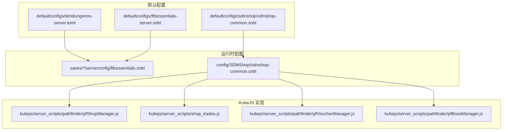
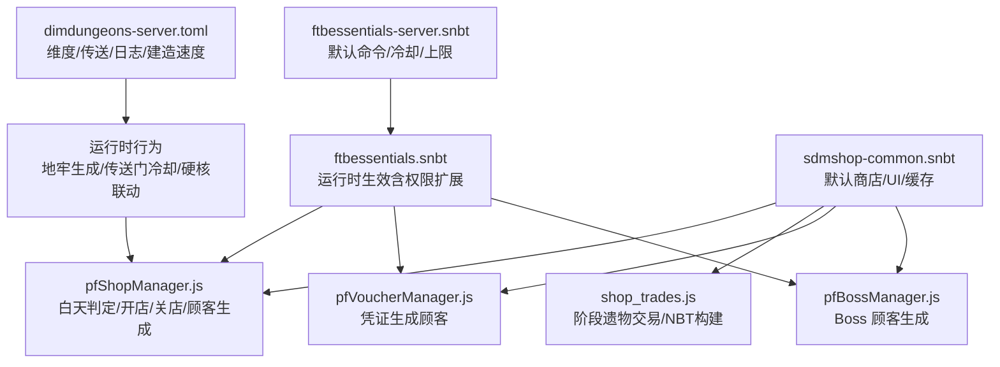
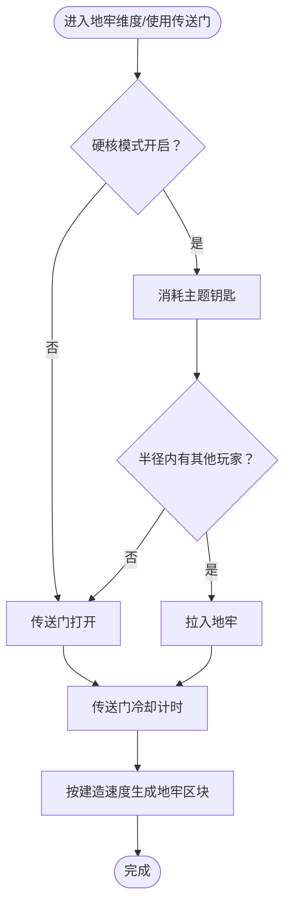
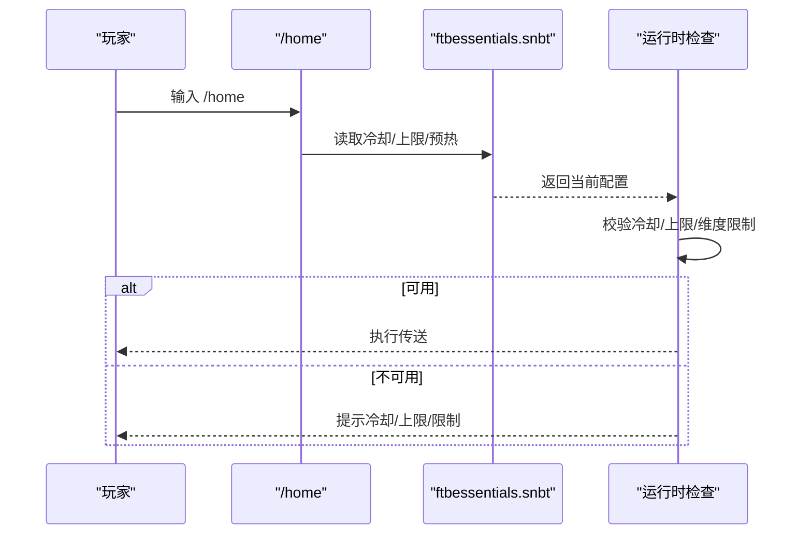
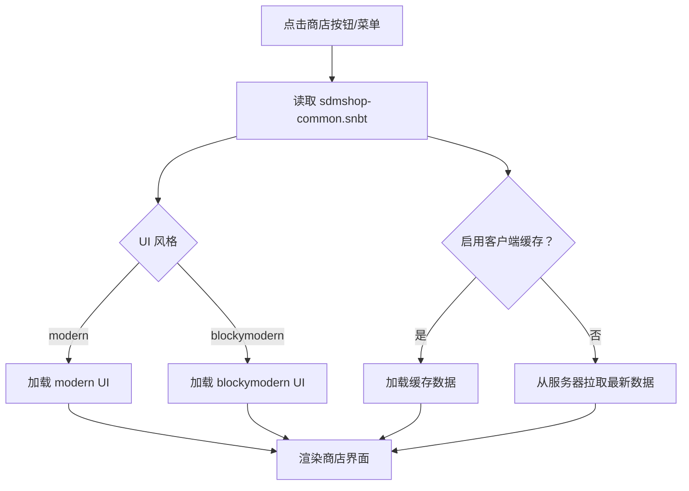
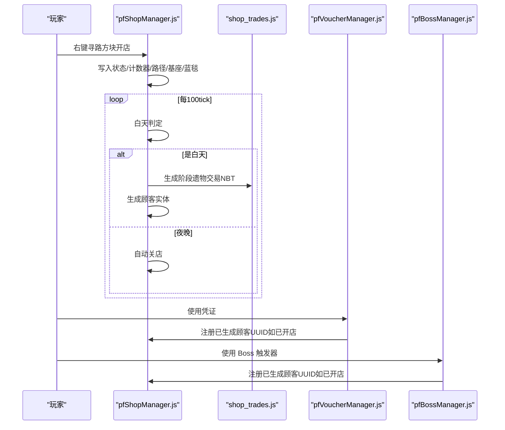
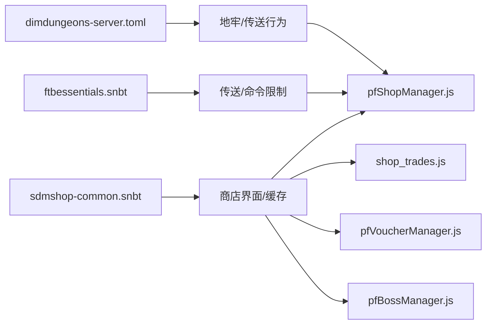

# 服务器配置

<cite>
**本文引用的文件**
- [dimdungeons-server.toml](file://defaultconfigs/dimdungeons-server.toml)
- [ftbessentials-server.snbt](file://defaultconfigs/ftbessentials-server.snbt)
- [ftbessentials.snbt](file://saves/新的世界 (5)/serverconfig/ftbessentials.snbt)
- [sdmshop-common.snbt（默认）](file://defaultconfigs/sdmshop/sdmshop-common.snbt)
- [sdmshop-common.snbt（实际）](file://config/SDMShop/sdmshop-common.snbt)
- [pfShopManager.js](file://kubejs/server_scripts/pathfinder/pfShopManager.js)
- [shop_trades.js](file://kubejs/server_scripts/shop_trades.js)
- [pfVoucherManager.js](file://kubejs/server_scripts/pathfinder/pfVoucherManager.js)
- [pfBossManager.js](file://kubejs/server_scripts/pathfinder/pfBossManager.js)
</cite>

## 目录
1. [简介](#简介)
2. [项目结构](#项目结构)
3. [核心组件](#核心组件)
4. [架构总览](#架构总览)
5. [详细组件分析](#详细组件分析)
6. [依赖关系分析](#依赖关系分析)
7. [性能考量](#性能考量)
8. [故障排查指南](#故障排查指南)
9. [结论](#结论)
10. [附录](#附录)

## 简介
本指南聚焦于服务器配置，覆盖以下三类配置文件与相关机制：
- dimdungeons-server.toml：维度保护、硬核模式、传送门冷却等关键行为参数
- ftbessentials-server.snbt 与运行时 ftbessentials.snbt：权限管理、命令限制、玩家管理与传送冷却/上限等
- sdmshop-common.snbt：商店系统 UI、缓存与默认商店 ID 等通用配置

同时结合 KubeJS 脚本对商店系统进行流程说明，并提供修改建议、性能影响分析、最佳实践与常见问题排查。

## 项目结构
本仓库中与服务器配置直接相关的文件主要位于 defaultconfigs、config 与 saves 下的 serverconfig 目录，以及 kubejs 脚本中对商店系统的实现逻辑。

图表来源
- [dimdungeons-server.toml:1-46](file://defaultconfigs/dimdungeons-server.toml#L1-L46)
- [ftbessentials-server.snbt:1-14](file://defaultconfigs/ftbessentials-server.snbt#L1-L14)
- [sdmshop-common.snbt（默认）:1-5](file://defaultconfigs/sdmshop/sdmshop-common.snbt#L1-L5)
- [ftbessentials.snbt:1-313](file://saves/新的世界 (5)/serverconfig/ftbessentials.snbt#L1-L313)
- [sdmshop-common.snbt（实际）:1-24](file://config/SDMShop/sdmshop-common.snbt#L1-L24)
- [pfShopManager.js:1-300](file://kubejs/server_scripts/pathfinder/pfShopManager.js#L1-L300)
- [shop_trades.js:1-186](file://kubejs/server_scripts/shop_trades.js#L1-L186)
- [pfVoucherManager.js:1-89](file://kubejs/server_scripts/pathfinder/pfVoucherManager.js#L1-L89)
- [pfBossManager.js:1-25](file://kubejs/server_scripts/pathfinder/pfBossManager.js#L1-L25)

章节来源
- [dimdungeons-server.toml:1-46](file://defaultconfigs/dimdungeons-server.toml#L1-L46)
- [ftbessentials-server.snbt:1-14](file://defaultconfigs/ftbessentials-server.snbt#L1-L14)
- [sdmshop-common.snbt（默认）:1-5](file://defaultconfigs/sdmshop/sdmshop-common.snbt#L1-L5)
- [ftbessentials.snbt:1-313](file://saves/新的世界 (5)/serverconfig/ftbessentials.snbt#L1-L313)
- [sdmshop-common.snbt（实际）:1-24](file://config/SDMShop/sdmshop-common.snbt#L1-L24)
- [pfShopManager.js:1-300](file://kubejs/server_scripts/pathfinder/pfShopManager.js#L1-L300)
- [shop_trades.js:1-186](file://kubejs/server_scripts/shop_trades.js#L1-L186)
- [pfVoucherManager.js:1-89](file://kubejs/server_scripts/pathfinder/pfVoucherManager.js#L1-L89)
- [pfBossManager.js:1-25](file://kubejs/server_scripts/pathfinder/pfBossManager.js#L1-L25)

## 核心组件
- 维度与传送配置（dimdungeons-server.toml）
  - 维度保护、硬核模式、多人联动半径、个人维度安全策略、传送门冷却、钥匙消耗与损坏概率、日志级别、世界边界考虑维度、主题钥匙掉落率、地牢建造速度等
- 权限与命令限制（ftbessentials-server.snbt 与运行时 ftbessentials.snbt）
  - 管理员作弊命令开关、通用杂项功能、传送冷却/上限/预热、维度/随机传送限制、回退点历史记录等
- 商店系统配置（sdmshop-common.snbt）
  - 默认商店 ID、按键绑定禁用、通知开关、管理员消息显示、UI 风格、客户端缓存开关等

章节来源
- [dimdungeons-server.toml:3-35](file://defaultconfigs/dimdungeons-server.toml#L3-L35)
- [dimdungeons-server.toml:37-45](file://defaultconfigs/dimdungeons-server.toml#L37-L45)
- [ftbessentials-server.snbt:1-14](file://defaultconfigs/ftbessentials-server.snbt#L1-L14)
- [ftbessentials.snbt:4-313](file://saves/新的世界 (5)/serverconfig/ftbessentials.snbt#L4-L313)
- [sdmshop-common.snbt（默认）:1-5](file://defaultconfigs/sdmshop/sdmshop-common.snbt#L1-L5)
- [sdmshop-common.snbt（实际）:1-24](file://config/SDMShop/sdmshop-common.snbt#L1-L24)

## 架构总览
下图展示配置文件与运行时脚本之间的交互关系，以及关键参数如何影响行为。

图表来源
- [dimdungeons-server.toml:3-35](file://defaultconfigs/dimdungeons-server.toml#L3-L35)
- [ftbessentials-server.snbt:1-14](file://defaultconfigs/ftbessentials-server.snbt#L1-L14)
- [ftbessentials.snbt:144-311](file://saves/新的世界 (5)/serverconfig/ftbessentials.snbt#L144-L311)
- [sdmshop-common.snbt（实际）:1-24](file://config/SDMShop/sdmshop-common.snbt#L1-L24)
- [pfShopManager.js:14-299](file://kubejs/server_scripts/pathfinder/pfShopManager.js#L14-L299)
- [shop_trades.js:13-186](file://kubejs/server_scripts/shop_trades.js#L13-L186)
- [pfVoucherManager.js:14-89](file://kubejs/server_scripts/pathfinder/pfVoucherManager.js#L14-L89)
- [pfBossManager.js:11-25](file://kubejs/server_scripts/pathfinder/pfBossManager.js#L11-L25)

## 详细组件分析

### 维度与传送配置（dimdungeons-server.toml）
- 通用配置（general）
  - 维度保护开关：控制地牢维度的全局区块保护是否启用
  - 硬核模式：进入传送门时消耗钥匙
  - 硬核多人联动半径：硬核模式下半径内的玩家也会一同进入地牢
  - 个人维度安全策略：忽略个人建造维度的权限
  - 传送门总开关：禁用地牢/个人维度传送门
  - 调试开关：开启某些作弊能力
  - 传送门冷却（ticks）：传送门冷却时长
  - 钥匙合成器损坏概率：满级、已使用、损坏状态下使用时的降级/损毁概率
  - 日志级别：all/warn/error
  - 世界边界考虑维度：激活钥匙时参考的世界边界所属维度
  - 主题钥匙掉落率：基础地牢敌人携带主题钥匙的概率
  - 地牢建造速度：跳过若干刻以避免卡顿
- 地牢维度方块行为（blocks）
  - 破坏白名单：允许玩家破坏的方块（例如墓碑）
  - 交互黑名单：禁止交互的方块清单（红石、工作台、床等）
  - 无掉落黑名单：任何方式破坏都不会掉落物品的方块

图表来源
- [dimd dungeons-server.toml:7-35](file://defaultconfigs/dimdungeons-server.toml#L7-L35)

章节来源
- [dimdungeons-server.toml:3-35](file://defaultconfigs/dimdungeons-server.toml#L3-L35)
- [dimdungeons-server.toml:37-45](file://defaultconfigs/dimdungeons-server.toml#L37-L45)

### 权限与命令限制（ftbessentials-server.snbt 与 ftbessentials.snbt）
- 默认配置（defaultconfigs/ftbessentials-server.snbt）：提供可覆盖的默认模板，建议在此处编辑并复制到运行时生效
- 运行时配置（saves/*/serverconfig/ftbessentials.snbt）：包含管理员命令、杂项功能、传送相关冷却/上限/预热、维度/随机传送限制、回退点历史等
- 关键要点
  - 管理员命令：灭火、喂食、飞行、无敌、治疗、查看他人背包、设置/使用背包、禁言、速度、传送离线玩家等
  - 杂项功能：铁砧/工作台/Smithing/Stonecutter/末影箱/帽子/自踢/排行榜/附近玩家/昵称/录音/垃圾桶
  - 传送相关：back/home/rtp/spawn/tpa/warp 等命令的冷却、上限、预热、维度白/黑名单、距离限制
  - 权限扩展：可通过 FTB Ranks 重写上述冷却/上限/预热等参数

图表来源
- [ftbessentials.snbt:144-311](file://saves/新的世界 (5)/serverconfig/ftbessentials.snbt#L144-L311)

章节来源
- [ftbessentials-server.snbt:1-14](file://defaultconfigs/ftbessentials-server.snbt#L1-L14)
- [ftbessentials.snbt:4-313](file://saves/新的世界 (5)/serverconfig/ftbessentials.snbt#L4-L313)

### 商店系统配置（sdmshop-common.snbt）
- 默认商店 ID：创建商店时使用的商店标识
- 键位绑定禁用：是否禁用默认按键打开商店界面
- 通知开关：是否向玩家发送商店相关提示
- 管理员消息显示：是否显示管理员消息
- UI 风格：modern 或 blockymodern
- 客户端缓存：是否缓存商店数据以降低网络负载

图表来源
- [sdmshop-common.snbt（实际）:1-24](file://config/SDMShop/sdmshop-common.snbt#L1-L24)

章节来源
- [sdmshop-common.snbt（默认）:1-5](file://defaultconfigs/sdmshop/sdmshop-common.snbt#L1-L5)
- [sdmshop-common.snbt（实际）:1-24](file://config/SDMShop/sdmshop-common.snbt#L1-L24)

### 商店系统实现与交易规则（KubeJS）
- 开店/关店与白天判定
  - 白天判定：基于游戏时间 0-12000
  - 开店：写入路径字符串、基座坐标、蓝色地毯位置、玩家 UUID、计数器清零
  - 关店：清理仍在行走/等待的顾客，支持自动与手动关店
  - 顾客生成：每 100 tick（5 秒）尝试一次，按类别模型生成顾客
- 阶段式遗物交易
  - 5 个阶段，每个阶段随机 3-5 个遗物
  - 金块价格区间随阶段递增，交易上限为 1 次
  - 交易 NBT 构建：买 A/B 两栏最多各 64 块金块，卖 1 个遗物
- 凭证与 Boss 顾客
  - 凭证：消耗 1 个凭证（创意免），按类别或随机选择模型生成顾客
  - Boss 顾客：通过触发器生成单个 Boss，不参与常规类别评价

图表来源
- [pfShopManager.js:14-299](file://kubejs/server_scripts/pathfinder/pfShopManager.js#L14-L299)
- [shop_trades.js:13-186](file://kubejs/server_scripts/shop_trades.js#L13-L186)
- [pfVoucherManager.js:14-89](file://kubejs/server_scripts/pathfinder/pfVoucherManager.js#L14-L89)
- [pfBossManager.js:11-25](file://kubejs/server_scripts/pathfinder/pfBossManager.js#L11-L25)

章节来源
- [pfShopManager.js:14-299](file://kubejs/server_scripts/pathfinder/pfShopManager.js#L14-L299)
- [shop_trades.js:13-186](file://kubejs/server_scripts/shop_trades.js#L13-L186)
- [pfVoucherManager.js:14-89](file://kubejs/server_scripts/pathfinder/pfVoucherManager.js#L14-L89)
- [pfBossManager.js:11-25](file://kubejs/server_scripts/pathfinder/pfBossManager.js#L11-L25)

## 依赖关系分析
- 配置到行为的映射
  - dimdungeons-server.toml → 地牢生成/传送门冷却/硬核联动 → pfShopManager.js（白天判定/顾客生成）
  - ftbessentials.snbt → 传送冷却/上限/维度限制 → 玩家体验与服务器负载
  - sdmshop-common.snbt → UI/缓存 → pfShopManager.js（界面渲染/数据拉取）
- 脚本对配置的依赖
  - 商店阶段价格区间来自 shop_trades.js 的常量表
  - 凭证与 Boss 生成依赖 pfShopManager.js 的已开店状态进行统一清理

图表来源
- [dimdungeons-server.toml:3-35](file://defaultconfigs/dimdungeons-server.toml#L3-L35)
- [ftbessentials.snbt:144-311](file://saves/新的世界 (5)/serverconfig/ftbessentials.snbt#L144-L311)
- [sdmshop-common.snbt（实际）:1-24](file://config/SDMShop/sdmshop-common.snbt#L1-L24)
- [pfShopManager.js:14-299](file://kubejs/server_scripts/pathfinder/pfShopManager.js#L14-L299)
- [shop_trades.js:13-186](file://kubejs/server_scripts/shop_trades.js#L13-L186)
- [pfVoucherManager.js:14-89](file://kubejs/server_scripts/pathfinder/pfVoucherManager.js#L14-L89)
- [pfBossManager.js:11-25](file://kubejs/server_scripts/pathfinder/pfBossManager.js#L11-L25)

章节来源
- [dimdungeons-server.toml:3-35](file://defaultconfigs/dimdungeons-server.toml#L3-L35)
- [ftbessentials.snbt:144-311](file://saves/新的世界 (5)/serverconfig/ftbessentials.snbt#L144-L311)
- [sdmshop-common.snbt（实际）:1-24](file://config/SDMShop/sdmshop-common.snbt#L1-L24)
- [pfShopManager.js:14-299](file://kubejs/server_scripts/pathfinder/pfShopManager.js#L14-L299)
- [shop_trades.js:13-186](file://kubejs/server_scripts/shop_trades.js#L13-L186)
- [pfVoucherManager.js:14-89](file://kubejs/server_scripts/pathfinder/pfVoucherManager.js#L14-L89)
- [pfBossManager.js:11-25](file://kubejs/server_scripts/pathfinder/pfBossManager.js#L11-L25)

## 性能考量
- 地牢建造速度
  - 通过增大“跳过的刻数”减少生成过程中的卡顿，但可能延长首次生成时间
- 传送门冷却
  - 合理设置冷却刻数，避免频繁传送导致的瞬时负载
- 日志级别
  - 生产环境建议设为 warn 或 error，降低日志输出对 I/O 的影响
- 商店系统
  - 启用客户端缓存可显著降低网络负载，但需注意缓存一致性
  - 适当降低阶段交易数量与价格波动范围，有助于减少 NBT 构建复杂度
- 传送限制
  - 合理设置 RTP 最小/最大距离、尝试次数与维度黑名单，避免无效计算

## 故障排查指南
- 传送门无法打开
  - 检查 dimdungeons-server.toml 的传送门总开关与个人维度安全策略
  - 确认世界边界维度配置正确
- 硬核模式下未拉入队友
  - 检查硬核多人联动半径与硬核模式开关
- 传送命令冷却过长或无冷却
  - 在 ftbessentials.snbt 中调整对应命令的冷却/上限/预热
- 商店界面无法打开或 UI 异常
  - 检查 sdmshop-common.snbt 的 UI 风格与缓存开关
- 商店未生成顾客
  - 确认白天判定与 100 tick 计数器逻辑
  - 检查阶段交易是否已正确生成 NBT
- 凭证/Boss 无法生成
  - 确认凭证类别存在且模型有效
  - 检查寻路方块实体是否存在与状态是否正确

章节来源
- [dimdungeons-server.toml:14-17](file://defaultconfigs/dimdungeons-server.toml#L14-L17)
- [dimdungeons-server.toml:10](file://defaultconfigs/dimdungeons-server.toml#L10)
- [ftbessentials.snbt:144-311](file://saves/新的世界 (5)/serverconfig/ftbessentials.snbt#L144-L311)
- [sdmshop-common.snbt（实际）:1-24](file://config/SDMShop/sdmshop-common.snbt#L1-L24)
- [pfShopManager.js:143-146](file://kubejs/server_scripts/pathfinder/pfShopManager.js#L143-L146)
- [shop_trades.js:128-186](file://kubejs/server_scripts/shop_trades.js#L128-L186)
- [pfVoucherManager.js:14-89](file://kubejs/server_scripts/pathfinder/pfVoucherManager.js#L14-L89)
- [pfBossManager.js:11-25](file://kubejs/server_scripts/pathfinder/pfBossManager.js#L11-L25)

## 结论
- dimdungeons-server.toml 控制维度与传送的核心行为，建议结合服务器规模与玩家体验适度调整硬核联动与建造速度
- ftbessentials.snbt 提供丰富的命令与传送限制，建议通过权限系统精细化控制
- sdmshop-common.snbt 影响商店 UI 与网络负载，建议启用缓存并合理设置 UI 风格
- KubeJS 脚本将配置转化为具体行为，理解其逻辑有助于快速定位问题与优化性能

## 附录
- 配置验证方法
  - 修改 defaultconfigs 后，重新生成世界或复制到对应 serverconfig 目录生效
  - 通过命令测试传送/商店功能，观察日志输出确认配置是否生效
- 常见错误与修复
  - 配置未生效：确认已复制到运行时目录
  - 逻辑冲突：检查维度/传送限制与硬核模式之间的相互作用
  - 性能问题：优先优化日志级别、传送冷却与商店缓存策略