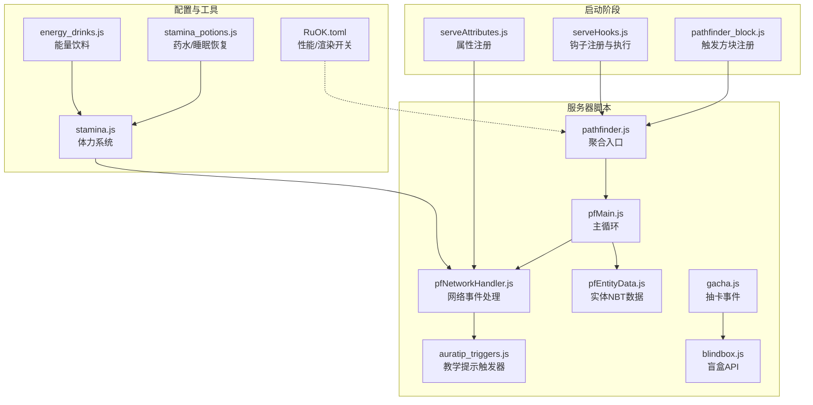
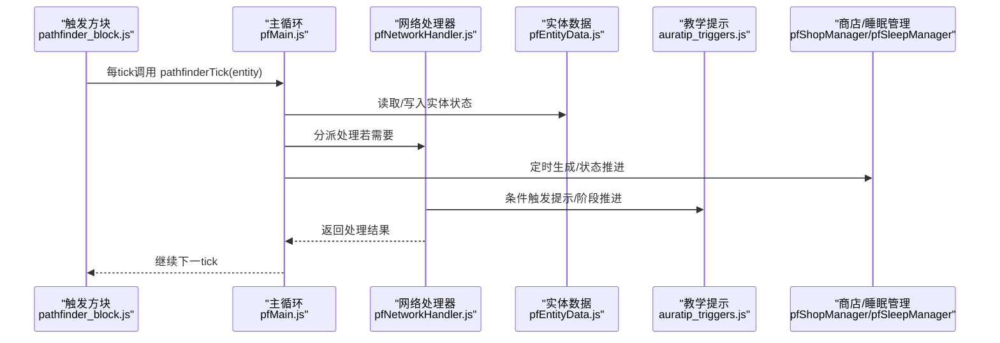
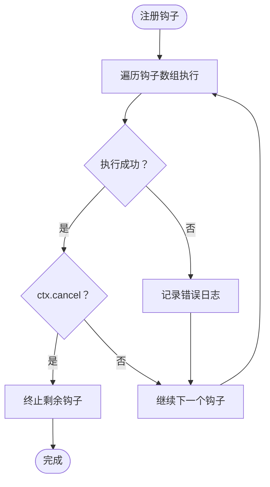
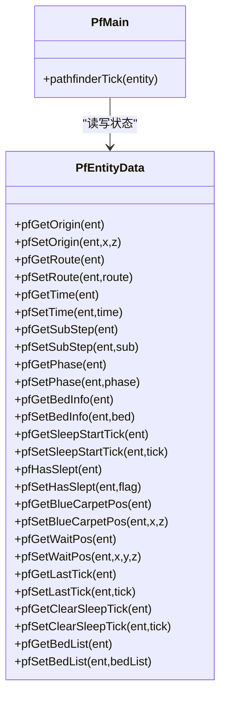
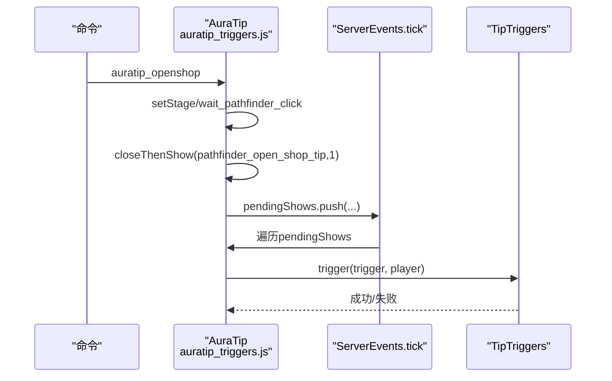
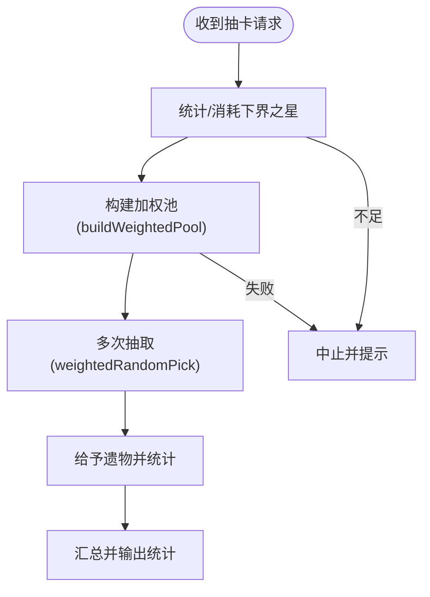
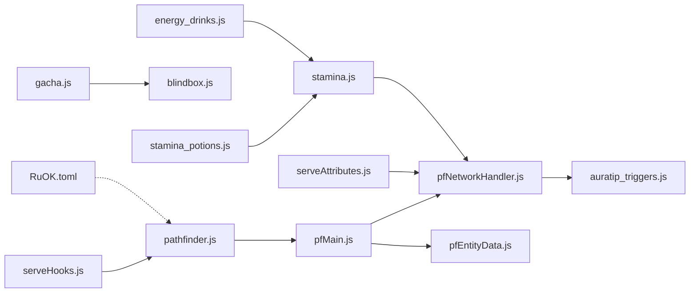

# 监控维护

<cite>
**本文引用的文件**
- [serveHooks.js](file://kubejs/startup_scripts/serveHooks.js)
- [pathfinder.js](file://kubejs/server_scripts/pathfinder.js)
- [auratip_triggers.js](file://kubejs/server_scripts/auratip_triggers.js)
- [gacha.js](file://kubejs/server_scripts/gacha.js)
- [blindbox.js](file://kubejs/server_scripts/blindbox.js)
- [pfMain.js](file://kubejs/server_scripts/pathfinder/pfMain.js)
- [pfEntityData.js](file://kubejs/server_scripts/pathfinder/pfEntityData.js)
- [pfNetworkHandler.js](file://kubejs/server_scripts/pathfinder/pfNetworkHandler.js)
- [pathfinder_block.js](file://kubejs/startup_scripts/block/pathfinder.js)
- [serveAttributes.js](file://kubejs/startup_scripts/attributes/serveAttributes.js)
- [stamina.js](file://kubejs/server_scripts/stamina.js)
- [stamina_potions.js](file://kubejs/server_scripts/stamina_potions.js)
- [energy_drinks.js](file://kubejs/server_scripts/energy_drinks.js)
- [RuOK.toml](file://config/RuOK.toml)
</cite>

## 目录
1. [简介](#简介)
2. [项目结构](#项目结构)
3. [核心组件](#核心组件)
4. [架构总览](#架构总览)
5. [详细组件分析](#详细组件分析)
6. [依赖关系分析](#依赖关系分析)
7. [性能考量](#性能考量)
8. [故障排查指南](#故障排查指南)
9. [结论](#结论)
10. [附录](#附录)

## 简介
本指南面向运维与开发团队，围绕 KubeJS 项目中的“监控维护”目标，构建一套完整的模组运行状态监控体系。重点覆盖以下方面：
- 服务钩子监控：serveHooks.js 的钩子注册与执行链路
- 实体状态跟踪：pathfinder.js 与 pfEntityData.js 的实体 NBT 状态管理
- 触发器监控：auratip_triggers.js 的教学提示与阶段推进
- 随机事件监控与统计：gacha.js 的抽卡流程与统计输出
- 日志管理策略、错误追踪与性能指标采集
- 自动化监控脚本、告警配置与维护计划
- 备份策略、数据完整性校验与灾难恢复流程
- 运维工具推荐与监控仪表板配置示例

## 项目结构
本项目采用“启动脚本 + 服务器脚本 + 子模块”的分层组织方式。核心监控涉及：
- 启动阶段：serveHooks.js 提供钩子框架；serveAttributes.js 注册属性；pathfinder_block.js 注册触发方块
- 服务器脚本：pathfinder.js 作为聚合入口；pfMain.js 提供主循环；pfNetworkHandler.js 处理网络事件；pfEntityData.js 管理实体 NBT；auratip_triggers.js 管理教学提示；gacha.js 管理抽卡事件
- 配置与工具：RuOK.toml 提供渲染与性能开关；stamina.js/stamina_potions.js/energy_drinks.js 提供体力系统与恢复机制

图表来源
- [serveHooks.js:1-31](file://kubejs/startup_scripts/serveHooks.js#L1-L31)
- [serveAttributes.js:1-53](file://kubejs/startup_scripts/attributes/serveAttributes.js#L1-L53)
- [pathfinder_block.js:1-19](file://kubejs/startup_scripts/block/pathfinder.js#L1-L19)
- [pathfinder.js:1-30](file://kubejs/server_scripts/pathfinder.js#L1-L30)
- [pfMain.js:1-177](file://kubejs/server_scripts/pathfinder/pfMain.js#L1-L177)
- [pfNetworkHandler.js:1-317](file://kubejs/server_scripts/pathfinder/pfNetworkHandler.js#L1-L317)
- [pfEntityData.js:1-218](file://kubejs/server_scripts/pathfinder/pfEntityData.js#L1-L218)
- [auratip_triggers.js:1-212](file://kubejs/server_scripts/auratip_triggers.js#L1-L212)
- [gacha.js:1-137](file://kubejs/server_scripts/gacha.js#L1-L137)
- [blindbox.js:1-153](file://kubejs/server_scripts/blindbox.js#L1-L153)
- [stamina.js:1-81](file://kubejs/server_scripts/stamina.js#L1-L81)
- [stamina_potions.js:1-73](file://kubejs/server_scripts/stamina_potions.js#L1-L73)
- [energy_drinks.js:1-63](file://kubejs/server_scripts/energy_drinks.js#L1-L63)
- [RuOK.toml:1-45](file://config/RuOK.toml#L1-L45)

章节来源
- [pathfinder.js:1-30](file://kubejs/server_scripts/pathfinder.js#L1-L30)
- [pathfinder_block.js:1-19](file://kubejs/startup_scripts/block/pathfinder.js#L1-L19)

## 核心组件
- 服务钩子框架（serveHooks.js）：提供全局钩子数组与执行函数，支持模块化扩展与错误隔离
- 实体状态管理（pfEntityData.js）：封装实体 persistentData 的读写，统一状态字段与同步
- 网络事件处理（pfNetworkHandler.js）：接收客户端点击事件，执行消费、收益、掉落等业务逻辑，并记录日志
- 教学提示触发器（auratip_triggers.js）：基于阶段推进与队列展示，提供命令调试与关闭能力
- 抽卡系统（gacha.js + blindbox.js）：消费道具、构建加权池、执行多次抽取并统计结果
- 体力系统（stamina.js + stamina_potions.js + energy_drinks.js）：持久化体力、自动恢复、药水与睡眠恢复
- 性能与渲染配置（RuOK.toml）：控制实体渲染、粒子、帧率监控等

章节来源
- [serveHooks.js:11-30](file://kubejs/startup_scripts/serveHooks.js#L11-L30)
- [pfEntityData.js:185-218](file://kubejs/server_scripts/pathfinder/pfEntityData.js#L185-L218)
- [pfNetworkHandler.js:36-317](file://kubejs/server_scripts/pathfinder/pfNetworkHandler.js#L36-L317)
- [auratip_triggers.js:9-125](file://kubejs/server_scripts/auratip_triggers.js#L9-L125)
- [gacha.js:53-137](file://kubejs/server_scripts/gacha.js#L53-L137)
- [blindbox.js:41-87](file://kubejs/server_scripts/blindbox.js#L41-L87)
- [stamina.js:34-53](file://kubejs/server_scripts/stamina.js#L34-L53)
- [stamina_potions.js:47-72](file://kubejs/server_scripts/stamina_potions.js#L47-L72)
- [energy_drinks.js:9-63](file://kubejs/server_scripts/energy_drinks.js#L9-L63)
- [RuOK.toml:1-45](file://config/RuOK.toml#L1-L45)

## 架构总览
整体监控体系围绕“事件驱动 + 状态持久化 + 日志与统计”的闭环展开：
- 事件来源：触发方块（每 tick 调用主循环）、客户端网络事件、玩家登录/Tick 事件
- 处理中心：主循环与网络处理器，负责状态读取、业务计算、副作用落地
- 状态存储：实体与玩家 persistentData，确保跨重启可恢复
- 输出与观测：控制台日志、命令反馈、UI 展示、配置项开关

图表来源
- [pathfinder_block.js:14-18](file://kubejs/startup_scripts/block/pathfinder.js#L14-L18)
- [pfMain.js:11-177](file://kubejs/server_scripts/pathfinder/pfMain.js#L11-L177)
- [pfNetworkHandler.js:36-317](file://kubejs/server_scripts/pathfinder/pfNetworkHandler.js#L36-L317)
- [pfEntityData.js:185-218](file://kubejs/server_scripts/pathfinder/pfEntityData.js#L185-L218)
- [auratip_triggers.js:188-212](file://kubejs/server_scripts/auratip_triggers.js#L188-L212)

## 详细组件分析

### 服务钩子监控（serveHooks.js）
- 设计目标：将“额外功能（如抹油、连击奖励等）”从主流程拆分，通过钩子注册与顺序执行实现模块化扩展
- 关键点：
  - 全局钩子数组与注册函数，保证幂等性
  - 执行时 try/catch 包裹，ctx.cancel 支持短路
  - pathfinder.js 仅在关键节点调用钩子，降低耦合
- 监控建议：
  - 记录钩子执行耗时与异常次数
  - 对 ctx.cancel 进行统计，评估钩子对主流程的影响
  - 建立钩子健康度阈值，异常增多时降级或熔断

图表来源
- [serveHooks.js:19-30](file://kubejs/startup_scripts/serveHooks.js#L19-L30)

章节来源
- [serveHooks.js:11-30](file://kubejs/startup_scripts/serveHooks.js#L11-L30)
- [pathfinder.js:25-29](file://kubejs/server_scripts/pathfinder.js#L25-L29)

### 实体状态跟踪（pathfinder.js + pfEntityData.js）
- 设计目标：通过统一的数据访问接口管理实体状态，避免分散读写带来的竞态与不一致
- 关键点：
  - pfEntityData.js 封装所有 persistentData 字段的读写，导出全局对象
  - pfMain.js 在主循环中按 tick 防重复处理，读取实体状态并推进流程
  - 状态字段包括：路线、时间、子步、阶段、床位、睡眠起始、等待位置、最后处理 tick 等
- 监控建议：
  - 统计实体状态变更频率与耗时
  - 监控 lastTick 防重复处理是否生效
  - 对异常字段（如负值、越界）进行告警

图表来源
- [pfEntityData.js:185-218](file://kubejs/server_scripts/pathfinder/pfEntityData.js#L185-L218)
- [pfMain.js:11-177](file://kubejs/server_scripts/pathfinder/pfMain.js#L11-L177)

章节来源
- [pfEntityData.js:1-218](file://kubejs/server_scripts/pathfinder/pfEntityData.js#L1-L218)
- [pfMain.js:1-177](file://kubejs/server_scripts/pathfinder/pfMain.js#L1-L177)

### 触发器监控（auratip_triggers.js）
- 设计目标：通过阶段化教学提示与延迟队列，引导玩家完成一系列交互
- 关键点：
  - triggers 映射、getStage/setStage/clearStage 管理教学阶段
  - queueShow/closeThenShow/closePlayerTip 实现延迟展示与关闭
  - 通过命令 auratip_openshop/auratip_reset/auratip_debug_show 调试与重置
  - ServerEvents.tick 驱动 pendingShows 队列
- 监控建议：
  - 统计 pendingShows 队列长度与平均延迟误差
  - 记录 show/close 成功/失败次数
  - 对 TipTriggers 未就绪与 trigger 缺失进行告警

图表来源
- [auratip_triggers.js:79-125](file://kubejs/server_scripts/auratip_triggers.js#L79-L125)
- [auratip_triggers.js:188-212](file://kubejs/server_scripts/auratip_triggers.js#L188-L212)

章节来源
- [auratip_triggers.js:1-212](file://kubejs/server_scripts/auratip_triggers.js#L1-L212)

### 随机事件监控与统计（gacha.js + blindbox.js）
- 设计目标：基于加权池的随机抽取，支持多抽卡与统计分析
- 关键点：
  - gacha.js 校验消耗、构建加权池、执行多次抽取并统计稀有度分布
  - blindbox.js 提供通用加权池构建与随机抽取算法
  - 使用 pfGachaApi 供外部模块复用
- 监控建议：
  - 统计抽卡次数、消耗下界之星数量、各稀有度产出占比
  - 监控加权池构建耗时与抽取失败率
  - 对 API 未就绪、消耗失败等异常进行告警

图表来源
- [gacha.js:53-137](file://kubejs/server_scripts/gacha.js#L53-L137)
- [blindbox.js:41-87](file://kubejs/server_scripts/blindbox.js#L41-L87)

章节来源
- [gacha.js:1-137](file://kubejs/server_scripts/gacha.js#L1-L137)
- [blindbox.js:1-153](file://kubejs/server_scripts/blindbox.js#L1-L153)

### 网络事件处理与日志（pfNetworkHandler.js）
- 设计目标：集中处理客户端点击事件，执行消费、收益、掉落等业务逻辑
- 关键点：
  - 一键满足与逐点满足两种模式，分别统计体力消耗与掉落
  - 通过属性系统动态读取收益与消耗参数
  - 记录详细日志，便于问题定位
- 监控建议：
  - 统计点击事件类型、成功率、收益分布
  - 监控属性读取失败与异常分支
  - 对 pfSleepManager/pfCunDrop 等外部模块调用异常进行告警

章节来源
- [pfNetworkHandler.js:36-317](file://kubejs/server_scripts/pathfinder/pfNetworkHandler.js#L36-L317)

### 体力系统与恢复（stamina.js + stamina_potions.js + energy_drinks.js）
- 设计目标：持久化体力、自动恢复、药水与睡眠恢复
- 关键点：
  - stamina.js 维护 pfStamina 并通过网络包同步
  - stamina_potions.js 提供药水恢复与睡眠恢复
  - energy_drinks.js 提供能量饮料的副作用与恢复
- 监控建议：
  - 监控体力变化速率与异常波动
  - 统计药水/睡眠/饮料的使用次数与效果达成率
  - 对恢复失败与副作用异常进行告警

章节来源
- [stamina.js:1-81](file://kubejs/server_scripts/stamina.js#L1-L81)
- [stamina_potions.js:1-73](file://kubejs/server_scripts/stamina_potions.js#L1-L73)
- [energy_drinks.js:1-63](file://kubejs/server_scripts/energy_drinks.js#L1-L63)

## 依赖关系分析
- serveHooks.js 与 pathfinder.js：钩子在主循环关键节点被调用，降低耦合
- pfNetworkHandler.js 依赖属性系统与外部模块（pfSleepManager、pfCunDrop 等）
- pfEntityData.js 为 pfMain.js 的状态源，提供跨模块共享
- gacha.js 依赖 blindbox.js 的加权池与随机抽取
- RuOK.toml 影响渲染与性能，间接影响 tick 负载

图表来源
- [serveHooks.js:11-30](file://kubejs/startup_scripts/serveHooks.js#L11-L30)
- [pathfinder.js:25-29](file://kubejs/server_scripts/pathfinder.js#L25-L29)
- [pfMain.js:11-177](file://kubejs/server_scripts/pathfinder/pfMain.js#L11-L177)
- [pfNetworkHandler.js:36-317](file://kubejs/server_scripts/pathfinder/pfNetworkHandler.js#L36-L317)
- [pfEntityData.js:185-218](file://kubejs/server_scripts/pathfinder/pfEntityData.js#L185-L218)
- [auratip_triggers.js:188-212](file://kubejs/server_scripts/auratip_triggers.js#L188-L212)
- [gacha.js:53-137](file://kubejs/server_scripts/gacha.js#L53-L137)
- [blindbox.js:41-87](file://kubejs/server_scripts/blindbox.js#L41-L87)
- [serveAttributes.js:27-40](file://kubejs/startup_scripts/attributes/serveAttributes.js#L27-L40)
- [stamina.js:34-53](file://kubejs/server_scripts/stamina.js#L34-L53)
- [stamina_potions.js:47-72](file://kubejs/server_scripts/stamina_potions.js#L47-L72)
- [energy_drinks.js:9-63](file://kubejs/server_scripts/energy_drinks.js#L9-L63)
- [RuOK.toml:1-45](file://config/RuOK.toml#L1-L45)

章节来源
- [serveHooks.js:11-30](file://kubejs/startup_scripts/serveHooks.js#L11-L30)
- [pathfinder.js:25-29](file://kubejs/server_scripts/pathfinder.js#L25-L29)
- [pfMain.js:11-177](file://kubejs/server_scripts/pathfinder/pfMain.js#L11-L177)
- [pfNetworkHandler.js:36-317](file://kubejs/server_scripts/pathfinder/pfNetworkHandler.js#L36-L317)
- [pfEntityData.js:185-218](file://kubejs/server_scripts/pathfinder/pfEntityData.js#L185-L218)
- [auratip_triggers.js:188-212](file://kubejs/server_scripts/auratip_triggers.js#L188-L212)
- [gacha.js:53-137](file://kubejs/server_scripts/gacha.js#L53-L137)
- [blindbox.js:41-87](file://kubejs/server_scripts/blindbox.js#L41-L87)
- [serveAttributes.js:27-40](file://kubejs/startup_scripts/attributes/serveAttributes.js#L27-L40)
- [stamina.js:34-53](file://kubejs/server_scripts/stamina.js#L34-L53)
- [stamina_potions.js:47-72](file://kubejs/server_scripts/stamina_potions.js#L47-L72)
- [energy_drinks.js:9-63](file://kubejs/server_scripts/energy_drinks.js#L9-L63)
- [RuOK.toml:1-45](file://config/RuOK.toml#L1-L45)

## 性能考量
- 主循环防重复处理：pfMain.js 对 lastTick 的检查避免同一 tick 内重复处理
- 网络事件处理：属性读取与外部模块调用可能成为瓶颈，建议缓存常用属性值
- 抽卡加权池：构建与随机抽取应限制单次请求上限（已内置），并监控耗时
- 渲染与实体：RuOK.toml 的 EntityRender/FPSMonitor 等开关可调节性能
- 体力系统：自动恢复按子 tick 计数，避免每 tick 都进行大范围写入

章节来源
- [pfMain.js:11-177](file://kubejs/server_scripts/pathfinder/pfMain.js#L11-L177)
- [pfNetworkHandler.js:7-17](file://kubejs/server_scripts/pathfinder/pfNetworkHandler.js#L7-L17)
- [gacha.js:10-13](file://kubejs/server_scripts/gacha.js#L10-L13)
- [RuOK.toml:28-45](file://config/RuOK.toml#L28-L45)

## 故障排查指南
- 钩子异常：检查 serveHooks.js 的 try/catch 与 ctx.cancel 行为，查看控制台错误日志
- 实体状态异常：核对 pfEntityData.js 字段读写一致性，关注负值或越界
- 教学提示未触发：确认 TipTriggers 是否就绪、trigger 映射是否存在、pendingShows 是否堆积
- 抽卡失败：检查下界之星消耗、加权池构建、API 就绪状态与客户端数据
- 网络事件失败：检查属性读取、外部模块可用性与异常捕获
- 体力异常：核查 stamina.js 的同步与自动恢复逻辑，药水/睡眠/饮料副作用

章节来源
- [serveHooks.js:23-29](file://kubejs/startup_scripts/serveHooks.js#L23-L29)
- [pfEntityData.js:185-218](file://kubejs/server_scripts/pathfinder/pfEntityData.js#L185-L218)
- [auratip_triggers.js:42-56](file://kubejs/server_scripts/auratip_triggers.js#L42-L56)
- [gacha.js:71-102](file://kubejs/server_scripts/gacha.js#L71-L102)
- [pfNetworkHandler.js:36-317](file://kubejs/server_scripts/pathfinder/pfNetworkHandler.js#L36-L317)
- [stamina.js:34-53](file://kubejs/server_scripts/stamina.js#L34-L53)

## 结论
通过服务钩子、实体状态管理、教学提示触发器、抽卡统计与体力系统的协同，本项目形成了较为完善的监控维护基础。建议进一步引入自动化监控脚本、告警配置与维护计划，结合备份与灾难恢复流程，持续优化性能与稳定性。

## 附录
- 自动化监控脚本建议
  - 周期性检查钩子执行耗时与异常次数
  - 统计实体状态变更频率与 lastTick 防重复生效情况
  - 监控教学提示队列长度与延迟误差
  - 抽卡统计与加权池构建耗时监控
  - 体力变化速率与药水/睡眠使用统计
- 告警配置
  - 钩子异常率、抽卡失败率、提示队列超长、体力异常波动等阈值告警
- 维护计划
  - 定期审查日志与统计数据，识别异常趋势
  - 版本升级前进行回归测试与性能压测
- 备份策略与灾难恢复
  - 备份 persistentData（实体与玩家）与配置文件
  - 制定数据完整性校验流程与回滚方案
- 运维工具与仪表板
  - 使用日志聚合与可视化工具（如 ELK/Fluentd/Grafana）
  - 仪表板展示：钩子耗时、实体状态变更、抽卡统计、提示队列、体力变化曲线