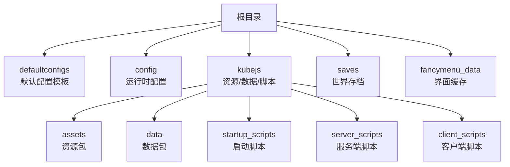
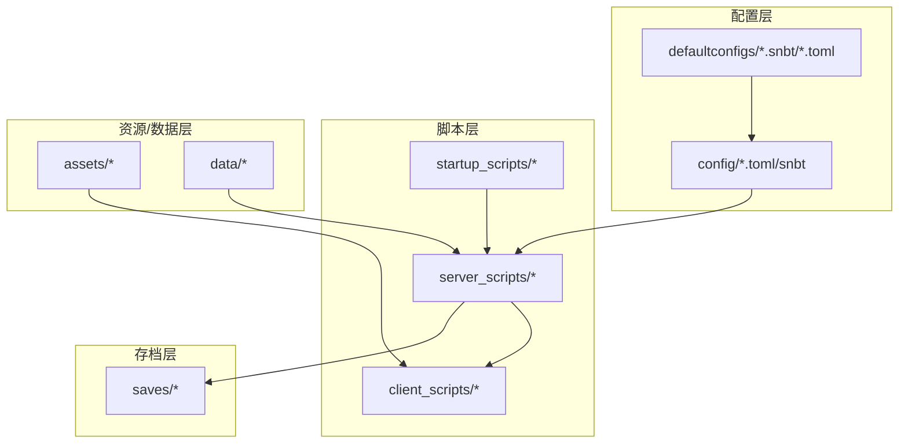
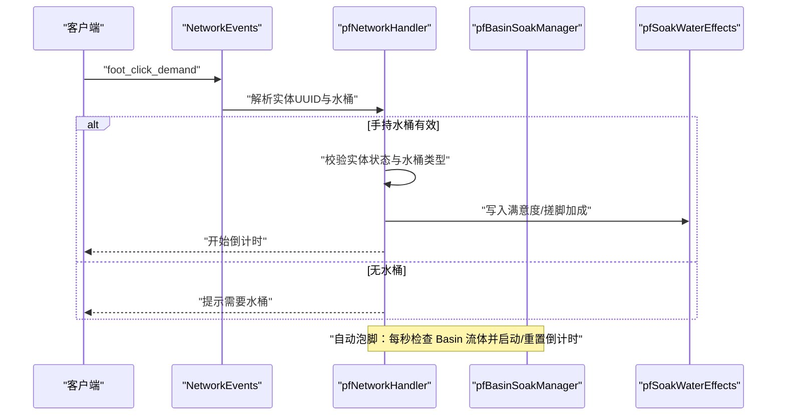
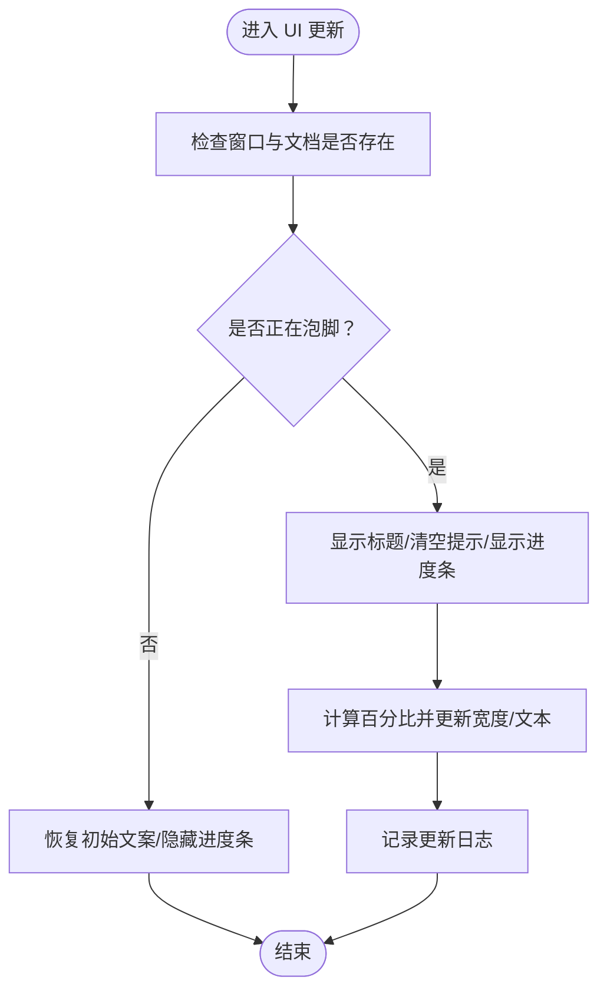
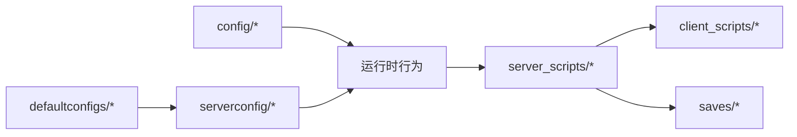

# 部署运维

<cite>
**本文引用的文件**
- [README.md](file://README.md)
- [.gitignore](file://.gitignore)
- [defaultconfigs/ftbessentials-server.snbt](file://defaultconfigs/ftbessentials-server.snbt)
- [defaultconfigs/dimdungeons-server.toml](file://defaultconfigs/dimdungeons-server.toml)
- [config/Mekanism/common.toml](file://config/Mekanism/common.toml)
- [config/ModernUI/common.toml](file://config/ModernUI/common.toml)
- [config/RuOK.toml](file://config/RuOK.toml)
- [kubejs/README.txt](file://kubejs/README.txt)
- [kubejs/server_scripts/phone_settings.js](file://kubejs/server_scripts/phone_settings.js)
- [kubejs/server_scripts/pathfinder/pfNetworkHandler.js](file://kubejs/server_scripts/pathfinder/pfNetworkHandler.js)
- [kubejs/server_scripts/pathfinder/pfBasinSoakManager.js](file://kubejs/server_scripts/pathfinder/pfBasinSoakManager.js)
- [kubejs/server_scripts/pathfinder/pfSoakWaterEffects.js](file://kubejs/server_scripts/pathfinder/pfSoakWaterEffects.js)
- [kubejs/server_scripts/pathfinder/pfCoinDropScheduler.js](file://kubejs/server_scripts/pathfinder/pfCoinDropScheduler.js)
- [kubejs/server_scripts/backpack/backpackInit.js](file://kubejs/server_scripts/backpack/backpackInit.js)
- [kubejs/server_scripts/recipes/recipes_create_precision_mechanism.js](file://kubejs/server_scripts/recipes/recipes_create_precision_mechanism.js)
- [kubejs/client_scripts/ui/foot_ui.js](file://kubejs/client_scripts/ui/foot_ui.js)
- [kubejs/startup_scripts/soakwater/soakWaterRegister.js](file://kubejs/startup_scripts/soakwater/soakWaterRegister.js)
- [kubejs/startup_scripts/relic/relicHelpers.js](file://kubejs/startup_scripts/relic/relicHelpers.js)
- [fancymenu_data/last_world.fmdata](file://fancymenu_data/last_world.fmdata)
</cite>

## 目录
1. [简介](#简介)
2. [项目结构](#项目结构)
3. [核心组件](#核心组件)
4. [架构总览](#架构总览)
5. [详细组件分析](#详细组件分析)
6. [依赖关系分析](#依赖关系分析)
7. [性能考虑](#性能考虑)
8. [故障排除指南](#故障排除指南)
9. [结论](#结论)
10. [附录](#附录)

## 简介
本指南面向系统管理员与运维工程师，围绕该 Minecraft 模组项目提供一套可落地的部署、性能优化与日常维护方案。内容涵盖服务器配置要点、性能调优建议、监控与日志管理、故障排查、自动化与灾备策略，以及生产环境的安全与备份实践。文档同时结合项目内现有配置与脚本，给出可执行的操作步骤与最佳实践。

## 项目结构
该项目为一个基于 Minecraft 1.20.1 + Forge 的模组包，采用 KubeJS 数据/资源包与服务端脚本扩展玩法，并包含多个模组配置文件与默认配置模板。关键目录与职责如下：
- 根目录：安装与基础说明、忽略项与本地数据
- defaultconfigs：各模组默认配置模板（复制到世界 serverconfig 目录生效）
- config：运行时各模组配置（如 Mekanism、ModernUI、RuOK 等）
- kubejs：资源包与数据包目录、服务端/客户端脚本、启动脚本
- saves：世界存档（含 FTB 系列团队/任务/区块等数据）
- fancymenu_data：界面相关缓存与上次游玩记录

**图表来源**
- [README.md:1-6](file://README.md#L1-L6)
- [kubejs/README.txt:1-15](file://kubejs/README.txt#L1-L15)

**章节来源**
- [README.md:1-6](file://README.md#L1-L6)
- [.gitignore:1-42](file://.gitignore#L1-L42)
- [kubejs/README.txt:1-15](file://kubejs/README.txt#L1-L15)

## 核心组件
- 服务器配置与默认模板
  - defaultconfigs 提供各模组默认配置模板，需复制到世界 serverconfig 目录生效，便于统一管理与版本控制。
  - 关键模板包括 FTBEssentials、FTBQuests、SDMShop 等。
- 运行时配置
  - config 目录包含 Mekanism、ModernUI、RuOK 等模组的运行时配置，直接影响性能与功能行为。
- KubeJS 脚本体系
  - 服务端脚本负责业务逻辑（如泡脚、商店、硬币掉落调度、背包初始化等）。
  - 客户端脚本负责 UI 与提示展示。
  - 启动脚本负责注册与全局状态初始化。
- 存档与界面缓存
  - saves 包含世界数据与 FTB 系列插件数据；fancymenu_data 记录上次游玩世界路径。

**章节来源**
- [defaultconfigs/ftbessentials-server.snbt:1-14](file://defaultconfigs/ftbessentials-server.snbt#L1-L14)
- [defaultconfigs/dimdungeons-server.toml:1-46](file://defaultconfigs/dimdungeons-server.toml#L1-L46)
- [config/Mekanism/common.toml:1-13](file://config/Mekanism/common.toml#L1-L13)
- [config/ModernUI/common.toml:1-16](file://config/ModernUI/common.toml#L1-L16)
- [config/RuOK.toml:1-45](file://config/RuOK.toml#L1-L45)
- [kubejs/README.txt:1-15](file://kubejs/README.txt#L1-L15)

## 架构总览
整体运维架构由“配置层（defaultconfigs/config）+ 资源/数据层（kubejs/assets,data）+ 业务脚本层（server_scripts, startup_scripts, client_scripts）+ 存档层（saves）”构成。KubeJS 作为业务中枢，通过网络事件与客户端 UI 协同，驱动泡脚、商店、掉落等玩法；模组配置决定底层性能与行为。

**图表来源**
- [kubejs/README.txt:1-15](file://kubejs/README.txt#L1-L15)
- [defaultconfigs/ftbessentials-server.snbt:1-14](file://defaultconfigs/ftbessentials-server.snbt#L1-L14)
- [config/Mekanism/common.toml:1-13](file://config/Mekanism/common.toml#L1-L13)

## 详细组件分析

### 服务器配置与默认模板
- defaultconfigs
  - FTBEssentials 默认模板可用于统一世界 serverconfig 中的 misc/enderchest 等选项，便于集中管控。
  - TOML 模板（如 dimdungeons-server.toml）提供维度行为、日志级别、建造速度等参数，建议在上线前评估并固化。
- config
  - Mekanism.common.energyType/temperatureUnit 控制 GUI 显示单位，影响玩家体验与调试一致性。
  - ModernUI.common.autoShutdown.times 可设定定时关服时间点，便于维护窗口管理。
  - RuOK.toml 提供渲染与性能相关开关，如 FPSMonitor、EntityRender、MaxEntityEntities 等，建议在高负载场景下调低非必要渲染项。

**章节来源**
- [defaultconfigs/ftbessentials-server.snbt:1-14](file://defaultconfigs/ftbessentials-server.snbt#L1-L14)
- [defaultconfigs/dimdungeons-server.toml:1-46](file://defaultconfigs/dimdungeons-server.toml#L1-L46)
- [config/Mekanism/common.toml:1-13](file://config/Mekanism/common.toml#L1-L13)
- [config/ModernUI/common.toml:1-16](file://config/ModernUI/common.toml#L1-L16)
- [config/RuOK.toml:1-45](file://config/RuOK.toml#L1-L45)

### KubeJS 服务端脚本（业务中枢）
- 手机设置持久化（phone_settings.js）
  - 使用 player.persistentData 存储设置，支持客户端/服务端双向同步与校验。
  - 通过 NetworkEvents.dataReceived 接收客户端变更请求，写入后回推最新设置。
- 泡脚系统（pfNetworkHandler.js、pfBasinSoakManager.js、pfSoakWaterEffects.js）
  - 客户端点击需求按钮触发服务端逻辑，校验水桶类型与实体状态，写入泡脚 NBT 并驱动倒计时。
  - Basin 自动泡脚：检测床边 Create 工作盆流体，自动启动倒计时并在完成后消耗流体。
  - 满意度与搓脚加成：按水桶定义追加 pfSatisfaction、pfCunBonusPerClick 等字段。
- 硬币掉落调度（pfCoinDropScheduler.js）
  - 将一次性掉落改为“每 2 tick 出一枚”的弹出序列，降低瞬时实体压力。
- 背包初始化（backpackInit.js）
  - 登录时为玩家初始化镶板矩阵，触发属性重算，确保状态一致。
- Create 精密机械配方覆盖（recipes_create_precision_mechanism.js）
  - 通过 sequenced assembly API 覆盖配方基材与副产物，兼容多风格 API 调用。
- 启动脚本（soakWaterRegister.js、relicHelpers.js）
  - 注册洗脚水定义与属性修改辅助函数，支撑泡脚系统与遗物系统。

**图表来源**
- [kubejs/server_scripts/pathfinder/pfNetworkHandler.js:1-242](file://kubejs/server_scripts/pathfinder/pfNetworkHandler.js#L1-L242)
- [kubejs/server_scripts/pathfinder/pfBasinSoakManager.js:1-417](file://kubejs/server_scripts/pathfinder/pfBasinSoakManager.js#L1-L417)
- [kubejs/server_scripts/pathfinder/pfSoakWaterEffects.js:127-159](file://kubejs/server_scripts/pathfinder/pfSoakWaterEffects.js#L127-L159)

**章节来源**
- [kubejs/server_scripts/phone_settings.js:1-78](file://kubejs/server_scripts/phone_settings.js#L1-L78)
- [kubejs/server_scripts/pathfinder/pfNetworkHandler.js:1-242](file://kubejs/server_scripts/pathfinder/pfNetworkHandler.js#L1-L242)
- [kubejs/server_scripts/pathfinder/pfBasinSoakManager.js:1-417](file://kubejs/server_scripts/pathfinder/pfBasinSoakManager.js#L1-L417)
- [kubejs/server_scripts/pathfinder/pfSoakWaterEffects.js:127-159](file://kubejs/server_scripts/pathfinder/pfSoakWaterEffects.js#L127-L159)
- [kubejs/server_scripts/pathfinder/pfCoinDropScheduler.js:1-34](file://kubejs/server_scripts/pathfinder/pfCoinDropScheduler.js#L1-L34)
- [kubejs/server_scripts/backpack/backpackInit.js:34-66](file://kubejs/server_scripts/backpack/backpackInit.js#L34-L66)
- [kubejs/server_scripts/recipes/recipes_create_precision_mechanism.js:1-130](file://kubejs/server_scripts/recipes/recipes_create_precision_mechanism.js#L1-L130)
- [kubejs/startup_scripts/soakwater/soakWaterRegister.js:113-120](file://kubejs/startup_scripts/soakwater/soakWaterRegister.js#L113-L120)
- [kubejs/startup_scripts/relic/relicHelpers.js:40-79](file://kubejs/startup_scripts/relic/relicHelpers.js#L40-L79)

### 客户端 UI 与交互
- 泡脚 UI（foot_ui.js）
  - 根据实体泡脚状态动态更新标题、进度条与倒计时文本，支持自动泡脚与手动泡脚两种模式。
  - 在状态切换时打印日志，便于前端调试与问题定位。

**图表来源**
- [kubejs/client_scripts/ui/foot_ui.js:376-834](file://kubejs/client_scripts/ui/foot_ui.js#L376-L834)

**章节来源**
- [kubejs/client_scripts/ui/foot_ui.js:376-834](file://kubejs/client_scripts/ui/foot_ui.js#L376-L834)

## 依赖关系分析
- 配置依赖
  - defaultconfigs 模板需复制到世界 serverconfig 生效，否则运行时采用模组默认值。
  - config 中的 Mekanism/ModernUI/RuOK 等配置直接影响运行时性能与功能。
- 脚本依赖
  - 服务端脚本依赖 KubeJS 网络事件与实体 NBT 字段，客户端脚本依赖 FancyMenu/Foot UI 资源。
  - 泡脚系统依赖 Basin 流体读写与水桶定义注册。
- 存档依赖
  - saves 中包含 FTB 团队/任务/区块等数据，需纳入备份范围。

**图表来源**
- [defaultconfigs/ftbessentials-server.snbt:1-14](file://defaultconfigs/ftbessentials-server.snbt#L1-L14)
- [config/Mekanism/common.toml:1-13](file://config/Mekanism/common.toml#L1-L13)
- [kubejs/README.txt:1-15](file://kubejs/README.txt#L1-L15)

**章节来源**
- [defaultconfigs/ftbessentials-server.snbt:1-14](file://defaultconfigs/ftbessentials-server.snbt#L1-L14)
- [config/Mekanism/common.toml:1-13](file://config/Mekanism/common.toml#L1-L13)
- [kubejs/README.txt:1-15](file://kubejs/README.txt#L1-L15)

## 性能考虑
- 渲染与帧率
  - RuOK.toml 中的 FPSMonitor、EntityRender、MaxEntityEntities、Particle 等开关可按场景调整，建议在高负载服务器关闭非必要渲染项。
- 维度与建造速度
  - dimdungeons-server.toml 的 dungeonBuildSpeed 可调节维度生成节奏，避免瞬时卡顿。
- 硬币掉落抖动
  - pfCoinDropScheduler.js 将一次性掉落拆分为“每 2 tick 一枚”，显著降低实体生成峰值。
- 自动关服
  - ModernUI.common.autoShutdown.times 可设定维护窗口，减少高峰时段维护风险。

**章节来源**
- [config/RuOK.toml:1-45](file://config/RuOK.toml#L1-L45)
- [defaultconfigs/dimdungeons-server.toml:34-35](file://defaultconfigs/dimdungeons-server.toml#L34-L35)
- [kubejs/server_scripts/pathfinder/pfCoinDropScheduler.js:29-34](file://kubejs/server_scripts/pathfinder/pfCoinDropScheduler.js#L29-L34)
- [config/ModernUI/common.toml:10-14](file://config/ModernUI/common.toml#L10-L14)

## 故障排除指南
- 安装与启动
  - 按 README 步骤下载 1.20.1 客户端与最新 Forge，拉取仓库后创建存档。
- 配置未生效
  - 检查 defaultconfigs 是否已复制到世界 serverconfig；确认 config 中对应项未被覆盖。
- 泡脚无效
  - 确认手持水桶为支持的洗脚水桶或原版水桶；查看 pfNetworkHandler 日志与 Foot UI 状态。
  - 若使用 Basin 自动泡脚，检查工作盆内流体是否为未使用水，且未处于手动泡脚状态。
- 硬币掉落异常
  - 检查 pfCoinDropScheduler 的队列与间隔设置，确认未被其他脚本干扰。
- 背包初始化失败
  - 查看 backpackInit 日志，确认登录事件触发与镶板矩阵初始化流程。
- 客户端 UI 不更新
  - 检查 FancyMenu 与 Foot UI 资源是否完整，确认实体泡脚状态变化日志。

**章节来源**
- [README.md:1-6](file://README.md#L1-L6)
- [kubejs/server_scripts/pathfinder/pfNetworkHandler.js:36-242](file://kubejs/server_scripts/pathfinder/pfNetworkHandler.js#L36-L242)
- [kubejs/server_scripts/pathfinder/pfBasinSoakManager.js:393-408](file://kubejs/server_scripts/pathfinder/pfBasinSoakManager.js#L393-L408)
- [kubejs/server_scripts/pathfinder/pfCoinDropScheduler.js:1-34](file://kubejs/server_scripts/pathfinder/pfCoinDropScheduler.js#L1-L34)
- [kubejs/server_scripts/backpack/backpackInit.js:34-66](file://kubejs/server_scripts/backpack/backpackInit.js#L34-L66)
- [kubejs/client_scripts/ui/foot_ui.js:376-834](file://kubejs/client_scripts/ui/foot_ui.js#L376-L834)

## 结论
本指南提供了从配置、脚本到性能与运维的全链路参考。建议在生产环境中：
- 将 defaultconfigs 与 config 作为受控资产，严格版本化与灰度发布；
- 使用 RuOK/ModernUI 等配置进行性能裁剪；
- 通过 KubeJS 脚本实现业务自动化与可观测性；
- 将 saves 与关键配置纳入备份与灾备演练；
- 建立日志与告警机制，结合自动关服窗口进行例行维护。

## 附录

### A. 生产环境配置清单
- 服务器版本与模组
  - Minecraft 1.20.1 + 最新 Forge
  - 关键模组：Mekanism、ModernUI、RuOK、FTB 系列等
- 配置要点
  - defaultconfigs 复制至 serverconfig
  - dimdungeons-server.toml dungeonBuildSpeed、logLevel 调整
  - Mekanism.common.energyType/temperatureUnit 固定
  - ModernUI.common.autoShutdown.times 设定维护窗口
  - RuOK.toml 关闭非必要渲染项
- 安全与备份
  - .gitignore 中排除 logs、saves、backups 等目录，按需纳入版本控制
  - 定期备份 saves 与 serverconfig
  - 限制对 config 与 kubejs 的直接修改权限

**章节来源**
- [README.md:1-6](file://README.md#L1-L6)
- [defaultconfigs/dimdungeons-server.toml:28-35](file://defaultconfigs/dimdungeons-server.toml#L28-L35)
- [config/Mekanism/common.toml:4-11](file://config/Mekanism/common.toml#L4-L11)
- [config/ModernUI/common.toml:10-14](file://config/ModernUI/common.toml#L10-L14)
- [config/RuOK.toml:28-45](file://config/RuOK.toml#L28-L45)
- [.gitignore:1-42](file://.gitignore#L1-L42)

### B. 日志与监控
- 日志位置
  - KubeJS 类型日志位于 logs/kubejs/ 目录
- 建议监控指标
  - 泡脚事件次数与成功率、硬币掉落延迟、实体生成峰值、帧率与 TPS
- 告警阈值
  - 实体生成峰值超过阈值触发告警
  - TPS 低于阈值触发扩容或限流

**章节来源**
- [kubejs/README.txt:12-15](file://kubejs/README.txt#L12-L15)

### C. 灾难恢复
- 快照与备份
  - 使用外部存储定期快照 saves 与 serverconfig
- 恢复流程
  - 停服 → 恢复备份 → 验证 defaultconfigs 与 config → 启动验证
- 世界路径
  - last_world.fmdata 记录上次游玩世界路径，便于快速定位

**章节来源**
- [fancymenu_data/last_world.fmdata:1-6](file://fancymenu_data/last_world.fmdata#L1-L6)