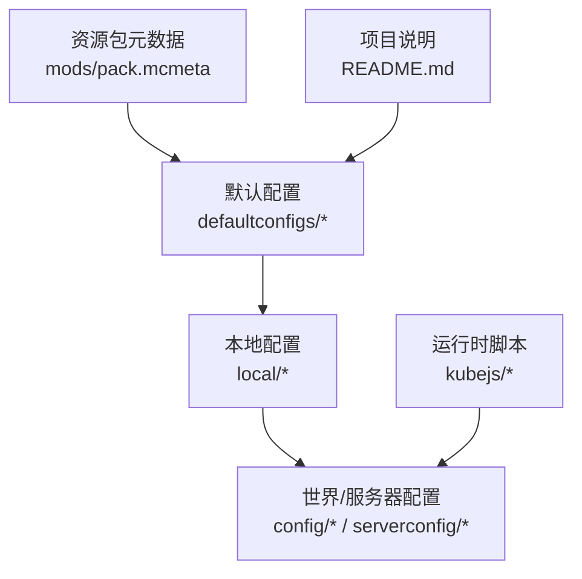
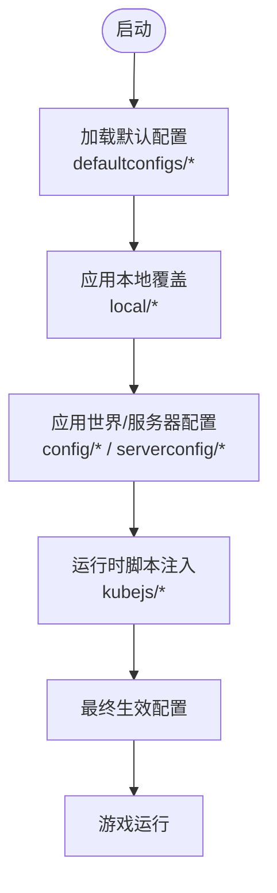
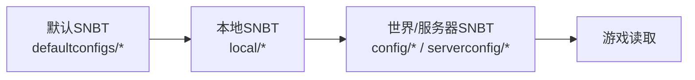
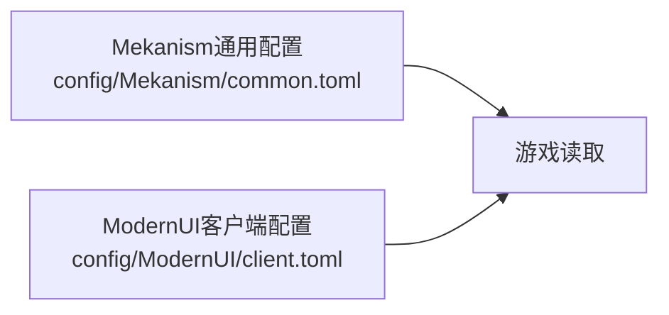
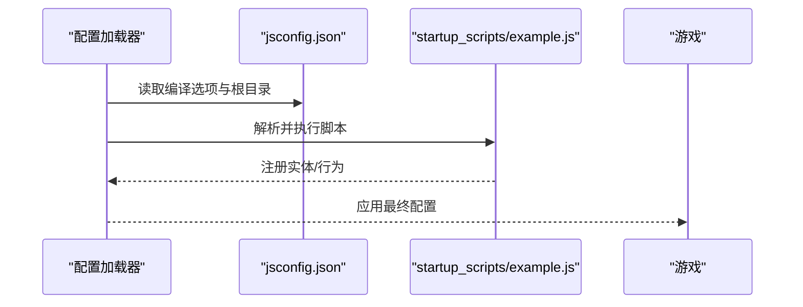
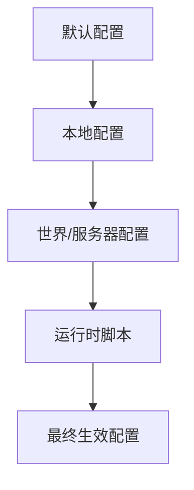

# 配置管理

<cite>
**本文引用的文件**
- [README.md](file://README.md)
- [pack.mcmeta](file://mods/pack.mcmeta)
- [defaultconfigs/ftblibrary/ftblibrary-client.snbt](file://defaultconfigs/ftblibrary/ftblibrary-client.snbt)
- [defaultconfigs/ftbquests/client-config.snbt](file://defaultconfigs/ftbquests/client-config.snbt)
- [defaultconfigs/dimdungeons-server.toml](file://defaultconfigs/dimdungeons-server.toml)
- [defaultconfigs/ftbessentials-server.snbt](file://defaultconfigs/ftbessentials-server.snbt)
- [defaultconfigs/sdmshop/sdmshop-common.snbt](file://defaultconfigs/sdmshop/sdmshop-common.snbt)
- [local/ftblibrary-client.snbt](file://local/ftblibrary-client.snbt)
- [local/ftbquests/client-config.snbt](file://local/ftbquests/client-config.snbt)
- [config/SDMShop/sdmshop-common.snbt](file://config/SDMShop/sdmshop-common.snbt)
- [config/Mekanism/common.toml](file://config/Mekanism/common.toml)
- [config/ModernUI/client.toml](file://config/ModernUI/client.toml)
- [kubejs/jsconfig.json](file://kubejs/jsconfig.json)
- [kubejs/startup_scripts/example.js](file://kubejs/startup_scripts/example.js)
</cite>

## 目录
1. [简介](#简介)
2. [项目结构](#项目结构)
3. [核心组件](#核心组件)
4. [架构总览](#架构总览)
5. [详细组件分析](#详细组件分析)
6. [依赖关系分析](#依赖关系分析)
7. [性能考量](#性能考量)
8. [故障排查指南](#故障排查指南)
9. [结论](#结论)
10. [附录](#附录)

## 简介
本文件面向管理员与开发者，系统化梳理该Minecraft版本中的配置管理体系，覆盖以下内容：
- 配置格式：SNBT（结构化命名二进制标记）、TOML（Tom’s Obvious, Minimal Language）以及KubeJS JavaScript配置。
- 加载顺序与优先级：默认配置、本地配置、世界/服务器配置、运行时脚本注入等。
- 继承与覆盖机制：如何通过复制默认配置并进行增量覆盖实现定制。
- 默认配置修改、运行时更新与配置验证方法。
- 性能优化、安全注意事项与版本兼容性处理。

## 项目结构
该版本的配置体系由多类配置文件组成，按来源与作用域分为：
- 默认配置（defaultconfigs）：随模组或版本发布，作为初始模板。
- 本地配置（local）：用户在单机客户端生效的覆盖层。
- 世界/服务器配置（config/world/serverconfig）：按世界或服务器生效的持久化配置。
- 运行时脚本（kubejs）：通过JavaScript在启动/服务端事件中动态注入或修改行为。

图表来源
- [defaultconfigs/ftblibrary/ftblibrary-client.snbt:1-5](file://defaultconfigs/ftblibrary/ftblibrary-client.snbt#L1-L5)
- [local/ftblibrary-client.snbt:1-24](file://local/ftblibrary-client.snbt#L1-L24)
- [config/SDMShop/sdmshop-common.snbt:1-24](file://config/SDMShop/sdmshop-common.snbt#L1-L24)
- [kubejs/jsconfig.json:1-16](file://kubejs/jsconfig.json#L1-L16)
- [pack.mcmeta:1-7](file://mods/pack.mcmeta#L1-L7)
- [README.md:1-6](file://README.md#L1-L6)

章节来源
- [README.md:1-6](file://README.md#L1-L6)
- [pack.mcmeta:1-7](file://mods/pack.mcmeta#L1-L7)

## 核心组件
- SNBT配置（结构化命名二进制标记）
  - 特点：键值对结构，支持注释与嵌套对象，常用于模组客户端/世界配置。
  - 示例：FTB Library客户端配置、FTB Quests客户端配置、SDM Shop通用配置、FTBEssentials服务器配置等。
- TOML配置（Tom’s Obvious, Minimal Language）
  - 特点：键=值，分节声明，适合数值、布尔、字符串与列表等标量配置。
  - 示例：Mekanism通用配置、ModernUI客户端配置等。
- KubeJS JavaScript配置
  - 特点：通过jsconfig.json组织源码目录，通过脚本在启动/服务端事件中注册实体、修改行为等。
  - 示例：jsconfig.json定义编译目标与根目录；startup_scripts/example.js展示实体注册流程。

章节来源
- [defaultconfigs/ftblibrary/ftblibrary-client.snbt:1-5](file://defaultconfigs/ftblibrary/ftblibrary-client.snbt#L1-L5)
- [defaultconfigs/ftbquests/client-config.snbt:1-5](file://defaultconfigs/ftbquests/client-config.snbt#L1-L5)
- [defaultconfigs/sdmshop/sdmshop-common.snbt:1-5](file://defaultconfigs/sdmshop/sdmshop-common.snbt#L1-L5)
- [defaultconfigs/ftbessentials-server.snbt:1-14](file://defaultconfigs/ftbessentials-server.snbt#L1-L14)
- [config/SDMShop/sdmshop-common.snbt:1-24](file://config/SDMShop/sdmshop-common.snbt#L1-L24)
- [config/Mekanism/common.toml:1-13](file://config/Mekanism/common.toml#L1-L13)
- [config/ModernUI/client.toml:1-168](file://config/ModernUI/client.toml#L1-L168)
- [kubejs/jsconfig.json:1-16](file://kubejs/jsconfig.json#L1-L16)
- [kubejs/startup_scripts/example.js:1-26](file://kubejs/startup_scripts/example.js#L1-L26)

## 架构总览
下图展示了从“默认配置”到“最终生效配置”的加载与覆盖路径，以及运行时脚本的介入时机。

图表来源
- [defaultconfigs/ftblibrary/ftblibrary-client.snbt:1-5](file://defaultconfigs/ftblibrary/ftblibrary-client.snbt#L1-L5)
- [local/ftblibrary-client.snbt:1-24](file://local/ftblibrary-client.snbt#L1-L24)
- [config/SDMShop/sdmshop-common.snbt:1-24](file://config/SDMShop/sdmshop-common.snbt#L1-L24)
- [kubejs/jsconfig.json:1-16](file://kubejs/jsconfig.json#L1-L16)

## 详细组件分析

### SNBT配置体系（FTB系列与通用）
- FTB Library客户端配置
  - 默认文件：defaultconfigs/ftblibrary/ftblibrary-client.snbt
  - 实际生效：local/ftblibrary-client.snbt
  - 覆盖方式：复制默认文件至本地后，仅修改需要变更的键值。
- FTB Quests客户端配置
  - 默认文件：defaultconfigs/ftbquests/client-config.snbt
  - 实际生效：local/ftbquests/client-config.snbt
- SDM Shop通用配置
  - 默认文件：defaultconfigs/sdmshop/sdmshop-common.snbt
  - 实际生效：config/SDMShop/sdmshop-common.snbt
- FTBEssentials服务器配置
  - 默认文件：defaultconfigs/ftbessentials-server.snbt
  - 实际生效：世界目录下的serverconfig/ftbessentials.snbt（路径示例见默认文件注释）

图表来源
- [defaultconfigs/ftblibrary/ftblibrary-client.snbt:1-5](file://defaultconfigs/ftblibrary/ftblibrary-client.snbt#L1-L5)
- [local/ftblibrary-client.snbt:1-24](file://local/ftblibrary-client.snbt#L1-L24)
- [defaultconfigs/ftbquests/client-config.snbt:1-5](file://defaultconfigs/ftbquests/client-config.snbt#L1-L5)
- [local/ftbquests/client-config.snbt](file://local/ftbquests/client-config.snbt)
- [defaultconfigs/sdmshop/sdmshop-common.snbt:1-5](file://defaultconfigs/sdmshop/sdmshop-common.snbt#L1-L5)
- [config/SDMShop/sdmshop-common.snbt:1-24](file://config/SDMShop/sdmshop-common.snbt#L1-L24)
- [defaultconfigs/ftbessentials-server.snbt:1-14](file://defaultconfigs/ftbessentials-server.snbt#L1-L14)

章节来源
- [defaultconfigs/ftblibrary/ftblibrary-client.snbt:1-5](file://defaultconfigs/ftblibrary/ftblibrary-client.snbt#L1-L5)
- [local/ftblibrary-client.snbt:1-24](file://local/ftblibrary-client.snbt#L1-L24)
- [defaultconfigs/ftbquests/client-config.snbt:1-5](file://defaultconfigs/ftbquests/client-config.snbt#L1-L5)
- [local/ftbquests/client-config.snbt](file://local/ftbquests/client-config.snbt)
- [defaultconfigs/sdmshop/sdmshop-common.snbt:1-5](file://defaultconfigs/sdmshop/sdmshop-common.snbt#L1-L5)
- [config/SDMShop/sdmshop-common.snbt:1-24](file://config/SDMShop/sdmshop-common.snbt#L1-L24)
- [defaultconfigs/ftbessentials-server.snbt:1-14](file://defaultconfigs/ftbessentials-server.snbt#L1-L14)

### TOML配置体系（Mekanism与ModernUI）
- Mekanism通用配置
  - 文件：config/Mekanism/common.toml
  - 典型键：能量单位、温度单位、衰变计时器开关等。
- ModernUI客户端配置
  - 文件：config/ModernUI/client.toml
  - 分节：screen、tooltip、general、view、font等，覆盖界面动画、模糊、字体、滚动等。

图表来源
- [config/Mekanism/common.toml:1-13](file://config/Mekanism/common.toml#L1-L13)
- [config/ModernUI/client.toml:1-168](file://config/ModernUI/client.toml#L1-L168)

章节来源
- [config/Mekanism/common.toml:1-13](file://config/Mekanism/common.toml#L1-L13)
- [config/ModernUI/client.toml:1-168](file://config/ModernUI/client.toml#L1-L168)

### KubeJS JavaScript配置与运行时注入
- 编译与根目录
  - jsconfig.json定义了ES目标、库与多个rootDirs，确保脚本可被正确解析与编译。
- 启动/服务端事件
  - startup_scripts/example.js演示了实体注册与模型/纹理绑定的典型流程，表明配置可通过脚本在运行时影响游戏行为。

图表来源
- [kubejs/jsconfig.json:1-16](file://kubejs/jsconfig.json#L1-L16)
- [kubejs/startup_scripts/example.js:1-26](file://kubejs/startup_scripts/example.js#L1-L26)

章节来源
- [kubejs/jsconfig.json:1-16](file://kubejs/jsconfig.json#L1-L16)
- [kubejs/startup_scripts/example.js:1-26](file://kubejs/startup_scripts/example.js#L1-L26)

## 依赖关系分析
- 配置来源依赖
  - 默认配置是所有后续覆盖的基础模板。
  - 本地配置优先于默认配置生效。
  - 世界/服务器配置进一步覆盖本地与默认配置。
  - 运行时脚本在配置加载完成后注入，可能动态改变部分行为。
- 模块间耦合
  - 不同模组的配置相互独立，但共同参与最终的游戏体验。
  - KubeJS脚本与配置解耦，通过事件钩子影响行为而非直接替代配置文件。

图表来源
- [defaultconfigs/ftblibrary/ftblibrary-client.snbt:1-5](file://defaultconfigs/ftblibrary/ftblibrary-client.snbt#L1-L5)
- [local/ftblibrary-client.snbt:1-24](file://local/ftblibrary-client.snbt#L1-L24)
- [config/SDMShop/sdmshop-common.snbt:1-24](file://config/SDMShop/sdmshop-common.snbt#L1-L24)
- [kubejs/jsconfig.json:1-16](file://kubejs/jsconfig.json#L1-L16)

## 性能考量
- SNBT配置
  - 嵌套层级不宜过深，避免过大文件导致读写开销。
  - 仅覆盖必要字段，减少冗余键值。
- TOML配置
  - 大列表项（如黑名单/白名单）应保持精简，避免频繁匹配带来的CPU消耗。
  - 合理设置日志级别，降低不必要的日志输出。
- 运行时脚本
  - 避免在每tick执行昂贵操作，尽量缓存结果或延迟计算。
  - 使用事件钩子进行一次性初始化，减少重复注册。

## 故障排查指南
- 配置未生效
  - 检查是否已将默认配置复制到正确的本地/世界/服务器路径。
  - 确认键名拼写与数据类型一致（例如布尔/字符串/整数）。
- TOML语法错误
  - 注意分节与键值对格式，避免遗漏引号或逗号。
- SNBT结构异常
  - 确保大括号与数组闭合，避免注释位置不当导致解析失败。
- 运行时脚本问题
  - 查看脚本根目录与编译目标是否匹配，确保模块可被正确解析。
  - 关注事件回调中的异常日志，定位注册失败原因。

## 结论
本版本的配置体系采用“默认模板+本地覆盖+世界/服务器持久化+运行时脚本注入”的分层设计，既保证了易用性，又提供了足够的灵活性。通过遵循本文的加载顺序、覆盖策略与最佳实践，管理员与开发者可以高效地完成配置管理，并在性能、安全与兼容性之间取得平衡。

## 附录
- 安装与基础信息
  - 项目说明与版本要求参见README.md。
  - 资源包元数据pack.mcmeta可用于描述资源包与版本信息。

章节来源
- [README.md:1-6](file://README.md#L1-L6)
- [pack.mcmeta:1-7](file://mods/pack.mcmeta#L1-L7)