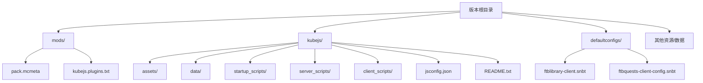
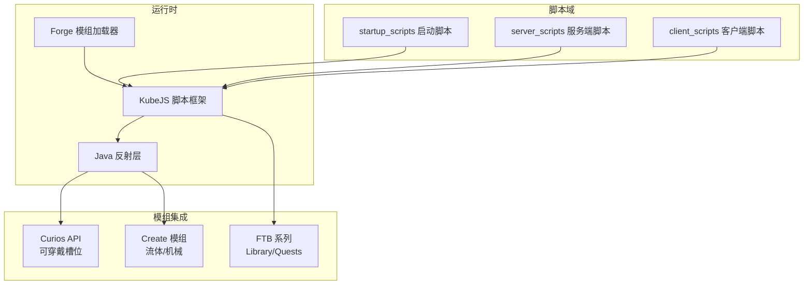
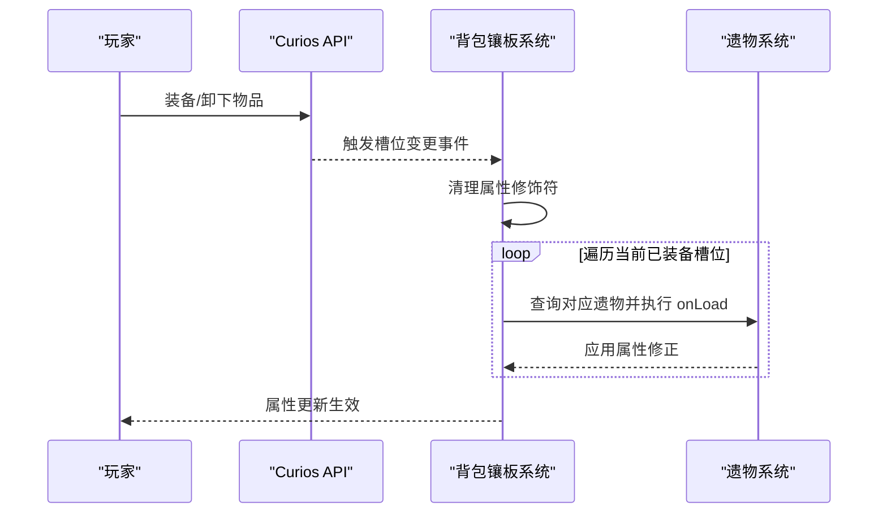
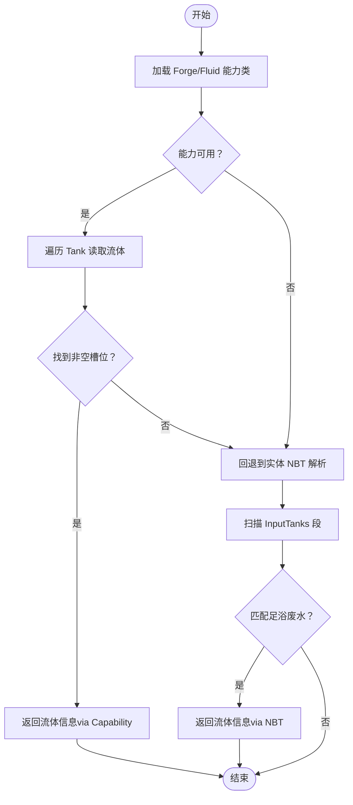
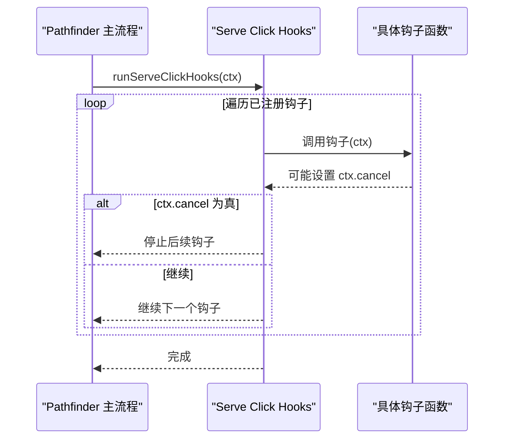
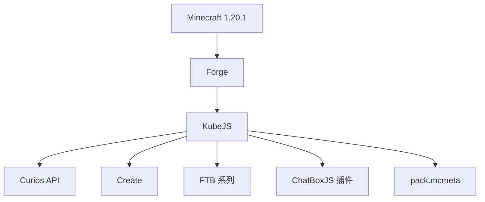

# 技术栈

<cite>
**本文引用的文件**
- [README.md](file://README.md)
- [kubejs/README.txt](file://kubejs/README.txt)
- [kubejs/jsconfig.json](file://kubejs/jsconfig.json)
- [mods/pack.mcmeta](file://mods/pack.mcmeta)
- [mods/kubejs.plugins.txt](file://mods/kubejs.plugins.txt)
- [kubejs/server_scripts/backpack/backpackInit.js](file://kubejs/server_scripts/backpack/backpackInit.js)
- [kubejs/server_scripts/backpack/backpackUpdate.js](file://kubejs/server_scripts/backpack/backpackUpdate.js)
- [kubejs/startup_scripts/relic/relic.js](file://kubejs/startup_scripts/relic/relic.js)
- [kubejs/startup_scripts/relic/relicHelpers.js](file://kubejs/startup_scripts/relic/relicHelpers.js)
- [kubejs/server_scripts/pathfinder/pfBasinSoakManager.js](file://kubejs/server_scripts/pathfinder/pfBasinSoakManager.js)
- [kubejs/startup_scripts/attributes/serveAttributes.js](file://kubejs/startup_scripts/attributes/serveAttributes.js)
- [kubejs/startup_scripts/serveHooks.js](file://kubejs/startup_scripts/serveHooks.js)
- [kubejs/assets/curios/lang/zh_cn.json](file://kubejs/assets/curios/lang/zh_cn.json)
- [defaultconfigs/ftblibrary/ftblibrary-client.snbt](file://defaultconfigs/ftblibrary/ftblibrary-client.snbt)
- [defaultconfigs/ftbquests/client-config.snbt](file://defaultconfigs/ftbquests/client-config.snbt)
</cite>

## 目录
1. [简介](#简介)
2. [项目结构](#项目结构)
3. [核心组件](#核心组件)
4. [架构总览](#架构总览)
5. [详细组件分析](#详细组件分析)
6. [依赖分析](#依赖分析)
7. [性能考虑](#性能考虑)
8. [故障排查指南](#故障排查指南)
9. [结论](#结论)
10. [附录](#附录)

## 简介
本项目是一个基于 Minecraft 1.20.1 的模组化内容扩展，采用 JavaScript 作为主要脚本语言，通过 KubeJS 模组框架实现服务端/客户端逻辑与资源数据的动态扩展，并与 Forge 模组加载器协同运行。项目围绕“服务玩法”（Serve Gameplay）展开，结合 Curios API 实现可穿戴的“背包镶板”系统，利用 Create 模组的流体处理能力实现足浴与废水处理机制，并通过 FTB 系列模组（如 FTB Library、FTB Quests）提供任务与界面支持。

此外，项目还包含自定义 UI 组件（如足浴 HUD、电话 UI、耐力 HUD）、对话框系统（Marguerite、SkyFootspa 等）以及大量配方与数据生成脚本，形成一个以 JavaScript 为中心、多模组协作的综合扩展方案。

## 项目结构
项目采用 KubeJS 的标准目录组织方式，同时包含默认配置与资源文件：
- 根目录提供安装说明与版本元数据
- kubejs 目录包含资源（assets）与数据（data）、脚本（server_scripts、client_scripts、startup_scripts）
- defaultconfigs 提供 FTB 系列模组的默认配置模板
- mods 目录包含模组元数据与插件声明
- 其他子目录用于特定功能的数据导出与构建产物

图表来源
- [mods/pack.mcmeta:1-7](file://mods/pack.mcmeta#L1-L7)
- [mods/kubejs.plugins.txt:1-1](file://mods/kubejs.plugins.txt#L1-L1)
- [kubejs/README.txt:1-15](file://kubejs/README.txt#L1-L15)
- [kubejs/jsconfig.json:1-16](file://kubejs/jsconfig.json#L1-L16)
- [defaultconfigs/ftblibrary/ftblibrary-client.snbt:1-5](file://defaultconfigs/ftblibrary/ftblibrary-client.snbt#L1-L5)
- [defaultconfigs/ftbquests/client-config.snbt:1-5](file://defaultconfigs/ftbquests/client-config.snbt#L1-L5)

章节来源
- [README.md:1-6](file://README.md#L1-L6)
- [kubejs/README.txt:1-15](file://kubejs/README.txt#L1-L15)
- [kubejs/jsconfig.json:1-16](file://kubejs/jsconfig.json#L1-L16)
- [mods/pack.mcmeta:1-7](file://mods/pack.mcmeta#L1-L7)
- [mods/kubejs.plugins.txt:1-1](file://mods/kubejs.plugins.txt#L1-L1)
- [defaultconfigs/ftblibrary/ftblibrary-client.snbt:1-5](file://defaultconfigs/ftblibrary/ftblibrary-client.snbt#L1-L5)
- [defaultconfigs/ftbquests/client-config.snbt:1-5](file://defaultconfigs/ftbquests/client-config.snbt#L1-L5)

## 核心组件
- JavaScript 编程语言与 ES2015 目标
  - 项目使用 ES5/ES2015 作为编译目标，脚本根目录覆盖 probe、server_scripts、startup_scripts、client_scripts 等路径，确保 IDE 与类型提示可用。
- KubeJS 模组框架
  - 作为资源包与数据包的统一入口，提供资源与数据的动态生成与覆盖能力；支持启动阶段、服务端与客户端脚本的生命周期管理。
- Forge 模组加载器
  - 作为底层平台，提供事件系统、注册表、能力系统（Capabilities）与流体处理接口，KubeJS 通过 Java 反射与 Forge API 协作。
- Curios API
  - 提供可穿戴“背包镶板”槽位系统，配合 KubeJS 的物品与能力注册，实现属性增益与动态重算。
- Create 模组
  - 提供流体处理与机械交互，KubeJS 通过 Forge 能力系统读取 Create Basin 的流体槽位状态，实现足浴与废水处理逻辑。
- FTB 系列模组
  - FTB Library 与 FTB Quests 提供界面与任务系统支持，项目包含其默认配置模板以便快速部署。

章节来源
- [kubejs/jsconfig.json:1-16](file://kubejs/jsconfig.json#L1-L16)
- [kubejs/README.txt:1-15](file://kubejs/README.txt#L1-L15)
- [kubejs/server_scripts/backpack/backpackInit.js:1-35](file://kubejs/server_scripts/backpack/backpackInit.js#L1-L35)
- [kubejs/server_scripts/backpack/backpackUpdate.js:1-72](file://kubejs/server_scripts/backpack/backpackUpdate.js#L1-L72)
- [kubejs/server_scripts/pathfinder/pfBasinSoakManager.js:25-55](file://kubejs/server_scripts/pathfinder/pfBasinSoakManager.js#L25-L55)
- [kubejs/assets/curios/lang/zh_cn.json:1-4](file://kubejs/assets/curios/lang/zh_cn.json#L1-L4)
- [defaultconfigs/ftblibrary/ftblibrary-client.snbt:1-5](file://defaultconfigs/ftblibrary/ftblibrary-client.snbt#L1-L5)
- [defaultconfigs/ftbquests/client-config.snbt:1-5](file://defaultconfigs/ftbquests/client-config.snbt#L1-L5)

## 架构总览
项目整体架构围绕“KubeJS 脚本层 + Forge 平台 + 多模组集成”展开。KubeJS 负责业务逻辑与资源数据生成，Forge 提供底层事件与能力接口，Curios 与 Create 分别负责可穿戴槽位与流体处理，FTB 系列提供任务与界面支持。

图表来源
- [kubejs/README.txt:1-15](file://kubejs/README.txt#L1-L15)
- [kubejs/server_scripts/backpack/backpackInit.js:17-35](file://kubejs/server_scripts/backpack/backpackInit.js#L17-L35)
- [kubejs/server_scripts/pathfinder/pfBasinSoakManager.js:25-55](file://kubejs/server_scripts/pathfinder/pfBasinSoakManager.js#L25-L55)
- [kubejs/startup_scripts/relic/relic.js:1-30](file://kubejs/startup_scripts/relic/relic.js#L1-L30)
- [mods/kubejs.plugins.txt:1-1](file://mods/kubejs.plugins.txt#L1-L1)

## 详细组件分析

### 组件一：Curios 集成与背包镶板系统
- 功能概述
  - 通过 Curios API 为玩家提供可穿戴的“背包镶板”槽位，初始布局为 6×9 矩阵，随玩家登录一次性填充。
  - 当玩家装备或卸下物品时，触发属性重算，清理旧修饰符并根据当前装备重新应用效果。
- 关键实现要点
  - 使用 Java.loadClass 加载 CuriosApi，获取 CuriosHelper 并查询已装备槽位。
  - 在背包初始化脚本中，按预设矩阵填充指定槽位；在属性重算脚本中，清空指定属性的修饰符并重新叠加。
  - 遗物物品通过 attachCuriosCapability 注册“装备/卸下”回调，在回调中调用更新函数与自定义逻辑。
- 数据与资源
  - Curios 本地化词条位于 assets/curios/lang/zh_cn.json，定义槽位标识与修饰语。

图表来源
- [kubejs/server_scripts/backpack/backpackUpdate.js:39-72](file://kubejs/server_scripts/backpack/backpackUpdate.js#L39-L72)
- [kubejs/server_scripts/backpack/backpackInit.js:29-35](file://kubejs/server_scripts/backpack/backpackInit.js#L29-L35)
- [kubejs/startup_scripts/relic/relic.js:13-28](file://kubejs/startup_scripts/relic/relic.js#L13-L28)
- [kubejs/assets/curios/lang/zh_cn.json:1-4](file://kubejs/assets/curios/lang/zh_cn.json#L1-L4)

章节来源
- [kubejs/server_scripts/backpack/backpackInit.js:1-35](file://kubejs/server_scripts/backpack/backpackInit.js#L1-L35)
- [kubejs/server_scripts/backpack/backpackUpdate.js:1-72](file://kubejs/server_scripts/backpack/backpackUpdate.js#L1-L72)
- [kubejs/startup_scripts/relic/relic.js:1-30](file://kubejs/startup_scripts/relic/relic.js#L1-L30)
- [kubejs/startup_scripts/relic/relicHelpers.js:326-331](file://kubejs/startup_scripts/relic/relicHelpers.js#L326-L331)
- [kubejs/assets/curios/lang/zh_cn.json:1-4](file://kubejs/assets/curios/lang/zh_cn.json#L1-L4)

### 组件二：Create 流体处理与足浴废水管理
- 功能概述
  - 通过 Forge 能力系统读取 Create Basin 的流体槽位，定位足浴废水并进行替换或拦截处理。
  - 支持两种路径：优先使用 Forge 能力接口直接读取槽位信息，若失败则回退到解析方块实体 NBT 文本。
- 关键实现要点
  - 使用 Java.loadClass 加载 BlockPos、ResourceLocation、ForgeRegistries、ForgeCapabilities、FluidStack、FluidAction 等类。
  - 通过 capability 获取 Tank 数量与流体信息，定位第一个非空槽位；若为空则回退到正则扫描实体 NBT。
  - 对 Create Basin 的槽位顺序进行适配，避免直接使用 capability 返回的索引导致写入位置错误。

图表来源
- [kubejs/server_scripts/pathfinder/pfBasinSoakManager.js:25-55](file://kubejs/server_scripts/pathfinder/pfBasinSoakManager.js#L25-L55)
- [kubejs/server_scripts/pathfinder/pfBasinSoakManager.js:86-197](file://kubejs/server_scripts/pathfinder/pfBasinSoakManager.js#L86-L197)

章节来源
- [kubejs/server_scripts/pathfinder/pfBasinSoakManager.js:25-55](file://kubejs/server_scripts/pathfinder/pfBasinSoakManager.js#L25-L55)
- [kubejs/server_scripts/pathfinder/pfBasinSoakManager.js:86-197](file://kubejs/server_scripts/pathfinder/pfBasinSoakManager.js#L86-L197)

### 组件三：服务玩法属性系统与点击钩子
- 功能概述
  - 注册自定义属性（满意度增量、金钱增量、体力消耗），按脚部部位分组，支持通过遗物等途径修改。
  - 提供“点击结算 Hook”框架，将复杂逻辑拆分为多个独立钩子，按序执行并在必要时取消后续流程。
- 关键实现要点
  - 使用 RangedAttribute 创建自定义属性，并在 EntityAttributeModificationEvent 中确保玩家拥有这些属性。
  - 通过全局数组维护钩子函数，提供注册与执行接口，支持在点击结算等关键节点插入额外逻辑。

图表来源
- [kubejs/startup_scripts/serveHooks.js:19-31](file://kubejs/startup_scripts/serveHooks.js#L19-L31)
- [kubejs/startup_scripts/attributes/serveAttributes.js:27-53](file://kubejs/startup_scripts/attributes/serveAttributes.js#L27-L53)

章节来源
- [kubejs/startup_scripts/attributes/serveAttributes.js:1-53](file://kubejs/startup_scripts/attributes/serveAttributes.js#L1-L53)
- [kubejs/startup_scripts/serveHooks.js:1-31](file://kubejs/startup_scripts/serveHooks.js#L1-L31)

### 组件四：FTB 系列模组集成
- 功能概述
  - 通过 defaultconfigs 目录提供 FTB Library 与 FTB Quests 的默认客户端配置模板，便于快速部署与一致性管理。
- 关键实现要点
  - 配置文件以 SNBT 格式提供，未存在时会复制到本地配置路径，支持按需覆盖。

章节来源
- [defaultconfigs/ftblibrary/ftblibrary-client.snbt:1-5](file://defaultconfigs/ftblibrary/ftblibrary-client.snbt#L1-L5)
- [defaultconfigs/ftbquests/client-config.snbt:1-5](file://defaultconfigs/ftbquests/client-config.snbt#L1-L5)

## 依赖分析
- 技术栈依赖
  - Minecraft 1.20.1：项目明确要求的运行版本。
  - Forge：提供事件系统、注册表与能力接口，KubeJS 通过 Java 反射与其交互。
  - KubeJS：统一资源与数据扩展入口，管理脚本生命周期。
  - Curios API：提供可穿戴槽位能力，与 KubeJS 物品与能力注册配合。
  - Create：提供流体处理与机械交互，KubeJS 通过 Forge 能力系统读取状态。
  - FTB 系列：提供任务与界面支持，使用默认配置模板进行部署。
- 插件与元数据
  - pack.mcmeta 描述资源包元信息。
  - kubejs.plugins.txt 声明 ChatBoxJS 插件，扩展 KubeJS 能力。

图表来源
- [README.md:3-3](file://README.md#L3-L3)
- [mods/pack.mcmeta:1-7](file://mods/pack.mcmeta#L1-L7)
- [mods/kubejs.plugins.txt:1-1](file://mods/kubejs.plugins.txt#L1-L1)

章节来源
- [README.md:3-3](file://README.md#L3-L3)
- [mods/pack.mcmeta:1-7](file://mods/pack.mcmeta#L1-L7)
- [mods/kubejs.plugins.txt:1-1](file://mods/kubejs.plugins.txt#L1-L1)

## 性能考虑
- 脚本重载与缓存
  - 启动脚本与服务端脚本支持重载，但部分启动阶段内容可能无法完全重载，建议在开发阶段谨慎使用重载命令。
- 属性重算优化
  - 在更新玩家属性时，先清理已有修饰符再重新叠加，避免重复叠加导致数值膨胀；按需遍历 Curios 槽位，减少无效操作。
- 能力读取降级
  - 当 Forge 能力接口不可用时，回退到实体 NBT 文本扫描，保证功能可用性，但会增加字符串处理成本，建议优先修复能力接口问题。

## 故障排查指南
- 安装与版本
  - 确保使用 1.20.1 客户端并安装最新 Forge，避免版本不一致导致的兼容性问题。
- KubeJS 脚本重载
  - 若启动脚本重载失败，尝试重启游戏或检查脚本中是否存在不可重载的注册逻辑。
- Curios 槽位异常
  - 若背包镶板未正确填充或属性未生效，检查 Curios API 是否正常加载，确认初始化脚本与属性重算脚本是否执行。
- Create 流体读取失败
  - 若无法读取 Basin 槽位信息，检查 Forge 能力类是否成功加载；若失败，确认 Create 版本与 Forge 版本兼容性。
- FTB 配置未生效
  - 检查 defaultconfigs 中的 SNBT 文件是否正确复制到本地配置路径，确认客户端/服务端配置同步。

章节来源
- [README.md:3-3](file://README.md#L3-L3)
- [kubejs/README.txt:8-11](file://kubejs/README.txt#L8-L11)
- [kubejs/server_scripts/backpack/backpackInit.js:29-35](file://kubejs/server_scripts/backpack/backpackInit.js#L29-L35)
- [kubejs/server_scripts/backpack/backpackUpdate.js:44-51](file://kubejs/server_scripts/backpack/backpackUpdate.js#L44-L51)
- [kubejs/server_scripts/pathfinder/pfBasinSoakManager.js:25-55](file://kubejs/server_scripts/pathfinder/pfBasinSoakManager.js#L25-L55)
- [defaultconfigs/ftblibrary/ftblibrary-client.snbt:1-5](file://defaultconfigs/ftblibrary/ftblibrary-client.snbt#L1-L5)
- [defaultconfigs/ftbquests/client-config.snbt:1-5](file://defaultconfigs/ftbquests/client-config.snbt#L1-L5)

## 结论
本项目以 JavaScript 为核心，借助 KubeJS 在 Forge 平台上实现了丰富的服务玩法扩展。通过与 Curios API、Create 模组及 FTB 系列模组的深度集成，项目形成了从可穿戴槽位、流体处理到任务与界面的完整生态。开发过程中应重点关注版本兼容性、脚本重载策略与能力接口的稳定性，以确保功能的可靠运行与良好的开发体验。

## 附录
- 开发环境配置
  - 使用 ES5/ES2015 目标与相应 rootDirs，确保 IDE 能识别脚本路径并提供类型提示。
- 依赖管理策略
  - 通过 pack.mcmeta 与 kubejs.plugins.txt 明确资源包与插件信息，避免遗漏关键元数据。
- 技术选型背景
  - 选择 KubeJS 作为脚本层，兼顾易用性与扩展性；选择 Forge 作为底层平台，获得稳定的事件与能力体系；选择 Curios 与 Create 作为可穿戴与流体处理的成熟解决方案；选择 FTB 系列提升任务与界面体验。

章节来源
- [kubejs/jsconfig.json:1-16](file://kubejs/jsconfig.json#L1-L16)
- [mods/pack.mcmeta:1-7](file://mods/pack.mcmeta#L1-L7)
- [mods/kubejs.plugins.txt:1-1](file://mods/kubejs.plugins.txt#L1-L1)