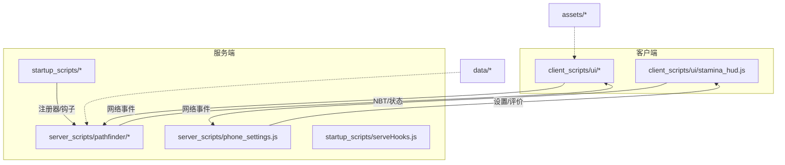
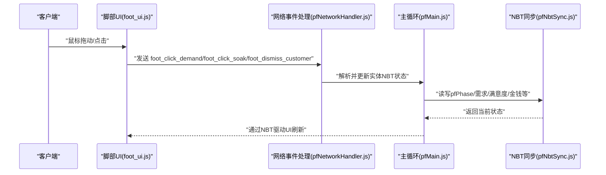
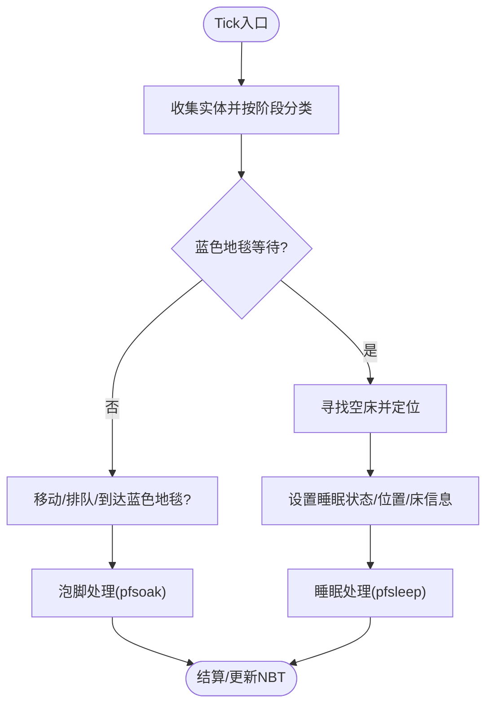
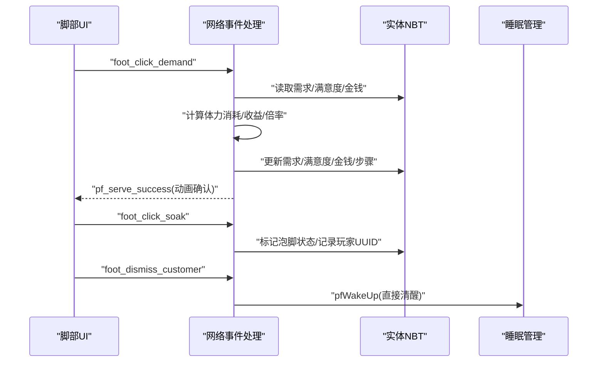
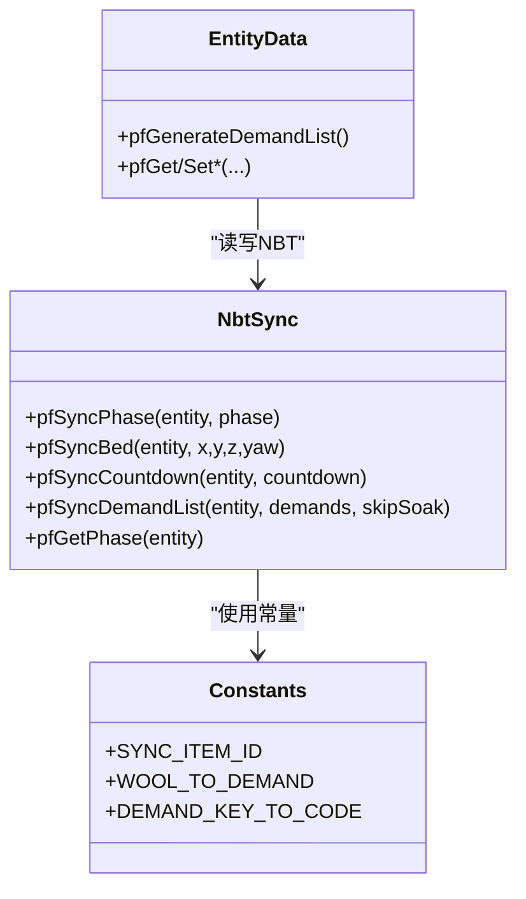
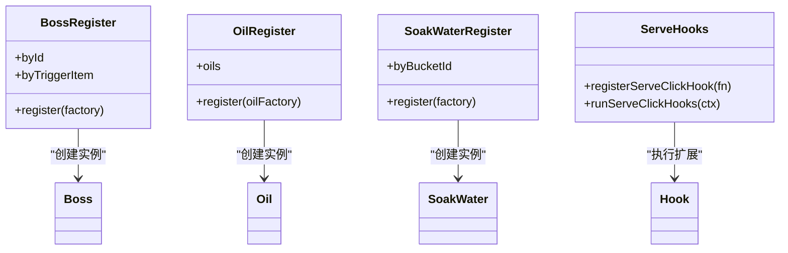
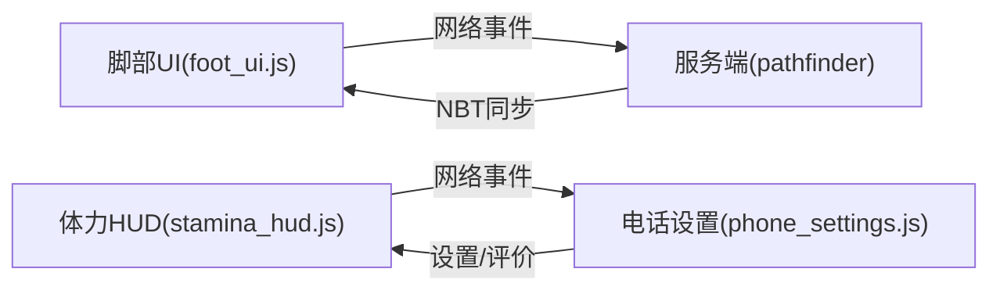
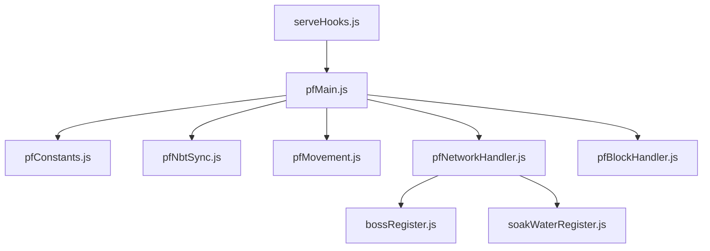

# 架构概览

<cite>
**本文引用的文件**
- [kubejs/README.txt](file://kubejs/README.txt)
- [kubejs/server_scripts/pathfinder.js](file://kubejs/server_scripts/pathfinder.js)
- [kubejs/server_scripts/pathfinder/pfMain.js](file://kubejs/server_scripts/pathfinder/pfMain.js)
- [kubejs/server_scripts/pathfinder/pfNetworkHandler.js](file://kubejs/server_scripts/pathfinder/pfNetworkHandler.js)
- [kubejs/server_scripts/pathfinder/pfConstants.js](file://kubejs/server_scripts/pathfinder/pfConstants.js)
- [kubejs/server_scripts/pathfinder/pfNbtSync.js](file://kubejs/server_scripts/pathfinder/pfNbtSync.js)
- [kubejs/server_scripts/pathfinder/pfEntityData.js](file://kubejs/server_scripts/pathfinder/pfEntityData.js)
- [kubejs/server_scripts/pathfinder/pfMovement.js](file://kubejs/server_scripts/pathfinder/pfMovement.js)
- [kubejs/server_scripts/pathfinder/pfBlockHandler.js](file://kubejs/server_scripts/pathfinder/pfBlockHandler.js)
- [kubejs/server_scripts/phone_settings.js](file://kubejs/server_scripts/phone_settings.js)
- [kubejs/client_scripts/ui/foot_ui.js](file://kubejs/client_scripts/ui/foot_ui.js)
- [kubejs/client_scripts/ui/stamina_hud.js](file://kubejs/client_scripts/ui/stamina_hud.js)
- [kubejs/startup_scripts/serveHooks.js](file://kubejs/startup_scripts/serveHooks.js)
- [kubejs/startup_scripts/block/pathfinder.js](file://kubejs/startup_scripts/block/pathfinder.js)
- [kubejs/startup_scripts/oil/oilRegister.js](file://kubejs/startup_scripts/oil/oilRegister.js)
- [kubejs/startup_scripts/soakwater/soakWaterRegister.js](file://kubejs/startup_scripts/soakwater/soakWaterRegister.js)
- [kubejs/startup_scripts/boss/bossRegister.js](file://kubejs/startup_scripts/boss/bossRegister.js)
- [kubejs/startup_scripts/example.js](file://kubejs/startup_scripts/example.js)
</cite>

## 目录
1. [引言](#引言)
2. [项目结构](#项目结构)
3. [核心组件](#核心组件)
4. [架构总览](#架构总览)
5. [详细组件分析](#详细组件分析)
6. [依赖关系分析](#依赖关系分析)
7. [性能考虑](#性能考虑)
8. [故障排查指南](#故障排查指南)
9. [结论](#结论)

## 引言
本项目基于 KubeJS 框架构建，采用服务端-客户端分离、模块化组件设计与事件驱动架构。系统围绕“寻路与服务”主线，通过注册器模式统一管理各类内容（如 Boss、Oil、洗脚水等），通过钩子系统实现扩展点注入，通过 NBT 同步与网络事件实现状态流转与交互。本文档旨在帮助开发者快速理解整体架构与数据流，明确模块边界与交互关系。

## 项目结构
KubeJS 项目遵循约定式目录组织：
- assets：资源包，存放客户端纹理、模型、声音等
- data：数据包，存放服务端规则、战利品表、函数等
- startup_scripts：启动阶段脚本，仅在游戏加载时执行一次
- server_scripts：服务器资源重载时执行，处理事件与逻辑
- client_scripts：客户端资源重载时执行，处理 UI 与事件
- config/exported：配置与导出数据

图表来源
- [kubejs/README.txt:1-15](file://kubejs/README.txt#L1-L15)
- [kubejs/server_scripts/pathfinder.js:1-29](file://kubejs/server_scripts/pathfinder.js#L1-L29)
- [kubejs/client_scripts/ui/foot_ui.js:1-800](file://kubejs/client_scripts/ui/foot_ui.js#L1-L800)

章节来源
- [kubejs/README.txt:1-15](file://kubejs/README.txt#L1-L15)

## 核心组件
- 寻路系统（pathfinder）：模块化主循环，负责实体收集、移动、排队、睡眠、泡脚、结算等
- 网络事件处理：接收客户端点击与交互，驱动服务端状态变更
- NBT 同步：以实体主手物品为载体进行状态同步
- 注册器模式：统一注册 Boss、Oil、洗脚水等定义
- 钩子系统：在关键节点注入扩展逻辑
- 客户端 UI：基于 WorldWindow 的 3D UI 与 HUD

章节来源
- [kubejs/server_scripts/pathfinder/pfMain.js:1-177](file://kubejs/server_scripts/pathfinder/pfMain.js#L1-L177)
- [kubejs/server_scripts/pathfinder/pfNetworkHandler.js:1-317](file://kubejs/server_scripts/pathfinder/pfNetworkHandler.js#L1-L317)
- [kubejs/server_scripts/pathfinder/pfNbtSync.js:1-94](file://kubejs/server_scripts/pathfinder/pfNbtSync.js#L1-L94)
- [kubejs/startup_scripts/serveHooks.js:1-31](file://kubejs/startup_scripts/serveHooks.js#L1-L31)
- [kubejs/startup_scripts/boss/bossRegister.js:1-28](file://kubejs/startup_scripts/boss/bossRegister.js#L1-L28)
- [kubejs/startup_scripts/oil/oilRegister.js:1-60](file://kubejs/startup_scripts/oil/oilRegister.js#L1-L60)
- [kubejs/startup_scripts/soakwater/soakWaterRegister.js:113-120](file://kubejs/startup_scripts/soakwater/soakWaterRegister.js#L113-L120)

## 架构总览
系统采用“事件驱动 + 状态管理 + 模块化”的设计：
- 服务端 Tick 驱动：由触发方块实体每 tick 调用主循环，按阶段推进实体状态
- 事件驱动交互：客户端通过网络事件发送点击/泡脚/送客等请求，服务端处理并更新状态
- 状态管理：以实体主手物品 NBT 为核心，承载需求、满意度、金钱、倒计时等状态
- 模块化：将寻路、床铺、实体数据、睡眠、移动、网络处理等拆分为独立模块
- 注册器与钩子：统一注册内容定义，关键节点注入扩展逻辑

图表来源
- [kubejs/client_scripts/ui/foot_ui.js:1-800](file://kubejs/client_scripts/ui/foot_ui.js#L1-L800)
- [kubejs/server_scripts/pathfinder/pfNetworkHandler.js:1-317](file://kubejs/server_scripts/pathfinder/pfNetworkHandler.js#L1-L317)
- [kubejs/server_scripts/pathfinder/pfMain.js:1-177](file://kubejs/server_scripts/pathfinder/pfMain.js#L1-L177)
- [kubejs/server_scripts/pathfinder/pfNbtSync.js:1-94](file://kubejs/server_scripts/pathfinder/pfNbtSync.js#L1-L94)

## 详细组件分析

### 寻路系统（模块化主循环）
- 主入口：pathfinder.js 作为兼容层，实际主循环定义在 pfMain.js
- 模块职责：
  - pfConstants：集中常量（同步物品ID、方向、需求键映射等）
  - pfNbtSync：NBT 同步工具（设置/读取阶段、床位、倒计时、需求清单等）
  - pfMovement：实体收集、分类、排队与移动
  - pfNetworkHandler：网络事件处理（点击、泡脚、送客）
  - pfBlockHandler：方块事件（右键触发、凭证/Boss 分支）
- 数据流：Tick 驱动 → 实体收集 → 蓝色地毯等待 → 躺床睡眠 → 泡脚 → 结算

图表来源
- [kubejs/server_scripts/pathfinder/pfMain.js:1-177](file://kubejs/server_scripts/pathfinder/pfMain.js#L1-L177)
- [kubejs/server_scripts/pathfinder/pfMovement.js:1-36](file://kubejs/server_scripts/pathfinder/pfMovement.js#L1-L36)
- [kubejs/server_scripts/pathfinder/pfNbtSync.js:1-94](file://kubejs/server_scripts/pathfinder/pfNbtSync.js#L1-L94)

章节来源
- [kubejs/server_scripts/pathfinder.js:1-29](file://kubejs/server_scripts/pathfinder.js#L1-L29)
- [kubejs/server_scripts/pathfinder/pfMain.js:1-177](file://kubejs/server_scripts/pathfinder/pfMain.js#L1-L177)
- [kubejs/server_scripts/pathfinder/pfMovement.js:1-36](file://kubejs/server_scripts/pathfinder/pfMovement.js#L1-L36)

### 网络事件处理（客户端-服务端交互）
- 客户端事件：
  - foot_click_demand：点击部位，按属性消耗体力，更新需求与满意度/金钱
  - foot_click_soak：手持水桶开始泡脚，记录操作玩家UUID
  - foot_dismiss_customer：直接送客，跳过结算
  - stamina_request：请求体力值，周期性同步
- 服务端处理：
  - 解析实体与部位，计算消耗与收益
  - 应用 Boss 满意度倍率
  - 更新 NBT 并回传 UI 动画确认

图表来源
- [kubejs/client_scripts/ui/foot_ui.js:1-800](file://kubejs/client_scripts/ui/foot_ui.js#L1-L800)
- [kubejs/server_scripts/pathfinder/pfNetworkHandler.js:1-317](file://kubejs/server_scripts/pathfinder/pfNetworkHandler.js#L1-L317)

章节来源
- [kubejs/server_scripts/pathfinder/pfNetworkHandler.js:1-317](file://kubejs/server_scripts/pathfinder/pfNetworkHandler.js#L1-L317)
- [kubejs/client_scripts/ui/foot_ui.js:1-800](file://kubejs/client_scripts/ui/foot_ui.js#L1-L800)

### NBT 同步与状态管理
- 同步载体：实体主手物品（默认红石纸），NBT 自动同步至客户端
- 关键状态：
  - pfPhase：阶段（行走/躺床/等待等）
  - 需求清单：脚掌/脚后跟/脚趾/脚心
  - 满意度/金钱/倒计时/泡脚状态
- 读写接口：pfNbtSync 提供统一 set/get 方法，pfEntityData 提供实体数据封装

图表来源
- [kubejs/server_scripts/pathfinder/pfNbtSync.js:1-94](file://kubejs/server_scripts/pathfinder/pfNbtSync.js#L1-L94)
- [kubejs/server_scripts/pathfinder/pfEntityData.js:178-217](file://kubejs/server_scripts/pathfinder/pfEntityData.js#L178-L217)
- [kubejs/server_scripts/pathfinder/pfConstants.js:1-65](file://kubejs/server_scripts/pathfinder/pfConstants.js#L1-L65)

章节来源
- [kubejs/server_scripts/pathfinder/pfNbtSync.js:1-94](file://kubejs/server_scripts/pathfinder/pfNbtSync.js#L1-L94)
- [kubejs/server_scripts/pathfinder/pfEntityData.js:178-217](file://kubejs/server_scripts/pathfinder/pfEntityData.js#L178-L217)

### 注册器模式与钩子系统
- 注册器：
  - bossRegister：注册 Boss 定义（ID、名称、模型、触发物、倍率等）
  - oilRegister：注册 Oil 定义（名称、描述、耐久、标签等）
  - soakWaterRegister：注册洗脚水定义（需求增量、掉落、效果、结束回调等）
- 钩子系统：
  - serveHooks：在点击结算的关键节点注入扩展逻辑，支持取消上下文

图表来源
- [kubejs/startup_scripts/boss/bossRegister.js:1-28](file://kubejs/startup_scripts/boss/bossRegister.js#L1-L28)
- [kubejs/startup_scripts/boss/bossRegister.js:85-102](file://kubejs/startup_scripts/boss/bossRegister.js#L85-L102)
- [kubejs/startup_scripts/oil/oilRegister.js:1-60](file://kubejs/startup_scripts/oil/oilRegister.js#L1-L60)
- [kubejs/startup_scripts/soakwater/soakWaterRegister.js:113-120](file://kubejs/startup_scripts/soakwater/soakWaterRegister.js#L113-L120)
- [kubejs/startup_scripts/serveHooks.js:1-31](file://kubejs/startup_scripts/serveHooks.js#L1-L31)

章节来源
- [kubejs/startup_scripts/boss/bossRegister.js:1-28](file://kubejs/startup_scripts/boss/bossRegister.js#L1-L28)
- [kubejs/startup_scripts/oil/oilRegister.js:1-60](file://kubejs/startup_scripts/oil/oilRegister.js#L1-L60)
- [kubejs/startup_scripts/soakwater/soakWaterRegister.js:113-120](file://kubejs/startup_scripts/soakwater/soakWaterRegister.js#L113-L120)
- [kubejs/startup_scripts/serveHooks.js:1-31](file://kubejs/startup_scripts/serveHooks.js#L1-L31)

### 客户端 UI 与 HUD
- 脚部 UI（WorldWindow）：显示倒计时、需求清单、满意度、步骤、抹油状态；响应鼠标拖动触发点击
- 泡脚 UI：显示泡脚倒计时与进度条
- Stamina HUD：周期性请求体力值并显示

图表来源
- [kubejs/client_scripts/ui/foot_ui.js:1-800](file://kubejs/client_scripts/ui/foot_ui.js#L1-L800)
- [kubejs/client_scripts/ui/stamina_hud.js:41-100](file://kubejs/client_scripts/ui/stamina_hud.js#L41-L100)
- [kubejs/server_scripts/phone_settings.js:73-108](file://kubejs/server_scripts/phone_settings.js#L73-L108)

章节来源
- [kubejs/client_scripts/ui/foot_ui.js:1-800](file://kubejs/client_scripts/ui/foot_ui.js#L1-L800)
- [kubejs/client_scripts/ui/stamina_hud.js:41-100](file://kubejs/client_scripts/ui/stamina_hud.js#L41-L100)
- [kubejs/server_scripts/phone_settings.js:73-108](file://kubejs/server_scripts/phone_settings.js#L73-L108)

## 依赖关系分析
- 模块依赖顺序（pathfinder.js 注释列出）：常量 → NBT同步 → 寻路 → 床铺 → 实体数据 → 睡眠 → 泡脚 → 移动 → 生成 → 网络 → 方块 → 主循环
- 事件依赖：客户端 UI 依赖网络事件；网络事件依赖注册器与钩子；主循环依赖各模块接口
- 资源依赖：assets/data 为资源与数据包，client_scripts/server_scripts 为运行时脚本

图表来源
- [kubejs/server_scripts/pathfinder.js:1-29](file://kubejs/server_scripts/pathfinder.js#L1-L29)
- [kubejs/server_scripts/pathfinder/pfMain.js:1-177](file://kubejs/server_scripts/pathfinder/pfMain.js#L1-L177)
- [kubejs/server_scripts/pathfinder/pfNetworkHandler.js:1-317](file://kubejs/server_scripts/pathfinder/pfNetworkHandler.js#L1-L317)
- [kubejs/startup_scripts/serveHooks.js:1-31](file://kubejs/startup_scripts/serveHooks.js#L1-L31)
- [kubejs/startup_scripts/boss/bossRegister.js:1-28](file://kubejs/startup_scripts/boss/bossRegister.js#L1-L28)
- [kubejs/startup_scripts/soakwater/soakWaterRegister.js:113-120](file://kubejs/startup_scripts/soakwater/soakWaterRegister.js#L113-L120)

章节来源
- [kubejs/server_scripts/pathfinder.js:1-29](file://kubejs/server_scripts/pathfinder.js#L1-L29)

## 性能考虑
- Tick 频率与范围：主循环在方块周围有限范围内收集实体，避免全服扫描
- 防重复处理：通过 lastTick 字段避免同一 tick 内重复处理
- NBT 同步：仅通过主手物品 NBT 同步，减少网络负载
- 硬币掉落优化：调度器将一次性掉落拆分为多次小批量弹出，降低命令执行压力
- 客户端 UI：使用 WorldWindow 与 Overlay，按需创建与销毁窗口，降低渲染开销

## 故障排查指南
- 网络事件未生效
  - 检查客户端是否正确发送事件（foot_ui.js）
  - 检查服务端网络处理器是否已初始化（pathfinder.js）
  - 检查实体是否存在与 UUID 是否匹配（pfNetworkHandler.js）
- 状态不同步
  - 检查实体主手物品是否为同步物品（pfConstants.js）
  - 检查 NBT 写入/读取接口（pfNbtSync.js、pfEntityData.js）
- UI 不显示或闪烁
  - 检查 WorldWindow 生命周期与窗口创建/销毁逻辑（foot_ui.js）
  - 检查 Overlay 层初始化与自检（foot_ui.js）
- 体力值不同步
  - 检查 stamina_request 请求频率与 stamina_sync 回传（stamina_hud.js）
  - 检查服务端设置同步逻辑（phone_settings.js）

章节来源
- [kubejs/server_scripts/pathfinder/pfNetworkHandler.js:1-317](file://kubejs/server_scripts/pathfinder/pfNetworkHandler.js#L1-L317)
- [kubejs/server_scripts/pathfinder/pfNbtSync.js:1-94](file://kubejs/server_scripts/pathfinder/pfNbtSync.js#L1-L94)
- [kubejs/server_scripts/pathfinder/pfEntityData.js:178-217](file://kubejs/server_scripts/pathfinder/pfEntityData.js#L178-L217)
- [kubejs/client_scripts/ui/foot_ui.js:1-800](file://kubejs/client_scripts/ui/foot_ui.js#L1-L800)
- [kubejs/client_scripts/ui/stamina_hud.js:41-100](file://kubejs/client_scripts/ui/stamina_hud.js#L41-L100)
- [kubejs/server_scripts/phone_settings.js:73-108](file://kubejs/server_scripts/phone_settings.js#L73-L108)

## 结论
本项目以 KubeJS 为基础，构建了清晰的服务端-客户端分离、模块化与事件驱动架构。通过注册器模式与钩子系统实现内容与扩展的解耦，通过 NBT 同步与网络事件实现状态一致性与交互流畅性。建议在后续开发中：
- 明确模块边界与接口契约，持续优化 Tick 内处理逻辑
- 严格校验网络事件输入与状态前置条件，增强健壮性
- 逐步引入单元测试与集成测试，保障复杂交互稳定性
- 持续评估性能瓶颈，优化大规模实体场景下的处理效率