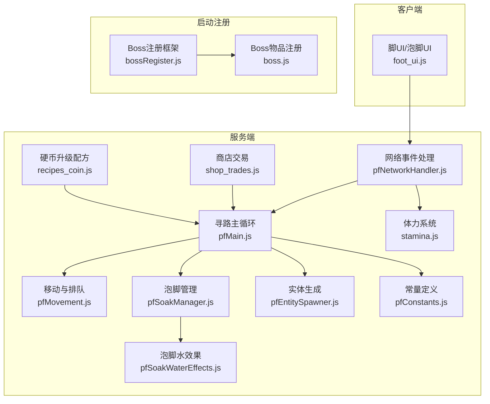
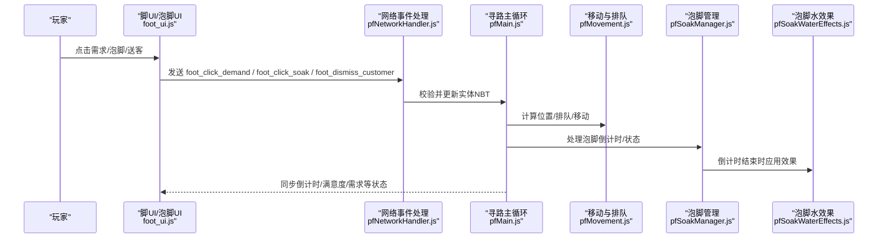
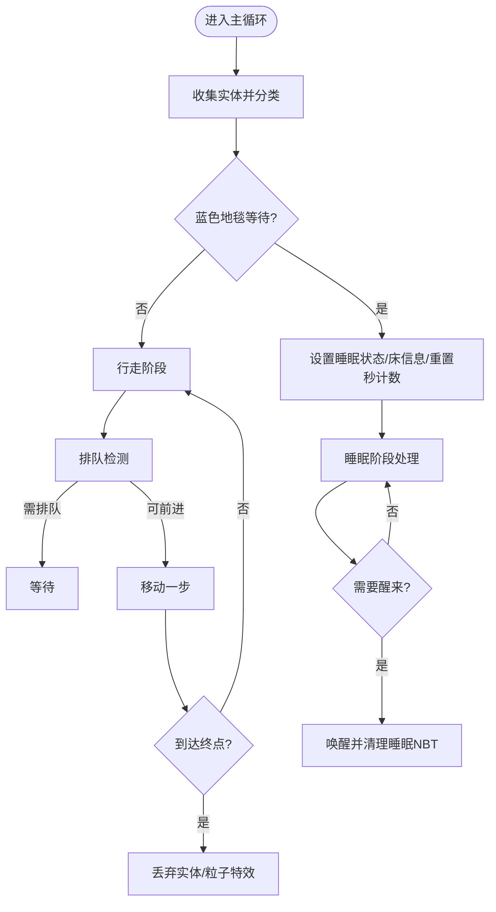
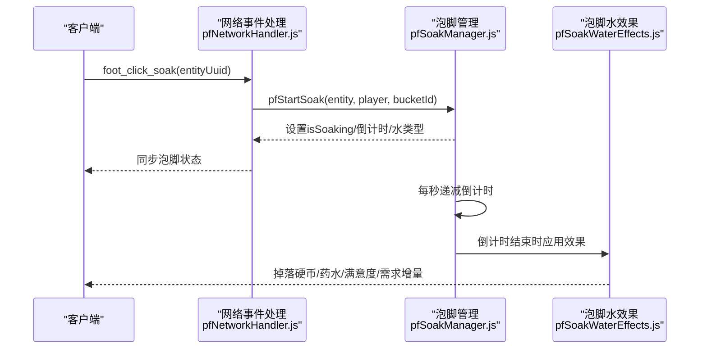
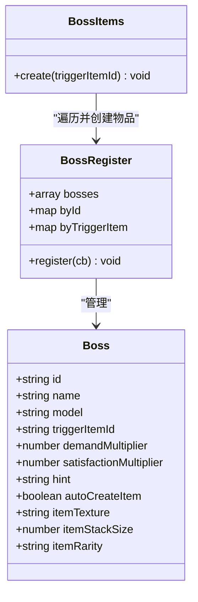
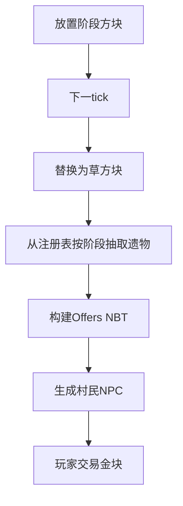
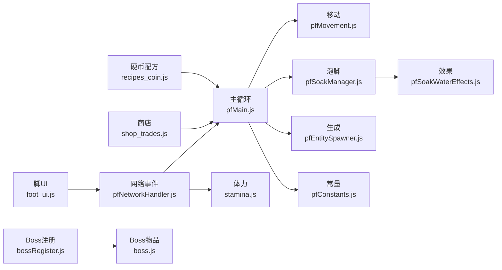

# 核心特性

<cite>
**本文引用的文件**
- [kubejs/server_scripts/pathfinder.js](file://kubejs/server_scripts/pathfinder.js)
- [kubejs/server_scripts/pathfinder/pfMain.js](file://kubejs/server_scripts/pathfinder/pfMain.js)
- [kubejs/server_scripts/pathfinder/pfMovement.js](file://kubejs/server_scripts/pathfinder/pfMovement.js)
- [kubejs/server_scripts/pathfinder/pfSoakManager.js](file://kubejs/server_scripts/pathfinder/pfSoakManager.js)
- [kubejs/server_scripts/pathfinder/pfSoakWaterEffects.js](file://kubejs/server_scripts/pathfinder/pfSoakWaterEffects.js)
- [kubejs/server_scripts/pathfinder/pfNetworkHandler.js](file://kubejs/server_scripts/pathfinder/pfNetworkHandler.js)
- [kubejs/server_scripts/pathfinder/pfEntitySpawner.js](file://kubejs/server_scripts/pathfinder/pfEntitySpawner.js)
- [kubejs/server_scripts/pathfinder/pfConstants.js](file://kubejs/server_scripts/pathfinder/pfConstants.js)
- [kubejs/client_scripts/ui/foot_ui.js](file://kubejs/client_scripts/ui/foot_ui.js)
- [kubejs/server_scripts/stamina.js](file://kubejs/server_scripts/stamina.js)
- [kubejs/server_scripts/shop_trades.js](file://kubejs/server_scripts/shop_trades.js)
- [kubejs/server_scripts/recipes/recipes_coin.js](file://kubejs/server_scripts/recipes/recipes_coin.js)
- [kubejs/startup_scripts/boss/bossRegister.js](file://kubejs/startup_scripts/boss/bossRegister.js)
- [kubejs/startup_scripts/boss/boss.js](file://kubejs/startup_scripts/boss/boss.js)
</cite>

## 目录
1. [引言](#引言)
2. [项目结构](#项目结构)
3. [核心组件](#核心组件)
4. [架构总览](#架构总览)
5. [详细组件分析](#详细组件分析)
6. [依赖分析](#依赖分析)
7. [性能考虑](#性能考虑)
8. [故障排除指南](#故障排除指南)
9. [结论](#结论)
10. [附录](#附录)

## 引言
本文件面向使用者与开发者，系统性梳理项目四大核心系统：寻路服务系统（NPC移动与路径规划）、SPA按摩系统（泡脚水制作与按摩体验）、Boss挑战系统（多种Boss生成与挑战机制）、经济交易系统（硬币升级与商店交易）。文档解释每个系统的功能特点、实现原理与用户体验价值，并阐明系统间的协作关系与数据流转，帮助用户快速掌握功能全景与使用场景。

## 项目结构
项目采用KubeJS脚本化扩展，核心逻辑集中在以下目录：
- 寻路系统：位于 kubejs/server_scripts/pathfinder 与 kubejs/client_scripts/ui
- SPA系统：位于 kubejs/server_scripts 与相关注册/配方脚本
- Boss系统：位于 kubejs/startup_scripts/boss
- 经济系统：位于 kubejs/server_scripts/recipes 与 shop_trades.js

**图表来源**
- [kubejs/server_scripts/pathfinder/pfMain.js:1-177](file://kubejs/server_scripts/pathfinder/pfMain.js#L1-L177)
- [kubejs/server_scripts/pathfinder/pfMovement.js:1-186](file://kubejs/server_scripts/pathfinder/pfMovement.js#L1-L186)
- [kubejs/server_scripts/pathfinder/pfSoakManager.js:1-197](file://kubejs/server_scripts/pathfinder/pfSoakManager.js#L1-L197)
- [kubejs/server_scripts/pathfinder/pfSoakWaterEffects.js:1-233](file://kubejs/server_scripts/pathfinder/pfSoakWaterEffects.js#L1-L233)
- [kubejs/server_scripts/pathfinder/pfNetworkHandler.js:1-317](file://kubejs/server_scripts/pathfinder/pfNetworkHandler.js#L1-L317)
- [kubejs/server_scripts/pathfinder/pfEntitySpawner.js:1-141](file://kubejs/server_scripts/pathfinder/pfEntitySpawner.js#L1-L141)
- [kubejs/server_scripts/pathfinder/pfConstants.js:1-65](file://kubejs/server_scripts/pathfinder/pfConstants.js#L1-L65)
- [kubejs/client_scripts/ui/foot_ui.js:1-1004](file://kubejs/client_scripts/ui/foot_ui.js#L1-L1004)
- [kubejs/server_scripts/stamina.js:1-81](file://kubejs/server_scripts/stamina.js#L1-L81)
- [kubejs/server_scripts/shop_trades.js:1-186](file://kubejs/server_scripts/shop_trades.js#L1-L186)
- [kubejs/server_scripts/recipes/recipes_coin.js:1-57](file://kubejs/server_scripts/recipes/recipes_coin.js#L1-L57)
- [kubejs/startup_scripts/boss/bossRegister.js:1-103](file://kubejs/startup_scripts/boss/bossRegister.js#L1-L103)
- [kubejs/startup_scripts/boss/boss.js:1-37](file://kubejs/startup_scripts/boss/boss.js#L1-L37)

**章节来源**
- [kubejs/server_scripts/pathfinder.js:1-30](file://kubejs/server_scripts/pathfinder.js#L1-L30)

## 核心组件
- 寻路服务系统：以路径规划为核心，结合实体移动、排队、睡眠与泡脚状态机，形成完整的NPC服务闭环。
- SPA按摩系统：以泡脚水为媒介，提供多维度体验增强（需求增长、满意度提升、掉落奖励、药水效果等）。
- Boss挑战系统：通过注册框架与物品自动创建，实现多种Boss的差异化需求与满意度倍率，提升挑战趣味性。
- 经济交易系统：以硬币升级链替代原版堆叠方式，配合商店NPC按阶段随机交易遗物，形成稳定的资源循环。

**章节来源**
- [kubejs/server_scripts/pathfinder/pfMain.js:1-177](file://kubejs/server_scripts/pathfinder/pfMain.js#L1-L177)
- [kubejs/server_scripts/pathfinder/pfSoakManager.js:1-197](file://kubejs/server_scripts/pathfinder/pfSoakManager.js#L1-L197)
- [kubejs/server_scripts/pathfinder/pfSoakWaterEffects.js:1-233](file://kubejs/server_scripts/pathfinder/pfSoakWaterEffects.js#L1-L233)
- [kubejs/server_scripts/pathfinder/pfNetworkHandler.js:1-317](file://kubejs/server_scripts/pathfinder/pfNetworkHandler.js#L1-L317)
- [kubejs/server_scripts/pathfinder/pfEntitySpawner.js:1-141](file://kubejs/server_scripts/pathfinder/pfEntitySpawner.js#L1-L141)
- [kubejs/server_scripts/pathfinder/pfConstants.js:1-65](file://kubejs/server_scripts/pathfinder/pfConstants.js#L1-L65)
- [kubejs/client_scripts/ui/foot_ui.js:1-1004](file://kubejs/client_scripts/ui/foot_ui.js#L1-L1004)
- [kubejs/server_scripts/stamina.js:1-81](file://kubejs/server_scripts/stamina.js#L1-L81)
- [kubejs/server_scripts/shop_trades.js:1-186](file://kubejs/server_scripts/shop_trades.js#L1-L186)
- [kubejs/server_scripts/recipes/recipes_coin.js:1-57](file://kubejs/server_scripts/recipes/recipes_coin.js#L1-L57)
- [kubejs/startup_scripts/boss/bossRegister.js:1-103](file://kubejs/startup_scripts/boss/bossRegister.js#L1-L103)
- [kubejs/startup_scripts/boss/boss.js:1-37](file://kubejs/startup_scripts/boss/boss.js#L1-L37)

## 架构总览
四大系统围绕“实体生命周期”与“玩家交互”展开：玩家通过客户端UI发起交互，服务端网络处理器接收并校验，随后驱动寻路主循环与各子模块执行具体逻辑，最终通过NBT与网络包同步状态至客户端，形成闭环。

**图表来源**
- [kubejs/client_scripts/ui/foot_ui.js:1-1004](file://kubejs/client_scripts/ui/foot_ui.js#L1-L1004)
- [kubejs/server_scripts/pathfinder/pfNetworkHandler.js:1-317](file://kubejs/server_scripts/pathfinder/pfNetworkHandler.js#L1-L317)
- [kubejs/server_scripts/pathfinder/pfMain.js:1-177](file://kubejs/server_scripts/pathfinder/pfMain.js#L1-L177)
- [kubejs/server_scripts/pathfinder/pfMovement.js:1-186](file://kubejs/server_scripts/pathfinder/pfMovement.js#L1-L186)
- [kubejs/server_scripts/pathfinder/pfSoakManager.js:1-197](file://kubejs/server_scripts/pathfinder/pfSoakManager.js#L1-L197)
- [kubejs/server_scripts/pathfinder/pfSoakWaterEffects.js:1-233](file://kubejs/server_scripts/pathfinder/pfSoakWaterEffects.js#L1-L233)

## 详细组件分析

### 寻路服务系统（NPC移动与路径规划）
- 功能特点
  - 路径驱动移动：基于字符序列的路径（N/S/E/W），实体在格间插值移动，支持子步细分与进度记录。
  - 排队与等待：依据实体进度与相对位置进行排队判定，避免拥堵。
  - 睡眠与泡脚：在到达蓝色地毯后进入等待，随后进入睡眠阶段，期间处理泡脚倒计时与效果。
  - 实体生成：按路线与床位预扫描，生成需求清单并初始化持久化数据。
- 实现原理
  - 主循环整合：每tick收集实体、处理蓝色地毯等待、睡眠逻辑、构建排队信息、执行移动与到达判断。
  - 数据同步：通过手持物品承载NBT，客户端UI读取并展示倒计时、满意度、需求与步骤。
  - 状态机：phase=2/3/4/5分别代表行走、躺床、等待床位、蓝色地毯等待。
- 用户体验价值
  - 流畅的NPC服务流程，清晰的状态反馈（UI倒计时、满意度条、需求清单）。
  - 一键满足与体力消耗机制平衡操作效率与成本。

**图表来源**
- [kubejs/server_scripts/pathfinder/pfMain.js:1-177](file://kubejs/server_scripts/pathfinder/pfMain.js#L1-L177)
- [kubejs/server_scripts/pathfinder/pfMovement.js:1-186](file://kubejs/server_scripts/pathfinder/pfMovement.js#L1-L186)

**章节来源**
- [kubejs/server_scripts/pathfinder/pfMain.js:1-177](file://kubejs/server_scripts/pathfinder/pfMain.js#L1-L177)
- [kubejs/server_scripts/pathfinder/pfMovement.js:1-186](file://kubejs/server_scripts/pathfinder/pfMovement.js#L1-L186)
- [kubejs/server_scripts/pathfinder/pfEntitySpawner.js:1-141](file://kubejs/server_scripts/pathfinder/pfEntitySpawner.js#L1-L141)
- [kubejs/server_scripts/pathfinder/pfConstants.js:1-65](file://kubejs/server_scripts/pathfinder/pfConstants.js#L1-L65)
- [kubejs/client_scripts/ui/foot_ui.js:1-1004](file://kubejs/client_scripts/ui/foot_ui.js#L1-L1004)

### SPA按摩系统（泡脚水制作与按摩体验）
- 功能特点
  - 泡脚水注册与识别：支持原版水桶与已注册的洗脚水桶，倒计时以秒为单位，跨重启友好。
  - 多维效果：泡脚完成后按水类型追加需求、提升满意度、掉落硬币、增加皴掉落加成、施加药水效果。
  - 交互联动：客户端点击泡脚按钮触发服务端开始泡脚，消耗水桶并更新状态。
- 实现原理
  - 倒计时驱动：实体持久化秒内tick计数器，每20tick触发一次“秒事件”，决定剩余秒数变化。
  - 效果应用：根据桶id解析水定义，批量更新NBT与掉落硬币，再对玩家/实体施加效果。
  - 客户端同步：UI读取倒计时、是否泡脚、剩余秒数并渲染。
- 用户体验价值
  - 泡脚成为策略性环节：选择不同洗脚水获得差异化收益，提升可玩性与收集动机。

**图表来源**
- [kubejs/server_scripts/pathfinder/pfNetworkHandler.js:221-272](file://kubejs/server_scripts/pathfinder/pfNetworkHandler.js#L221-L272)
- [kubejs/server_scripts/pathfinder/pfSoakManager.js:147-186](file://kubejs/server_scripts/pathfinder/pfSoakManager.js#L147-L186)
- [kubejs/server_scripts/pathfinder/pfSoakWaterEffects.js:107-226](file://kubejs/server_scripts/pathfinder/pfSoakWaterEffects.js#L107-L226)

**章节来源**
- [kubejs/server_scripts/pathfinder/pfSoakManager.js:1-197](file://kubejs/server_scripts/pathfinder/pfSoakManager.js#L1-L197)
- [kubejs/server_scripts/pathfinder/pfSoakWaterEffects.js:1-233](file://kubejs/server_scripts/pathfinder/pfSoakWaterEffects.js#L1-L233)
- [kubejs/server_scripts/pathfinder/pfNetworkHandler.js:221-272](file://kubejs/server_scripts/pathfinder/pfNetworkHandler.js#L221-L272)
- [kubejs/client_scripts/ui/foot_ui.js:357-458](file://kubejs/client_scripts/ui/foot_ui.js#L357-L458)

### Boss挑战系统（多种Boss生成与挑战机制）
- 功能特点
  - 注册框架：统一注册Boss定义（id、名称、模型、触发物品、需求/满意度倍率等）。
  - 物品自动创建：可为Boss自动创建专属召唤符物品，便于携带与使用。
  - 差异化体验：Boss需求倍率与满意度倍率影响挑战难度与收益。
- 实现原理
  - 注册阶段：BossRegister集中管理Boss列表与索引，校验唯一性与完整性。
  - 启动物品：在注册完成后遍历Boss列表，按规则创建物品并命名。
  - 运行期：网络事件处理读取实体持久化BossId，应用满意度倍率。
- 用户体验价值
  - 明确的挑战目标与差异化回报，鼓励玩家针对不同Boss制定策略。

**图表来源**
- [kubejs/startup_scripts/boss/bossRegister.js:1-103](file://kubejs/startup_scripts/boss/bossRegister.js#L1-L103)
- [kubejs/startup_scripts/boss/boss.js:1-37](file://kubejs/startup_scripts/boss/boss.js#L1-L37)

**章节来源**
- [kubejs/startup_scripts/boss/bossRegister.js:1-103](file://kubejs/startup_scripts/boss/bossRegister.js#L1-L103)
- [kubejs/startup_scripts/boss/boss.js:1-37](file://kubejs/startup_scripts/boss/boss.js#L1-L37)
- [kubejs/server_scripts/pathfinder/pfNetworkHandler.js:19-34](file://kubejs/server_scripts/pathfinder/pfNetworkHandler.js#L19-L34)

### 经济交易系统（硬币升级与商店交易）
- 功能特点
  - 硬币升级链：9个下级硬币合成1个上级硬币，形成稳定的价值递增体系。
  - 商店NPC：按阶段随机生成，交易内容来自遗物注册表，货币为金块。
- 实现原理
  - 合成配方：移除原版“pile”合成，注册严格的一对一升阶配方。
  - 商店生成：放置特定方块后下一tick替换为草方块并在上方生成村民NPC，Offer通过NBT构建。
- 用户体验价值
  - 简洁高效的资源转化路径与阶段性挑战目标，促进长期留存。

**图表来源**
- [kubejs/server_scripts/shop_trades.js:122-185](file://kubejs/server_scripts/shop_trades.js#L122-L185)

**章节来源**
- [kubejs/server_scripts/recipes/recipes_coin.js:1-57](file://kubejs/server_scripts/recipes/recipes_coin.js#L1-L57)
- [kubejs/server_scripts/shop_trades.js:1-186](file://kubejs/server_scripts/shop_trades.js#L1-L186)

## 依赖分析
- 模块耦合
  - 寻路主循环依赖移动、睡眠、泡脚、实体数据、网络事件等模块，形成高内聚低耦合的分层设计。
  - SPA系统通过泡脚水注册表与效果应用模块解耦不同水类型的差异化行为。
  - 经济系统与Boss系统通过持久化数据与注册表实现弱耦合关联。
- 关键依赖链
  - 客户端UI → 网络事件处理 → 寻路主循环/泡脚管理 → 效果应用
  - 实体生成 → 需求清单 → 挑战流程 → 结算与掉落

**图表来源**
- [kubejs/client_scripts/ui/foot_ui.js:1-1004](file://kubejs/client_scripts/ui/foot_ui.js#L1-L1004)
- [kubejs/server_scripts/pathfinder/pfNetworkHandler.js:1-317](file://kubejs/server_scripts/pathfinder/pfNetworkHandler.js#L1-L317)
- [kubejs/server_scripts/pathfinder/pfMain.js:1-177](file://kubejs/server_scripts/pathfinder/pfMain.js#L1-L177)
- [kubejs/server_scripts/pathfinder/pfMovement.js:1-186](file://kubejs/server_scripts/pathfinder/pfMovement.js#L1-L186)
- [kubejs/server_scripts/pathfinder/pfSoakManager.js:1-197](file://kubejs/server_scripts/pathfinder/pfSoakManager.js#L1-L197)
- [kubejs/server_scripts/pathfinder/pfSoakWaterEffects.js:1-233](file://kubejs/server_scripts/pathfinder/pfSoakWaterEffects.js#L1-L233)
- [kubejs/server_scripts/pathfinder/pfEntitySpawner.js:1-141](file://kubejs/server_scripts/pathfinder/pfEntitySpawner.js#L1-L141)
- [kubejs/server_scripts/pathfinder/pfConstants.js:1-65](file://kubejs/server_scripts/pathfinder/pfConstants.js#L1-L65)
- [kubejs/server_scripts/stamina.js:1-81](file://kubejs/server_scripts/stamina.js#L1-L81)
- [kubejs/server_scripts/shop_trades.js:1-186](file://kubejs/server_scripts/shop_trades.js#L1-L186)
- [kubejs/server_scripts/recipes/recipes_coin.js:1-57](file://kubejs/server_scripts/recipes/recipes_coin.js#L1-L57)
- [kubejs/startup_scripts/boss/bossRegister.js:1-103](file://kubejs/startup_scripts/boss/bossRegister.js#L1-L103)
- [kubejs/startup_scripts/boss/boss.js:1-37](file://kubejs/startup_scripts/boss/boss.js#L1-L37)

**章节来源**
- [kubejs/server_scripts/pathfinder.js:1-30](file://kubejs/server_scripts/pathfinder.js#L1-L30)

## 性能考虑
- 主循环节流：每tick仅处理一次实体，避免重复处理；排队与移动逻辑按范围搜索，限制网格半径。
- 跨重启友好：倒计时与子tick计数器存储在实体持久化数据中，避免依赖server.getTickCount差值。
- 网络最小化：客户端仅接收必要状态更新，服务端通过NBT与事件驱动，减少冗余同步。
- 合成配方优化：移除冲突配方，避免重复计算与资源浪费。

## 故障排除指南
- 客户端UI不显示
  - 检查WorldWindow文档创建与fx层挂载是否成功，确认HTML路径正确。
  - 确认手持物品NBT字段是否存在且包含床信息与倒计时数据。
- 泡脚无效
  - 确认玩家手持水桶或已注册的洗脚水桶；检查倒计时是否被重置（无可用洗脚水会重置）。
  - 检查效果应用模块是否正确解析水定义与掉落硬币。
- 商店NPC未生成
  - 确认阶段方块放置后下一tick是否执行；检查注册表是否有该阶段的遗物。
- 硬币升级失败
  - 确认配方已被注册且无pile类冲突；检查合成输入是否为9个下级硬币。

**章节来源**
- [kubejs/client_scripts/ui/foot_ui.js:1-1004](file://kubejs/client_scripts/ui/foot_ui.js#L1-L1004)
- [kubejs/server_scripts/pathfinder/pfSoakManager.js:74-145](file://kubejs/server_scripts/pathfinder/pfSoakManager.js#L74-L145)
- [kubejs/server_scripts/shop_trades.js:122-185](file://kubejs/server_scripts/shop_trades.js#L122-L185)
- [kubejs/server_scripts/recipes/recipes_coin.js:15-56](file://kubejs/server_scripts/recipes/recipes_coin.js#L15-L56)

## 结论
四大系统通过清晰的职责划分与模块化设计，实现了从NPC移动、SPA体验到Boss挑战与经济循环的完整生态。寻路系统提供流畅的流程控制，SPA系统引入策略性与收集要素，Boss系统强化挑战多样性，经济系统保障资源流转稳定性。整体架构兼顾可扩展性与易用性，适合进一步定制与迭代。

## 附录
- 使用场景预览
  - 寻路服务：布置路径与床位，生成NPC并观察其服务流程与UI反馈。
  - SPA体验：准备不同洗脚水桶，体验泡脚带来的多维收益与视觉效果。
  - Boss挑战：使用Boss召唤符触发挑战，利用需求/满意度倍率制定策略。
  - 经济循环：通过硬币升级链与商店交易，逐步提升资源价值与可交易内容。