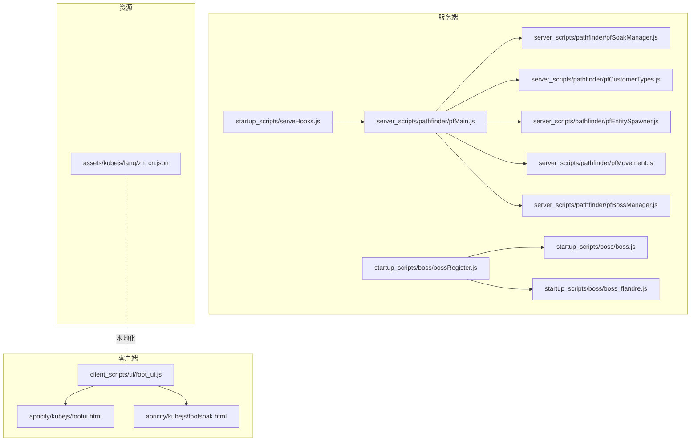
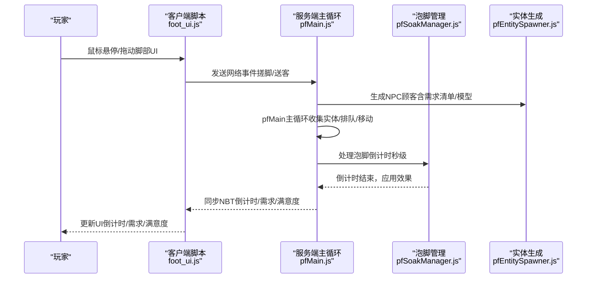
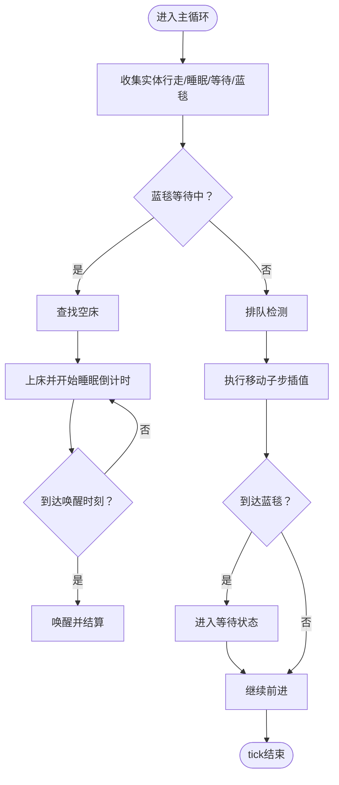
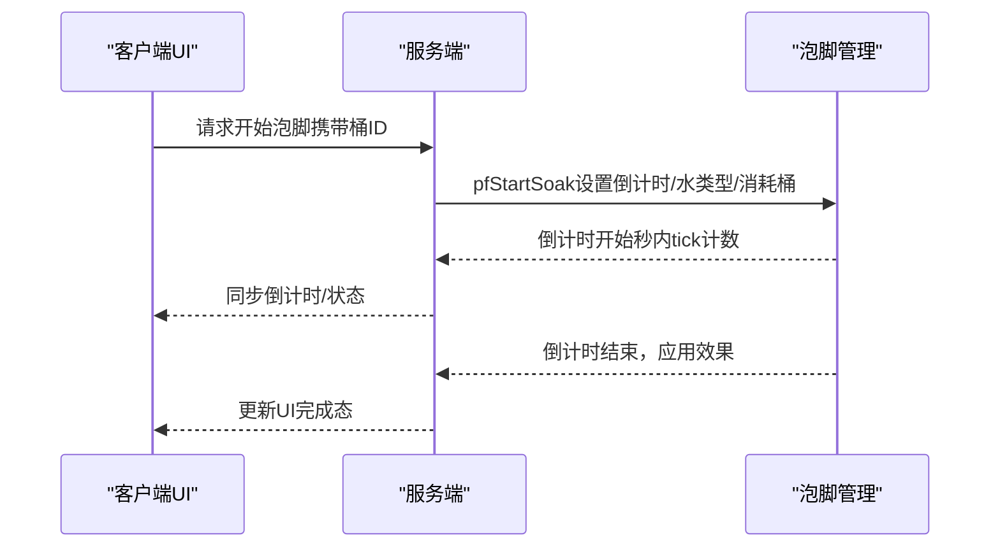
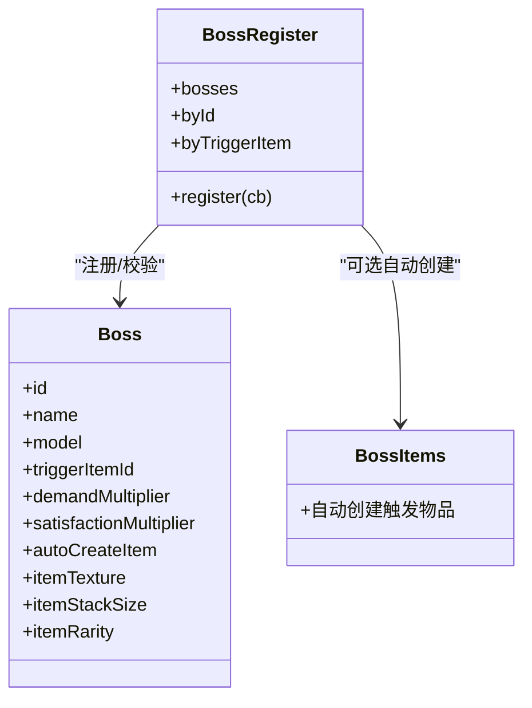
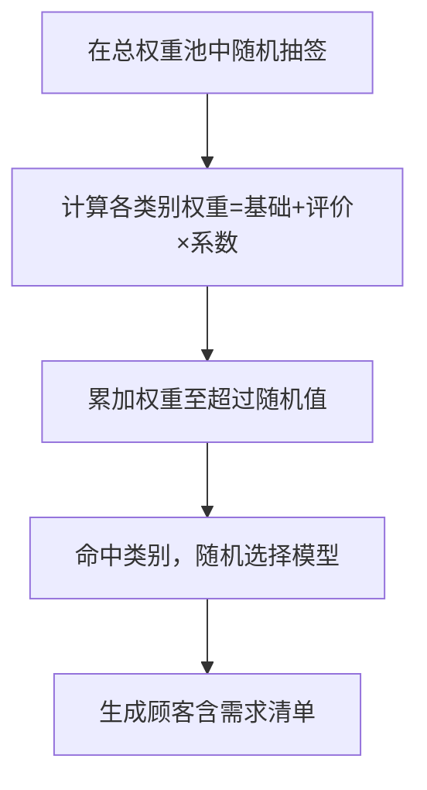
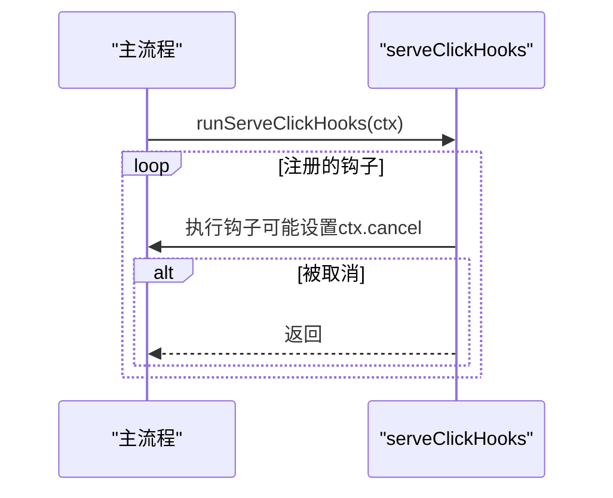
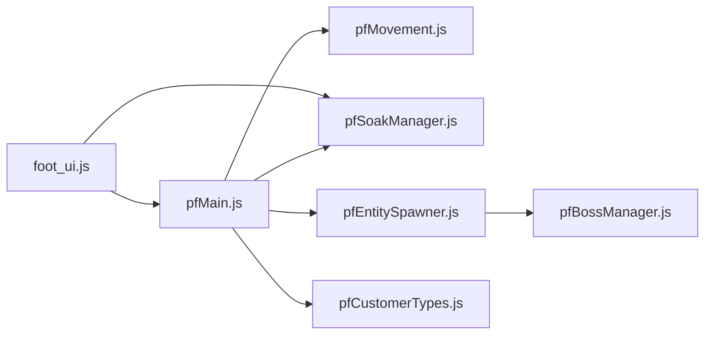

# 项目介绍

<cite>
**本文引用的文件**
- [kubejs/README.txt](file://kubejs/README.txt)
- [kubejs/assets/kubejs/lang/zh_cn.json](file://kubejs/assets/kubejs/lang/zh_cn.json)
- [kubejs/client_scripts/ui/foot_ui.js](file://kubejs/client_scripts/ui/foot_ui.js)
- [apricity/kubejs/footui.html](file://apricity/kubejs/footui.html)
- [apricity/kubejs/footsoak.html](file://apricity/kubejs/footsoak.html)
- [kubejs/server_scripts/pathfinder/pfMain.js](file://kubejs/server_scripts/pathfinder/pfMain.js)
- [kubejs/server_scripts/pathfinder/pfSoakManager.js](file://kubejs/server_scripts/pathfinder/pfSoakManager.js)
- [kubejs/server_scripts/pathfinder/pfCustomerTypes.js](file://kubejs/server_scripts/pathfinder/pfCustomerTypes.js)
- [kubejs/server_scripts/pathfinder/pfEntitySpawner.js](file://kubejs/server_scripts/pathfinder/pfEntitySpawner.js)
- [kubejs/server_scripts/pathfinder/pfMovement.js](file://kubejs/server_scripts/pathfinder/pfMovement.js)
- [kubejs/server_scripts/pathfinder/pfBossManager.js](file://kubejs/server_scripts/pathfinder/pfBossManager.js)
- [kubejs/startup_scripts/boss/bossRegister.js](file://kubejs/startup_scripts/boss/bossRegister.js)
- [kubejs/startup_scripts/boss/boss.js](file://kubejs/startup_scripts/boss/boss.js)
- [kubejs/startup_scripts/boss/boss_flandre.js](file://kubejs/startup_scripts/boss/boss_flandre.js)
- [kubejs/startup_scripts/serveHooks.js](file://kubejs/startup_scripts/serveHooks.js)
</cite>

## 目录
1. [引言](#引言)
2. [项目结构](#项目结构)
3. [核心组件](#核心组件)
4. [架构总览](#架构总览)
5. [详细组件分析](#详细组件分析)
6. [依赖关系分析](#依赖关系分析)
7. [性能考量](#性能考量)
8. [故障排查指南](#故障排查指南)
9. [结论](#结论)
10. [附录](#附录)

## 引言
本项目是一个基于KubeJS的Minecraft模组扩展，围绕“足部SPA服务”与“NPC顾客寻路体验”构建，提供以下核心玩法：
- NPC顾客服务模拟系统：顾客沿预设路径行进、排队、等待床位、泡脚、接受服务、对话反馈与评价体系联动。
- SPA按摩体验系统：通过“泡脚水”与“搓脚工具”实现可交互的SPA流程，支持倒计时、效果叠加与可视化UI。
- Boss挑战机制：以“召唤符”触发特殊Boss顾客，具备独立的需求倍率与满意度倍率，增强挑战性与策略深度。

项目在模组生态中的定位是“高自由度的NPC服务体验+可扩展的Boss挑战”，适合喜欢策略经营、角色扮演与沉浸式交互的玩家群体。通过模块化的脚本设计，新用户可快速上手，老玩家可按需扩展功能。

## 项目结构
项目采用KubeJS标准目录组织，结合资源包与数据包，配合启动脚本、服务端脚本与客户端脚本协同工作：
- assets：客户端资源（UI模板、贴图、声音、语言包等）
- data：服务端数据（实体定义、任务语言等）
- startup_scripts：启动阶段一次性加载的注册与框架脚本
- server_scripts：服务器运行期的业务逻辑（寻路、泡脚、顾客类型、Boss、商店等）
- client_scripts：客户端UI与事件处理（WorldWindow UI、鼠标交互、粒子特效等）

**图表来源**
- [kubejs/client_scripts/ui/foot_ui.js:1-976](file://kubejs/client_scripts/ui/foot_ui.js#L1-L976)
- [apricity/kubejs/footui.html:1-356](file://apricity/kubejs/footui.html#L1-L356)
- [apricity/kubejs/footsoak.html:1-155](file://apricity/kubejs/footsoak.html#L1-L155)
- [kubejs/server_scripts/pathfinder/pfMain.js:1-177](file://kubejs/server_scripts/pathfinder/pfMain.js#L1-L177)
- [kubejs/server_scripts/pathfinder/pfSoakManager.js:1-197](file://kubejs/server_scripts/pathfinder/pfSoakManager.js#L1-L197)
- [kubejs/server_scripts/pathfinder/pfCustomerTypes.js:1-314](file://kubejs/server_scripts/pathfinder/pfCustomerTypes.js#L1-L314)
- [kubejs/server_scripts/pathfinder/pfEntitySpawner.js:1-141](file://kubejs/server_scripts/pathfinder/pfEntitySpawner.js#L1-L141)
- [kubejs/server_scripts/pathfinder/pfMovement.js:1-186](file://kubejs/server_scripts/pathfinder/pfMovement.js#L1-L186)
- [kubejs/server_scripts/pathfinder/pfBossManager.js:1-25](file://kubejs/server_scripts/pathfinder/pfBossManager.js#L1-L25)
- [kubejs/startup_scripts/boss/bossRegister.js:1-103](file://kubejs/startup_scripts/boss/bossRegister.js#L1-L103)
- [kubejs/startup_scripts/boss/boss.js:1-37](file://kubejs/startup_scripts/boss/boss.js#L1-L37)
- [kubejs/startup_scripts/boss/boss_flandre.js:1-22](file://kubejs/startup_scripts/boss/boss_flandre.js#L1-L22)
- [kubejs/startup_scripts/serveHooks.js:1-31](file://kubejs/startup_scripts/serveHooks.js#L1-L31)

**章节来源**
- [kubejs/README.txt:1-15](file://kubejs/README.txt#L1-L15)

## 核心组件
- NPC顾客服务模拟系统
  - 寻路与排队：基于路径字符串的网格寻路、子步插值、排队检测与进度排序。
  - 睡眠与床位：预扫描床位、蓝色地毯等待、上床睡眠、倒计时与唤醒。
  - 服务流程：需求清单（脚掌/脚后跟/脚趾/脚心）、满意度计算、步骤记录、对话反馈。
- SPA按摩体验系统
  - 泡脚管理：倒计时以秒为单位、可用洗脚水判定、效果应用、手持物品NBT同步。
  - 客户端UI：WorldWindow展示倒计时、需求清单、满意度与步骤，支持拖动搓脚交互。
- Boss挑战机制
  - Boss注册框架：统一注册、自动物品创建、触发物绑定、需求与满意度倍率。
  - Boss生成：沿路径生成、需求倍率应用、持久化标记、跨重启兼容。
- 评价与权重系统
  - 顾客类别（人类/妖精/妖怪/神明/幽灵/鬼族）与评价加权，影响生成概率与后续互动。

**章节来源**
- [kubejs/server_scripts/pathfinder/pfMain.js:1-177](file://kubejs/server_scripts/pathfinder/pfMain.js#L1-L177)
- [kubejs/server_scripts/pathfinder/pfSoakManager.js:1-197](file://kubejs/server_scripts/pathfinder/pfSoakManager.js#L1-L197)
- [kubejs/client_scripts/ui/foot_ui.js:1-976](file://kubejs/client_scripts/ui/foot_ui.js#L1-L976)
- [kubejs/server_scripts/pathfinder/pfCustomerTypes.js:1-314](file://kubejs/server_scripts/pathfinder/pfCustomerTypes.js#L1-L314)
- [kubejs/server_scripts/pathfinder/pfEntitySpawner.js:1-141](file://kubejs/server_scripts/pathfinder/pfEntitySpawner.js#L1-L141)
- [kubejs/server_scripts/pathfinder/pfMovement.js:1-186](file://kubejs/server_scripts/pathfinder/pfMovement.js#L1-L186)
- [kubejs/server_scripts/pathfinder/pfBossManager.js:1-25](file://kubejs/server_scripts/pathfinder/pfBossManager.js#L1-L25)
- [kubejs/startup_scripts/boss/bossRegister.js:1-103](file://kubejs/startup_scripts/boss/bossRegister.js#L1-L103)
- [kubejs/startup_scripts/boss/boss.js:1-37](file://kubejs/startup_scripts/boss/boss.js#L1-L37)
- [kubejs/startup_scripts/boss/boss_flandre.js:1-22](file://kubejs/startup_scripts/boss/boss_flandre.js#L1-L22)

## 架构总览
整体架构遵循“服务端主循环 + 客户端UI”的模式：
- 服务端主循环（pfMain）负责收集实体、处理蓝色地毯等待、睡眠逻辑、排队与移动。
- 泡脚管理（pfSoakManager）独立于睡眠流程，按秒驱动倒计时并应用效果。
- 客户端UI（foot_ui.js）通过WorldWindow渲染HTML模板，监听鼠标拖动与点击事件，与服务端进行数据交换。

**图表来源**
- [kubejs/client_scripts/ui/foot_ui.js:1-976](file://kubejs/client_scripts/ui/foot_ui.js#L1-L976)
- [kubejs/server_scripts/pathfinder/pfMain.js:1-177](file://kubejs/server_scripts/pathfinder/pfMain.js#L1-L177)
- [kubejs/server_scripts/pathfinder/pfSoakManager.js:1-197](file://kubejs/server_scripts/pathfinder/pfSoakManager.js#L1-L197)
- [kubejs/server_scripts/pathfinder/pfEntitySpawner.js:1-141](file://kubejs/server_scripts/pathfinder/pfEntitySpawner.js#L1-L141)

## 详细组件分析

### NPC顾客服务模拟系统
- 寻路与排队
  - 路径解析：基于起始点与路径字符串，按格推进，子步0~9实现平滑插值。
  - 排队检测：依据实体progress与ID比较，避免碰撞与重复处理。
- 睡眠与床位
  - 蓝色地毯等待：检测到蓝色地毯后进入等待状态，随后寻找空床并上床。
  - 睡眠倒计时：与泡脚流程解耦，支持跨重启的秒级计时。
- 服务流程
  - 需求清单：四部位需求次数，支持Boss需求倍率。
  - 满意度：基于部位服务与属性加成，达到阈值触发对话与评价。
  - 步骤记录：以编码字符串记录服务顺序，客户端解码显示。

**图表来源**
- [kubejs/server_scripts/pathfinder/pfMain.js:1-177](file://kubejs/server_scripts/pathfinder/pfMain.js#L1-L177)
- [kubejs/server_scripts/pathfinder/pfMovement.js:1-186](file://kubejs/server_scripts/pathfinder/pfMovement.js#L1-L186)

**章节来源**
- [kubejs/server_scripts/pathfinder/pfMain.js:1-177](file://kubejs/server_scripts/pathfinder/pfMain.js#L1-L177)
- [kubejs/server_scripts/pathfinder/pfMovement.js:1-186](file://kubejs/server_scripts/pathfinder/pfMovement.js#L1-L186)

### SPA按摩体验系统
- 泡脚倒计时
  - 以秒为单位的倒计时，可用洗脚水判定与效果应用，空桶消耗。
  - 客户端UI实时显示倒计时与提示，支持泡脚中进度条。
- 客户端交互
  - WorldWindow渲染HTML模板，鼠标拖动触发搓脚，粒子特效增强体验。
  - 送客按钮可直接结束服务，跳过结算。

**图表来源**
- [kubejs/server_scripts/pathfinder/pfSoakManager.js:1-197](file://kubejs/server_scripts/pathfinder/pfSoakManager.js#L1-L197)
- [apricity/kubejs/footsoak.html:1-155](file://apricity/kubejs/footsoak.html#L1-L155)
- [kubejs/client_scripts/ui/foot_ui.js:1-976](file://kubejs/client_scripts/ui/foot_ui.js#L1-L976)

**章节来源**
- [kubejs/server_scripts/pathfinder/pfSoakManager.js:1-197](file://kubejs/server_scripts/pathfinder/pfSoakManager.js#L1-L197)
- [apricity/kubejs/footsoak.html:1-155](file://apricity/kubejs/footsoak.html#L1-L155)
- [kubejs/client_scripts/ui/foot_ui.js:1-976](file://kubejs/client_scripts/ui/foot_ui.js#L1-L976)

### Boss挑战机制
- 注册框架
  - 统一注册Boss定义，自动创建触发物品（召唤符），设置需求与满意度倍率。
- 生成与管理
  - 沿路径生成Boss顾客，应用需求倍率，写入Boss标识，参与寻路流程但不参与常规评价系统。

**图表来源**
- [kubejs/startup_scripts/boss/bossRegister.js:1-103](file://kubejs/startup_scripts/boss/bossRegister.js#L1-L103)
- [kubejs/startup_scripts/boss/boss.js:1-37](file://kubejs/startup_scripts/boss/boss.js#L1-L37)
- [kubejs/startup_scripts/boss/boss_flandre.js:1-22](file://kubejs/startup_scripts/boss/boss_flandre.js#L1-L22)

**章节来源**
- [kubejs/startup_scripts/boss/bossRegister.js:1-103](file://kubejs/startup_scripts/boss/bossRegister.js#L1-L103)
- [kubejs/startup_scripts/boss/boss.js:1-37](file://kubejs/startup_scripts/boss/boss.js#L1-L37)
- [kubejs/server_scripts/pathfinder/pfBossManager.js:1-25](file://kubejs/server_scripts/pathfinder/pfBossManager.js#L1-L25)
- [kubejs/server_scripts/pathfinder/pfEntitySpawner.js:1-141](file://kubejs/server_scripts/pathfinder/pfEntitySpawner.js#L1-L141)

### 评价与权重系统
- 顾客类别与权重
  - 六大类别（人类/妖精/妖怪/神明/幽灵/鬼族），基础权重与评价加成构成总权重池。
- 评价影响
  - 满意度达到阈值（60）时增加评价，影响后续生成概率与互动体验。

**图表来源**
- [kubejs/server_scripts/pathfinder/pfCustomerTypes.js:266-296](file://kubejs/server_scripts/pathfinder/pfCustomerTypes.js#L266-L296)

**章节来源**
- [kubejs/server_scripts/pathfinder/pfCustomerTypes.js:1-314](file://kubejs/server_scripts/pathfinder/pfCustomerTypes.js#L1-L314)

### 服务点击钩子系统
- 设计目标：将“额外功能（如抹油、连击奖励等）”从主流程拆分，通过注册钩子按序执行，支持中途取消。

**图表来源**
- [kubejs/startup_scripts/serveHooks.js:1-31](file://kubejs/startup_scripts/serveHooks.js#L1-L31)

**章节来源**
- [kubejs/startup_scripts/serveHooks.js:1-31](file://kubejs/startup_scripts/serveHooks.js#L1-L31)

## 依赖关系分析
- 低耦合高内聚：服务端模块按职责拆分（主循环、移动、泡脚、生成、顾客类型），通过全局对象与NBT传递状态。
- 数据一致性：客户端UI通过同步物品NBT读取状态，服务端主循环统一推进，避免竞态。
- 可扩展性：Boss注册、服务钩子、顾客类型权重均以框架形式提供，便于新增内容。

**图表来源**
- [kubejs/server_scripts/pathfinder/pfMain.js:1-177](file://kubejs/server_scripts/pathfinder/pfMain.js#L1-L177)
- [kubejs/server_scripts/pathfinder/pfMovement.js:1-186](file://kubejs/server_scripts/pathfinder/pfMovement.js#L1-L186)
- [kubejs/server_scripts/pathfinder/pfSoakManager.js:1-197](file://kubejs/server_scripts/pathfinder/pfSoakManager.js#L1-L197)
- [kubejs/server_scripts/pathfinder/pfEntitySpawner.js:1-141](file://kubejs/server_scripts/pathfinder/pfEntitySpawner.js#L1-L141)
- [kubejs/server_scripts/pathfinder/pfCustomerTypes.js:1-314](file://kubejs/server_scripts/pathfinder/pfCustomerTypes.js#L1-L314)
- [kubejs/server_scripts/pathfinder/pfBossManager.js:1-25](file://kubejs/server_scripts/pathfinder/pfBossManager.js#L1-L25)
- [kubejs/client_scripts/ui/foot_ui.js:1-976](file://kubejs/client_scripts/ui/foot_ui.js#L1-L976)

**章节来源**
- [kubejs/server_scripts/pathfinder/pfMain.js:1-177](file://kubejs/server_scripts/pathfinder/pfMain.js#L1-L177)
- [kubejs/client_scripts/ui/foot_ui.js:1-976](file://kubejs/client_scripts/ui/foot_ui.js#L1-L976)

## 性能考量
- tick级驱动：主循环与泡脚均以tick推进，避免高频网络同步，降低延迟抖动。
- NBT同步：仅通过同步物品NBT传输必要状态，减少带宽占用。
- 跨重启：倒计时与子步计数存储于实体persistentData，保证稳定性。
- 优化建议
  - 控制UI窗口数量，避免过多WorldWindow实例。
  - 合理设置路径长度与床位密度，避免大量实体堆积。
  - 适当调整倒计时与权重参数，平衡体验与性能。

## 故障排查指南
- 泡脚无效或倒计时不更新
  - 检查是否持有可用的洗脚水桶（原版水桶始终可用，其他桶需注册）。
  - 确认客户端已收到倒计时同步（查看UI显示与日志）。
- 顾客不生成或不移动
  - 检查路径字符串与起始点是否正确，确认蓝色地毯位置。
  - 查看日志中“生成女仆/存储验证”输出，确认需求清单与模型写入成功。
- Boss未出现
  - 确认触发物品ID与注册一致，检查自动创建日志。
  - 确认Boss生成入口（触发物右键开店方块）是否正确。
- UI不显示或交互异常
  - 检查WorldWindow文档创建与元素ID匹配，确认HTML模板路径正确。
  - 查看客户端日志中“cursor_fx Overlay”创建与事件绑定情况。

**章节来源**
- [kubejs/server_scripts/pathfinder/pfSoakManager.js:1-197](file://kubejs/server_scripts/pathfinder/pfSoakManager.js#L1-L197)
- [kubejs/server_scripts/pathfinder/pfEntitySpawner.js:1-141](file://kubejs/server_scripts/pathfinder/pfEntitySpawner.js#L1-L141)
- [kubejs/server_scripts/pathfinder/pfBossManager.js:1-25](file://kubejs/server_scripts/pathfinder/pfBossManager.js#L1-L25)
- [kubejs/client_scripts/ui/foot_ui.js:1-976](file://kubejs/client_scripts/ui/foot_ui.js#L1-L976)

## 结论
本项目通过“NPC寻路+SPA体验+Boss挑战”的组合，为Minecraft带来高自由度的沉浸式服务体验。其模块化设计与可扩展框架，既满足新用户的快速上手，也为高级玩家提供了深度定制空间。建议在实践中关注路径规划、权重平衡与UI性能，持续优化玩家体验。

## 附录
- 使用场景举例
  - 经营主题洗脚店：通过顾客评价系统引导玩家优化服务流程。
  - 挑战型玩法：使用Boss挑战机制引入高难度与高回报。
  - 社交互动：通过对话反馈与广播增强玩家间的交流。
- 目标用户群体
  - 喜欢策略经营与角色扮演的玩家
  - 追求沉浸式交互与视觉反馈的玩家
  - 希望扩展模组功能的模组制作者与整合者