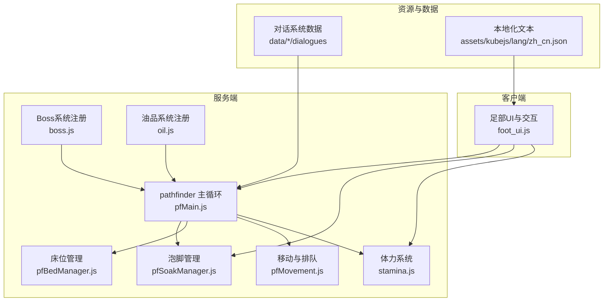
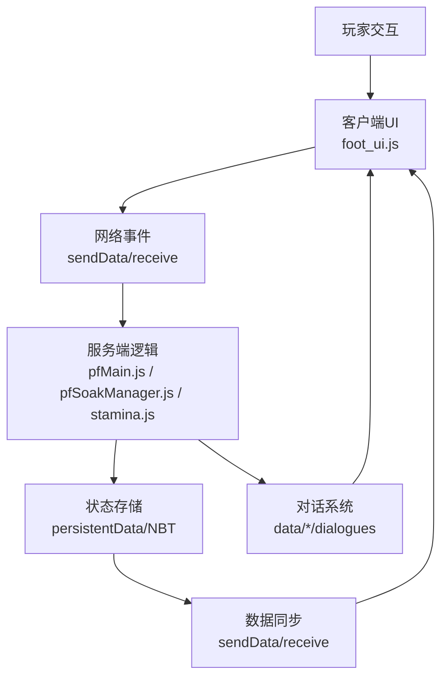
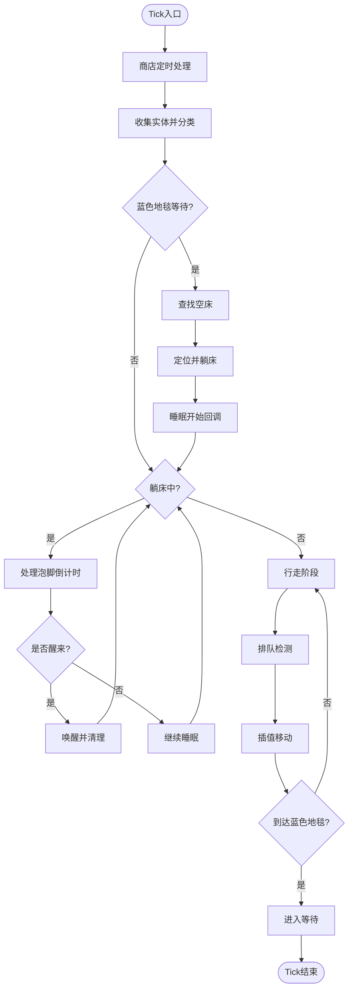
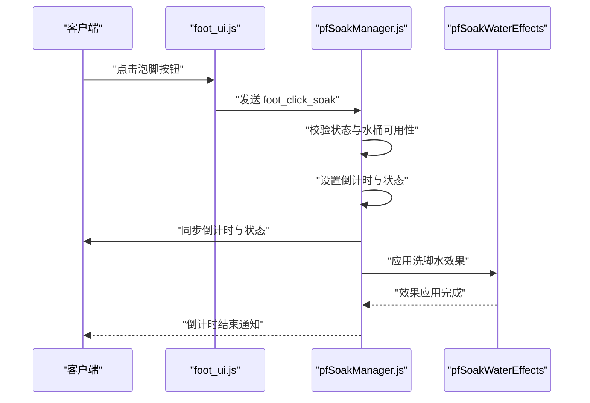
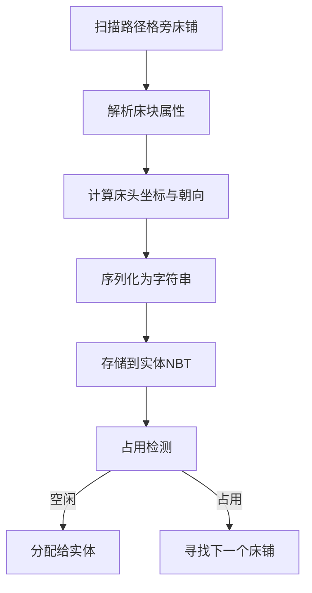
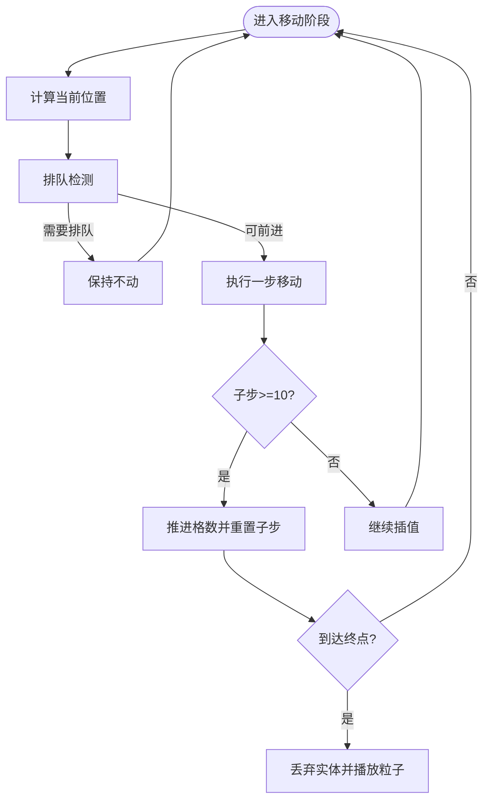
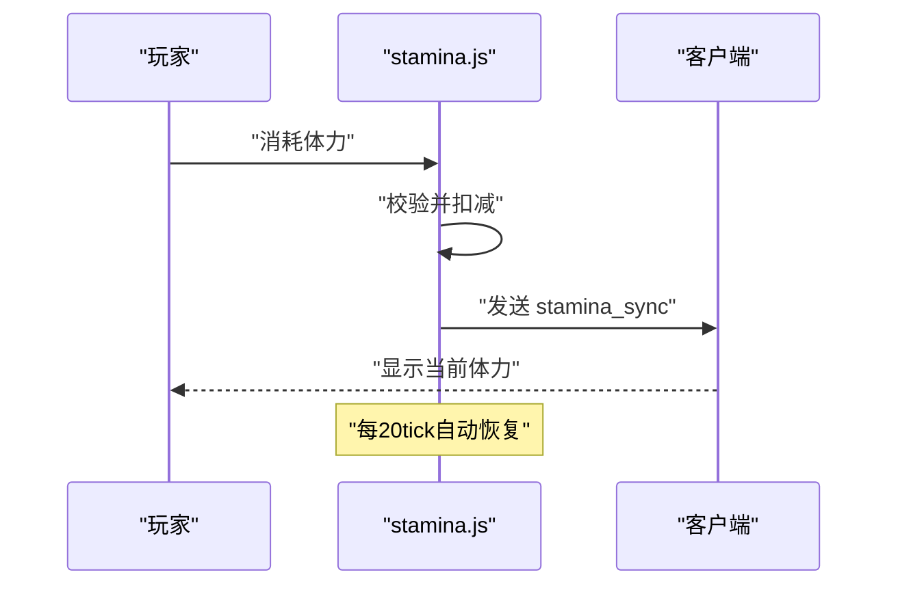
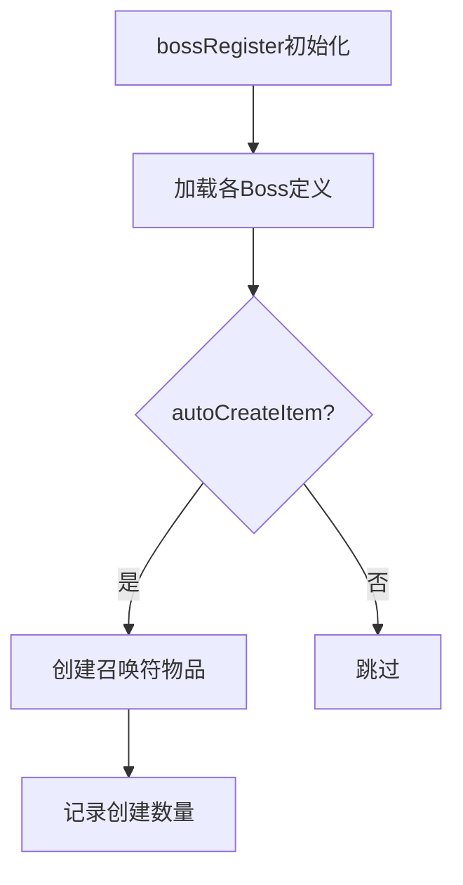
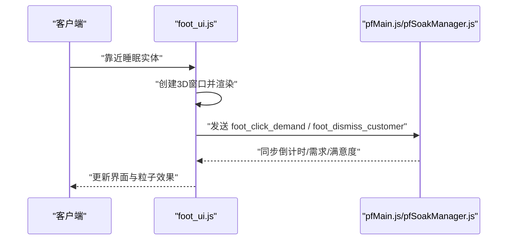
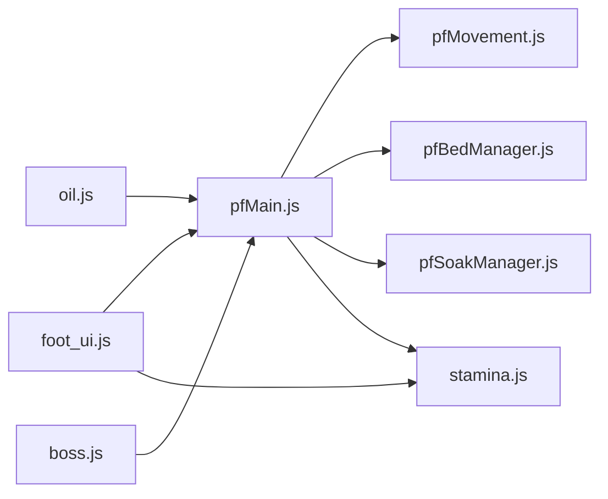

# 项目概述

<cite>
**本文引用的文件**
- [README.md](file://README.md)
- [kubejs/README.txt](file://kubejs/README.txt)
- [serveHooks.js](file://kubejs/startup_scripts/serveHooks.js)
- [boss.js](file://kubejs/startup_scripts/boss/boss.js)
- [pfMain.js](file://kubejs/server_scripts/pathfinder/pfMain.js)
- [pfSoakManager.js](file://kubejs/server_scripts/pathfinder/pfSoakManager.js)
- [pfBedManager.js](file://kubejs/server_scripts/pathfinder/pfBedManager.js)
- [pfMovement.js](file://kubejs/server_scripts/pathfinder/pfMovement.js)
- [foot_ui.js](file://kubejs/client_scripts/ui/foot_ui.js)
- [oil.js](file://kubejs/startup_scripts/oil/oil.js)
- [stamina.js](file://kubejs/server_scripts/stamina.js)
- [zh_cn.json](file://kubejs/assets/kubejs/lang/zh_cn.json)
- [intro.json](file://kubejs/data/marguerite/dialogues/intro.json)
- [intro.json](file://kubejs/data/skyfootspa/chatbox/dialogues/intro.json)
</cite>

## 目录
1. [引言](#引言)
2. [项目结构](#项目结构)
3. [核心组件](#核心组件)
4. [架构总览](#架构总览)
5. [详细组件分析](#详细组件分析)
6. [依赖关系分析](#依赖关系分析)
7. [性能考量](#性能考量)
8. [故障排查指南](#故障排查指南)
9. [结论](#结论)
10. [附录](#附录)

## 引言
本项目是一个基于KubeJS的Minecraft模组，围绕“SPA按摩服务”与“NPC互动体验”构建，旨在为玩家提供沉浸式的虚拟足浴 SPA 体验与可扩展的NPC服务模拟框架。项目通过KubeJS脚本系统整合了服务流程（排队、睡眠、按摩、泡脚）、体力系统、物品与配方注册、对话系统以及客户端UI展示，形成一套完整的“服务经济+交互叙事”闭环。

项目在模组生态中的定位是“轻量级、可扩展、易定制”的服务类玩法模组，适合喜欢策略性服务经营与角色扮演的玩家群体。通过Curios API、Create等模组的集成点，项目实现了装备槽位扩展、机械加工配方与流体处理等增强功能，进一步丰富了玩法深度。

## 项目结构
项目采用KubeJS标准目录组织，分为资源与数据层（assets、data）、脚本层（startup_scripts、server_scripts、client_scripts）以及配置与导出目录。核心特性分布如下：
- 服务寻路与流程控制：server_scripts/pathfinder
- 客户端UI与交互：client_scripts/ui
- 物品与配方注册：startup_scripts 与 server_scripts/recipes
- NPC对话系统：data/*/dialogues
- 体力系统：server_scripts/stamina.js
- 语言本地化：assets/kubejs/lang/zh_cn.json

**图表来源**
- [pfMain.js:1-177](file://kubejs/server_scripts/pathfinder/pfMain.js#L1-L177)
- [pfSoakManager.js:1-197](file://kubejs/server_scripts/pathfinder/pfSoakManager.js#L1-L197)
- [pfBedManager.js:1-129](file://kubejs/server_scripts/pathfinder/pfBedManager.js#L1-L129)
- [pfMovement.js:1-186](file://kubejs/server_scripts/pathfinder/pfMovement.js#L1-L186)
- [stamina.js:1-81](file://kubejs/server_scripts/stamina.js#L1-L81)
- [boss.js:1-37](file://kubejs/startup_scripts/boss/boss.js#L1-L37)
- [oil.js:1-28](file://kubejs/startup_scripts/oil/oil.js#L1-L28)
- [foot_ui.js:1-958](file://kubejs/client_scripts/ui/foot_ui.js#L1-L958)
- [intro.json:1-136](file://kubejs/data/marguerite/dialogues/intro.json#L1-L136)
- [intro.json:1-136](file://kubejs/data/skyfootspa/chatbox/dialogues/intro.json#L1-L136)
- [zh_cn.json:1-15](file://kubejs/assets/kubejs/lang/zh_cn.json#L1-L15)

**章节来源**
- [kubejs/README.txt:1-15](file://kubejs/README.txt#L1-L15)

## 核心组件
- 服务寻路主循环：整合开店定时、实体收集、移动与排队、睡眠与泡脚流程，提供每tick的驱动入口。
- 泡脚管理系统：以秒为粒度的倒计时驱动，支持多种洗脚水类型与效果应用。
- 床位管理：扫描路径周边床铺、序列化存储、占用检测与定位计算。
- 移动与排队：基于路径进度与子步进的插值移动，排队检测与优先级判定。
- 体力系统：基于玩家persistentData的体力值管理与跨tick自动恢复。
- Boss系统：集中注册Boss与自动生成召唤符物品。
- 油品系统：批量注册各类油品物品及其标签。
- 客户端UI：基于WorldWindow的3D UI，展示倒计时、需求清单、满意度与步骤，支持交互点击。
- 对话系统：JSON驱动的多主题对话数据，支持选项、命令、音效与动画联动。

**章节来源**
- [pfMain.js:1-177](file://kubejs/server_scripts/pathfinder/pfMain.js#L1-L177)
- [pfSoakManager.js:1-197](file://kubejs/server_scripts/pathfinder/pfSoakManager.js#L1-L197)
- [pfBedManager.js:1-129](file://kubejs/server_scripts/pathfinder/pfBedManager.js#L1-L129)
- [pfMovement.js:1-186](file://kubejs/server_scripts/pathfinder/pfMovement.js#L1-L186)
- [stamina.js:1-81](file://kubejs/server_scripts/stamina.js#L1-L81)
- [boss.js:1-37](file://kubejs/startup_scripts/boss/boss.js#L1-L37)
- [oil.js:1-28](file://kubejs/startup_scripts/oil/oil.js#L1-L28)
- [foot_ui.js:1-958](file://kubejs/client_scripts/ui/foot_ui.js#L1-L958)
- [intro.json:1-136](file://kubejs/data/marguerite/dialogues/intro.json#L1-L136)
- [intro.json:1-136](file://kubejs/data/skyfootspa/chatbox/dialogues/intro.json#L1-L136)
- [zh_cn.json:1-15](file://kubejs/assets/kubejs/lang/zh_cn.json#L1-L15)

## 架构总览
项目采用“服务端主控 + 客户端展示 + 数据驱动”的分层架构：
- 服务端负责业务逻辑与状态管理（路径、睡眠、泡脚、体力、Boss、油品等）。
- 客户端负责UI渲染与用户交互（3D窗口、点击事件、粒子特效）。
- 数据层通过JSON与NBT实现跨端同步（对话、需求、满意度、倒计时等）。

**图表来源**
- [foot_ui.js:1-958](file://kubejs/client_scripts/ui/foot_ui.js#L1-L958)
- [pfMain.js:1-177](file://kubejs/server_scripts/pathfinder/pfMain.js#L1-L177)
- [pfSoakManager.js:1-197](file://kubejs/server_scripts/pathfinder/pfSoakManager.js#L1-L197)
- [stamina.js:1-81](file://kubejs/server_scripts/stamina.js#L1-L81)
- [intro.json:1-136](file://kubejs/data/marguerite/dialogues/intro.json#L1-L136)

## 详细组件分析

### 服务寻路主循环（pfMain）
- 职责：每tick驱动整个服务流程，协调商店定时、实体收集、移动与排队、睡眠与泡脚。
- 关键流程：
  - 蓝色地毯等待 → 床位查找与定位 → 睡眠开始回调
  - 躺床中 → 泡脚倒计时与效果应用 → 唤醒逻辑
  - 行走中 → 排队检测 → 插值移动 → 到达蓝色地毯进入等待
- 设计要点：防止重复处理、跨重启友好的时间状态存储、模块间解耦与可扩展Hook框架。

**图表来源**
- [pfMain.js:1-177](file://kubejs/server_scripts/pathfinder/pfMain.js#L1-L177)

**章节来源**
- [pfMain.js:1-177](file://kubejs/server_scripts/pathfinder/pfMain.js#L1-L177)

### 泡脚管理系统（pfSoakManager）
- 职责：以秒为粒度的倒计时驱动，判定洗脚水可用性，应用效果并消费水桶。
- 关键设计：
  - 实体侧维护pfSoakSubTick（0~19）作为秒内计数器，每20tick触发一次“秒事件”。
  - 无可用洗脚水时重置倒计时至默认值，保障流程鲁棒性。
  - 通过global.pfSoakWaterEffects应用洗脚水附加效果。
- 交互：客户端发送开始泡脚请求，服务端更新状态并消耗水桶。

**图表来源**
- [foot_ui.js:354-364](file://kubejs/client_scripts/ui/foot_ui.js#L354-L364)
- [pfSoakManager.js:90-145](file://kubejs/server_scripts/pathfinder/pfSoakManager.js#L90-L145)

**章节来源**
- [pfSoakManager.js:1-197](file://kubejs/server_scripts/pathfinder/pfSoakManager.js#L1-L197)
- [foot_ui.js:316-371](file://kubejs/client_scripts/ui/foot_ui.js#L316-L371)

### 床位管理（pfBedManager）
- 职责：沿路径扫描床铺、序列化存储、占用检测与定位计算。
- 关键设计：
  - 通过解析床块属性（part、facing）计算床头坐标与朝向（yaw）。
  - AABB范围检查占用，避免冲突分配。
  - 字符串序列化/反序列化，便于持久化与传输。

**图表来源**
- [pfBedManager.js:10-77](file://kubejs/server_scripts/pathfinder/pfBedManager.js#L10-L77)
- [pfBedManager.js:91-107](file://kubejs/server_scripts/pathfinder/pfBedManager.js#L91-L107)
- [pfBedManager.js:109-120](file://kubejs/server_scripts/pathfinder/pfBedManager.js#L109-L120)

**章节来源**
- [pfBedManager.js:1-129](file://kubejs/server_scripts/pathfinder/pfBedManager.js#L1-L129)

### 移动与排队（pfMovement）
- 职责：实体移动、排队检测、进度管理与路径插值。
- 关键设计：
  - 基于routeStr与time/subStep进行路径插值，每10个子步进推进一格。
  - 排队检测依据距离与进度，必要时按实体ID排序，保证公平性。
  - 清理残留睡眠NBT，避免状态污染。

**图表来源**
- [pfMovement.js:81-162](file://kubejs/server_scripts/pathfinder/pfMovement.js#L81-L162)
- [pfMovement.js:54-79](file://kubejs/server_scripts/pathfinder/pfMovement.js#L54-L79)

**章节来源**
- [pfMovement.js:1-186](file://kubejs/server_scripts/pathfinder/pfMovement.js#L1-L186)

### 体力系统（stamina）
- 职责：在player.persistentData中维护pfStamina，提供消耗与恢复接口，并通过网络包同步到客户端。
- 关键设计：
  - 每20tick（1秒）自动恢复固定点数，跨重启友好。
  - 从玩家属性kubejs:serve.stamina_cost读取消耗量，支持差异化服务成本。

**图表来源**
- [stamina.js:33-53](file://kubejs/server_scripts/stamina.js#L33-L53)
- [stamina.js:62-79](file://kubejs/server_scripts/stamina.js#L62-L79)

**章节来源**
- [stamina.js:1-81](file://kubejs/server_scripts/stamina.js#L1-L81)

### Boss系统（boss）
- 职责：集中注册Boss并自动生成召唤符物品，确保加载顺序与完整性。
- 关键设计：通过global.bossRegister.bosses遍历并创建物品，支持显示名、堆叠上限、稀有度与贴图。

**图表来源**
- [boss.js:9-36](file://kubejs/startup_scripts/boss/boss.js#L9-L36)

**章节来源**
- [boss.js:1-37](file://kubejs/startup_scripts/boss/boss.js#L1-L37)

### 油品系统（oil）
- 职责：批量注册各类油品物品，设置显示名、不可堆叠、耐久与标签。
- 关键设计：通过global.oilRegister.oils收集定义，统一在StartupEvents.registry中注册。

**章节来源**
- [oil.js:1-28](file://kubejs/startup_scripts/oil/oil.js#L1-L28)

### 客户端UI（foot_ui）
- 职责：在世界中显示睡眠实体的脚部UI，包括倒计时、需求清单、满意度、步骤与抹油状态；支持拖动搓脚与泡脚按钮交互。
- 关键设计：
  - 基于WorldWindow创建3D窗口，根据床朝向旋转与缩放。
  - 通过sendData与服务端通信，实现点击事件与状态同步。
  - 提供粒子特效与轨迹反馈，增强交互体验。

**图表来源**
- [foot_ui.js:76-284](file://kubejs/client_scripts/ui/foot_ui.js#L76-L284)
- [foot_ui.js:354-371](file://kubejs/client_scripts/ui/foot_ui.js#L354-L371)
- [pfMain.js:11-177](file://kubejs/server_scripts/pathfinder/pfMain.js#L11-L177)
- [pfSoakManager.js:90-145](file://kubejs/server_scripts/pathfinder/pfSoakManager.js#L90-L145)

**章节来源**
- [foot_ui.js:1-958](file://kubejs/client_scripts/ui/foot_ui.js#L1-L958)

### 对话系统（dialogues）
- 职责：通过JSON定义对话主题、选项、命令与音效，支持多场景切换与解锁条件。
- 关键设计：支持命令触发、锁定/解锁逻辑、音效与动画联动，适配不同NPC主题。

**章节来源**
- [intro.json:1-136](file://kubejs/data/marguerite/dialogues/intro.json#L1-L136)
- [intro.json:1-136](file://kubejs/data/skyfootspa/chatbox/dialogues/intro.json#L1-L136)

## 依赖关系分析
- 模块耦合：
  - pfMain作为中枢，依赖pfMovement、pfBedManager、pfSoakManager、stamina等模块。
  - foot_ui依赖pfMain与stamina的状态同步，实现UI与逻辑解耦。
  - oil与boss通过startup_scripts集中注册，降低重复配置。
- 外部依赖：
  - KubeJS框架提供脚本生命周期与事件系统。
  - Curios API用于装备槽位扩展（通过注册项与标签）。
  - Create用于流体与机械加工配方（如泡脚水制作）。

**图表来源**
- [pfMain.js:1-177](file://kubejs/server_scripts/pathfinder/pfMain.js#L1-L177)
- [pfMovement.js:1-186](file://kubejs/server_scripts/pathfinder/pfMovement.js#L1-L186)
- [pfBedManager.js:1-129](file://kubejs/server_scripts/pathfinder/pfBedManager.js#L1-L129)
- [pfSoakManager.js:1-197](file://kubejs/server_scripts/pathfinder/pfSoakManager.js#L1-L197)
- [stamina.js:1-81](file://kubejs/server_scripts/stamina.js#L1-L81)
- [foot_ui.js:1-958](file://kubejs/client_scripts/ui/foot_ui.js#L1-L958)
- [oil.js:1-28](file://kubejs/startup_scripts/oil/oil.js#L1-L28)
- [boss.js:1-37](file://kubejs/startup_scripts/boss/boss.js#L1-L37)

**章节来源**
- [pfMain.js:1-177](file://kubejs/server_scripts/pathfinder/pfMain.js#L1-L177)
- [foot_ui.js:1-958](file://kubejs/client_scripts/ui/foot_ui.js#L1-L958)

## 性能考量
- Tick负载控制：pfMain每tick仅处理必要逻辑（商店定时、实体分类、关键状态推进），避免全量扫描。
- 状态存储优化：使用persistentData与NBT字段，减少频繁IO；秒事件与子tick计数降低计算复杂度。
- 客户端渲染节流：WorldWindow窗口按距离与可见性创建/销毁，粒子与特效按阈值触发，降低GPU压力。
- 数据同步最小化：仅在状态变更时通过sendData同步，避免高频广播。

## 故障排查指南
- 服务流程异常：
  - 检查pfMain日志与实体状态（pfPhase、pfTime、pfSubStep），确认是否存在重复处理或越界。
  - 排查pfMovement的排队逻辑与路径字符合法性。
- 泡脚不生效：
  - 确认水桶ID在soakWaterRegister中定义或为原版水桶。
  - 检查pfSoakManager的倒计时与效果应用是否抛出异常。
- UI不显示或点击无响应：
  - 核对foot_ui.js中WorldWindow创建参数与事件绑定。
  - 检查网络事件sendData/receive是否正确传递UUID与状态。
- 体力异常：
  - 确认stamina.js的消耗/恢复逻辑与属性读取是否一致。
  - 检查跨重启后的pfStaminaRegenSubTick是否正确重置。

**章节来源**
- [pfMain.js:1-177](file://kubejs/server_scripts/pathfinder/pfMain.js#L1-L177)
- [pfSoakManager.js:74-88](file://kubejs/server_scripts/pathfinder/pfSoakManager.js#L74-L88)
- [foot_ui.js:766-800](file://kubejs/client_scripts/ui/foot_ui.js#L766-L800)
- [stamina.js:33-53](file://kubejs/server_scripts/stamina.js#L33-L53)

## 结论
本项目以KubeJS为核心，构建了“服务流程 + SPA交互 + NPC叙事”的完整模组方案。通过模块化的服务寻路、稳健的泡脚系统、直观的客户端UI与可扩展的Hook框架，项目既满足初学者的易用性，也为高级玩家提供了深度定制空间。结合Curios与Create等生态模组，项目具备良好的扩展性与社区价值，适合进一步发展为多人服务类玩法的基础框架。

## 附录
- 安装与运行：参考根目录README与KubeJS目录说明，确保Forge版本与KubeJS兼容。
- 本地化：通过assets/kubejs/lang/zh_cn.json扩展属性与UI文本。
- 对话扩展：在data/*/dialogues中新增主题与选项，配合命令与解锁逻辑实现复杂剧情。

**章节来源**
- [README.md:1-6](file://README.md#L1-L6)
- [kubejs/README.txt:1-15](file://kubejs/README.txt#L1-L15)
- [zh_cn.json:1-15](file://kubejs/assets/kubejs/lang/zh_cn.json#L1-L15)